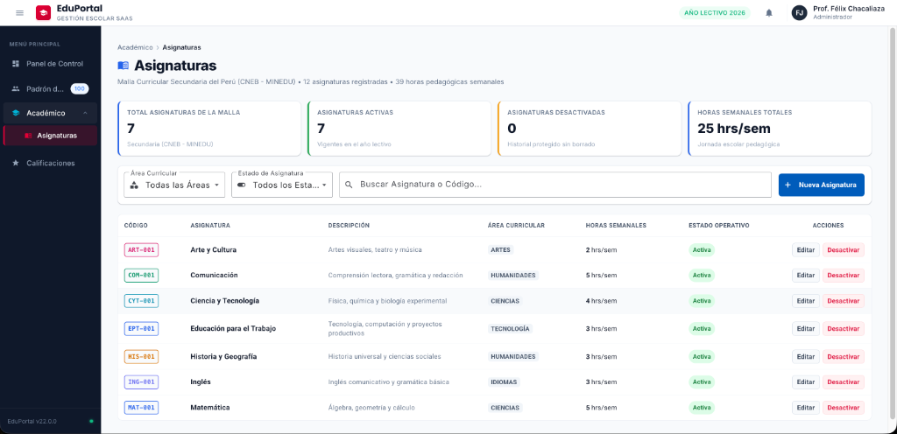
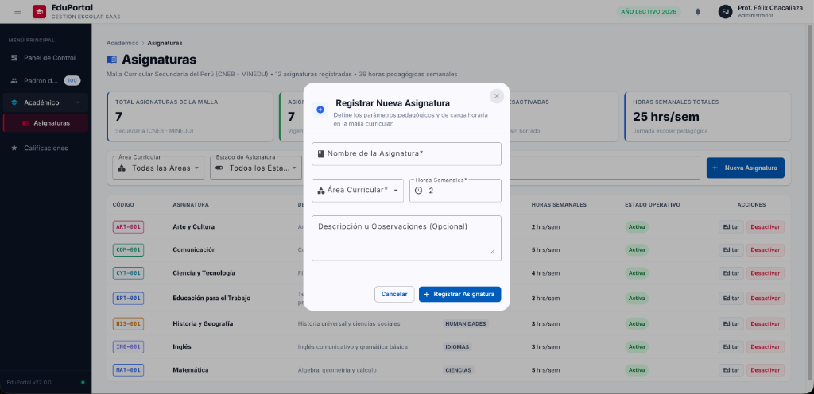
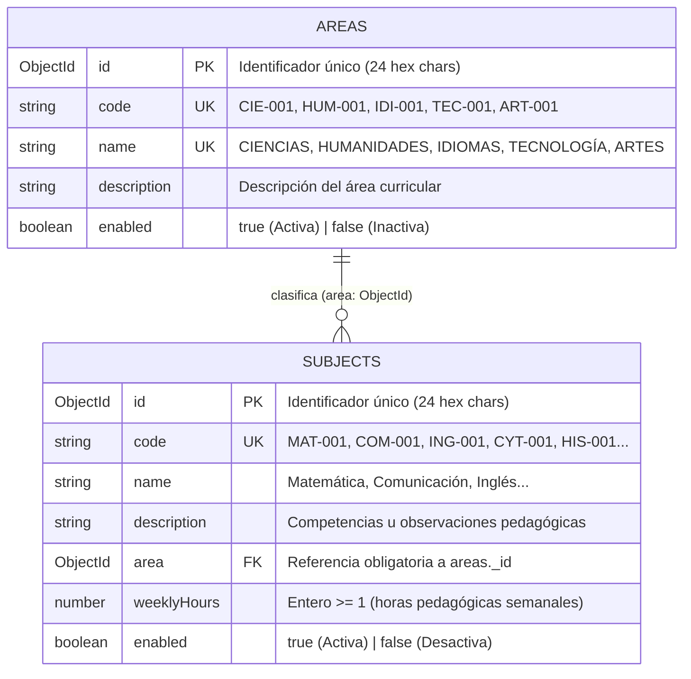
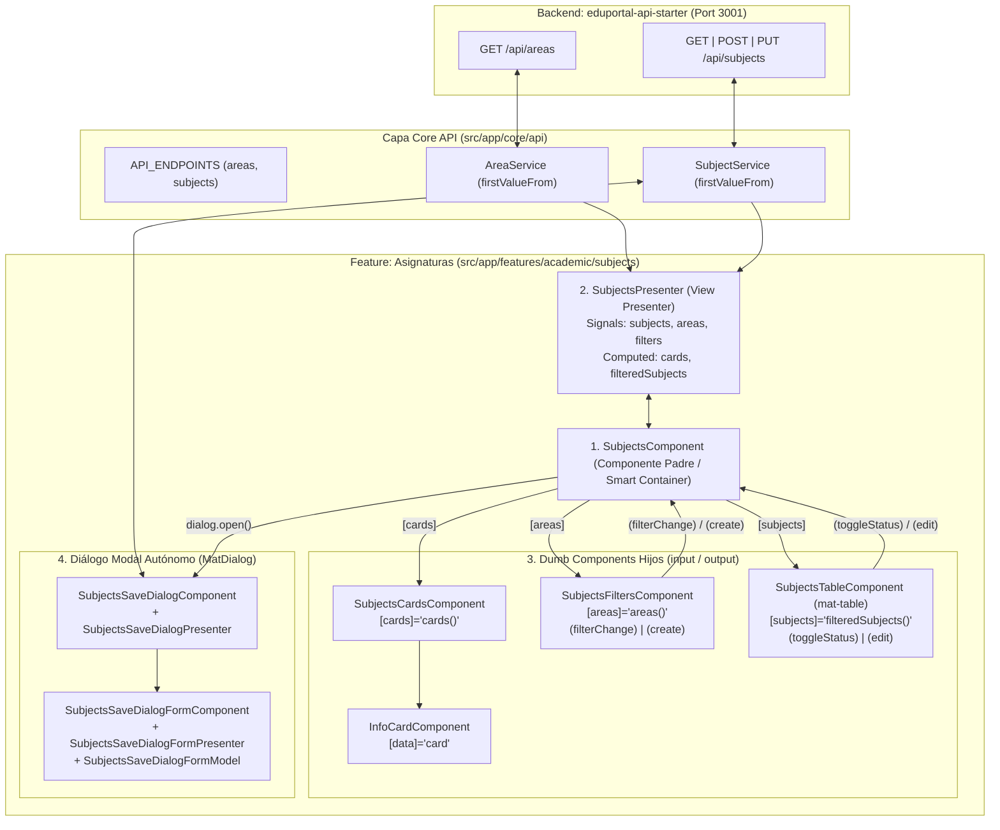

# 📗 Guía del Estudiante • Sesión 02
## Arquitectura Smart-Dumb + Presenter, Comunicación con Signals, Base de Datos `eduportalangular`, API REST (`eduportal-api-starter`) y Módulo de Asignaturas (`eduportal-web`)

> **Curso:** Desarrollo Web Frontend Profesional con Angular 22  
> **Proyecto Transversal:** EduPortal — Sistema de Gestión Escolar SaaS  
> **Rama Oficial de Trabajo:** `02-components-http`  
> **Frontend:** `eduportal-web` (`http://localhost:4200`) • Angular 22 (Standalone & OnPush, Signals, Angular Material, BEM)  
> **Backend de Soporte:** `eduportal-api-starter` (`http://localhost:3001`) • Base de Datos MongoDB: `eduportalangular`  
> **Docente Titular:** Félix Junior Chacaliaza Gutiérrez • Intevex Academy

---

## 🎯 Objetivos y Competencias de la Sesión

1. **Comprender el Modelo de Datos de `areas` y `subjects` (`eduportalangular`):** Analizar las **2 colecciones** con las que trabajaremos en esta sesión en MongoDB (`areas` y `subjects`), su relación `1:N` (`ObjectId`), reglas de validación (`$jsonSchema`) y cómo inicializar la base de datos con un solo comando (`npm run db:init`).
2. **Dominar los Endpoints REST de Áreas y Asignaturas (`eduportal-api-starter`):** Conocer y consumir los endpoints de `/api/areas` y `/api/subjects` en `http://localhost:3001/api/...`.
3. **Implementar el Patrón Empresarial Smart-Dumb + View Presenter:** Separar responsabilidades entre el componente padre contenedor (`SubjectsComponent`), su presentador maestro (`SubjectsPresenter`) y los componentes presentacionales puros (`InfoCardComponent`, `SubjectsCardsComponent`, `SubjectsFiltersComponent`, `SubjectsTableComponent`).
4. **Comunicar Componentes mediante Signals (`input` y `output`):** Aplicar flujo de datos unidireccional (*Top-Down* con `input()` / `input.required()` y *Bottom-Up* con `output()`).
5. **Conectar Angular 22 al Backend con Promesas (`async/await`):** Configurar `provideHttpClient()`, centralizar endpoints en `core/api/endpoints.ts` e implementar `AreaService` y `SubjectService` usando `firstValueFrom`.
6. **Construir el Diálogo Autónomo de Creación y Edición (`MatDialog`):** Desarrollar `SubjectsSaveDialogComponent` y `SubjectsSaveDialogFormComponent` empleando el patrón `FormModel`, `FormHtml` y `SubjectsSaveDialogFormPresenter`.

> [!IMPORTANT]
> **Alcance de Entidades en `eduportal-web` (Por ahora solo 2 entidades):**  
> Aunque el backend `eduportal-api-starter` inicializa toda la base de datos escolar en MongoDB (`eduportalangular`), **en el frontend `eduportal-web` trabajaremos por ahora única y exclusivamente con 2 entidades: `areas` (Áreas Curriculares) y `subjects` (Asignaturas)**. De esta forma mantenemos la capa `core/api` limpia y libre de código que aún no se utiliza.

---

## 🖼️ Referencia Visual del Producto a Construir

Para guiar tu desarrollo durante la sesión, a continuación se presentan las vistas finales que implementaremos paso a paso:

### 1. Pantalla Principal del Módulo de Asignaturas (`/asignaturas`)
Integra el **App Shell** con las **4 tarjetas métricas** (`SubjectsCardsComponent`), la **barra de filtros y búsqueda reactiva** (`SubjectsFiltersComponent`), y la **tabla de datos** con badges por área, estado operativo y acciones de edición y borrado lógico (`SubjectsTableComponent`).



### 2. Diálogo Modal Autónomo de Registro y Edición (`SubjectsSaveDialogComponent`)
Ventana modal flotante activada mediante `MatDialog`, con formulario reactivo desacoplado (`SubjectsSaveDialogFormComponent`), iconos de Angular Material, selector dinámico de áreas curriculares desde MongoDB y validaciones en tiempo real.



---

## 🗄️ PARTE 1: Base de Datos `eduportalangular` — Entidades `areas` y `subjects`

El backend **`eduportal-api-starter`** se conecta a la base de datos **`eduportalangular`** (`mongodb://127.0.0.1:27017/eduportalangular`). En esta sesión nos enfocaremos exclusivamente en las **2 colecciones** que consume nuestro módulo de Asignaturas en `eduportal-web`: **`areas`** y **`subjects`**.

Ambas colecciones cumplen tres reglas de diseño institucional:
- **Códigos estandarizados de 7 caracteres:** Formato `AAA-000` (`/^[A-Z]{3}-\d{3}$/`), autogenerados por el backend al crear un registro.
- **Borrado lógico (`enabled: boolean`):** Ningún registro académico se destruye físicamente; se activa o desactiva (`Activa` / `Desactiva`) para proteger el historial escolar.
- **Validación nativa `$jsonSchema`:** MongoDB valida tipos, longitudes y formatos a nivel de motor de base de datos.

### 1.1 Comandos para Crear o Reiniciar la Base de Datos

En la carpeta del backend (`eduportal-api-starter`), dispones de dos comandos automatizados para dejar lista la base de datos con sus valores por defecto:

```bash
# 1. Crear / Inicializar la base de datos con los valores por defecto (respeta datos existentes)
npm run db:init

# 2. Reiniciar desde cero la base de datos con los valores por defecto
npm run db:reset

# 3. Levantar el servidor backend en http://localhost:3001
npm run dev
```

---

### 1.2 Diagrama Entidad-Relación (`areas` y `subjects`)

Observa cómo se relacionan las **2 colecciones** con las que trabajaremos por ahora en `eduportal-web` (una **Área Curricular** agrupa múltiples **Asignaturas**):



---

### 1.3 Detalle de las 2 Tablas (Colecciones) que Usaremos en `eduportal-web`

#### 🧠 Concepto Teórico Clave: Relación `1:N` con `ObjectId`, Población (`populate`) y Borrado Lógico (`enabled`)
1. **Relación Referencial (`ObjectId`) y Población (`populate`):** En MongoDB, cada asignatura (`subjects`) guarda en su campo `area` únicamente el identificador de 24 caracteres hexadecimales (`ObjectId`) del área curricular a la que pertenece. Cuando `eduportal-web` solicita `GET /api/subjects`, el backend ejecuta `.populate('area', 'code name description enabled')` y nos entrega el objeto `area` completo anidado dentro de cada asignatura.
2. **Borrado Lógico (*Soft Delete* con `enabled: boolean`):** En sistemas escolares y financieros reales **nunca se ejecuta `DELETE` físico** sobre una asignatura, ya que destruiría las actas de notas históricas de años anteriores. En su lugar, alternamos el booleano `enabled` (`true` = `Activa`, `false` = `Desactiva`).
3. **Validación Nativa `$jsonSchema`:** Además de Mongoose, la base de datos `eduportalangular` tiene reglas nativas a nivel de motor MongoDB que exigen códigos de 7 caracteres (`AAA-000`) y `weeklyHours >= 1`.

#### 1. Colección: `areas` (Áreas Curriculares MINEDU)
Almacena las áreas pedagógicas que alimentan el selector de filtros (`SubjectsFiltersComponent`) y el selector del formulario modal (`SubjectsSaveDialogFormComponent`).

| Campo | Tipo MongoDB | Restricción | Longitud / Regla | Formato / Ejemplo |
| :--- | :--- | :---: | :--- | :--- |
| **`id`** | `String` (`ObjectId`) | Requerido • Único | 24 caracteres hex | `6ad063e8e607cd81d4bf3280` |
| **`code`** | `String` | Requerido • Único | 7 caracteres exactos | `CIE-001`, `HUM-001`, `IDI-001`, `TEC-001`, `ART-001` |
| **`name`** | `String` | Requerido • Único | 3 - 100 caracteres | `CIENCIAS`, `HUMANIDADES`, `IDIOMAS`, `TECNOLOGÍA`, `ARTES` |
| **`description`** | `String` | Opcional | 0 - 100 caracteres | Descripción del área curricular (por defecto: `""`) |
| **`enabled`** | `Boolean` | Opcional | Booleano | Estado activo/inactivo (por defecto: `true`) |

#### 2. Colección: `subjects` (Catálogo de Asignaturas)
Almacena las asignaturas de la malla curricular que se listan en la tabla principal (`SubjectsTableComponent`), calculan las 4 tarjetas KPI (`SubjectsCardsComponent`) y se crean o editan desde el modal (`SubjectsSaveDialogComponent`).

| Campo | Tipo MongoDB | Restricción | Longitud / Regla | Formato / Ejemplo |
| :--- | :--- | :---: | :--- | :--- |
| **`id`** | `String` (`ObjectId`) | Requerido • Único | 24 caracteres hex | `6ad06bfb44caa8cb64bab3ad` |
| **`code`** | `String` | Requerido • Único | 7 caracteres exactos | `MAT-001`, `COM-001`, `ING-001`, `CYT-001`, `HIS-001`... |
| **`name`** | `String` | Requerido | 3 - 100 caracteres | `Matemática`, `Comunicación`, `Inglés`... |
| **`description`** | `String` | Opcional | 0 - 100 caracteres | Competencias u observaciones pedagógicas |
| **`area`** | `ObjectId` (Ref: `Area`) | Requerido | 24 caracteres hex | Referencia a `areas._id` (poblada en `GET`) |
| **`weeklyHours`** | `Number` | Requerido | Entero >= 1 | Horas lectivas semanales base (ej: `5`) |
| **`enabled`** | `Boolean` | Opcional | Booleano | `true` (Activa) / `false` (Desactiva) |

---

## 📡 PARTE 2: Endpoints de `eduportal-api-starter` (`areas` y `subjects`)

El backend `eduportal-api-starter` corre en **`http://localhost:3001`**.

> [!NOTE]
> **Enfoque en `eduportal-web`:** Por ahora en nuestra aplicación web **únicamente trabajaremos con los endpoints de `areas` (`/api/areas`) y `subjects` (`/api/subjects`)**. Cada una de estas 2 entidades cuenta con 4 endpoints estandarizados (`GET /`, `GET /:id`, `POST /`, `PUT /:id`).

#### 🧠 Concepto Teórico Clave: Contrato Uniforme `ApiResponse<T>` y Verbos HTTP REST
Todas las respuestas del backend `eduportal-api-starter` respetan una **envoltura JSON estándar**:
```json
{
  "success": true,
  "count": 7,
  "data": [ ... ]
}
```
* **`GET /` y `GET /:id`:** Consultas de lectura idempotentes (no modifican el servidor).
* **`POST /`:** Creación de recurso; el backend calcula automáticamente el código correlativo (`MAT-001`, `FIS-001`) y responde con estado HTTP `201 Created`.
* **`PUT /:id`:** Actualización parcial o total de la entidad, utilizada tanto por el modal de edición como por el botón de alternancia rápida (`{ "enabled": false }`).

### 2.1 Resumen de Módulos REST que Consumiremos (`http://localhost:3001/api`)

| # | Módulo | Ruta Base | Métodos REST Habilitados | Descripción Operativa |
| :-: | :--- | :--- | :--- | :--- |
| **1** | **Áreas Curriculares** | `/api/areas` | `GET /` • `GET /:id` • `POST /` • `PUT /:id` | Lista, busca por ID/código (`CIE-001`), crea (`ROB-001`) y edita/inactiva. |
| **2** | **Asignaturas** | `/api/subjects` | `GET /` • `GET /:id` • `POST /` • `PUT /:id` | Lista con `area` poblada, busca por ID, crea (`FIS-001`) y edita/inactiva. |

---

### 2.2 Detalle de Contratos HTTP (`areas` y `subjects`)

#### A) Endpoints de Áreas Curriculares (`/api/areas`)
> 🌐 **Servidor API:** `http://localhost:3001` (todos los endpoints usan el prefijo `/api`)

| Acción | Método | Endpoint | Payload / Body | Respuesta Exitosa (`ApiResponse<T>`) |
| :--- | :---: | :--- | :--- | :--- |
| **Listar todas** | `GET` | `/api/areas` | *Ninguno* | `200 OK` — `{ success: true, count: 5, data: Area[] }` |
| **Obtener una** | `GET` | `/api/areas/:id` | *Ninguno* | `200 OK` — `{ success: true, data: Area }` |
| **Crear área** | `POST` | `/api/areas` | `{ "name": "Robótica", "description": "..." }` | `201 Created` — Autogenera `code: "ROB-001"` |
| **Actualizar** | `PUT` | `/api/areas/:id` | `{ "description": "...", "enabled": false }` | `200 OK` — `{ success: true, data: Area }` |

#### B) Endpoints de Asignaturas (`/api/subjects`)
> 🌐 **Servidor API:** `http://localhost:3001` (todos los endpoints usan el prefijo `/api`)

| Acción | Método | Endpoint | Payload / Body | Respuesta Exitosa (`ApiResponse<T>`) |
| :--- | :---: | :--- | :--- | :--- |
| **Listar todas** | `GET` | `/api/subjects` | *Ninguno* | `200 OK` — `{ success: true, count: 7, data: Subject[] }` (con `area` poblada) |
| **Obtener una** | `GET` | `/api/subjects/:id` | *Ninguno* | `200 OK` — `{ success: true, data: Subject }` |
| **Crear curso** | `POST` | `/api/subjects` | `{ "name": "Física", "area": "<areaId>", "weeklyHours": 4 }` | `201 Created` — Autogenera `FIS-001` y devuelve `area` poblada |
| **Actualizar / Toggle** | `PUT` | `/api/subjects/:id` | `{ "name": "...", "area": "<areaId>", "weeklyHours": 5 }` o `{ "enabled": false }` | `200 OK` — Actualiza campos enviados y devuelve `Subject` actualizado |

---

## 🏛️ PARTE 3: Arquitectura Frontend de `eduportal-web` (Smart-Dumb + Presenter)

En **`eduportal-web`** aplicamos la arquitectura empresarial de Angular 22 combinando **Smart-Dumb Components** con el patrón **View Presenter** (enfoque *Top-Down*: del componente padre orquestador hacia sus hijos presentacionales).

#### 🧠 Concepto Teórico Clave: Smart vs Dumb Components, Patrón View Presenter y Detección `OnPush`

| Rol Arquitectónico | Responsabilidad Principal | Ejemplo en `eduportal-web` |
| :--- | :--- | :--- |
| **Smart Component (Contenedor Padre)** | Punto de entrada de la ruta. Inyecta el `Presenter` y servicios de UI (`MatDialog`), pasa señales hacia abajo con `[inputs]` y delega eventos hacia arriba con `(outputs)`. No contiene lógica de negocio pesada. | `SubjectsComponent`, `SubjectsSaveDialogComponent` |
| **View Presenter (`@Injectable()`)** | **Cerebro y Única Fuente de Verdad** de la vista. Se provee en `providers: [SubjectsPresenter]` del componente padre (su ciclo de vida nace y muere con la pantalla). Consume `AreaService`/`SubjectService` y expone `signal()` y `computed()`. | `SubjectsPresenter`, `SubjectsSaveDialogPresenter`, `SubjectsSaveDialogFormPresenter` |
| **Dumb Component (Presentacional Hijo)** | Componente 100% visual y reutilizable con estrategia `OnPush`. **Prohibido inyectar servicios HTTP**. Recibe datos con `input()` / `input.required()` y notifica acciones con `output()`. | `InfoCardComponent`, `SubjectsCardsComponent`, `SubjectsFiltersComponent`, `SubjectsTableComponent` |

* **¿Por qué usamos `ChangeDetectionStrategy.OnPush`?**  
  Con `OnPush`, Angular **no revisa** un componente hijo en cada evento global del navegador; únicamente actualiza su DOM cuando cambia la referencia de uno de sus `input()`, se dispara un evento interno del template (`(click)`, `(input)`) o cambia una `signal()` leída en su plantilla.

### 3.1 ¿Cómo funciona la arquitectura en `eduportal-web`?

1. **Capa de API (`core/api/`):**
   - Centraliza únicamente las URLs que utilizamos ahora en `API_ENDPOINTS` (`areas` y `subjects`).
   - Define las interfaces de contrato (`ApiResponse<T>`, `Area`, `Subject`).
   - Provee servicios HTTP puros basados en Promesas (`AreaService`, `SubjectService`) usando `firstValueFrom`.
2. **Smart Component Padre (`SubjectsComponent`) + Presentador Maestro (`SubjectsPresenter`):**
   - **`SubjectsComponent` (Padre Contenedor):** Es el punto de entrada de la vista `/asignaturas`. Inyecta `SubjectsPresenter` y `MatDialog`, distribuye los datos hacia abajo con `[inputs]` y escucha los eventos de los hijos con `(outputs)`.
   - **`SubjectsPresenter` (View Presenter):** Es la **única fuente de verdad (Single Source of Truth)** de la pantalla: invoca a `SubjectService` y `AreaService`, almacena Signals (`subjects`, `areas`, `filters`), calcula Signals derivados (`filteredSubjects`, `cards`) y ejecuta la actualización optimista de estado (`toggleSubjectStatus`).
3. **Dumb Components Hijos (Presentacionales Puros):**
   - `SubjectsCardsComponent` + `InfoCardComponent`: Pintan las 4 tarjetas KPI superiores.
   - `SubjectsFiltersComponent`: Renderiza los selectores de Área, Estado, Buscador y el botón `+ Nueva Asignatura`.
   - `SubjectsTableComponent`: Renderiza la tabla Material (`mat-table`) con código coloreado, estado activo/desactivo y botones de acción.
4. **Diálogo Autónomo + Formulario (`SubjectsSaveDialogComponent` + `SubjectsSaveDialogFormComponent`):**
   - El modal gestiona su propio guardado HTTP mediante `SubjectsSaveDialogPresenter` y delega la validación reactiva a `SubjectsSaveDialogFormPresenter` y la clase base `FormModel`.

### 3.2 Diagrama de Flujo de Datos y Componentes en `eduportal-web`



---

### 3.3 Árbol de Archivos que Construiremos en `eduportal-web`

```text
src/
├── environments/
│   └── environment.ts                                      # apiUrl: 'http://localhost:3001/api'
└── app/
    ├── core/
    │   ├── api/
    │   │   ├── endpoints.ts                                # Mapa inmutable API_ENDPOINTS (areas y subjects)
    │   │   ├── index.ts                                    # Barrel de exportación
    │   │   ├── models/interfaces/
    │   │   │   ├── api-response.interface.ts               # ApiResponse<T>
    │   │   │   ├── area.interface.ts                       # Area
    │   │   │   └── subject.interface.ts                    # Subject (con area: Area)
    │   │   └── services/
    │   │       ├── area.service.ts                         # GET /api/areas
    │   │       └── subject.service.ts                      # GET, POST, PUT /api/subjects
    │   ├── constants/
    │   │   └── form-error-message.constants.ts             # Diccionario ErrorMessage
    │   └── layouts/main-layout/                            # Layout con cabecera dinámica por ruta
    ├── shared/
    │   ├── class/
    │   │   └── form-model.ts                               # Clase base FormModel (getErrorMessage)
    │   ├── interfaces/
    │   │   └── form-html.ts                                # Metadata visual de controles
    │   └── components/info-card/                           # Tarjeta reutilizable InfoCardComponent
    └── features/
        └── academic/
            ├── academic.routes.ts                          # Ruta '/asignaturas' -> SubjectsComponent
            ├── index.ts
            └── subjects/
                ├── subjects.component.ts/.html/.scss       # 1° Componente Padre (Smart Component)
                ├── subjects.presenter.ts                   # 2° View Presenter con Signals y Computed
                ├── components/                             # 3° Subcomponentes Hijos (Dumb Components)
                │   ├── index.ts
                │   ├── subjects-cards/                     # Grid de tarjetas KPI
                │   ├── subjects-filters/                   # Barra de filtros + botón Nueva Asignatura
                │   └── subjects-table/                     # Tabla mat-table con acciones
                └── dialogs/                                # 4° Modal autónomo de creación y edición
                    └── subjects-save-dialog/
                        ├── subjects-save-dialog.component.ts/.html/.scss
                        ├── subjects-save-dialog.presenter.ts
                        ├── models/interfaces/
                        └── form/                           # Formulario desacoplado con FormModel
```

---

### 3.4 Comandos Rápidos de Creación con Angular CLI (Orden Top-Down)

Ejecuta estos comandos desde la raíz del proyecto frontend (`eduportal-web`) para generar rápidamente los servicios y componentes respetando el estándar de nombres (`--type=component`, `--skip-tests`) y el orden **Top-Down (Padre primero)**:

```bash
# ==========================================================================
# 1. CAPA CORE API: Servicios HTTP (Parte 4)
# ==========================================================================
ng g s core/api/services/area --skip-tests
ng g s core/api/services/subject --skip-tests

# ==========================================================================
# 2. CAPA SHARED: Componente Reutilizable InfoCard (Parte 5)
# ==========================================================================
ng g c shared/components/info-card --skip-tests --type=component

# ==========================================================================
# 3. COMPONENTE PADRE CONTENEDOR (1° en orden Top-Down - Parte 6)
# ==========================================================================
ng g c features/academic/subjects --skip-tests --type=component

# ==========================================================================
# 4. SUBCOMPONENTES PRESENTACIONALES HIJOS (Dumb Components - Parte 7)
# ==========================================================================
ng g c features/academic/subjects/components/subjects-cards --skip-tests --type=component
ng g c features/academic/subjects/components/subjects-filters --skip-tests --type=component
ng g c features/academic/subjects/components/subjects-table --skip-tests --type=component

# ==========================================================================
# 5. DIÁLOGO MODAL AUTÓNOMO Y FORMULARIO REACTIVO (Parte 8)
# ==========================================================================
ng g c features/academic/subjects/dialogs/subjects-save-dialog --skip-tests --type=component
ng g c features/academic/subjects/dialogs/subjects-save-dialog/form/subjects-save-dialog-form --skip-tests --type=component --flat
```

> 💡 **¿Por qué usamos `--type=component` y `--skip-tests`?**
> En Angular 22, el CLI por defecto genera archivos sin sufijo (`subjects.ts`). El flag `--type=component` conserva explícitamente el sufijo empresarial `.component.ts` (`subjects.component.ts`), facilitando distinguir en el árbol de archivos los componentes (`*.component.ts`) de sus presentadores (`*.presenter.ts`) y modelos (`*.model.ts`).

---

## 🌐 PARTE 4: Configuración de Entorno y Capa Core API (`core/api`)

#### 🧠 Concepto Teórico Clave: `environment.ts`, `as const`, Interfaces Genéricas y `firstValueFrom`
1. **Separación de Entornos (`environment.ts`) e Inmutabilidad (`as const`):** Jamás debemos escribir `'http://localhost:3001/api/subjects'` directamente (*hardcoded*) dentro de un componente o servicio. Lo centralizamos en `environment.ts` y `API_ENDPOINTS` con la aserción `as const` de TypeScript, que convierte cada ruta en un tipo literal de solo lectura en tiempo de compilación.
2. **Genéricos en TypeScript (`ApiResponse<T>`):** En lugar de crear una interfaz distinta para la respuesta de áreas y otra para asignaturas, usamos el parámetro de tipo `<T>`. Así `ApiResponse<Area[]>` tipa `data` como un arreglo de áreas y `ApiResponse<Subject>` tipa `data` como una asignatura individual.
3. **`HttpClient` con `firstValueFrom` + `async / await`:** Por defecto `HttpClient` retorna un `Observable` de RxJS. Como una petición REST emite **un único valor y se completa**, envolverla con `firstValueFrom(...)` toma esa primera respuesta, cierra automáticamente la suscripción y devuelve una `Promise<T>` estándar que consumimos limpiamente con `async / await` y `try / catch / finally`.

### 4.1 Configurar `src/environments/environment.ts`

Apuntamos la aplicación Angular al puerto **`3001`** donde se ejecuta `eduportal-api-starter`:

```typescript
// src/environments/environment.ts
export const environment = {
  production: false,
  apiUrl: 'http://localhost:3001/api',
};
```

---

### 4.2 Mapa Centralizado de Endpoints (`src/app/core/api/endpoints.ts`)

> [!IMPORTANT]
> Como en `eduportal-web` **por ahora solo trabajaremos con las 2 entidades (`areas` y `subjects`)**, registramos únicamente esas dos rutas en `API_ENDPOINTS`. A medida que construyamos nuevos módulos en futuras sesiones, iremos agregando sus endpoints correspondientes.

```typescript
// src/app/core/api/endpoints.ts
import { environment } from '../../../environments/environment';

export const API_ENDPOINTS = {
  areas: `${environment.apiUrl}/areas`,
  subjects: `${environment.apiUrl}/subjects`,
} as const;
```

---

### 4.3 Interfaces de Contrato HTTP (`src/app/core/api/models/interfaces/`)

#### 1. `src/app/core/api/models/interfaces/api-response.interface.ts`
```typescript
export interface ApiResponse<T> {
  readonly success: boolean;
  readonly count?: number;
  readonly data: T;
  readonly message?: string;
}
```

#### 2. `src/app/core/api/models/interfaces/area.interface.ts`
```typescript
export interface Area {
  readonly id: string;
  readonly code: string;
  readonly name: string;
  readonly description: string;
  readonly enabled: boolean;
}
```

#### 3. `src/app/core/api/models/interfaces/subject.interface.ts`
```typescript
import { Area } from './area.interface';

export interface Subject {
  readonly id: string;
  readonly code: string;
  readonly name: string;
  readonly description?: string;
  readonly weeklyHours: number;
  readonly enabled: boolean;
  readonly area: Area;
}
```

---

### 4.4 Servicios HTTP con Promesas y `firstValueFrom` (`src/app/core/api/services/`)

> 💡 **¿Por qué usamos `firstValueFrom` con `async / await`?**  
> Las peticiones HTTP son operaciones de una sola respuesta (*one-shot*). Convertir el Observable de `HttpClient` en Promesa con `firstValueFrom` nos permite usar código secuencial limpio con bloques `try / catch / finally` sin fugas de memoria.

**Comando rápido de creación de ambos servicios:**
```bash
ng g s core/api/services/area --skip-tests
ng g s core/api/services/subject --skip-tests
```

#### 1. Servicio de Áreas Curriculares (`src/app/core/api/services/area.service.ts`)
```typescript
import { Injectable, inject } from '@angular/core';
import { HttpClient } from '@angular/common/http';
import { firstValueFrom } from 'rxjs';
import { API_ENDPOINTS } from '../endpoints';
import { ApiResponse } from '../models/interfaces/api-response.interface';
import { Area } from '../models/interfaces/area.interface';

@Injectable({
  providedIn: 'root',
})
export class AreaService {
  private readonly http = inject(HttpClient);
  private readonly endpoint = API_ENDPOINTS.areas;

  /**
   * 1. Listar todas las áreas curriculares (Promesa con async / await)
   * GET /api/areas (areaRoutes.get('/', AreaController.getAreas))
   */
  public async getAreas(): Promise<Area[]> {
    const response = await firstValueFrom(
      this.http.get<ApiResponse<Area[]>>(this.endpoint)
    );
    return response.data;
  }

  /**
   * 2. Obtener área curricular por ID o CODE (Promesa con async / await)
   * GET /api/areas/:id
   */
  public async getAreaById(id: string): Promise<Area> {
    const response = await firstValueFrom(
      this.http.get<ApiResponse<Area>>(`${this.endpoint}/${id}`)
    );
    return response.data;
  }
}
```

#### 2. Servicio de Asignaturas (`src/app/core/api/services/subject.service.ts`)
```typescript
import { Injectable, inject } from '@angular/core';
import { HttpClient } from '@angular/common/http';
import { firstValueFrom } from 'rxjs';
import { API_ENDPOINTS } from '../endpoints';
import { ApiResponse } from '../models/interfaces/api-response.interface';
import { Subject } from '../models/interfaces/subject.interface';

@Injectable({
  providedIn: 'root',
})
export class SubjectService {
  private readonly http = inject(HttpClient);
  private readonly endpoint = API_ENDPOINTS.subjects;

  /**
   * 1. Listar todas las asignaturas (Promesa con async / await)
   * GET /api/subjects (SubjectController.getSubjects)
   */
  public async getSubjects(): Promise<Subject[]> {
    const response = await firstValueFrom(
      this.http.get<ApiResponse<Subject[]>>(this.endpoint)
    );
    return response.data;
  }

  /**
   * 2. Obtener asignatura por ID (Promesa con async / await)
   * GET /api/subjects/:id (SubjectController.getSubjectById)
   */
  public async getSubjectById(id: string): Promise<Subject> {
    const response = await firstValueFrom(
      this.http.get<ApiResponse<Subject>>(`${this.endpoint}/${id}`)
    );
    return response.data;
  }

  /**
   * 3. Registrar una nueva asignatura (Promesa con async / await)
   * POST /api/subjects (SubjectController.createSubject)
   */
  public async createSubject(payload: Record<string, unknown>): Promise<Subject> {
    const response = await firstValueFrom(
      this.http.post<ApiResponse<Subject>>(this.endpoint, payload)
    );
    return response.data;
  }

  /**
   * 4. Modificar una asignatura existente por ID (Promesa con async / await)
   * PUT /api/subjects/:id (SubjectController.updateSubject)
   */
  public async updateSubject(id: string, payload: Record<string, unknown>): Promise<Subject> {
    const response = await firstValueFrom(
      this.http.put<ApiResponse<Subject>>(`${this.endpoint}/${id}`, payload)
    );
    return response.data;
  }
}
```

#### 3. Barrel de Exportación (`src/app/core/api/index.ts`)
```typescript
export * from './endpoints';
export * from './models/interfaces/api-response.interface';
export * from './models/interfaces/area.interface';
export * from './models/interfaces/subject.interface';
export * from './services/area.service';
export * from './services/subject.service';
```

---

## 🧩 PARTE 5: Componentes Compartidos e Infraestructura de Formularios (`shared/` y `core/`)

### 5.1 Componente Reutilizable de Tarjeta Informativa (`InfoCardComponent`)

#### 🧠 Concepto Teórico Clave: `input.required<T>()` y Modificadores Dinámicos BEM
* **`input.required<InfoCardData>()`:** Declara una entrada basada en Signal obligatoria. Si algún componente padre intenta usar `<app-info-card />` sin pasarle `[data]="..."`, el compilador de Angular detendrá el build de inmediato indicando el error exacto.
* **Binding de Clases BEM (`[class.info-card--green]`):** En lugar de usar estilos en línea (`style="..."`), activamos dinámicamente modificadores BEM (`--green`, `--amber`, `--blue`) según el valor de `data().color`, manteniendo toda la presentación visual encapsulada en el archivo `.scss`.

Este componente presentacional recibe un objeto `InfoCardData` mediante `input.required()` y aplica modificadores BEM (`info-card--green`, `info-card--amber`, `info-card--blue`).

**Comando rápido de creación:**
```bash
ng g c shared/components/info-card --skip-tests --type=component
```

#### 1. `src/app/shared/components/info-card/models/types/card-color.type.ts`
```typescript
export type CardColor = 'green' | 'amber' | 'blue';
```

#### 2. `src/app/shared/components/info-card/models/interfaces/infor-card-data.interface.ts`
```typescript
import { CardColor } from '../types/card-color.type';

export interface InfoCardData {
  label: string;
  value: string | number;
  subtitle?: string;
  color?: CardColor;
}
```

#### 3. `src/app/shared/components/info-card/info-card.component.ts`
```typescript
import { Component, input } from '@angular/core';
import { MatCardModule } from '@angular/material/card';
import { InfoCardData } from './models/interfaces/infor-card-data.interface';

export * from './models/interfaces/infor-card-data.interface';
export * from './models/types/card-color.type';

@Component({
  selector: 'app-info-card',
  imports: [MatCardModule],
  templateUrl: './info-card.component.html',
  styleUrl: './info-card.component.scss',
})
export class InfoCardComponent {
  public readonly data = input.required<InfoCardData>();
}
```

#### 4. `src/app/shared/components/info-card/info-card.component.html`
```html
<mat-card
  class="info-card mat-elevation-z1"
  [class.info-card--green]="data().color === 'green'"
  [class.info-card--amber]="data().color === 'amber'"
  [class.info-card--blue]="data().color === 'blue'"
>
  <span class="info-card__label">{{ data().label }}</span>
  <span class="info-card__value">{{ data().value }}</span>
  @if (data().subtitle) {
    <span class="info-card__subtitle">{{ data().subtitle }}</span>
  }
</mat-card>
```

#### 5. `src/app/shared/components/info-card/info-card.component.scss`
```scss
:host {
  display: block;
  height: 100%;
}

.info-card {
  height: 100%;
  box-sizing: border-box;
  padding: 16px 20px;
  border-radius: 12px;
  border: 1px solid #e2e8f0;
  background: #ffffff;
  display: flex;
  flex-direction: column;
  gap: 4px;

  &--green {
    border-left: 4px solid #16a34a;
  }

  &--amber {
    border-left: 4px solid #f59e0b;
  }

  &--blue {
    border-left: 4px solid #2563eb;
  }

  &__label {
    font-size: 0.75rem;
    font-weight: 600;
    color: #64748b;
    text-transform: uppercase;
    letter-spacing: 0.5px;
  }

  &__value {
    font-size: 1.6rem;
    font-weight: 800;
    color: #0f172a;
  }

  &__subtitle {
    font-size: 0.75rem;
    color: #94a3b8;
  }
}
```

---

### 5.2 Infraestructura Transversal para Formularios Reactivos (`FormModel` y `FormHtml`)

#### 🧠 Concepto Teórico Clave: Patrón `FormModel` + `FormHtml` + `ErrorMessage`
En proyectos tradicionales, las plantillas HTML se llenan de múltiples bloques repetitivos `@if (form.get('name')?.hasError('required')) { ... } @else if (form.get('name')?.hasError('minlength')) { ... }`.  
Para solucionarlo de raíz aplicando POO, diseñamos 3 artefactos reutilizables:
1. **`ErrorMessage`:** Diccionario centralizado que mapea cada clave de validador (`required`, `minlength`, `min`, `max`) a su mensaje institucional en español.
2. **`FormHtml`:** Interfaz que estandariza los metadatos visuales de cada campo (`label`, `placeHolder`, `iconLeft`, `validators`).
3. **`FormModel`:** Clase base de la cual heredan nuestros modelos de formulario (`extends FormModel`). Su método `getErrorMessage(control, form)` inspecciona si el control fue tocado (`touched` o `dirty`) y devuelve `{ state: 'error', error: '...' }` listo para pintarse en `<mat-error>`.

Para evitar repetir validaciones manuales en cada plantilla HTML, `eduportal-web` incorpora una arquitectura limpia de formularios empresariales compuesta por 3 piezas:

#### 1. Catálogo de Mensajes de Error (`src/app/core/constants/form-error-message.constants.ts`)
```typescript
export const ErrorMessage: Record<string, string> = {
  required: 'Este campo es obligatorio.',
  minlength: 'No cumple con la longitud mínima requerida.',
  maxlength: 'Supera la longitud máxima permitida.',
  pattern: 'El formato ingresado no es válido.',
  min: 'El valor es inferior al mínimo permitido.',
  max: 'El valor supera el máximo permitido.',
  email: 'El formato de correo electrónico no es válido.',
};
```

#### 2. Contrato de Metadata Visual (`src/app/shared/interfaces/form-html.ts`)
```typescript
export interface FormHtml {
  formControlName?: string;
  label?: string;
  placeHolder?: string;
  type?: string;
  validators?: {
    maxLength?: number;
    minLength?: number;
    min?: number;
    max?: number;
  };
  iconRight?: string;
  iconLeft?: string;
  valueRight?: string;
  valueLeft?: string;
  slot?: string;
}
```

#### 3. Clase Base `FormModel` (`src/app/shared/class/form-model.ts`)
```typescript
import { FormGroup } from '@angular/forms';
import { ErrorMessage } from '../../core/constants/form-error-message.constants';

export interface FormControlError {
  state: 'error' | '';
  error: string;
}

export class FormModel {
  public getErrorMessage(control: string, form: FormGroup): FormControlError {
    const controlRef = form.get(control);
    if (!controlRef) {
      throw new Error(`El control '${control}' no existe en el FormGroup.`);
    }

    const { touched, dirty, errors } = controlRef;
    const message: FormControlError = { state: '', error: '' };

    if ((!touched && !dirty) || !errors) {
      return message;
    }

    const typeError = Object.keys(errors)[0];
    if (typeError) {
      message.error = ErrorMessage[String(typeError)] ?? 'Error de validación.';
      message.state = 'error';
    }

    return message;
  }
}
```

---

## 🎯 PARTE 6: Componente Padre (`SubjectsComponent`), Presentador Maestro (`SubjectsPresenter`) y Rutas

Empezamos construyendo **el componente padre contenedor (`SubjectsComponent`) y su presentador (`SubjectsPresenter`)**, que actúan como el cerebro y punto de entrada de la vista `/asignaturas`.

### 6.1 Enrutamiento Académico (`academic.routes.ts` y `app.routes.ts`)

#### 1. `src/app/features/academic/academic.routes.ts`
```typescript
import { Routes } from '@angular/router';

export const ACADEMIC_ROUTES: Routes = [
  {
    path: 'asignaturas',
    loadComponent: () =>
      import('./subjects/subjects.component').then(m => m.SubjectsComponent),
  }
];
```

#### 2. `src/app/features/academic/index.ts`
```typescript
// Componentes de la funcionalidad académica
export * from './subjects/subjects.component';

// Rutas académicas
export * from './academic.routes';
```

#### 3. Registro en `src/app/app.routes.ts`
```typescript
import { Routes } from '@angular/router';

export const routes: Routes = [
  {
    path: '',
    loadComponent: () =>
      import('./core/layouts/main-layout/main-layout.component').then(m => m.MainLayoutComponent),
    children: [
      {
        path: '',
        redirectTo: 'dashboard',
        pathMatch: 'full'
      },
      {
        path: 'dashboard',
        loadComponent: () =>
          import('./features/dashboard/pages/dashboard-page/dashboard-page.component').then(
            m => m.DashboardPageComponent
          )
      },
      {
        path: 'alumnos',
        loadComponent: () =>
          import('./features/students/pages/students-page/students-page.component').then(
            m => m.StudentsPageComponent
          )
      },
      {
        path: '',
        loadChildren: () =>
          import('./features/academic').then(m => m.ACADEMIC_ROUTES)
      },
    ]
  }
];
```

---

### 6.2 Componente Padre Contenedor (`src/app/features/academic/subjects/subjects.component.ts`)

#### 🧠 Concepto Teórico Clave: Inyección Local de Presenter (`providers: [SubjectsPresenter]`) y Orquestación `MatDialog`
* **Ciclo de Vida Atado a la Vista (`providers: [SubjectsPresenter]`):** A diferencia de los servicios HTTP globales (`providedIn: 'root'`), el `SubjectsPresenter` se registra dentro del arreglo `providers` del propio `@Component`. Esto significa que Angular crea una instancia fresca de `SubjectsPresenter` al entrar a `/asignaturas` y la destruye automáticamente al salir de la ruta, liberando sus Signals de la memoria.
* **Flujo Unidireccional Top-Down / Bottom-Up:** El padre lee las señales del Presenter (`cards()`, `areas()`, `filteredSubjects()`) y las pasa hacia abajo a los 3 componentes hijos. Cuando un hijo emite un `(output)`, el padre invoca el método correspondiente del Presenter o abre el modal `MatDialog`.

El **Smart Component (`SubjectsComponent`)** es el director de orquesta: inyecta `SubjectsPresenter` y `MatDialog`, distribuye el estado hacia sus tres componentes hijos mediante `[inputs]` y reacciona a sus interacciones mediante `(outputs)`.

**Comando rápido de creación (1° en orden Top-Down):**
```bash
ng g c features/academic/subjects --skip-tests --type=component
```

#### 1. `src/app/features/academic/subjects/subjects.component.ts`
```typescript
import { Component, inject } from '@angular/core';
import { MatDialog, MatDialogModule } from '@angular/material/dialog';
import {
  SubjectsCardsComponent,
  SubjectsFiltersComponent,
  SubjectsTableComponent,
} from './components';
import { SubjectsSaveDialogComponent } from './dialogs/subjects-save-dialog/subjects-save-dialog.component';
import { SubjectsPresenter } from './subjects.presenter';
import { SubjectsFilterState } from './components/subjects-filters/models/interfaces/subjects-filter-state.interface';

/**
 * Componente principal (Smart Component / Container) del módulo de Asignaturas.
 */
@Component({
  selector: 'app-subjects',
  imports: [
    MatDialogModule,
    SubjectsCardsComponent,
    SubjectsFiltersComponent,
    SubjectsTableComponent,
  ],
  providers: [SubjectsPresenter],
  templateUrl: './subjects.component.html',
  styleUrl: './subjects.component.scss',
})
export class SubjectsComponent {
  /** Inyección del presentador maestro y fuente única de verdad */
  private readonly presenter = inject(SubjectsPresenter);

  /** Servicio de Angular Material para la apertura de diálogos modales */
  private readonly dialog = inject(MatDialog);

  /** Datos reactivos para las tarjetas métricas superiores */
  public readonly cards = this.presenter.cards;

  /** Opciones de áreas curriculares para el componente de filtros */
  public readonly areas = this.presenter.areas;

  /** Asignaturas filtradas reactivamente para el componente de tabla */
  public readonly filteredSubjects = this.presenter.filteredSubjects;

  /**
   * Propaga los cambios de filtros consolidados hacia el presentador maestro.
   */
  public onFilterChange(filters: SubjectsFilterState): void {
    this.presenter.applyFilters(filters);
  }

  /**
   * Alterna el estado operativo de una asignatura seleccionada en la tabla.
   */
  public onToggleStatus(id: string): void {
    this.presenter.toggleSubjectStatus(id);
  }

  /**
   * Abre el diálogo modal en modo edición para modificar una asignatura existente.
   */
  public onEditSubject(id: string): void {
    const subject = this.presenter.subjects().find(item => item.id === id);
    if (!subject) return;

    const dialogRef = this.dialog.open(SubjectsSaveDialogComponent, {
      width: '580px',
      data: {
        mode: 'edit',
        subject,
        areas: this.areas(),
      },
    });

    dialogRef.afterClosed().subscribe((saved: boolean | undefined) => {
      if (saved) {
        this.presenter.loadSubjects();
      }
    });
  }

  /**
   * Abre el diálogo modal en modo creación para registrar una nueva asignatura.
   */
  public handleCreateSubject(): void {
    const dialogRef = this.dialog.open(SubjectsSaveDialogComponent, {
      width: '580px',
      data: {
        mode: 'create',
        areas: this.areas(),
      },
    });

    dialogRef.afterClosed().subscribe((saved: boolean | undefined) => {
      if (saved) {
        this.presenter.loadSubjects();
      }
    });
  }
}
```

#### 2. `src/app/features/academic/subjects/subjects.component.html`
```html
<!-- ==========================================================================
  Subjects Feature Page Template
  Contenedor principal (Smart Component). Orquesta el flujo de datos
  unidireccional (Top-Down vía input()) y eventos (Bottom-Up vía output()).
========================================================================== -->
<div class="subjects">
  <!-- 1. Tarjetas de Métricas Estadísticas de la Malla Curricular -->
  <app-subjects-cards [cards]="cards()" />

  <!-- 2. Barra Unificada de Filtros, Búsqueda y Botón Crear Asignatura -->
  <app-subjects-filters
    [areas]="areas()"
    (filterChange)="onFilterChange($event)"
    (create)="handleCreateSubject()"
  />

  <!-- 3. Tabla de Asignaturas (Dumb Component) -->
  <app-subjects-table
    [subjects]="filteredSubjects()"
    (toggleStatus)="onToggleStatus($event)"
    (edit)="onEditSubject($event)"
  />
</div>
```

#### 3. `src/app/features/academic/subjects/subjects.component.scss`
```scss
:host {
  display: block;
  width: 100%;
}

.subjects {
  width: 100%;
}
```

---

### 6.3 Presentador Maestro (`src/app/features/academic/subjects/subjects.presenter.ts`)

#### 🧠 Concepto Teórico Clave: Grafo Reactivo (`signal` + `computed`) y Actualización Optimista (*Optimistic UI*)
1. **Señales de Escritura (`signal`) vs Señales Computadas (`computed`):**
   - `subjects`, `areas` y `filters` son **Writable Signals** (se actualizan con `.set()` o `.update()`).
   - `filteredSubjects` y `cards` son **Computed Signals** de solo lectura y memorizados (*memoized*): Angular rastrea automáticamente qué señales leen por dentro y solo los recalcula cuando cambia `subjects()` o `filters()`.
2. **Actualización Optimista con Reversión (*Rollback*) en `toggleSubjectStatus`:**
   - En lugar de bloquear la pantalla esperando al servidor, actualizamos `this.subjects.update(...)` **inmediatamente en memoria** ($0\text{ ms}$ de espera visual; tanto la fila como las tarjetas KPI de Activas/Desactivadas cambian al instante).
   - Luego enviamos `await this.subjectService.updateSubject(id, { enabled: nextEnabled })`. Si el servidor respondiera con error (`catch`), revertimos `status` a `previousStatus`.

Transforma las entidades crudas de MongoDB (`Subject` y `Area`) en el ViewModel `SubjectItem` (con paleta cromática `color` según el prefijo del código), calcula automáticamente las 4 tarjetas KPI (`cards`) y filtra reactivamente la tabla (`filteredSubjects`).

```typescript
import { Injectable, computed, inject, signal } from '@angular/core';
import { InfoCardData } from '../../../shared/components/info-card/info-card.component';
import { AreaService, Subject, SubjectService } from '../../../core/api';
import { FilterOption } from './components/subjects-filters/models/interfaces/filter-option.interface';
import { SubjectsFilterState } from './components/subjects-filters/models/interfaces/subjects-filter-state.interface';
import { SubjectsSaveFormPayload } from './dialogs/subjects-save-dialog/models/interfaces/subjects-save-form-payload.interface';

/**
 * Modelo de vista (ViewModel) para la representación de una asignatura en la UI.
 */
export interface SubjectItem {
  /** Identificador único UUID de la asignatura */
  readonly id: string;

  /** Código académico de la asignatura (ej. 'MAT-001', 'COM-001') */
  readonly code: string;

  /** Nombre formal de la materia */
  readonly name: string;

  /** Descripción u observaciones pedagógicas de la asignatura */
  readonly description?: string;

  /** Nombre del área curricular pedagógica asociada */
  readonly area: string;

  /** Identificador único (ObjectId) del área curricular asociada */
  readonly areaId: string;

  /** Carga lectiva semanal en horas pedagógicas */
  readonly hours: number;

  /** Estado operativo textual formateado para presentación ('Activa' | 'Desactiva') */
  readonly status: 'Activa' | 'Desactiva';

  /** Color hexadecimal distintivo para etiquetas de código */
  readonly color: string;
}

@Injectable()
export class SubjectsPresenter {
  private readonly subjectService = inject(SubjectService);
  private readonly areaService = inject(AreaService);

  /** Catálogo maestro de asignaturas */
  public readonly subjects = signal<readonly SubjectItem[]>([]);

  /** Opciones de áreas curriculares para el componente de filtros */
  public readonly areas = signal<readonly FilterOption[]>([]);

  /** Estado actual de filtros aplicados */
  public readonly filters = signal<SubjectsFilterState>({
    area: 'ALL',
    status: 'ALL',
    search: '',
  });

  constructor() {
    this.loadSubjects();
    this.loadAreas();
  }

  /**
   * Consulta todas las asignaturas al Backend con async / await:
   * GET /api/subjects (port 3001)
   */
  public async loadSubjects(): Promise<void> {
    try {
      const subjects = await this.subjectService.getSubjects();
      const mapped = subjects.map(item => this.mapSubjectToItem(item));
      this.subjects.set(mapped);
    } catch (error) {
      console.error('Error al cargar asignaturas desde el backend:', error);
    }
  }

  /**
   * Consulta las áreas curriculares activas al Backend con async / await:
   * GET /api/areas (port 3001)
   */
  public async loadAreas(): Promise<void> {
    try {
      const areas = await this.areaService.getAreas();
      const options: FilterOption[] = [
        { label: 'Todas las Áreas', value: 'ALL' },
        ...areas
          .filter(area => area.enabled)
          .map(area => ({
            label: area.name.charAt(0).toUpperCase() + area.name.slice(1).toLowerCase(),
            value: (area as any).id || (area as any)._id || area.name,
          })),
      ];
      this.areas.set(options);
    } catch (error) {
      console.error('Error al cargar áreas curriculares desde el backend:', error);
    }
  }

  /**
   * Aplica los filtros consolidados provenientes del componente de filtros.
   */
  public applyFilters(filters: SubjectsFilterState): void {
    this.filters.set(filters);
  }

  /**
   * Alterna el estado operativo de una asignatura (Activa <-> Desactiva)
   * y persiste el cambio inmediatamente en MongoDB.
   */
  public async toggleSubjectStatus(id: string): Promise<void> {
    const subject = this.subjects().find(item => item.id === id);
    if (!subject) return;

    const previousStatus = subject.status;
    const nextEnabled = previousStatus !== 'Activa';

    // 1. Actualización optimista en memoria
    this.subjects.update(items =>
      items.map(item =>
        item.id === id
          ? {
              ...item,
              status: nextEnabled ? 'Activa' : 'Desactiva',
            }
          : item
      )
    );

    // 2. Persistencia en la base de datos (MongoDB) vía PUT /api/subjects/:id
    try {
      await this.subjectService.updateSubject(id, { enabled: nextEnabled });
    } catch (error) {
      console.error('Error al actualizar estado operativo en MongoDB:', error);
      // Reversión del estado en caso de error
      this.subjects.update(items =>
        items.map(item =>
          item.id === id
            ? {
                ...item,
                status: previousStatus,
              }
            : item
        )
      );
    }
  }

  /**
   * Persiste una nueva asignatura en el Backend y refresca el catálogo.
   */
  public async createSubject(payload: SubjectsSaveFormPayload): Promise<void> {
    try {
      await this.subjectService.createSubject({
        name: payload.name,
        area: payload.area,
        weeklyHours: payload.weeklyHours,
        description: payload.description,
        enabled: payload.enabled,
      });
      await this.loadSubjects();
    } catch (error) {
      console.error('Error al registrar asignatura en el backend:', error);
    }
  }

  /**
   * Modifica una asignatura existente en el Backend y refresca el catálogo.
   */
  public async updateSubject(id: string, payload: SubjectsSaveFormPayload): Promise<void> {
    try {
      await this.subjectService.updateSubject(id, {
        name: payload.name,
        area: payload.area,
        weeklyHours: payload.weeklyHours,
        description: payload.description,
        enabled: payload.enabled,
      });
      await this.loadSubjects();
    } catch (error) {
      console.error('Error al actualizar asignatura en el backend:', error);
    }
  }

  /** Asignaturas filtradas en tiempo real (consumidas por la tabla) */
  public readonly filteredSubjects = computed<readonly SubjectItem[]>(() => {
    const { area, status, search } = this.filters();
    const query = search.trim().toLowerCase();

    return this.subjects().filter(item => {
      const matchArea =
        area === 'ALL' ||
        item.areaId === area ||
        item.area.toLowerCase() === area.toLowerCase();
      const matchStatus =
        status === 'ALL' ||
        item.status.toLowerCase() === status.toLowerCase() ||
        (status.toLowerCase().startsWith('inact') && item.status.toLowerCase().startsWith('desact')) ||
        (status.toLowerCase().startsWith('desact') && item.status.toLowerCase().startsWith('inact'));
      const matchQuery =
        !query ||
        item.name.toLowerCase().includes(query) ||
        item.code.toLowerCase().includes(query);

      return matchArea && matchStatus && matchQuery;
    });
  });

  /** Cantidad de asignaturas coincidentes con los filtros activos */
  public readonly filteredCount = computed<number>(() => this.filteredSubjects().length);

  /** Cantidad total de asignaturas registradas en el catálogo maestro */
  public readonly totalCount = computed<number>(() => this.subjects().length);

  /* Métricas dinámicas calculadas desde el catálogo maestro: */
  private readonly _totalAsignaturas = computed(
    () => this.subjects().length
  );
  private readonly _asignaturasActivas = computed(
    () => this.subjects().filter(s => s.status === 'Activa').length
  );
  private readonly _asignaturasDesactivadas = computed(
    () => this.subjects().filter(s => s.status !== 'Activa').length
  );
  private readonly _horasSemanalesTotales = computed(() => {
    const total = this.subjects().reduce((sum, s) => sum + s.hours, 0);
    return `${total} hrs/sem`;
  });

  /* Tarjetas para la parte superior de la página: */
  public readonly cards = computed<InfoCardData[]>(() => [
    {
      label: 'Total Asignaturas de la Malla',
      value: this._totalAsignaturas(),
      subtitle: 'Secundaria (CNEB - MINEDU)',
      color: 'blue',
    },
    {
      label: 'Asignaturas Activas',
      value: this._asignaturasActivas(),
      subtitle: 'Vigentes en el año lectivo',
      color: 'green',
    },
    {
      label: 'Asignaturas Desactivadas',
      value: this._asignaturasDesactivadas(),
      subtitle: 'Historial protegido sin borrado',
      color: 'amber',
    },
    {
      label: 'Horas Semanales Totales',
      value: this._horasSemanalesTotales(),
      subtitle: 'Jornada escolar pedagógica',
      color: 'blue',
    },
  ]);

  private mapSubjectToItem(subject: Subject): SubjectItem {
    const meta = this.getSubjectMetadata(subject.code);
    return {
      id: subject.id,
      code: subject.code,
      name: subject.name,
      description: subject.description ?? '',
      area: subject.area?.name ?? '',
      areaId: (subject.area as any)?.id || (subject.area as any)?._id || '',
      hours: subject.weeklyHours,
      status: subject.enabled ? 'Activa' : 'Desactiva',
      color: meta.color,
    };
  }

  private getSubjectMetadata(code: string): { color: string } {
    const prefix = code.split('-')[0]?.toUpperCase();
    const map: Record<string, { color: string }> = {
      ART: { color: '#db2777' },
      COM: { color: '#059669' },
      CYT: { color: '#0891b2' },
      CIE: { color: '#0891b2' },
      DPCC: { color: '#7c3aed' },
      EDF: { color: '#16a34a' },
      EPT: { color: '#2563eb' },
      HIS: { color: '#d97706' },
      ING: { color: '#6366f1' },
      MAT: { color: '#2563eb' },
      REL: { color: '#0284c7' },
      TUT: { color: '#059669' },
    };
    return map[prefix] || { color: '#475569' };
  }
}
```

---

## 📚 PARTE 7: Subcomponentes Presentacionales Hijos (`features/academic/subjects/components`)

Una vez definido el componente padre (`SubjectsComponent`) y su presentador (`SubjectsPresenter`), construimos los **3 componentes hijos presentacionales (Dumb Components)** que reciben sus datos por `input()` y emiten eventos por `output()`.


#### 🧠 Concepto Teórico Clave: `@for (...; track ...)`, `output<T>()` y `mat-table` con Especificidad BEM
1. **Control Flow `@for` y la obligatoriedad de `track`:** En `SubjectsCardsComponent` y `SubjectsFiltersComponent`, `@for` exige una expresión `track` única (`track card.label`, `track option.value`). Esto le permite a Angular identificar cada nodo del DOM sin destruir ni recrear toda la lista cuando cambian los datos.
2. **Emisión de Eventos Hijo → Padre con `output<T>()`:** En `SubjectsFiltersComponent`, cada vez que el usuario selecciona un área, cambia el estado o escribe en el buscador, consolidamos los 3 valores en un objeto inmutable `SubjectsFilterState` y lo emitimos al padre mediante `this.filterChange.emit(...)`.
3. **Tabla Declarativa `mat-table` y Especificidad BEM (`button#{&}__action-btn`):** En `SubjectsTableComponent` definimos cada columna con `<ng-container matColumnDef="...">` y controlamos qué columnas y en qué orden se pintan mediante el arreglo `displayedColumns`. Además, usamos el selector interpolado `button#{&}__action-btn` en SCSS para elevar limpiamente la especificidad sobre los estilos base de Angular Material sin usar `!important`.

**Comandos rápidos de creación de los 3 subcomponentes hijos:**
```bash
ng g c features/academic/subjects/components/subjects-cards --skip-tests --type=component
ng g c features/academic/subjects/components/subjects-filters --skip-tests --type=component
ng g c features/academic/subjects/components/subjects-table --skip-tests --type=component
```

### 7.1 Subcomponente 1: Grid de Tarjetas KPI (`SubjectsCardsComponent`)

Recibe el arreglo inmutable de tarjetas calculadas por el Presenter y las renderiza con `@for`.

**Comando rápido de creación:**
```bash
ng g c features/academic/subjects/components/subjects-cards --skip-tests --type=component
```

#### 1. `src/app/features/academic/subjects/components/subjects-cards/subjects-cards.component.ts`
```typescript
import { ChangeDetectionStrategy, Component, input } from '@angular/core';
import { InfoCardComponent, InfoCardData } from '../../../../../shared/components/info-card/info-card.component';

@Component({
  selector: 'app-subjects-cards',
  imports: [InfoCardComponent],
  templateUrl: './subjects-cards.component.html',
  styleUrl: './subjects-cards.component.scss',
  changeDetection: ChangeDetectionStrategy.OnPush,
})
export class SubjectsCardsComponent {
  public readonly cards = input.required<readonly InfoCardData[]>();
}
```

#### 2. `src/app/features/academic/subjects/components/subjects-cards/subjects-cards.component.html`
```html
<div class="subjects-cards">
  @for (card of cards(); track card.label) {
    <app-info-card [data]="card" />
  }
</div>
```

#### 3. `src/app/features/academic/subjects/components/subjects-cards/subjects-cards.component.scss`
```scss
:host {
  display: block;
  width: 100%;
}

.subjects-cards {
  display: grid;
  grid-template-columns: repeat(auto-fit, minmax(220px, 1fr));
  gap: 16px;
  width: 100%;
  margin-bottom: 24px;
}
```

---

### 7.2 Subcomponente 2: Barra de Filtros y Búsqueda (`SubjectsFiltersComponent`)

Recibe dinámicamente las áreas curriculares desde `GET /api/areas` vía `input.required()` y emite los filtros consolidados (`filterChange`) o la orden de apertura del modal (`create`) mediante `output()`.

**Comando rápido de creación:**
```bash
ng g c features/academic/subjects/components/subjects-filters --skip-tests --type=component
```

#### 1. Interfaces de Filtros (`models/interfaces/`)
```typescript
// src/app/features/academic/subjects/components/subjects-filters/models/interfaces/filter-option.interface.ts
export interface FilterOption {
  readonly label: string;
  readonly value: string;
}
```

```typescript
// src/app/features/academic/subjects/components/subjects-filters/models/interfaces/subjects-filter-state.interface.ts
export interface SubjectsFilterState {
  readonly area: string;
  readonly status: string;
  readonly search: string;
}
```

#### 2. `src/app/features/academic/subjects/components/subjects-filters/subjects-filters.component.ts`
```typescript
import {
  ChangeDetectionStrategy,
  Component,
  input,
  output,
  signal,
} from '@angular/core';
import { MatCardModule } from '@angular/material/card';
import { MatFormFieldModule } from '@angular/material/form-field';
import { MatSelectModule } from '@angular/material/select';
import { MatInputModule } from '@angular/material/input';
import { MatIconModule } from '@angular/material/icon';
import { MatButtonModule } from '@angular/material/button';
import { FilterOption } from './models/interfaces/filter-option.interface';
import { SubjectsFilterState } from './models/interfaces/subjects-filter-state.interface';

@Component({
  selector: 'app-subjects-filters',
  imports: [
    MatCardModule,
    MatFormFieldModule,
    MatSelectModule,
    MatInputModule,
    MatIconModule,
    MatButtonModule,
  ],
  templateUrl: './subjects-filters.component.html',
  styleUrl: './subjects-filters.component.scss',
  changeDetection: ChangeDetectionStrategy.OnPush,
})
export class SubjectsFiltersComponent {
  /** Opciones dinámicas de áreas curriculares recibidas desde el componente padre */
  public readonly areas = input.required<readonly FilterOption[]>();

  /** Evento emitido al modificarse cualquier criterio de filtro (Área, Estado o Búsqueda) */
  public readonly filterChange = output<SubjectsFilterState>();

  /** Evento emitido al presionar el botón "Nueva Asignatura" */
  public readonly create = output<void>();

  /** Opciones estáticas para el filtro de estado operativo */
  public readonly statusOptions: readonly FilterOption[] = [
    { label: 'Todos los Estados', value: 'ALL' },
    { label: 'Activa', value: 'Activa' },
    { label: 'Desactiva', value: 'Desactiva' },
  ];

  public readonly selectedArea = signal<string>('ALL');
  public readonly selectedStatus = signal<string>('ALL');
  public readonly search = signal<string>('');

  public onAreaChange(area: string): void {
    this.selectedArea.set(area);
    this.emitFilters();
  }

  public onStatusChange(status: string): void {
    this.selectedStatus.set(status);
    this.emitFilters();
  }

  public onSearchInput(event: Event): void {
    const target = event.target as HTMLInputElement;
    this.search.set(target.value);
    this.emitFilters();
  }

  public onCreate(): void {
    this.create.emit();
  }

  private emitFilters(): void {
    this.filterChange.emit({
      area: this.selectedArea(),
      status: this.selectedStatus(),
      search: this.search(),
    });
  }
}
```

#### 3. `src/app/features/academic/subjects/components/subjects-filters/subjects-filters.component.html`
```html
<mat-card class="subjects-filters mat-elevation-z1">
  <div class="subjects-filters__container">
    <div class="subjects-filters__controls">
      <!-- 1. Filtro: Área Curricular -->
      <mat-form-field appearance="outline" subscriptSizing="dynamic" class="subjects-filters__field">
        <mat-label>Área Curricular</mat-label>
        <mat-icon matPrefix>category</mat-icon>
        <mat-select
          [value]="selectedArea()"
          (selectionChange)="onAreaChange($event.value)"
        >
          @for (option of areas(); track option.value) {
            <mat-option [value]="option.value">{{ option.label }}</mat-option>
          }
        </mat-select>
      </mat-form-field>

      <!-- 2. Filtro: Estado de Asignatura -->
      <mat-form-field appearance="outline" subscriptSizing="dynamic" class="subjects-filters__field">
        <mat-label>Estado de Asignatura</mat-label>
        <mat-icon matPrefix>toggle_on</mat-icon>
        <mat-select
          [value]="selectedStatus()"
          (selectionChange)="onStatusChange($event.value)"
        >
          @for (option of statusOptions; track option.value) {
            <mat-option [value]="option.value">{{ option.label }}</mat-option>
          }
        </mat-select>
      </mat-form-field>

      <!-- 3. Campo de Búsqueda por Texto o Código -->
      <mat-form-field appearance="outline" subscriptSizing="dynamic" class="subjects-filters__field subjects-filters__field--search">
        <mat-label>Buscar Asignatura o Código...</mat-label>
        <mat-icon matPrefix>search</mat-icon>
        <input
          matInput
          [value]="search()"
          (input)="onSearchInput($event)"
          placeholder="Ej: Matemática o MAT-001"
        />
      </mat-form-field>
    </div>

    <!-- 4. Acción Principal: Crear Nueva Asignatura -->
    <div class="subjects-filters__actions">
      <button
        mat-flat-button
        color="primary"
        class="subjects-filters__create-btn"
        (click)="onCreate()"
        title="Registrar una nueva asignatura en la malla curricular"
      >
        <mat-icon>add</mat-icon> Nueva Asignatura
      </button>
    </div>
  </div>
</mat-card>
```

#### 4. `src/app/features/academic/subjects/components/subjects-filters/subjects-filters.component.scss`
```scss
:host {
  display: block;
  width: 100%;
}

.subjects-filters {
  background: #ffffff;
  border-radius: 12px;
  border: 1px solid #e2e8f0;
  padding: 16px;
  margin-bottom: 24px;

  &__container {
    display: flex;
    justify-content: space-between;
    align-items: center;
    gap: 16px;
    flex-wrap: wrap;
  }

  &__controls {
    display: flex;
    gap: 16px;
    flex-wrap: wrap;
    align-items: center;
    flex: 1;
  }

  &__field {
    min-width: 190px;

    &--search {
      min-width: 240px;
      flex: 1;
    }
  }

  &__actions {
    display: flex;
    align-items: center;
  }

  button#{&}__create-btn {
    border-radius: 8px;
    font-weight: 600;
    height: 56px;
    padding: 0 20px;
    white-space: nowrap;
    display: inline-flex;
    align-items: center;
    justify-content: center;
    gap: 8px;
  }
}
```

---

### 7.3 Subcomponente 3: Tabla Presentacional con Angular Material (`SubjectsTableComponent`)

Renderiza las 7 columnas oficiales (`code`, `name`, `description`, `area`, `hours`, `status`, `actions`) usando `mat-table` y metodología BEM sin `!important`.

**Comando rápido de creación:**
```bash
ng g c features/academic/subjects/components/subjects-table --skip-tests --type=component
```

#### 1. `src/app/features/academic/subjects/components/subjects-table/subjects-table.component.ts`
```typescript
import { ChangeDetectionStrategy, Component, input, output } from '@angular/core';
import { MatTableModule } from '@angular/material/table';
import { MatButtonModule } from '@angular/material/button';
import { SubjectItem } from '../../subjects.presenter';

@Component({
  selector: 'app-subjects-table',
  imports: [MatTableModule, MatButtonModule],
  templateUrl: './subjects-table.component.html',
  styleUrl: './subjects-table.component.scss',
  changeDetection: ChangeDetectionStrategy.OnPush,
})
export class SubjectsTableComponent {
  /** Catálogo de asignaturas a renderizar en la tabla */
  public readonly subjects = input.required<readonly SubjectItem[]>();

  /** Emite el ID de la asignatura cuyo estado operativo debe alternarse */
  public readonly toggleStatus = output<string>();

  /** Emite el ID de la asignatura a modificar */
  public readonly edit = output<string>();

  /** Columnas activas y orden de renderizado en el mat-table */
  public readonly displayedColumns: readonly string[] = [
    'code',
    'name',
    'description',
    'area',
    'hours',
    'status',
    'actions',
  ];
}
```

#### 2. `src/app/features/academic/subjects/components/subjects-table/subjects-table.component.html`
```html
<div class="subjects-table mat-elevation-z1">
  <table mat-table [dataSource]="subjects()" class="subjects-table__table">
    <!-- 1. Columna: Código de Asignatura -->
    <ng-container matColumnDef="code">
      <th mat-header-cell *matHeaderCellDef class="subjects-table__header-cell">Código</th>
      <td mat-cell *matCellDef="let course" class="subjects-table__cell">
        <span
          class="subjects-table__code-badge"
          [style.borderColor]="course.color"
          [style.color]="course.color"
        >
          {{ course.code }}
        </span>
      </td>
    </ng-container>

    <!-- 2. Columna: Nombre de la Asignatura -->
    <ng-container matColumnDef="name">
      <th mat-header-cell *matHeaderCellDef class="subjects-table__header-cell">Asignatura</th>
      <td mat-cell *matCellDef="let course" class="subjects-table__cell">
        <strong class="subjects-table__title">{{ course.name }}</strong>
      </td>
    </ng-container>

    <!-- 3. Columna: Descripción -->
    <ng-container matColumnDef="description">
      <th mat-header-cell *matHeaderCellDef class="subjects-table__header-cell">Descripción</th>
      <td mat-cell *matCellDef="let course" class="subjects-table__cell subjects-table__cell--description">
        <span class="subjects-table__description-text" [title]="course.description || ''">
          {{ course.description || '—' }}
        </span>
      </td>
    </ng-container>

    <!-- 4. Columna: Área Curricular -->
    <ng-container matColumnDef="area">
      <th mat-header-cell *matHeaderCellDef class="subjects-table__header-cell">Área Curricular</th>
      <td mat-cell *matCellDef="let course" class="subjects-table__cell">
        <span class="subjects-table__area-badge">{{ course.area }}</span>
      </td>
    </ng-container>

    <!-- 5. Columna: Carga Horaria Semanal -->
    <ng-container matColumnDef="hours">
      <th mat-header-cell *matHeaderCellDef class="subjects-table__header-cell">Horas Semanales</th>
      <td mat-cell *matCellDef="let course" class="subjects-table__cell">
        <span class="subjects-table__hours-tag">
          <strong>{{ course.hours }}</strong> hrs/sem
        </span>
      </td>
    </ng-container>

    <!-- 6. Columna: Estado Operativo -->
    <ng-container matColumnDef="status">
      <th mat-header-cell *matHeaderCellDef class="subjects-table__header-cell">Estado Operativo</th>
      <td mat-cell *matCellDef="let course" class="subjects-table__cell">
        @if (course.status === 'Activa') {
          <span class="subjects-table__status-badge subjects-table__status-badge--active">
            Activa
          </span>
        } @else {
          <span class="subjects-table__status-badge subjects-table__status-badge--inactive">
            Desactiva
          </span>
        }
      </td>
    </ng-container>

    <!-- 7. Columna: Acciones de Gestión -->
    <ng-container matColumnDef="actions">
      <th mat-header-cell *matHeaderCellDef class="subjects-table__header-cell subjects-table__header-cell--actions">
        Acciones
      </th>
      <td mat-cell *matCellDef="let course" class="subjects-table__cell subjects-table__cell--actions">
        <div class="subjects-table__actions">
          <button
            mat-stroked-button
            class="subjects-table__action-btn subjects-table__action-btn--edit"
            (click)="edit.emit(course.id)"
            title="Modificar parámetros de la asignatura"
          >
            Editar
          </button>

          @if (course.status === 'Activa') {
            <button
              mat-stroked-button
              class="subjects-table__action-btn subjects-table__action-btn--deactivate"
              (click)="toggleStatus.emit(course.id)"
              title="Desactivar asignatura"
            >
              Desactivar
            </button>
          } @else {
            <button
              mat-flat-button
              class="subjects-table__action-btn subjects-table__action-btn--reactivate"
              (click)="toggleStatus.emit(course.id)"
              title="Reactivar asignatura"
            >
              Activar
            </button>
          }
        </div>
      </td>
    </ng-container>

    <!-- Filas Header, Data y No-Data -->
    <tr mat-header-row *matHeaderRowDef="displayedColumns" class="subjects-table__header-row"></tr>
    <tr
      mat-row
      *matRowDef="let row; columns: displayedColumns"
      class="subjects-table__row"
      [class.subjects-table__row--inactive]="row.status !== 'Activa'"
    ></tr>
    <tr class="mat-row" *matNoDataRow>
      <td class="mat-cell subjects-table__empty-cell" [attr.colspan]="displayedColumns.length">
        No se encontraron asignaturas registradas o coincidentes con los filtros aplicados.
      </td>
    </tr>
  </table>
</div>
```

#### 3. `src/app/features/academic/subjects/components/subjects-table/subjects-table.component.scss`
```scss
:host {
  display: block;
  width: 100%;
}

.subjects-table {
  background: #ffffff;
  border-radius: 12px;
  border: 1px solid #e2e8f0;
  overflow-x: auto;
  -webkit-overflow-scrolling: touch;
  margin-bottom: 24px;
  width: 100%;

  &__table {
    width: 100%;
    min-width: 850px;
    border-collapse: collapse;
    text-align: left;
    font-size: 0.875rem;
    background: transparent;
  }

  &__header-cell {
    background: #f8fafc;
    color: #475569;
    font-weight: 700;
    padding: 14px 16px;
    border-bottom: 1px solid #e2e8f0;
    font-size: 0.75rem;
    text-transform: uppercase;
    letter-spacing: 0.5px;
    white-space: nowrap;

    &--actions {
      min-width: 200px;
      width: 200px;
      text-align: center;
    }
  }

  &__cell {
    padding: 14px 16px;
    border-bottom: 1px solid #f1f5f9;
    color: #1e293b;
    vertical-align: middle;

    &--description {
      max-width: 280px;
      min-width: 180px;
    }

    &--actions {
      min-width: 200px;
      white-space: nowrap;
    }
  }

  &__row {
    transition: background-color 0.15s ease-in-out;

    &:hover {
      background-color: #f8fafc;
    }

    &--inactive {
      background-color: #fafaf9;
      opacity: 0.85;
    }
  }

  &__code-badge {
    display: inline-block;
    font-family: monospace;
    font-size: 0.75rem;
    font-weight: 700;
    padding: 3px 8px;
    border-radius: 6px;
    background: #f8fafc;
    border: 1.5px solid #cbd5e1;
    white-space: nowrap;
  }

  &__title {
    font-size: 0.875rem;
    font-weight: 700;
    color: #0f172a;
    display: block;
  }

  &__description-text {
    display: -webkit-box;
    -webkit-line-clamp: 2;
    line-clamp: 2;
    -webkit-box-orient: vertical;
    overflow: hidden;
    text-overflow: ellipsis;
    font-size: 0.8125rem;
    color: #64748b;
    line-height: 1.4;
  }

  &__area-badge {
    font-size: 0.75rem;
    font-weight: 700;
    padding: 3px 8px;
    border-radius: 6px;
    background: #f1f5f9;
    color: #475569;
    white-space: nowrap;
  }

  &__hours-tag {
    display: inline-flex;
    align-items: center;
    gap: 4px;
    font-size: 0.8125rem;
    color: #0f172a;
    white-space: nowrap;
  }

  &__status-badge {
    display: inline-flex;
    align-items: center;
    gap: 4px;
    padding: 4px 10px;
    border-radius: 9999px;
    font-size: 0.75rem;
    font-weight: 700;
    white-space: nowrap;

    &--active {
      background: #dcfce7;
      color: #15803d;
    }

    &--inactive {
      background: #fef3c7;
      color: #b45309;
    }
  }

  &__actions {
    display: flex;
    align-items: center;
    gap: 6px;
    flex-wrap: nowrap;
    white-space: nowrap;
  }

  button#{&}__action-btn {
    font-size: 0.8125rem;
    font-weight: 600;
    height: 34px;
    line-height: 34px;
    padding: 0 12px;
    border-radius: 8px;
    white-space: nowrap;

    &--edit {
      color: #334155;
      background: #f8fafc;
      border-color: #cbd5e1;
      &:hover {
        background: #f1f5f9;
      }
    }

    &--deactivate {
      color: #e11d48;
      background: #fff1f2;
      border-color: #fecdd3;
      &:hover {
        background: #ffe4e6;
      }
    }

    &--reactivate {
      color: #15803d;
      background: #f0fdf4;
      border-color: #bbf7d0;
      &:hover {
        background: #dcfce7;
      }
    }
  }

  &__empty-cell {
    text-align: center;
    padding: 40px;
    color: #64748b;
    font-size: 0.875rem;
  }
}
```

#### 4. Barrel de Subcomponentes (`src/app/features/academic/subjects/components/index.ts`)
```typescript
export * from './subjects-cards/subjects-cards.component';
export * from './subjects-filters/subjects-filters.component';
export * from './subjects-table/subjects-table.component';
```

---

## 🪟 PARTE 8: Diálogo Modal Autónomo de Creación y Edición (`dialogs/subjects-save-dialog`)

Finalmente construimos el modal autónomo invocado por `SubjectsComponent` mediante `MatDialog`, aplicando el patrón **Autonomous Dialog Presenter** + **Form Presenter**.


#### 🧠 Concepto Teórico Clave: Diálogo Autónomo (`MAT_DIALOG_DATA` + `MatDialogRef`) y Sincronización con `effect()`
1. **Inyección de Tokens del Modal (`MAT_DIALOG_DATA` y `MatDialogRef`):**
   - `inject(MAT_DIALOG_DATA)` permite que `SubjectsSaveDialogPresenter` reciba el objeto `{ mode, subject, areas }` enviado por `SubjectsComponent` al llamar a `this.dialog.open(...)`.
   - `inject(MatDialogRef)` permite controlar el cierre de la ventana modal. Cuando `POST` o `PUT /api/subjects` termina con éxito, ejecutamos `this.dialogRef.close(true)` para avisarle al padre que recargue el listado; si ocurre un error en el servidor, el modal **permanece abierto** mostrando el banner de error (`errorMessage`) sin que el usuario pierda los datos escritos.
2. **Reacción Automática a Entradas con `effect()` en el Formulario:**
   - En `SubjectsSaveDialogFormComponent`, el `effect()` observa las señales `mode()` e `initialData()`. Si el modal se abre en modo `'edit'`, ejecuta `this.presenter.preloadData(data)` (`form.patchValue(...)`); si se abre en modo `'create'`, limpia el formulario con `resetForm()`.

### 8.1 Contratos del Diálogo (`models/interfaces/`)

#### 1. `src/app/features/academic/subjects/dialogs/subjects-save-dialog/models/interfaces/subjects-save-dialog-data.interface.ts`
```typescript
import { SubjectItem } from '../../../../subjects.presenter';
import { FilterOption } from '../../../../components/subjects-filters/models/interfaces/filter-option.interface';

export interface SubjectsSaveDialogData {
  readonly mode: 'create' | 'edit';
  readonly subject?: SubjectItem;
  readonly areas: readonly FilterOption[];
}
```

#### 2. `src/app/features/academic/subjects/dialogs/subjects-save-dialog/models/interfaces/subjects-save-form-payload.interface.ts`
```typescript
export interface SubjectsSaveFormPayload {
  readonly name: string;
  readonly area: string;
  readonly weeklyHours: number;
  readonly description?: string;
  readonly enabled?: boolean;
}
```

---

### 8.2 Contenedor y Presentador del Diálogo Modal (`SubjectsSaveDialogComponent`)

**Comando rápido de creación del componente modal:**
```bash
ng g c features/academic/subjects/dialogs/subjects-save-dialog --skip-tests --type=component
```

#### 1. `dialogs/subjects-save-dialog/subjects-save-dialog.presenter.ts`
```typescript
import { Injectable, inject, signal } from '@angular/core';
import { MAT_DIALOG_DATA, MatDialogRef } from '@angular/material/dialog';
import { SubjectService } from '../../../../../core/api';
import { SubjectsSaveDialogComponent } from './subjects-save-dialog.component';
import { SubjectsSaveDialogData } from './models/interfaces/subjects-save-dialog-data.interface';
import { SubjectsSaveFormPayload } from './models/interfaces/subjects-save-form-payload.interface';

@Injectable()
export class SubjectsSaveDialogPresenter {
  private readonly subjectService = inject(SubjectService);
  private readonly dialogRef = inject(MatDialogRef<SubjectsSaveDialogComponent>);
  public readonly data: SubjectsSaveDialogData = inject(MAT_DIALOG_DATA);

  public readonly isSaving = signal<boolean>(false);
  public readonly errorMessage = signal<string | null>(null);

  public async save(payload: SubjectsSaveFormPayload): Promise<void> {
    this.isSaving.set(true);
    this.errorMessage.set(null);

    try {
      if (this.data.mode === 'create') {
        await this.subjectService.createSubject({
          name: payload.name,
          area: payload.area,
          weeklyHours: payload.weeklyHours,
          description: payload.description,
          enabled: true,
        });
      } else if (this.data.mode === 'edit' && this.data.subject?.id) {
        await this.subjectService.updateSubject(this.data.subject.id, {
          name: payload.name,
          area: payload.area,
          weeklyHours: payload.weeklyHours,
          description: payload.description,
          enabled: this.data.subject.status === 'Activa',
        });
      }

      this.dialogRef.close(true);
    } catch (error: any) {
      console.error('Error al guardar asignatura en el backend:', error);
      const serverMessage =
        error?.error?.message ||
        error?.message ||
        'Ocurrió un error al procesar la solicitud en el servidor. Intente nuevamente.';
      this.errorMessage.set(serverMessage);
    } finally {
      this.isSaving.set(false);
    }
  }

  public cancel(): void {
    this.dialogRef.close(false);
  }
}
```

#### 2. `dialogs/subjects-save-dialog/subjects-save-dialog.component.ts`
```typescript
import { ChangeDetectionStrategy, Component, inject } from '@angular/core';
import { MatDialogModule } from '@angular/material/dialog';
import { MatButtonModule } from '@angular/material/button';
import { MatIconModule } from '@angular/material/icon';
import { MatProgressBarModule } from '@angular/material/progress-bar';
import { SubjectsSaveDialogFormComponent } from './form/subjects-save-dialog-form.component';
import { SubjectsSaveDialogPresenter } from './subjects-save-dialog.presenter';
import { SubjectsSaveFormPayload } from './models/interfaces/subjects-save-form-payload.interface';

@Component({
  selector: 'app-subjects-save-dialog',
  imports: [
    MatDialogModule,
    MatButtonModule,
    MatIconModule,
    MatProgressBarModule,
    SubjectsSaveDialogFormComponent,
  ],
  providers: [SubjectsSaveDialogPresenter],
  templateUrl: './subjects-save-dialog.component.html',
  styleUrl: './subjects-save-dialog.component.scss',
  changeDetection: ChangeDetectionStrategy.OnPush,
})
export class SubjectsSaveDialogComponent {
  public readonly presenter = inject(SubjectsSaveDialogPresenter);

  public onFormSubmit(payload: SubjectsSaveFormPayload): void {
    this.presenter.save(payload);
  }

  public onFormCancel(): void {
    this.presenter.cancel();
  }
}
```

#### 3. `dialogs/subjects-save-dialog/subjects-save-dialog.component.html`
```html
<div class="subjects-save-dialog">
  @if (presenter.isSaving()) {
    <mat-progress-bar mode="indeterminate" class="subjects-save-dialog__progress"></mat-progress-bar>
  }

  <div class="subjects-save-dialog__header">
    <div class="subjects-save-dialog__title-group">
      <div class="subjects-save-dialog__icon-wrapper">
        <mat-icon>{{ presenter.data.mode === 'create' ? 'add_circle' : 'edit_note' }}</mat-icon>
      </div>
      <div>
        <h2 mat-dialog-title class="subjects-save-dialog__title">
          {{ presenter.data.mode === 'create' ? 'Registrar Nueva Asignatura' : 'Editar Asignatura' }}
        </h2>
        <p class="subjects-save-dialog__subtitle">
          {{ presenter.data.mode === 'create'
            ? 'Define los parámetros pedagógicos y de carga horaria en la malla curricular.'
            : 'Modifica los parámetros y estado operativo de ' + (presenter.data.subject?.name ?? 'la asignatura') + '.'
          }}
        </p>
      </div>
    </div>

    <button
      mat-icon-button
      type="button"
      class="subjects-save-dialog__close-btn"
      [disabled]="presenter.isSaving()"
      (click)="onFormCancel()"
      title="Cerrar ventana modal"
    >
      <mat-icon>close</mat-icon>
    </button>
  </div>

  @if (presenter.errorMessage(); as errorMsg) {
    <div class="subjects-save-dialog__error-banner" role="alert">
      <mat-icon class="subjects-save-dialog__error-icon">error_outline</mat-icon>
      <span class="subjects-save-dialog__error-text">{{ errorMsg }}</span>
    </div>
  }

  <mat-dialog-content class="subjects-save-dialog__content">
    <app-subjects-save-dialog-form
      [mode]="presenter.data.mode"
      [initialData]="presenter.data.subject"
      [areas]="presenter.data.areas"
      [isSaving]="presenter.isSaving()"
      (formSubmit)="onFormSubmit($event)"
      (formCancel)="onFormCancel()"
    />
  </mat-dialog-content>
</div>
```

---

### 8.3 Modelo y Subcomponente del Formulario (`dialogs/subjects-save-dialog/form/`)

**Comando rápido de creación del subcomponente de formulario:**
```bash
ng g c features/academic/subjects/dialogs/subjects-save-dialog/form/subjects-save-dialog-form --skip-tests --type=component --flat
```

#### 1. `form/models/subjects-save-dialog-form.model.interface.ts`
```typescript
export interface SubjectsSaveDialogFormModelInterface {
  name?: string;
  area?: string;
  weeklyHours?: number;
  description?: string;
}
```

#### 2. `form/models/subjects-save-dialog-form.model.ts`
```typescript
import { Validators } from '@angular/forms';
import { FormModel } from '../../../../../../../shared/class/form-model';

export class SubjectsSaveDialogFormModel extends FormModel {
  name = ['', [Validators.required, Validators.minLength(3)]];
  area = ['', [Validators.required]];
  weeklyHours = [2, [Validators.required, Validators.min(1), Validators.max(20)]];
  description = [''];
}
```

#### 3. `form/models/subjects-save-dialog-form.model.constant.ts`
```typescript
import { FormHtml } from '../../../../../../../shared/interfaces/form-html';

export const SUBJECTS_SAVE_DIALOG_FORM_MODEL_CONSTANT: Record<string, FormHtml> = Object.freeze({
  name: Object.freeze({
    formControlName: 'name',
    label: 'Nombre de la Asignatura',
    placeHolder: 'Ej: Matemática, Comunicación, Física',
    type: 'text',
    validators: {
      minLength: 3,
      maxLength: 100,
    },
    iconLeft: 'book',
  }),

  area: Object.freeze({
    formControlName: 'area',
    label: 'Área Curricular',
    placeHolder: 'Seleccione un área curricular',
    iconLeft: 'category',
  }),

  weeklyHours: Object.freeze({
    formControlName: 'weeklyHours',
    label: 'Horas Semanales',
    placeHolder: 'Ej: 4',
    type: 'number',
    validators: {
      min: 1,
      max: 20,
    },
    iconLeft: 'schedule',
  }),

  description: Object.freeze({
    formControlName: 'description',
    label: 'Descripción u Observaciones (Opcional)',
    placeHolder: 'Objetivos pedagógicos, competencias o notas sobre la materia...',
    type: 'text',
  }),
});
```

#### 4. `form/subjects-save-dialog-form.presenter.ts`
```typescript
import { Injectable, inject } from '@angular/core';
import { FormBuilder, FormGroup } from '@angular/forms';
import { SubjectItem } from '../../../subjects.presenter';
import { SubjectsSaveFormPayload } from '../models/interfaces/subjects-save-form-payload.interface';
import { SubjectsSaveDialogFormModel } from './models/subjects-save-dialog-form.model';
import { SUBJECTS_SAVE_DIALOG_FORM_MODEL_CONSTANT } from './models/subjects-save-dialog-form.model.constant';
import { SubjectsSaveDialogFormModelInterface } from './models/subjects-save-dialog-form.model.interface';
import { FormControlError } from '../../../../../../shared/class/form-model';

@Injectable()
export class SubjectsSaveDialogFormPresenter {
  private readonly fb = inject(FormBuilder);

  public readonly formModel = new SubjectsSaveDialogFormModel();
  public readonly formConstant = SUBJECTS_SAVE_DIALOG_FORM_MODEL_CONSTANT;
  public readonly form: FormGroup = this.fb.group(new SubjectsSaveDialogFormModel());

  public preloadData(data: SubjectItem): void {
    this.form.patchValue({
      name: data.name,
      area: data.areaId || data.area,
      weeklyHours: data.hours,
      description: data.description ?? '',
    });
  }

  public resetForm(): void {
    this.form.reset({
      name: '',
      area: '',
      weeklyHours: 2,
      description: '',
    });
  }

  public getErrorMessage(control: string): FormControlError {
    return this.formModel.getErrorMessage(control, this.form);
  }

  public getPayload(): SubjectsSaveFormPayload {
    const value = this.form.getRawValue() as SubjectsSaveDialogFormModelInterface;
    return {
      name: value.name?.trim() ?? '',
      area: value.area ?? '',
      weeklyHours: Number(value.weeklyHours ?? 2),
      description: value.description?.trim() || undefined,
    };
  }

  public markAllAsTouched(): void {
    this.form.markAllAsTouched();
  }
}
```

#### 5. `form/subjects-save-dialog-form.component.ts`
```typescript
import {
  ChangeDetectionStrategy,
  Component,
  computed,
  effect,
  inject,
  input,
  output,
} from '@angular/core';
import { ReactiveFormsModule } from '@angular/forms';
import { MatFormFieldModule } from '@angular/material/form-field';
import { MatInputModule } from '@angular/material/input';
import { MatSelectModule } from '@angular/material/select';
import { MatButtonModule } from '@angular/material/button';
import { MatIconModule } from '@angular/material/icon';
import { FilterOption } from '../../../components/subjects-filters/models/interfaces/filter-option.interface';
import { SubjectItem } from '../../../subjects.presenter';
import { SubjectsSaveFormPayload } from '../models/interfaces/subjects-save-form-payload.interface';
import { SubjectsSaveDialogFormPresenter } from './subjects-save-dialog-form.presenter';

@Component({
  selector: 'app-subjects-save-dialog-form',
  imports: [
    ReactiveFormsModule,
    MatFormFieldModule,
    MatInputModule,
    MatSelectModule,
    MatButtonModule,
    MatIconModule,
  ],
  providers: [SubjectsSaveDialogFormPresenter],
  templateUrl: './subjects-save-dialog-form.component.html',
  styleUrl: './subjects-save-dialog-form.component.scss',
  changeDetection: ChangeDetectionStrategy.OnPush,
})
export class SubjectsSaveDialogFormComponent {
  public readonly presenter = inject(SubjectsSaveDialogFormPresenter);

  public readonly mode = input<'create' | 'edit'>('create');
  public readonly initialData = input<SubjectItem | null | undefined>(null);
  public readonly areas = input.required<readonly FilterOption[]>();
  public readonly isSaving = input<boolean>(false);

  public readonly formSubmit = output<SubjectsSaveFormPayload>();
  public readonly formCancel = output<void>();

  public readonly selectableAreas = computed(() =>
    this.areas().filter(option => option.value !== 'ALL')
  );

  constructor() {
    effect(() => {
      const data = this.initialData();
      if (data) {
        this.presenter.preloadData(data);
      } else {
        this.presenter.resetForm();
      }
    });
  }

  public onSubmit(): void {
    if (this.presenter.form.invalid) {
      this.presenter.markAllAsTouched();
      return;
    }

    this.formSubmit.emit(this.presenter.getPayload());
  }

  public onCancel(): void {
    this.formCancel.emit();
  }
}
```

#### 6. `form/subjects-save-dialog-form.component.html`
```html
<form [formGroup]="presenter.form" (ngSubmit)="onSubmit()" class="subjects-save-form">
  <!-- 1. Campo: Nombre de la Asignatura -->
  <mat-form-field appearance="outline" class="subjects-save-form__field">
    <mat-label>{{ presenter.formConstant['name'].label }}</mat-label>
    @if (presenter.formConstant['name'].iconLeft) {
      <mat-icon matPrefix>{{ presenter.formConstant['name'].iconLeft }}</mat-icon>
    }
    <input
      matInput
      [formControlName]="presenter.formConstant['name'].formControlName!"
      [placeholder]="presenter.formConstant['name'].placeHolder!"
      required
    />
    @if (presenter.getErrorMessage('name').state === 'error') {
      <mat-error>{{ presenter.getErrorMessage('name').error }}</mat-error>
    }
  </mat-form-field>

  <!-- 2. Grupo en 2 columnas: Área Curricular y Horas Semanales -->
  <div class="subjects-save-form__row">
    <mat-form-field appearance="outline" class="subjects-save-form__field">
      <mat-label>{{ presenter.formConstant['area'].label }}</mat-label>
      @if (presenter.formConstant['area'].iconLeft) {
        <mat-icon matPrefix>{{ presenter.formConstant['area'].iconLeft }}</mat-icon>
      }
      <mat-select [formControlName]="presenter.formConstant['area'].formControlName!" required>
        @for (option of selectableAreas(); track option.value) {
          <mat-option [value]="option.value">{{ option.label }}</mat-option>
        }
      </mat-select>
      @if (presenter.getErrorMessage('area').state === 'error') {
        <mat-error>{{ presenter.getErrorMessage('area').error }}</mat-error>
      }
    </mat-form-field>

    <mat-form-field appearance="outline" class="subjects-save-form__field">
      <mat-label>{{ presenter.formConstant['weeklyHours'].label }}</mat-label>
      @if (presenter.formConstant['weeklyHours'].iconLeft) {
        <mat-icon matPrefix>{{ presenter.formConstant['weeklyHours'].iconLeft }}</mat-icon>
      }
      <input
        matInput
        type="number"
        [formControlName]="presenter.formConstant['weeklyHours'].formControlName!"
        [placeholder]="presenter.formConstant['weeklyHours'].placeHolder!"
        [min]="presenter.formConstant['weeklyHours'].validators?.min ?? 1"
        [max]="presenter.formConstant['weeklyHours'].validators?.max ?? 20"
        required
      />
      @if (presenter.getErrorMessage('weeklyHours').state === 'error') {
        <mat-error>{{ presenter.getErrorMessage('weeklyHours').error }}</mat-error>
      }
    </mat-form-field>
  </div>

  <!-- 3. Campo: Descripción pedagógica o notas -->
  <mat-form-field appearance="outline" class="subjects-save-form__field">
    <mat-label>{{ presenter.formConstant['description'].label }}</mat-label>
    <textarea
      matInput
      rows="3"
      [formControlName]="presenter.formConstant['description'].formControlName!"
      [placeholder]="presenter.formConstant['description'].placeHolder!"
    ></textarea>
  </mat-form-field>

  <!-- 4. Barra de Acciones del Formulario -->
  <div class="subjects-save-form__actions">
    <button
      type="button"
      mat-stroked-button
      class="subjects-save-form__btn subjects-save-form__btn--cancel"
      [disabled]="isSaving()"
      (click)="onCancel()"
    >
      Cancelar
    </button>

    <button
      type="submit"
      mat-flat-button
      color="primary"
      class="subjects-save-form__btn subjects-save-form__btn--submit"
      [disabled]="(presenter.form.invalid && presenter.form.touched) || isSaving()"
    >
      <mat-icon>{{ isSaving() ? 'hourglass_top' : mode() === 'create' ? 'add' : 'check' }}</mat-icon>
      {{ isSaving() ? 'Guardando...' : mode() === 'create' ? 'Registrar Asignatura' : 'Guardar Cambios' }}
    </button>
  </div>
</form>
```

#### 7. `form/subjects-save-dialog-form.component.scss`
```scss
:host {
  display: block;
  width: 100%;
}

.subjects-save-form {
  display: flex;
  flex-direction: column;
  gap: 16px;
  width: 100%;
  padding-top: 8px;

  &__row {
    display: grid;
    grid-template-columns: 1fr 1fr;
    gap: 16px;

    @media (max-width: 600px) {
      grid-template-columns: 1fr;
    }
  }

  &__field {
    width: 100%;
  }

  &__actions {
    display: flex;
    justify-content: flex-end;
    align-items: center;
    gap: 12px;
    margin-top: 16px;
    padding-top: 16px;
    border-top: 1px solid #f1f5f9;
  }

  &__btn {
    border-radius: 8px;
    font-weight: 600;
    height: 42px;
    padding: 0 18px;
  }
}
```

---

## ✅ PARTE 9: Verificación en Vivo y Checklist de Aceptación

### 9.1 Puesta en Marcha de Backend y Frontend

#### Terminal 1: Inicializar `eduportalangular` y Levantar `eduportal-api-starter` (Puerto 3001)
```bash
cd "C:\Users\felix\Desktop\Curso Angular\eduportal-api-starter"
npm run db:init
npm run dev
```

#### Terminal 2: Levantar `eduportal-web` (Puerto 4200)
```bash
cd "C:\Users\felix\Desktop\Angular22\eduportal-web"
ng serve
```

### 9.2 Checklist de Verificación en el Navegador (`http://localhost:4200/asignaturas`)

- [ ] **1. Base de Datos `eduportalangular` Activa:** `npm run db:init` inicializa las colecciones `areas` y `subjects` con sus validadores `$jsonSchema` y datos semilla.
- [ ] **2. Carga de Áreas Curriculares (`GET /api/areas`):** El filtro desplegable *"Área Curricular"* y el `<mat-select>` del modal muestran las áreas activas (`Ciencias`, `Humanidades`, `Idiomas`, `Tecnología`, `Artes`).
- [ ] **3. Carga de Asignaturas (`GET /api/subjects`):** La tabla `SubjectsTableComponent` muestra las asignaturas con su código coloreado (`MAT-001`, `COM-001`, etc.), nombre, descripción, área poblada y horas semanales.
- [ ] **4. Tarjetas KPI Reactivas (`SubjectsCardsComponent`):** Las 4 tarjetas `InfoCardComponent` calculan automáticamente Total Asignaturas, Activas, Desactivadas y Horas Semanales Totales.
- [ ] **5. Filtros Multicriterio en Tiempo Real:** Al filtrar por Área, Estado (`Activa` / `Desactiva`) o escribir en el buscador, `filteredSubjects()` actualiza la tabla instantáneamente.
- [ ] **6. Alternancia Optimista (`PUT /api/subjects/:id`):** Al pulsar *"Desactivar"* o *"Activar"*, el estado cambia de inmediato en la tabla y persiste `enabled: false/true` en MongoDB.
- [ ] **7. Creación y Edición en Modal Autónomo (`SubjectsSaveDialogComponent`):** El botón `+ Nueva Asignatura` y el botón `Editar` abren el diálogo modal, validan los campos con `FormModel` y guardan en MongoDB (`POST` / `PUT /api/subjects`).

---
