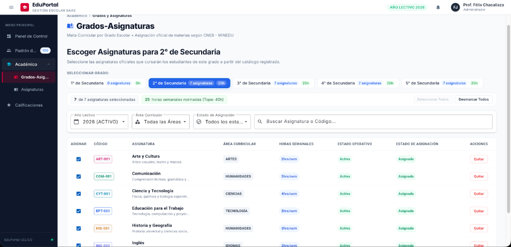
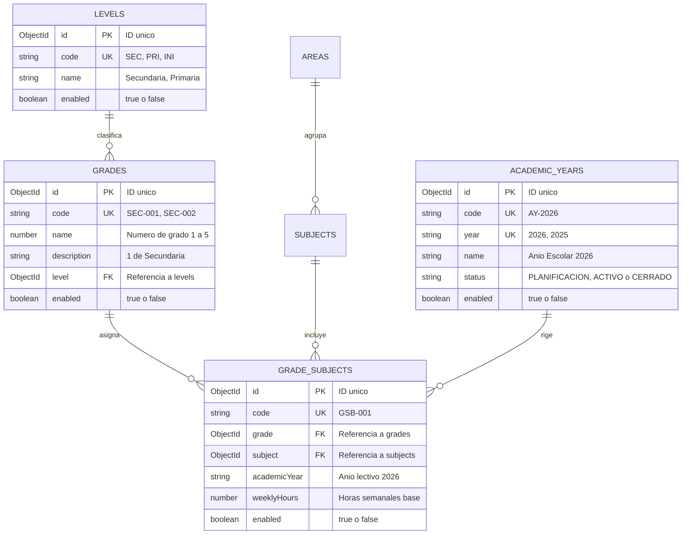
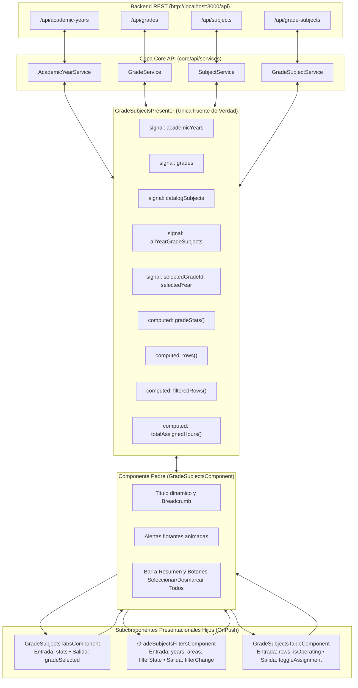

# 📗 Guía del Estudiante • Sesión 03
## Malla Curricular por Grado Escolar (`grade-subjects`), Gestión de Años Lectivos (`academic-years`), Computeds Avanzados con Signals, Acciones Masivas por Lote y Control de Carga Horaria MINEDU (`eduportal-web`)

> **Curso:** Desarrollo Web Frontend Profesional con Angular 22  
> **Proyecto Transversal:** EduPortal — Sistema de Gestión Escolar SaaS  
> **Rama Oficial de Trabajo:** `03-grade-subjects`  
> **Frontend:** `eduportal-web` (`http://localhost:4200`) • Angular 22 (Standalone & OnPush, Signals & Computeds Derivados, Angular Material, SCSS BEM)  
> **Backend de Soporte:** `eduportal-api-mongodb` (`http://localhost:3000`) • Base de Datos MongoDB: `eduportalangular`  
> **Docente Titular:** Félix Junior Chacaliaza Gutiérrez • Intevex Academy

---

## 🎯 Objetivos y Competencias de la Sesión

1. **Comprender el Modelo de Malla Curricular `N:M` (`eduportalangular`):** Comprender por qué una relación Muchos a Muchos entre Grados (`grades`) y Asignaturas (`subjects`) requiere una colección intermedia (`grade-subjects`) que contenga atributos propios del cruce (`academicYear`, `weeklyHours`, `enabled`, `code`).
2. **Dominar las Reglas de Negocio Institucionales y del MINEDU:** Asimilar la regla de unicidad compuesta (un curso no puede asignarse dos veces al mismo grado en el mismo año lectivo), el límite estricto de **40 horas semanales por grado escolar**, y la inmutabilidad de la malla en años lectivos con estado `CERRADO`.
3. **Expandir la Capa `core/api` en `eduportal-web`:** Diseñar 4 nuevas interfaces inmutables (`AcademicYear`, `Level`, `Grade`, `GradeSubject`) e implementar 3 servicios HTTP basados en Promesas (`firstValueFrom`).
4. **Dominar la Derivación Reactiva en Cascada con `computed()`:** Aprender a cruzar en el cliente el catálogo global de asignaturas con las asignaciones del grado activo sin duplicar estado en memoria.
5. **Implementar Componentes Presentacionales Especializados:** Construir `GradeSubjectsTabsComponent` (selector visual de grados con métricas integradas), `GradeSubjectsFiltersComponent` (filtros combinados multivariable) y `GradeSubjectsTableComponent` (tabla interactiva con badges dinámicos).
6. **Desarrollar Acciones Masivas por Lote (*Batch Processing*):** Implementar `selectAll()` y `deselectAll()` con control secuencial, detección anticipada de errores y banners de notificación animados (`alertMessage`).

---

## 🖼️ Referencia Visual del Producto a Construir

Para guiar tu desarrollo paso a paso, a continuación se presenta la vista final que implementaremos:

### Pantalla Oficial del Módulo de Grados y Asignaturas (`/grados-asignaturas`)
Integra el App Shell con el encabezado dinámico, las pestañas de selección de grado escolar con insignias de conteo y horas pedagógicas, la barra de resumen métrico con acciones por lote (`Seleccionar Todos` / `Desmarcar Todos`), la barra unificada de filtros y la tabla interactiva de asignación con checkboxes y botones de acción rápida.



---

## 🗄️ PARTE 1: Base de Datos `eduportalangular` — Colecciones de Malla Curricular

El backend escolar administra la base de datos **`eduportalangular`** en MongoDB (`mongodb://127.0.0.1:27017/eduportalangular`). En esta sesión trabajaremos con **4 colecciones interconectadas**:

1. **`levels` (Niveles Educativos):** Inicial (`INI`), Primaria (`PRI`), Secundaria (`SEC`).
2. **`grades` (Grados Escolares):** Del 1° al 5° de secundaria, vinculados a su nivel.
3. **`academic-years` (Años Lectivos):** Periodos escolares (ej. `2026`), con estados `PLANIFICACION`, `ACTIVO` o `CERRADO`.
4. **`grade-subjects` (Malla Curricular / Asignación):** Colección puente que une Grado + Asignatura + Año Lectivo.

### 1.1 Diagrama Entidad-Relación de la Malla Curricular



---

### 1.2 Detalle de las 4 Colecciones que Consumiremos

#### 1. Colección: `academic-years` (Años Lectivos)
| Campo | Tipo MongoDB | Restricción | Longitud / Regla | Formato / Ejemplo |
| :--- | :--- | :---: | :--- | :--- |
| **`id`** | `String` (`ObjectId`) | Requerido • Único | 24 caracteres hex | `6ad063e8e607cd81d4bf3101` |
| **`code`** | `String` | Requerido • Único | Formato `AY-YYYY` | `AY-2026`, `AY-2025` |
| **`year`** | `String` | Requerido • Único | 4 dígitos numéricos | `2026`, `2025` |
| **`name`** | `String` | Requerido | 3 - 100 caracteres | `Año Escolar Bicentenario 2026` |
| **`status`** | `String` (`enum`) | Requerido | `PLANIFICACION` \| `ACTIVO` \| `CERRADO` | `ACTIVO` |
| **`enabled`** | `Boolean` | Opcional | Booleano | `true` (Vigente) |

#### 2. Colección: `levels` (Niveles Educativos)
| Campo | Tipo MongoDB | Restricción | Longitud / Regla | Formato / Ejemplo |
| :--- | :--- | :---: | :--- | :--- |
| **`id`** | `String` (`ObjectId`) | Requerido • Único | 24 caracteres hex | `6ad063e8e607cd81d4bf3200` |
| **`code`** | `String` | Requerido • Único | 3 caracteres | `SEC`, `PRI`, `INI` |
| **`name`** | `String` | Requerido • Único | 3 - 60 caracteres | `Secundaria`, `Primaria`, `Inicial` |
| **`enabled`** | `Boolean` | Opcional | Booleano | `true` |

#### 3. Colección: `grades` (Grados Escolares)
| Campo | Tipo MongoDB | Restricción | Longitud / Regla | Formato / Ejemplo |
| :--- | :--- | :---: | :--- | :--- |
| **`id`** | `String` (`ObjectId`) | Requerido • Único | 24 caracteres hex | `6ad063e8e607cd81d4bf3301` |
| **`code`** | `String` | Requerido • Único | 7 caracteres (`AAA-000`) | `SEC-001`, `SEC-002`, `SEC-005` |
| **`name`** | `Number` | Requerido | Entero $1 \le x \le 6$ | `1`, `2`, `3`, `4`, `5` |
| **`description`** | `String` | Requerido | 3 - 100 caracteres | `1° de Secundaria`, `2° de Secundaria` |
| **`level`** | `ObjectId` (Ref: `Level`) | Requerido | 24 caracteres hex | Referencia a `levels._id` |
| **`enabled`** | `Boolean` | Opcional | Booleano | `true` |

#### 4. Colección: `grade-subjects` (Malla Curricular / Asignaciones)
| Campo | Tipo MongoDB | Restricción | Longitud / Regla | Formato / Ejemplo |
| :--- | :--- | :---: | :--- | :--- |
| **`id`** | `String` (`ObjectId`) | Requerido • Único | 24 caracteres hex | `6ad063e8e607cd81d4bf3401` |
| **`code`** | `String` | Requerido • Único | 7 caracteres (`GSB-000`) | `GSB-001`, `GSB-002` (autogenerado) |
| **`grade`** | `ObjectId` (Ref: `Grade`) | Requerido | 24 caracteres hex | Grado al que se asigna |
| **`subject`** | `ObjectId` (Ref: `Subject`) | Requerido | 24 caracteres hex | Asignatura del catálogo |
| **`academicYear`** | `String` | Requerido | 4 dígitos | `2026` |
| **`weeklyHours`** | `Number` | Requerido | Entero $\ge 1$ (Tope: 40h) | `5` (horas pedagógicas) |
| **`enabled`** | `Boolean` | Opcional | Booleano | `true` (Asignada) / `false` (Quitada) |

---

### 1.3 Las 3 Reglas de Negocio Clave en MongoDB

1. **Índice Compuesto de Unicidad (`grade + subject + academicYear`):** No se puede registrar la misma asignatura dos veces en el mismo grado y año lectivo. Si se intenta duplicar, MongoDB arroja error `E11000 duplicate key` y la API responde `409 Conflict`.
2. **Regla del Tope Semanal MINEDU (`MAX_WEEKLY_HOURS = 40`):** La suma de horas de las materias activas en un grado escolar no puede superar las 40 horas pedagógicas semanales. Si una asignatura intenta sobrepasar este límite, la API responde `400 Bad Request`.
3. **Inmutabilidad de Años Cerrados (`isYearClosed`):** Si un año lectivo tiene `status: 'CERRADO'`, el backend rechaza cualquier `POST` o `PUT` con `403 Forbidden` para proteger el historial académico.

---

## 📡 PARTE 2: Endpoints de `eduportal-api-mongodb`

> 🌐 **Servidor API:** `http://localhost:3000` (los endpoints responden con el prefijo `/api`)

### 2.1 Resumen de Endpoints que Consumiremos en la Sesión

| Módulo | Endpoint Base | Métodos Habilitados | Descripción Operativa |
| :--- | :--- | :--- | :--- |
| **Años Lectivos** | `/api/academic-years` | `GET /` • `GET /:idOrYear` | Consulta años escolares (ej: activo `2026` o cerrado `2025`). |
| **Grados** | `/api/grades` | `GET /` • `GET /:id` | Lista grados de secundaria (`1° de Secundaria` a `5° de Secundaria`). |
| **Malla Curricular** | `/api/grade-subjects` | `GET /` • `POST /` • `PUT /:id` | Consulta la malla por año/grado, asigna materias y edita/inactiva. |

### 2.2 Detalle de Contratos HTTP

#### A) Endpoints de Años Lectivos (`/api/academic-years`)
| Acción | Método | Endpoint | Parámetros Query | Respuesta Exitosa (`ApiResponse<T>`) |
| :--- | :---: | :--- | :--- | :--- |
| **Listar años** | `GET` | `/api/academic-years` | `?status=ACTIVO&enabled=true` | `200 OK` — `{ success: true, data: AcademicYear[] }` |
| **Obtener por año** | `GET` | `/api/academic-years/:idOrYear` | *Ninguno* (ej: `/api/academic-years/2026`) | `200 OK` — `{ success: true, data: AcademicYear }` |

#### B) Endpoints de Grados Escolares (`/api/grades`)
| Acción | Método | Endpoint | Parámetros Query | Respuesta Exitosa (`ApiResponse<T>`) |
| :--- | :---: | :--- | :--- | :--- |
| **Listar grados** | `GET` | `/api/grades` | *Ninguno* | `200 OK` — `{ success: true, data: Grade[] }` (poblado con `level`) |
| **Obtener grado** | `GET` | `/api/grades/:id` | *Ninguno* | `200 OK` — `{ success: true, data: Grade }` |

#### C) Endpoints de Malla Curricular (`/api/grade-subjects`)
| Acción | Método | Endpoint | Payload / Body | Respuesta Exitosa (`ApiResponse<T>`) |
| :--- | :---: | :--- | :--- | :--- |
| **Listar malla por grado** | `GET` | `/api/grade-subjects` | `?grade=<id>&academicYear=2026` | `200 OK` — `{ success: true, data: GradeSubject[] }` |
| **Asignar materia a grado** | `POST` | `/api/grade-subjects` | `{ grade, subject, academicYear, weeklyHours }` | `201 Created` — Autogenera `code: GSB-001` y valida tope 40h |
| **Alternar estado / Editar horas** | `PUT` | `/api/grade-subjects/:id` | `{ enabled: false }` o `{ weeklyHours: 4 }` | `200 OK` — Actualiza y retorna objeto con poblaciones |

---

## 🏛️ PARTE 3: Arquitectura Frontend de `eduportal-web` (Smart-Dumb + Signals Derivados)



---

### 3.1 Árbol de Archivos del Módulo (`grade-subjects/`)

```text
src/
├── environments/
│   └── environment.ts                                      # apiUrl: 'http://localhost:3000/api'
└── app/
    ├── core/
    │   ├── api/
    │   │   ├── endpoints.ts                                # Agregados: academicYears, grades, gradeSubjects...
    │   │   ├── index.ts                                    # Barrel exportando nuevas interfaces y servicios
    │   │   ├── models/interfaces/
    │   │   │   ├── academic-year.interface.ts              # AcademicYear, AcademicYearStatus
    │   │   │   ├── level.interface.ts                      # Level
    │   │   │   ├── grade.interface.ts                      # Grade (con level: Level)
    │   │   │   └── grade-subject.interface.ts              # GradeSubject (con grade, subject, academicYear)
    │   │   └── services/
    │   │       ├── academic-year.service.ts                # getAcademicYears, getAcademicYearByIdOrYear
    │   │       ├── grade.service.ts                        # getGrades, getGradeById
    │   │       └── grade-subject.service.ts                # getGradeSubjects, create, update
    │   └── layouts/main-layout/models/constants/
    │       └── page-headers.constant.ts                    # Agregada cabecera para '/grados-asignaturas'
    ├── shared/layout/sidebar/
    │   └── sidebar.component.ts                            # Agregada opción 'Grados-Asignaturas' en menú
    └── features/
        └── academic/
            ├── academic.routes.ts                          # Ruta '/grados-asignaturas' -> GradeSubjectsComponent
            ├── index.ts
            └── grade-subjects/
                ├── grade-subjects.component.ts/.html/.scss # Componente Padre Smart
                ├── grade-subjects.presenter.ts             # View Presenter con Signals & Computeds
                ├── models/
                │   ├── constants/
                │   │   └── grade-subjects-metadata.constant.ts # Mapeo de colores temáticos por código (ART, MAT...)
                │   └── interfaces/
                │       ├── grade-stat.interface.ts         # Métricas por grado (materias, horas)
                │       ├── grade-subject-row.interface.ts  # Fila visual de tabla cruzada
                │       └── grade-subjects-filter-state.interface.ts # Estado de filtros reactivos
                └── components/
                    ├── grade-subjects-tabs/                # Pestañas de Grados con badges
                    ├── grade-subjects-filters/             # Barra de filtros de 4 campos
                    └── grade-subjects-table/               # Tabla mat-table con asignación interactiva
```

---

---

### 3.2 Comandos Rápidos de Angular CLI de la Sesión 03

Ejecuta estos comandos desde la terminal dentro de `eduportal-web` para generar rápidamente todos los artefactos de la sesión con los sufijos empresariales estandarizados (`--skip-tests`, `--type=component`):

```bash
# ==============================================================================
# 1. CAPA CORE API: Interfaces y Servicios HTTP (Parte 4)
# ==============================================================================
# Interfaces de Contrato
ng g i core/api/models/interfaces/academic-year
ng g i core/api/models/interfaces/level
ng g i core/api/models/interfaces/grade
ng g i core/api/models/interfaces/grade-subject

# Servicios HTTP
ng g s core/api/services/academic-year --skip-tests
ng g s core/api/services/grade --skip-tests
ng g s core/api/services/grade-subject --skip-tests

# ==============================================================================
# 2. MODELOS DE VISTA DEL MÓDULO (Parte 5)
# ==============================================================================
ng g i features/academic/grade-subjects/models/interfaces/grade-stat
ng g i features/academic/grade-subjects/models/interfaces/grade-subject-row
ng g i features/academic/grade-subjects/models/interfaces/grade-subjects-filter-state

# ==============================================================================
# 3. COMPONENTE PADRE CONTENEDOR (1° en orden Top-Down - Parte 6)
# ==============================================================================
ng g c features/academic/grade-subjects --skip-tests --type=component

# ==============================================================================
# 4. SUBCOMPONENTES PRESENTACIONALES HIJOS (Dumb Components - Parte 7)
# ==============================================================================
ng g c features/academic/grade-subjects/components/grade-subjects-tabs --skip-tests --type=component
ng g c features/academic/grade-subjects/components/grade-subjects-filters --skip-tests --type=component
ng g c features/academic/grade-subjects/components/grade-subjects-table --skip-tests --type=component
```

> 💡 **¿Por qué usamos `--type=component` y `--skip-tests`?**  
> En Angular 22, el flag `--type=component` fuerza la convención oficial empresarial `.component.ts` (evitando que se cree como `grade-subjects.ts`), lo que permite diferenciar a simple vista en el explorador de archivos el componente visual (`*.component.ts`) de su presentador maestro (`*.presenter.ts`) y de sus modelos (`*.interface.ts`).

---

## 🌐 PARTE 4: Nuevas Interfaces y Servicios en la Capa Core API (`core/api`)

En el frontend agregamos los contratos tipados inmutables y los servicios HTTP correspondientes a las nuevas entidades.

### 4.1 Entorno `src/environments/environment.ts`
Asegúrate de que la URL del backend apunte al puerto `3000`:
```typescript
export const environment = {
  production: false,
  apiUrl: 'http://localhost:3000/api',
};
```

---

### 4.2 Interfaces de Contrato (`core/api/models/interfaces/`)

#### 1. `src/app/core/api/models/interfaces/academic-year.interface.ts`
```typescript
export type AcademicYearStatus = 'PLANIFICACION' | 'ACTIVO' | 'CERRADO';

export interface AcademicYear {
  readonly id: string;
  readonly code: string;
  readonly year: string;
  readonly name: string;
  readonly startDate: string;
  readonly endDate: string;
  readonly status: AcademicYearStatus;
  readonly closedAt?: string | null;
  readonly enabled: boolean;
}
```

#### 2. `src/app/core/api/models/interfaces/level.interface.ts`
```typescript
export interface Level {
  readonly id: string;
  readonly code: string;
  readonly name: string;
  readonly description?: string;
  readonly enabled: boolean;
}
```

#### 3. `src/app/core/api/models/interfaces/grade.interface.ts`
```typescript
import { Level } from './level.interface';

export interface Grade {
  readonly id: string;
  readonly code: string;
  readonly name: number;
  readonly description: string;
  readonly level: Level | string;
  readonly enabled: boolean;
}
```

#### 4. `src/app/core/api/models/interfaces/grade-subject.interface.ts`
```typescript
import { Grade } from './grade.interface';
import { Subject } from './subject.interface';

export interface GradeSubject {
  readonly id: string;
  readonly code: string;
  readonly grade: Grade | string;
  readonly subject: Subject | string;
  readonly academicYear: string;
  readonly weeklyHours: number;
  readonly enabled: boolean;
}
```

---

### 4.3 Servicios HTTP (`core/api/services/`)

#### 1. `src/app/core/api/services/academic-year.service.ts`

**Comando rápido de creación:**
```bash
ng g s core/api/services/academic-year --skip-tests
```

```typescript
import { Injectable, inject } from '@angular/core';
import { HttpClient, HttpParams } from '@angular/common/http';
import { firstValueFrom } from 'rxjs';
import { API_ENDPOINTS } from '../endpoints';
import { ApiResponse } from '../models/interfaces/api-response.interface';
import { AcademicYear } from '../models/interfaces/academic-year.interface';

@Injectable({
  providedIn: 'root',
})
export class AcademicYearService {
  private readonly http = inject(HttpClient);
  private readonly endpoint = API_ENDPOINTS.academicYears;

  public async getAcademicYears(params?: { status?: string; enabled?: boolean }): Promise<AcademicYear[]> {
    let httpParams = new HttpParams();
    if (params?.status) {
      httpParams = httpParams.set('status', params.status);
    }
    if (params?.enabled !== undefined) {
      httpParams = httpParams.set('enabled', String(params.enabled));
    }

    const response = await firstValueFrom(
      this.http.get<ApiResponse<AcademicYear[]>>(this.endpoint, { params: httpParams })
    );
    return response.data;
  }

  public async getAcademicYearByIdOrYear(idOrYear: string): Promise<AcademicYear> {
    const response = await firstValueFrom(
      this.http.get<ApiResponse<AcademicYear>>(`${this.endpoint}/${idOrYear}`)
    );
    return response.data;
  }
}
```

#### 2. `src/app/core/api/services/grade.service.ts`

**Comando rápido de creación:**
```bash
ng g s core/api/services/grade --skip-tests
```

```typescript
import { Injectable, inject } from '@angular/core';
import { HttpClient } from '@angular/common/http';
import { firstValueFrom } from 'rxjs';
import { API_ENDPOINTS } from '../endpoints';
import { ApiResponse } from '../models/interfaces/api-response.interface';
import { Grade } from '../models/interfaces/grade.interface';

@Injectable({
  providedIn: 'root',
})
export class GradeService {
  private readonly http = inject(HttpClient);
  private readonly endpoint = API_ENDPOINTS.grades;

  public async getGrades(): Promise<Grade[]> {
    const response = await firstValueFrom(
      this.http.get<ApiResponse<Grade[]>>(this.endpoint)
    );
    return response.data;
  }

  public async getGradeById(id: string): Promise<Grade> {
    const response = await firstValueFrom(
      this.http.get<ApiResponse<Grade>>(`${this.endpoint}/${id}`)
    );
    return response.data;
  }
}
```

#### 3. `src/app/core/api/services/grade-subject.service.ts`

**Comando rápido de creación:**
```bash
ng g s core/api/services/grade-subject --skip-tests
```

```typescript
import { Injectable, inject } from '@angular/core';
import { HttpClient, HttpParams } from '@angular/common/http';
import { firstValueFrom } from 'rxjs';
import { API_ENDPOINTS } from '../endpoints';
import { ApiResponse } from '../models/interfaces/api-response.interface';
import { GradeSubject } from '../models/interfaces/grade-subject.interface';

@Injectable({
  providedIn: 'root',
})
export class GradeSubjectService {
  private readonly http = inject(HttpClient);
  private readonly endpoint = API_ENDPOINTS.gradeSubjects;

  public async getGradeSubjects(filter?: {
    grade?: string;
    academicYear?: string;
    enabled?: boolean;
  }): Promise<GradeSubject[]> {
    let params = new HttpParams();
    if (filter?.grade) {
      params = params.set('grade', filter.grade);
    }
    if (filter?.academicYear) {
      params = params.set('academicYear', filter.academicYear);
    }
    if (filter?.enabled !== undefined) {
      params = params.set('enabled', String(filter.enabled));
    }

    const response = await firstValueFrom(
      this.http.get<ApiResponse<GradeSubject[]>>(this.endpoint, { params })
    );
    return response.data;
  }

  public async getGradeSubjectById(id: string): Promise<GradeSubject> {
    const response = await firstValueFrom(
      this.http.get<ApiResponse<GradeSubject>>(`${this.endpoint}/${id}`)
    );
    return response.data;
  }

  public async createGradeSubject(payload: {
    grade: string;
    subject: string;
    academicYear?: string;
    weeklyHours?: number;
    enabled?: boolean;
  }): Promise<GradeSubject> {
    const response = await firstValueFrom(
      this.http.post<ApiResponse<GradeSubject>>(this.endpoint, payload)
    );
    return response.data;
  }

  public async updateGradeSubject(
    id: string,
    payload: { weeklyHours?: number; enabled?: boolean; code?: string }
  ): Promise<GradeSubject> {
    const response = await firstValueFrom(
      this.http.put<ApiResponse<GradeSubject>>(`${this.endpoint}/${id}`, payload)
    );
    return response.data;
  }
}
```

#### 4. Exportar en el Barrel: `src/app/core/api/index.ts`
```typescript
export * from './endpoints';
export * from './models/interfaces/api-response.interface';
export * from './models/interfaces/area.interface';
export * from './models/interfaces/subject.interface';
export * from './models/interfaces/level.interface';
export * from './models/interfaces/grade.interface';
export * from './models/interfaces/academic-year.interface';
export * from './models/interfaces/grade-subject.interface';
export * from './services/area.service';
export * from './services/subject.service';
export * from './services/grade.service';
export * from './services/academic-year.service';
export * from './services/grade-subject.service';
```

---

## 🧩 PARTE 5: Modelos de Vista y Metadatos Visuales del Módulo

Creamos los contratos propios del módulo de presentación dentro de `features/academic/grade-subjects/models/`.

### 5.1 Metadatos Visuales: `models/constants/grade-subjects-metadata.constant.ts`
Permite asignar a cada código de curso su color temático distintivo:
```typescript
export interface SubjectMeta {
  readonly color: string;
}

export const SUBJECT_METADATA_MAP: Record<string, SubjectMeta> = {
  ART: { color: '#db2777' },
  COM: { color: '#059669' },
  CYT: { color: '#0891b2' },
  CIE: { color: '#0891b2' },
  DPCC: { color: '#7c3aed' },
  EDF: { color: '#16a34a' },
  EPT: { color: '#2563eb' },
  HIS: { color: '#d97706' },
  ING: { color: '#6366f1' },
  MAT: { color: '#2563eb' },
  REL: { color: '#0284c7' },
  TUT: { color: '#059669' },
};

export function getSubjectMetadata(code: string): SubjectMeta {
  const prefix = code?.split('-')[0]?.toUpperCase() || '';
  return SUBJECT_METADATA_MAP[prefix] || { color: '#475569' };
}
```

### 5.2 Modelos de Estadísticas, Filas y Filtros

#### 1. `models/interfaces/grade-stat.interface.ts`
```typescript
export interface GradeStat {
  readonly gradeId: string;
  readonly code: string;
  readonly name: number;
  readonly description: string;
  readonly assignedSubjectsCount: number;
  readonly totalHours: number;
}
```

#### 2. `models/interfaces/grade-subject-row.interface.ts`
```typescript
export type AssignmentStatus = 'Asignado' | 'No asignado' | 'Deshabilitado';

export interface GradeSubjectRow {
  readonly subjectId: string;
  readonly gradeSubjectId?: string;
  readonly code: string;
  readonly name: string;
  readonly description?: string;
  readonly area: string;
  readonly areaId: string;
  readonly hours: number;
  readonly operationalStatus: 'Activa' | 'Desactiva';
  readonly isAssigned: boolean;
  readonly assignmentStatus: AssignmentStatus;
  readonly color: string;
}
```

#### 3. `models/interfaces/grade-subjects-filter-state.interface.ts`
```typescript
export interface GradeSubjectsFilterState {
  readonly year: string;
  readonly area: string;
  readonly assignmentStatus: 'ALL' | 'ASSIGNED' | 'UNASSIGNED';
  readonly search: string;
}
```

---

## 🎯 PARTE 6: View Presenter Maestro (`GradeSubjectsPresenter`) y Rutas

### 6.1 Código Completo de `GradeSubjectsPresenter`
Ubicación: `src/app/features/academic/grade-subjects/grade-subjects.presenter.ts`:

```typescript
import { Injectable, computed, inject, signal } from '@angular/core';
import {
  AcademicYear,
  AcademicYearService,
  AreaService,
  Grade,
  GradeService,
  GradeSubject,
  GradeSubjectService,
  Subject,
  SubjectService,
} from '../../../core/api';
import { GradeSubjectRow, AssignmentStatus } from './models/interfaces/grade-subject-row.interface';
import { GradeStat } from './models/interfaces/grade-stat.interface';
import { GradeSubjectsFilterState } from './models/interfaces/grade-subjects-filter-state.interface';
import { getSubjectMetadata } from './models/constants/grade-subjects-metadata.constant';

@Injectable()
export class GradeSubjectsPresenter {
  private readonly academicYearService = inject(AcademicYearService);
  private readonly gradeService = inject(GradeService);
  private readonly subjectService = inject(SubjectService);
  private readonly gradeSubjectService = inject(GradeSubjectService);
  private readonly areaService = inject(AreaService);

  // --------------------------------------------------------------------------
  // Signals de Estado
  // --------------------------------------------------------------------------
  public readonly academicYears = signal<readonly AcademicYear[]>([]);
  public readonly selectedYear = signal<string>('2026');
  public readonly grades = signal<readonly Grade[]>([]);
  public readonly selectedGradeId = signal<string>('');
  public readonly catalogSubjects = signal<readonly Subject[]>([]);
  public readonly allYearGradeSubjects = signal<readonly GradeSubject[]>([]);
  public readonly areas = signal<readonly { label: string; value: string }[]>([]);

  public readonly filterState = signal<GradeSubjectsFilterState>({
    year: '2026',
    area: 'ALL',
    assignmentStatus: 'ALL',
    search: '',
  });

  public readonly isLoading = signal<boolean>(false);
  public readonly isOperating = signal<boolean>(false);
  public readonly alertMessage = signal<{ message: string; type: 'success' | 'warning' | 'error' } | null>(null);

  constructor() {
    this.init();
  }

  // --------------------------------------------------------------------------
  // Computeds Reactivos
  // --------------------------------------------------------------------------

  public readonly selectedGrade = computed<Grade | undefined>(() => {
    const list = this.grades();
    const id = this.selectedGradeId();
    return list.find(g => g.id === id) || list[0];
  });

  public readonly currentGradeAssignments = computed<readonly GradeSubject[]>(() => {
    const activeGradeId = this.selectedGrade()?.id;
    if (!activeGradeId) return [];

    return this.allYearGradeSubjects().filter(gs => {
      const gId = typeof gs.grade === 'string' ? gs.grade : gs.grade?.id;
      return gId === activeGradeId;
    });
  });

  public readonly gradeStats = computed<readonly GradeStat[]>(() => {
    const gradesList = this.grades();
    const assignments = this.allYearGradeSubjects();

    return gradesList.map(grade => {
      const activeAssignments = assignments.filter(gs => {
        const gId = typeof gs.grade === 'string' ? gs.grade : gs.grade?.id;
        return gId === grade.id && gs.enabled;
      });

      const assignedSubjectsCount = activeAssignments.length;
      const totalHours = activeAssignments.reduce((acc, curr) => acc + (curr.weeklyHours || 0), 0);

      return {
        gradeId: grade.id,
        code: grade.code,
        name: grade.name,
        description: grade.description,
        assignedSubjectsCount,
        totalHours,
      };
    });
  });

  public readonly rows = computed<readonly GradeSubjectRow[]>(() => {
    const catalog = this.catalogSubjects();
    const assignments = this.currentGradeAssignments();

    return catalog.map(subject => {
      const assignment = assignments.find(gs => {
        const sId = typeof gs.subject === 'string' ? gs.subject : gs.subject?.id;
        return sId === subject.id;
      });

      const isAssigned = !!assignment && assignment.enabled;
      let assignmentStatus: AssignmentStatus = 'No asignado';
      if (assignment) {
        assignmentStatus = assignment.enabled ? 'Asignado' : 'Deshabilitado';
      }

      const meta = getSubjectMetadata(subject.code);
      const hours = assignment ? assignment.weeklyHours : subject.weeklyHours;

      return {
        subjectId: subject.id,
        gradeSubjectId: assignment?.id,
        code: subject.code,
        name: subject.name,
        description: subject.description,
        area: subject.area?.name || 'General',
        areaId: (subject.area as any)?.id || (subject.area as any)?._id || '',
        hours,
        operationalStatus: subject.enabled ? 'Activa' : 'Desactiva',
        isAssigned,
        assignmentStatus,
        color: meta.color,
      };
    });
  });

  public readonly filteredRows = computed<readonly GradeSubjectRow[]>(() => {
    const { area, assignmentStatus, search } = this.filterState();
    const query = search.trim().toLowerCase();

    return this.rows().filter(row => {
      const matchArea =
        area === 'ALL' ||
        row.areaId === area ||
        row.area.toLowerCase() === area.toLowerCase();

      const matchStatus =
        assignmentStatus === 'ALL' ||
        (assignmentStatus === 'ASSIGNED' && row.isAssigned) ||
        (assignmentStatus === 'UNASSIGNED' && !row.isAssigned);

      const matchQuery =
        !query ||
        row.name.toLowerCase().includes(query) ||
        row.code.toLowerCase().includes(query);

      return matchArea && matchStatus && matchQuery;
    });
  });

  public readonly selectedCount = computed<number>(() => {
    return this.rows().filter(r => r.isAssigned).length;
  });

  public readonly totalCatalogCount = computed<number>(() => {
    return this.rows().length;
  });

  public readonly totalAssignedHours = computed<number>(() => {
    return this.rows()
      .filter(r => r.isAssigned)
      .reduce((sum, r) => sum + r.hours, 0);
  });

  public readonly areAllSelected = computed<boolean>(() => {
    const total = this.totalCatalogCount();
    return total > 0 && this.selectedCount() === total;
  });

  // --------------------------------------------------------------------------
  // Ciclo de Vida y Carga de Datos
  // --------------------------------------------------------------------------

  public async init(): Promise<void> {
    this.isLoading.set(true);
    try {
      await Promise.all([
        this.loadAcademicYears(),
        this.loadGrades(),
        this.loadCatalogSubjects(),
        this.loadAreas(),
      ]);
      await this.loadYearGradeSubjects();
    } catch (error) {
      console.error('Error al inicializar el módulo de Grados-Asignaturas:', error);
      this.showAlert('Error al conectar con la base de datos escolar', 'error');
    } finally {
      this.isLoading.set(false);
    }
  }

  public async loadAcademicYears(): Promise<void> {
    try {
      const years = await this.academicYearService.getAcademicYears();
      this.academicYears.set(years);

      const active = years.find(y => y.status === 'ACTIVO');
      const chosenYear = active ? active.year : years[0]?.year || '2026';
      this.selectedYear.set(chosenYear);
      this.filterState.update(s => ({ ...s, year: chosenYear }));
    } catch (err) {
      console.error('Error al cargar años lectivos:', err);
    }
  }

  public async loadGrades(): Promise<void> {
    try {
      const grades = await this.gradeService.getGrades();
      this.grades.set(grades);
      if (grades.length > 0 && !this.selectedGradeId()) {
        this.selectedGradeId.set(grades[0].id);
      }
    } catch (err) {
      console.error('Error al cargar grados escolares:', err);
    }
  }

  public async loadCatalogSubjects(): Promise<void> {
    try {
      const subjects = await this.subjectService.getSubjects();
      this.catalogSubjects.set(subjects);
    } catch (err) {
      console.error('Error al cargar catálogo de asignaturas:', err);
    }
  }

  public async loadAreas(): Promise<void> {
    try {
      const areas = await this.areaService.getAreas();
      this.areas.set([
        { label: 'Todas las Áreas', value: 'ALL' },
        ...areas.filter(a => a.enabled).map(a => ({
          label: a.name.charAt(0).toUpperCase() + a.name.slice(1).toLowerCase(),
          value: (a as any).id || (a as any)._id || a.name,
        })),
      ]);
    } catch (err) {
      console.error('Error al cargar áreas curriculares:', err);
    }
  }

  public async loadYearGradeSubjects(): Promise<void> {
    try {
      const year = this.selectedYear();
      const gradeSubjects = await this.gradeSubjectService.getGradeSubjects({ academicYear: year });
      this.allYearGradeSubjects.set(gradeSubjects);
    } catch (err) {
      console.error('Error al cargar asignaciones de malla curricular:', err);
    }
  }

  // --------------------------------------------------------------------------
  // Interacciones de Usuario
  // --------------------------------------------------------------------------

  public async selectYear(year: string): Promise<void> {
    if (this.selectedYear() === year) return;
    this.selectedYear.set(year);
    this.filterState.update(s => ({ ...s, year }));
    this.isLoading.set(true);
    try {
      await this.loadYearGradeSubjects();
      this.showAlert(`Año lectivo ${year} cargado correctamente`, 'success');
    } catch (err) {
      this.showAlert(`Error al cargar datos del año ${year}`, 'error');
    } finally {
      this.isLoading.set(false);
    }
  }

  public selectGrade(gradeId: string): void {
    this.selectedGradeId.set(gradeId);
  }

  public applyFilters(filters: Partial<GradeSubjectsFilterState>): void {
    this.filterState.update(prev => ({ ...prev, ...filters }));
  }

  public async toggleAssignment(row: GradeSubjectRow): Promise<void> {
    const grade = this.selectedGrade();
    if (!grade) return;

    const currentYear = this.selectedYear();
    const isCurrentlyAssigned = row.isAssigned;
    const nextStatus = !isCurrentlyAssigned;

    this.isOperating.set(true);

    try {
      if (row.gradeSubjectId) {
        const updated = await this.gradeSubjectService.updateGradeSubject(row.gradeSubjectId, {
          enabled: nextStatus,
        });

        this.allYearGradeSubjects.update(list =>
          list.map(item => (item.id === row.gradeSubjectId ? updated : item))
        );

        this.showAlert(
          nextStatus
            ? `Asignatura "${row.name}" asignada a ${grade.description}`
            : `Asignatura "${row.name}" deshabilitada de ${grade.description}`,
          'success'
        );
      } else {
        const created = await this.gradeSubjectService.createGradeSubject({
          grade: grade.id,
          subject: row.subjectId,
          academicYear: currentYear,
          weeklyHours: row.hours,
          enabled: true,
        });

        this.allYearGradeSubjects.update(list => [...list, created]);

        this.showAlert(
          `Asignatura "${row.name}" (${row.hours}h) asignada exitosamente a ${grade.description}`,
          'success'
        );
      }
    } catch (error: any) {
      console.error('Error al actualizar asignación:', error);
      const msg = error?.error?.message || error?.message || 'Error al actualizar asignación curricular';
      this.showAlert(msg, 'error');
    } finally {
      this.isOperating.set(false);
    }
  }

  public async selectAll(): Promise<void> {
    const unassigned = this.rows().filter(r => !r.isAssigned);
    if (unassigned.length === 0) return;

    this.isOperating.set(true);
    let successCount = 0;
    let errorMessage = '';

    for (const row of unassigned) {
      try {
        if (row.gradeSubjectId) {
          const updated = await this.gradeSubjectService.updateGradeSubject(row.gradeSubjectId, {
            enabled: true,
          });
          this.allYearGradeSubjects.update(list =>
            list.map(item => (item.id === row.gradeSubjectId ? updated : item))
          );
        } else {
          const created = await this.gradeSubjectService.createGradeSubject({
            grade: this.selectedGradeId(),
            subject: row.subjectId,
            academicYear: this.selectedYear(),
            weeklyHours: row.hours,
            enabled: true,
          });
          this.allYearGradeSubjects.update(list => [...list, created]);
        }
        successCount++;
      } catch (err: any) {
        errorMessage = err?.error?.message || err?.message || 'Límite o error de asignación';
        break;
      }
    }

    this.isOperating.set(false);
    if (errorMessage) {
      this.showAlert(`Se asignaron ${successCount} asignaturas. Aviso: ${errorMessage}`, 'warning');
    } else {
      this.showAlert(`Todas las asignaturas (${successCount}) han sido asignadas exitosamente`, 'success');
    }
  }

  public async deselectAll(): Promise<void> {
    const assigned = this.rows().filter(r => r.isAssigned && r.gradeSubjectId);
    if (assigned.length === 0) return;

    this.isOperating.set(true);
    let deactivatedCount = 0;

    for (const row of assigned) {
      if (row.gradeSubjectId) {
        try {
          const updated = await this.gradeSubjectService.updateGradeSubject(row.gradeSubjectId, {
            enabled: false,
          });
          this.allYearGradeSubjects.update(list =>
            list.map(item => (item.id === row.gradeSubjectId ? updated : item))
          );
          deactivatedCount++;
        } catch (err) {
          console.error(`Error al desmarcar ${row.name}:`, err);
        }
      }
    }

    this.isOperating.set(false);
    this.showAlert(`Se han quitado ${deactivatedCount} asignaturas de este grado`, 'success');
  }

  private showAlert(message: string, type: 'success' | 'warning' | 'error'): void {
    this.alertMessage.set({ message, type });
    setTimeout(() => {
      if (this.alertMessage()?.message === message) {
        this.alertMessage.set(null);
      }
    }, 5000);
  }
}
```

---

### 6.2 Registro de Rutas, Cabecera y Sidebar

#### 1. Ruta en `src/app/features/academic/academic.routes.ts`
```typescript
import { Routes } from '@angular/router';

export const ACADEMIC_ROUTES: Routes = [
  {
    path: 'asignaturas',
    loadComponent: () =>
      import('./subjects/subjects.component').then(m => m.SubjectsComponent),
  },
  {
    path: 'grados-asignaturas',
    loadComponent: () =>
      import('./grade-subjects/grade-subjects.component').then(m => m.GradeSubjectsComponent),
  },
];
```

#### 2. Cabecera en `src/app/core/layouts/main-layout/models/constants/page-headers.constant.ts`
```typescript
export const PAGE_HEADERS_CONSTANT: readonly PageHeaderConfig[] = Object.freeze([
  Object.freeze({
    route: '/grados-asignaturas',
    breadcrumbs: ['Académico', 'Grados y Asignaturas'],
    title: 'Grados-Asignaturas',
    icon: 'auto_stories',
    description: 'Malla Curricular por Grado Escolar • Asignación oficial de materias según CNEB - MINEDU',
  }),
  // ... resto de rutas
]);
```

#### 3. Menú Lateral en `src/app/shared/layout/sidebar/sidebar.component.ts`
```typescript
{
  id: 'academic',
  label: 'Académico',
  icon: 'school',
  children: [
    { path: '/grados-asignaturas', label: 'Grados-Asignaturas', icon: 'auto_stories' },
    { path: '/asignaturas', label: 'Asignaturas', icon: 'menu_book' }
  ]
}
```

---

## 📚 PARTE 7: Subcomponentes Presentacionales Hijos (`components/`)

Construimos los 3 subcomponentes visuales puros con estrategia `ChangeDetectionStrategy.OnPush`.

### 7.1 Subcomponente 1: Pestañas de Grados (`GradeSubjectsTabsComponent`)

**Comando rápido de creación:**
```bash
ng g c features/academic/grade-subjects/components/grade-subjects-tabs --skip-tests --type=component
```

#### TypeScript: `components/grade-subjects-tabs/grade-subjects-tabs.component.ts`
```typescript
import { Component, input, output } from '@angular/core';
import { GradeStat } from '../../models/interfaces/grade-stat.interface';

@Component({
  selector: 'app-grade-subjects-tabs',
  standalone: true,
  templateUrl: './grade-subjects-tabs.component.html',
  styleUrl: './grade-subjects-tabs.component.scss',
})
export class GradeSubjectsTabsComponent {
  public readonly stats = input.required<readonly GradeStat[]>();
  public readonly selectedGradeId = input.required<string>();
  public readonly gradeSelected = output<string>();

  public onSelect(gradeId: string): void {
    this.gradeSelected.emit(gradeId);
  }
}
```

#### Template: `components/grade-subjects-tabs/grade-subjects-tabs.component.html`
```html
<div class="grade-tabs">
  <div class="grade-tabs__label">SELECCIONAR GRADO:</div>
  <div class="grade-tabs__list">
    @for (grade of stats(); track grade.gradeId) {
      <button
        type="button"
        class="grade-tabs__btn"
        [class.grade-tabs__btn--active]="grade.gradeId === selectedGradeId()"
        (click)="onSelect(grade.gradeId)"
      >
        <span class="grade-tabs__title">{{ grade.description }}</span>
        <span class="grade-tabs__badge grade-tabs__badge--count">
          {{ grade.assignedSubjectsCount }} asignaturas
        </span>
        <span class="grade-tabs__badge grade-tabs__badge--hours">
          {{ grade.totalHours }}h
        </span>
      </button>
    }
  </div>
</div>
```

---

### 7.2 Subcomponente 2: Filtros Unificados (`GradeSubjectsFiltersComponent`)

**Comando rápido de creación:**
```bash
ng g c features/academic/grade-subjects/components/grade-subjects-filters --skip-tests --type=component
```

#### TypeScript: `components/grade-subjects-filters/grade-subjects-filters.component.ts`
```typescript
import { Component, input, output } from '@angular/core';
import { MatFormFieldModule } from '@angular/material/form-field';
import { MatSelectModule } from '@angular/material/select';
import { MatInputModule } from '@angular/material/input';
import { MatIconModule } from '@angular/material/icon';
import { MatCardModule } from '@angular/material/card';
import { AcademicYear } from '../../../../../core/api';
import { GradeSubjectsFilterState } from '../../models/interfaces/grade-subjects-filter-state.interface';

@Component({
  selector: 'app-grade-subjects-filters',
  standalone: true,
  imports: [
    MatCardModule,
    MatFormFieldModule,
    MatSelectModule,
    MatInputModule,
    MatIconModule,
  ],
  templateUrl: './grade-subjects-filters.component.html',
  styleUrl: './grade-subjects-filters.component.scss',
})
export class GradeSubjectsFiltersComponent {
  public readonly academicYears = input.required<readonly AcademicYear[]>();
  public readonly selectedYear = input.required<string>();
  public readonly areas = input.required<readonly { label: string; value: string }[]>();
  public readonly filterState = input.required<GradeSubjectsFilterState>();

  public readonly yearChange = output<string>();
  public readonly filterChange = output<Partial<GradeSubjectsFilterState>>();

  public readonly statusOptions = [
    { label: 'Todos los estados', value: 'ALL' },
    { label: 'Solo Asignadas', value: 'ASSIGNED' },
    { label: 'Solo No Asignadas', value: 'UNASSIGNED' },
  ] as const;

  public onYearSelect(year: string): void {
    this.yearChange.emit(year);
  }

  public onAreaSelect(area: string): void {
    this.filterChange.emit({ area });
  }

  public onStatusSelect(assignmentStatus: 'ALL' | 'ASSIGNED' | 'UNASSIGNED'): void {
    this.filterChange.emit({ assignmentStatus });
  }

  public onSearchInput(event: Event): void {
    const inputElement = event.target as HTMLInputElement;
    this.filterChange.emit({ search: inputElement.value });
  }
}
```

#### Template: `components/grade-subjects-filters/grade-subjects-filters.component.html`
```html
<mat-card class="grade-filters mat-elevation-z1">
  <div class="grade-filters__container">
    <div class="grade-filters__controls">
      
      <!-- 1. Filtro: Año Lectivo -->
      <mat-form-field appearance="outline" subscriptSizing="dynamic" class="grade-filters__field grade-filters__field--year">
        <mat-label>Año Lectivo</mat-label>
        <mat-icon matPrefix>calendar_today</mat-icon>
        <mat-select
          [value]="selectedYear()"
          (selectionChange)="onYearSelect($event.value)"
        >
          @for (yearItem of academicYears(); track yearItem.id) {
            <mat-option [value]="yearItem.year">
              {{ yearItem.year }} @if (yearItem.status === 'ACTIVO') { (ACTIVO) } @else if (yearItem.status === 'CERRADO') { (CERRADO) }
            </mat-option>
          }
        </mat-select>
      </mat-form-field>

      <!-- 2. Filtro: Área Curricular -->
      <mat-form-field appearance="outline" subscriptSizing="dynamic" class="grade-filters__field">
        <mat-label>Área Curricular</mat-label>
        <mat-icon matPrefix>category</mat-icon>
        <mat-select
          [value]="filterState().area"
          (selectionChange)="onAreaSelect($event.value)"
        >
          @for (area of areas(); track area.value) {
            <mat-option [value]="area.value">{{ area.label }}</mat-option>
          }
        </mat-select>
      </mat-form-field>

      <!-- 3. Filtro: Asignación -->
      <mat-form-field appearance="outline" subscriptSizing="dynamic" class="grade-filters__field">
        <mat-label>Estado de Asignación</mat-label>
        <mat-icon matPrefix>check_circle_outline</mat-icon>
        <mat-select
          [value]="filterState().assignmentStatus"
          (selectionChange)="onStatusSelect($event.value)"
        >
          @for (opt of statusOptions; track opt.value) {
            <mat-option [value]="opt.value">{{ opt.label }}</mat-option>
          }
        </mat-select>
      </mat-form-field>

      <!-- 4. Filtro: Búsqueda -->
      <mat-form-field appearance="outline" subscriptSizing="dynamic" class="grade-filters__field grade-filters__field--search">
        <mat-label>Buscar Asignatura o Código...</mat-label>
        <mat-icon matPrefix>search</mat-icon>
        <input
          matInput
          [value]="filterState().search"
          (input)="onSearchInput($event)"
          placeholder="Ej: Matemática o MAT-001"
        />
      </mat-form-field>

    </div>
  </div>
</mat-card>
```

---

### 7.3 Subcomponente 3: Tabla Interactiva (`GradeSubjectsTableComponent`)

**Comando rápido de creación:**
```bash
ng g c features/academic/grade-subjects/components/grade-subjects-table --skip-tests --type=component
```

#### TypeScript: `components/grade-subjects-table/grade-subjects-table.component.ts`
```typescript
import { Component, input, output } from '@angular/core';
import { CommonModule } from '@angular/common';
import { MatTableModule } from '@angular/material/table';
import { MatCheckboxModule } from '@angular/material/checkbox';
import { MatButtonModule } from '@angular/material/button';
import { GradeSubjectRow } from '../../models/interfaces/grade-subject-row.interface';

@Component({
  selector: 'app-grade-subjects-table',
  standalone: true,
  imports: [CommonModule, MatTableModule, MatCheckboxModule, MatButtonModule],
  templateUrl: './grade-subjects-table.component.html',
  styleUrl: './grade-subjects-table.component.scss',
})
export class GradeSubjectsTableComponent {
  public readonly rows = input.required<readonly GradeSubjectRow[]>();
  public readonly isOperating = input<boolean>(false);
  public readonly toggleAssignment = output<GradeSubjectRow>();

  public readonly displayedColumns: string[] = [
    'select',
    'code',
    'name',
    'area',
    'hours',
    'operationalStatus',
    'assignmentStatus',
    'actions',
  ];

  public onRowToggle(row: GradeSubjectRow): void {
    if (this.isOperating()) return;
    this.toggleAssignment.emit(row);
  }
}
```

---

## 🪟 PARTE 8: Componente Padre (`GradeSubjectsComponent`) y Acciones por Lote

### 8.1 TypeScript: `src/app/features/academic/grade-subjects/grade-subjects.component.ts`

**Comando rápido de creación:**
```bash
ng g c features/academic/grade-subjects --skip-tests --type=component
```

```typescript
import { Component, inject } from '@angular/core';
import { CommonModule } from '@angular/common';
import { MatButtonModule } from '@angular/material/button';
import { MatProgressSpinnerModule } from '@angular/material/progress-spinner';
import { GradeSubjectsPresenter } from './grade-subjects.presenter';
import { GradeSubjectsTabsComponent } from './components/grade-subjects-tabs/grade-subjects-tabs.component';
import { GradeSubjectsFiltersComponent } from './components/grade-subjects-filters/grade-subjects-filters.component';
import { GradeSubjectsTableComponent } from './components/grade-subjects-table/grade-subjects-table.component';

@Component({
  selector: 'app-grade-subjects',
  standalone: true,
  imports: [
    CommonModule,
    MatButtonModule,
    MatProgressSpinnerModule,
    GradeSubjectsTabsComponent,
    GradeSubjectsFiltersComponent,
    GradeSubjectsTableComponent,
  ],
  providers: [GradeSubjectsPresenter],
  templateUrl: './grade-subjects.component.html',
  styleUrl: './grade-subjects.component.scss',
})
export class GradeSubjectsComponent {
  public readonly presenter = inject(GradeSubjectsPresenter);
}
```

### 8.2 Template: `src/app/features/academic/grade-subjects/grade-subjects.component.html`
```html
<div class="grade-subjects">
  <!-- 1. Encabezado del Módulo -->
  <header class="grade-subjects__header">
    <h2 class="grade-subjects__title">
      Escoger Asignaturas para {{ presenter.selectedGrade()?.description || 'Secundaria' }}
    </h2>
    <p class="grade-subjects__subtitle">
      Seleccione las asignaturas oficiales que cursarán los estudiantes de este grado a partir del catálogo registrado.
    </p>
  </header>

  <!-- 2. Pestañas de Grados Escolares con Contadores de Asignaturas y Horas -->
  <app-grade-subjects-tabs
    [stats]="presenter.gradeStats()"
    [selectedGradeId]="presenter.selectedGradeId()"
    (gradeSelected)="presenter.selectGrade($event)"
  />

  <!-- 3. Barra de Resumen Métrico y Acciones por Lote (Seleccionar / Desmarcar Todos) -->
  <div class="grade-subjects__summary-bar">
    <div class="grade-subjects__summary-metrics">
      <div class="grade-subjects__metric-pill">
        <span>
          <strong>{{ presenter.selectedCount() }}</strong> de {{ presenter.totalCatalogCount() }} asignaturas seleccionadas
        </span>
      </div>

      <div
        class="grade-subjects__metric-pill grade-subjects__metric-pill--hours"
        [class.grade-subjects__metric-pill--warning]="presenter.totalAssignedHours() > 38"
      >
        <span>
          <strong>{{ presenter.totalAssignedHours() }}</strong> horas semanales normadas (Tope: 40h)
        </span>
      </div>
    </div>

    <div class="grade-subjects__batch-actions">
      <button
        mat-stroked-button
        class="grade-subjects__batch-btn grade-subjects__batch-btn--select-all"
        [disabled]="presenter.isOperating() || presenter.areAllSelected()"
        (click)="presenter.selectAll()"
        title="Asignar todas las materias disponibles para este grado"
      >
        Seleccionar Todos
      </button>

      <button
        mat-stroked-button
        class="grade-subjects__batch-btn grade-subjects__batch-btn--deselect-all"
        [disabled]="presenter.isOperating() || presenter.selectedCount() === 0"
        (click)="presenter.deselectAll()"
        title="Quitar / Desmarcar todas las materias de este grado"
      >
        Desmarcar Todos
      </button>
    </div>
  </div>

  <!-- 4. Barra Unificada de Filtros (Año Lectivo, Área, Estado y Búsqueda) -->
  <app-grade-subjects-filters
    [academicYears]="presenter.academicYears()"
    [selectedYear]="presenter.selectedYear()"
    [areas]="presenter.areas()"
    [filterState]="presenter.filterState()"
    (yearChange)="presenter.selectYear($event)"
    (filterChange)="presenter.applyFilters($event)"
  />

  <!-- 5. Mensaje de Alerta / Notificación de Operaciones -->
  @if (presenter.alertMessage(); as alert) {
    <div
      class="grade-subjects__alert"
      [class.grade-subjects__alert--success]="alert.type === 'success'"
      [class.grade-subjects__alert--warning]="alert.type === 'warning'"
      [class.grade-subjects__alert--error]="alert.type === 'error'"
    >
      <span class="grade-subjects__alert-text">{{ alert.message }}</span>
    </div>
  }

  <!-- 6. Indicador de Carga o Tabla Principal -->
  @if (presenter.isLoading()) {
    <div class="grade-subjects__loading">
      <mat-spinner diameter="44" />
      <p>Cargando asignaturas y malla curricular...</p>
    </div>
  } @else {
    <app-grade-subjects-table
      [rows]="presenter.filteredRows()"
      [isOperating]="presenter.isOperating()"
      (toggleAssignment)="presenter.toggleAssignment($event)"
    />
  }
</div>
```

---

## ✅ PARTE 9: Verificación en Vivo y Checklist de Aceptación

### 9.1 Flujos de Auditoría en Vivo

1. **Carga Inicial y Pestañas:** Verificar que se muestren los 5 grados de secundaria con sus insignias de asignaturas y horas calculadas correctamente.
2. **Cambio de Grado:** Hacer clic en `2° de Secundaria` y verificar que la tabla se actualice instantáneamente sin parpadeos ni peticiones redundantes.
3. **Asignación Individual:** Hacer clic en el botón `Asignar` de una materia. Verificar que el botón cambie a `Quitar` rojo, el badge pase a `Asignado` verde y las horas acumuladas aumenten en el contador superior.
4. **Validación de Tope de 40 Horas:** Intentar asignar más materias hasta superar las 40 horas. Verificar que la alerta capture el mensaje del servidor y que la píldora de horas cambie a advertencia.
5. **Filtros Combinados:** Seleccionar el área `CIENCIAS`, escribir `Física` en el buscador y verificar que solo aparezcan las materias coincidentes.

---

### 9.2 Checklist de Aceptación Oficial de la Sesión 03

- [ ] Ruta `/grados-asignaturas` configurada en `academic.routes.ts` y enlazada en el menú lateral.
- [ ] 4 interfaces de contrato inmutables y 3 servicios HTTP (`AcademicYearService`, `GradeService`, `GradeSubjectService`).
- [ ] Presentador `GradeSubjectsPresenter` con signals de estado y computeds en cascada.
- [ ] Componente Dumb `GradeSubjectsTabsComponent` con badges de materias y horas.
- [ ] Componente Dumb `GradeSubjectsFiltersComponent` con selector de año lectivo, área, asignación y búsqueda.
- [ ] Componente Dumb `GradeSubjectsTableComponent` con `mat-table`, badges por código y botones interactivos.
- [ ] Acciones por lote `selectAll()` y `deselectAll()` con validación de tope y alertas animadas.
