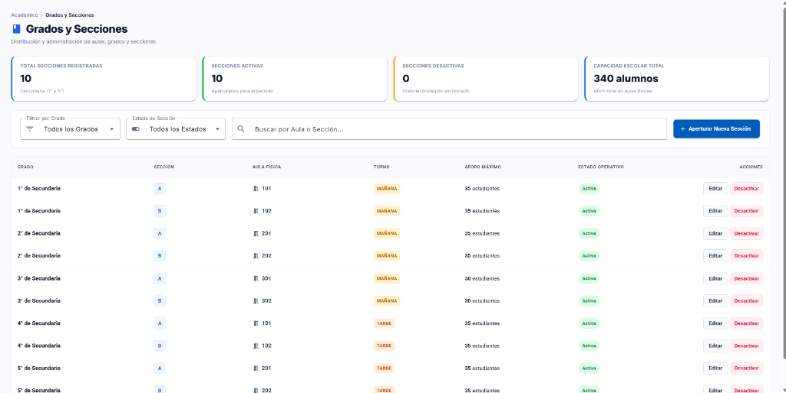
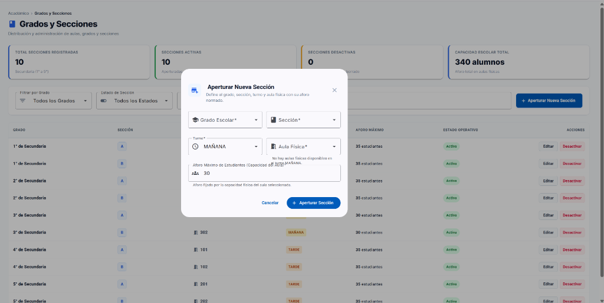
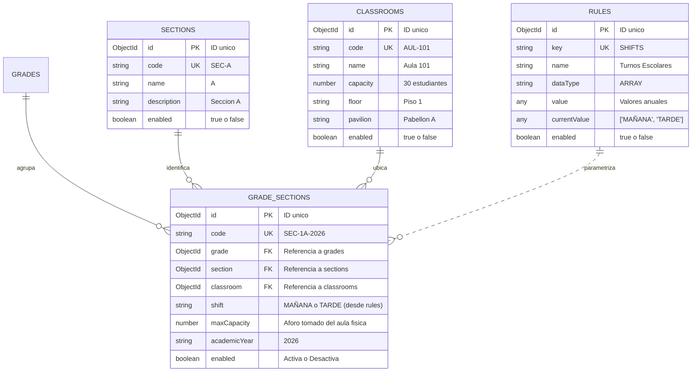

# 📗 Guía del Estudiante • Sesión 04
## Gestión de Grados y Secciones (`grades-sections`), Aulas Físicas (`classrooms`), Turnos Dinámicos (`rules`), Control de Concurrencia de Aulas, Arquitectura Container-Presenter y Signals en Angular 22 (`eduportal-web`)

> **Curso:** Desarrollo Web Frontend Profesional con Angular 22  
> **Proyecto Transversal:** EduPortal — Sistema de Gestión Escolar SaaS  
> **Rama Oficial de Trabajo:** `04-grades-sections`  
> **Frontend:** `eduportal-web` (`http://localhost:4200/grados-secciones`) • Angular 22 (Standalone & OnPush, Signals & Computeds Derivados, Angular Material, SCSS BEM)  
> **Backend de Soporte:** `eduportal-api-mongodb` (`http://localhost:3000`) • Base de Datos MongoDB: `eduportalangular`  
> **Docente Titular:** Félix Junior Chacaliaza Gutiérrez • Intevex Academy

---

## 🎯 Objetivos y Competencias de la Sesión

1. **Dominar el Patrón Container-Presenter (Smart vs. Dumb):** Comprender por qué el Componente `.ts` es el *Director de Escena* (gestor del DOM, `MatDialog` y eventos) y el Presenter `.ts` es el *Cerebro de Estado Headless* (fuente de verdad con Signals y llamadas HTTP).
2. **Filtrar Recursos Físicos con `computed()`:** Resolver en frontend la disponibilidad de aulas físicas en tiempo real: al cambiar el turno escolar en el formulario, las aulas ocupadas en ese turno desaparecen instantáneamente de las opciones seleccionables.
3. **Consumir Reglas de Negocio Dinámicas (`rules`):** Comprender por qué los valores de negocio (como los turnos lectivos `MAÑANA` y `TARDE`) no deben quemarse (*hardcodearse*) en el código, sino obtenerse desde el microservicio/colección de reglas de configuración.
4. **Optimizar con `ChangeDetectionStrategy.OnPush` y Signals:** Entender cómo Angular 22 actualiza quirúrgicamente la vista sin evaluar el árbol de componentes completo de forma innecesaria.
5. **Vincular Capacidades Físicas (Aforo Normado):** Garantizar la integridad de los datos impidiendo que el usuario digite aforos arbitrarios: la capacidad de la sección se sincroniza automáticamente con el aforo oficial del aula física elegida.
6. **Diseñar Tablas con Layout Fijo y BEM:** Aplicar `table-layout: fixed` y distribución porcentual calculada para evitar saltos visuales al cambiar de página o filtrar datos.

---

## 🖼️ Referencia Visual del Producto a Construir

Para guiar tu desarrollo paso a paso, a continuación se presentan las dos vistas oficiales que implementaremos en la sesión:

### 1. Pantalla Principal del Catálogo de Grados y Secciones (`/grados-secciones`)
Integra el encabezado de navegación académica, las 4 tarjetas KPI con contadores de salones y aforo global, la barra unificada de filtros (grado, estado, buscador predictivo y botón de apertura) y la tabla de alta densidad con `table-layout: fixed`, tags de turnos y badges operativos.



---

### 2. Diálogo Modal de Apertura y Edición de Sección
Formulario modal reactivo integrado con `MatDialog` que consume turnos autorizados desde MongoDB, excluye aulas ocupadas dinámicamente y sincroniza el aforo máximo de alumnos según la capacidad del aula física seleccionada.



---

## 🗄️ PARTE 1: Base de Datos `eduportalangular` — Colecciones de Apertura de Secciones

En esta sesión trabajaremos con **5 colecciones interconectadas** en MongoDB (`mongodb://127.0.0.1:27017/eduportalangular`):

1. **`grades` (Grados Escolares):** Del 1° al 5° de secundaria (ej. `SEC-001`).
2. **`sections` (Catálogo de Secciones):** Secciones alfabéticas disponibles (ej. `A`, `B`, `C`, `D`).
3. **`classrooms` (Aulas Físicas):** Salones reales del colegio con capacidad y ubicación (ej. `Aula 101`, capacidad 30).
4. **`rules` (Reglas del Sistema):** Parámetros institucionales dinámicos (ej. clave `SHIFTS` con los turnos autorizados para el año 2026).
5. **`grade-sections` (Apertura de Salones):** Colección relacional que une Grado + Sección + Aula Física + Turno + Año Lectivo.

### 1.1 Diagrama Entidad-Relación



---

## 📡 PARTE 2: Endpoints de `eduportal-api-mongodb`

> 🌐 **Servidor API:** `http://localhost:3000` (los endpoints responden con el prefijo `/api`)

| Módulo | Endpoint Base | Métodos Habilitados | Descripción Operativa |
| :--- | :--- | :--- | :--- |
| **Reglas del Sistema** | `/api/rules` | `GET /` • `GET /:keyOrId` | Consulta turnos autorizados para 2026 (`key: 'SHIFTS'`). |
| **Secciones** | `/api/sections` | `GET /` | Consulta catálogo de letras (`A`, `B`, `C`, `D`). |
| **Aulas Físicas** | `/api/classrooms` | `GET /` | Consulta catálogo de aulas físicas con capacidad oficial. |
| **Grados y Secciones** | `/api/grade-sections` | `GET /` • `POST /` • `PUT /:id` | Lista, apertura y edita salones escolares. |

---

## 🛠️ PARTE 3: Creación de Interfaces y Contratos en `core/api`

### 3.1 Contrato de Reglas: `rule.interface.ts`
Crea el archivo `src/app/core/api/models/interfaces/rule.interface.ts`:

```typescript
export type RuleDataType = 'STRING' | 'NUMBER' | 'BOOLEAN' | 'ARRAY' | 'ARRAY_OBJECT' | 'OBJECT';

export interface Rule {
  readonly id: string;
  readonly code: string;
  readonly key: string;
  readonly name: string;
  readonly description: string;
  readonly isAnnual: boolean;
  readonly dataType: RuleDataType;
  readonly value: any;
  readonly activeYear?: string;
  readonly currentValue?: any;
  readonly enabled: boolean;
}
```

### 3.2 Contrato de Grados y Secciones: `grade-section.interface.ts`
Crea el archivo `src/app/core/api/models/interfaces/grade-section.interface.ts`:

```typescript
import { Grade } from './grade.interface';

export interface Section {
  readonly id: string;
  readonly code: string;
  readonly name: string;
  readonly description?: string;
  readonly enabled: boolean;
}

export interface Classroom {
  readonly id: string;
  readonly code: string;
  readonly name: string;
  readonly capacity: number;
  readonly floor?: string;
  readonly pavilion?: string;
  readonly enabled: boolean;
}

export type ShiftType = 'MAÑANA' | 'TARDE' | 'NOCHE';

export interface GradeSection {
  readonly id: string;
  readonly code: string;
  readonly academicYear: string;
  readonly grade: Grade | string;
  readonly section: Section | string;
  readonly classroom?: Classroom | string;
  readonly shift: ShiftType;
  readonly maxCapacity: number;
  readonly enrolledCount: number;
  readonly enabled: boolean;
  readonly createdAt?: string;
  readonly updatedAt?: string;
}
```

### 3.3 Endpoints: `endpoints.ts`
En `src/app/core/api/endpoints.ts`, añade:

```typescript
rules: `${API_BASE_URL}/rules`,
sections: `${API_BASE_URL}/sections`,
classrooms: `${API_BASE_URL}/classrooms`,
gradeSections: `${API_BASE_URL}/grade-sections`,
```

---

## 🌐 PARTE 4: Servicios HTTP con `firstValueFrom` en `core/api`

### 4.1 Servicio de Reglas: `rule.service.ts`
Crea `src/app/core/api/services/rule.service.ts`:

```typescript
import { HttpClient, HttpParams } from '@angular/common/http';
import { Injectable, inject } from '@angular/core';
import { firstValueFrom } from 'rxjs';
import { API_ENDPOINTS } from '../endpoints';
import { ApiResponse } from '../models/interfaces/api-response.interface';
import { Rule } from '../models/interfaces/rule.interface';

@Injectable({
  providedIn: 'root',
})
export class RuleService {
  private readonly http = inject(HttpClient);
  private readonly endpoint = API_ENDPOINTS.rules;

  public async getRules(year?: string): Promise<Rule[]> {
    let params = new HttpParams();
    if (year) params = params.set('year', year);
    const res = await firstValueFrom(this.http.get<ApiResponse<Rule[]>>(this.endpoint, { params }));
    return res.data;
  }

  public async getRuleByKeyOrId(keyOrId: string, year?: string): Promise<Rule> {
    let params = new HttpParams();
    if (year) params = params.set('year', year);
    const res = await firstValueFrom(this.http.get<ApiResponse<Rule>>(`${this.endpoint}/${keyOrId}`, { params }));
    return res.data;
  }

  public async getShifts(year: string = '2026'): Promise<string[]> {
    try {
      const rule = await this.getRuleByKeyOrId('SHIFTS', year);
      if (Array.isArray(rule.currentValue)) return rule.currentValue;
      if (Array.isArray(rule.value)) {
        const item = rule.value.find((v: any) => String(v.year) === String(year));
        if (item && Array.isArray(item.value)) return item.value;
      }
      return ['MAÑANA', 'TARDE'];
    } catch {
      return ['MAÑANA', 'TARDE'];
    }
  }
}
```

### 4.2 Servicio de Grados-Secciones: `grade-section.service.ts`
Crea `src/app/core/api/services/grade-section.service.ts`:

```typescript
import { HttpClient } from '@angular/common/http';
import { Injectable, inject } from '@angular/core';
import { firstValueFrom } from 'rxjs';
import { API_ENDPOINTS } from '../endpoints';
import { GradeSection, Section, Classroom } from '../models/interfaces/grade-section.interface';
import { ApiResponse } from '../models/interfaces/api-response.interface';

@Injectable({
  providedIn: 'root',
})
export class GradeSectionService {
  private readonly http = inject(HttpClient);

  public async getGradeSections(params?: { academicYear?: string; grade?: string; enabled?: boolean }): Promise<GradeSection[]> {
    const res = await firstValueFrom(
      this.http.get<ApiResponse<GradeSection[]> | GradeSection[]>(API_ENDPOINTS.gradeSections, { params: params as any })
    );
    return Array.isArray(res) ? res : res.data;
  }

  public async getSections(): Promise<Section[]> {
    const res = await firstValueFrom(this.http.get<ApiResponse<Section[]> | Section[]>(API_ENDPOINTS.sections));
    return Array.isArray(res) ? res : res.data;
  }

  public async getClassrooms(): Promise<Classroom[]> {
    const res = await firstValueFrom(this.http.get<ApiResponse<Classroom[]> | Classroom[]>(API_ENDPOINTS.classrooms));
    return Array.isArray(res) ? res : res.data;
  }

  public async createGradeSection(payload: Partial<GradeSection>): Promise<GradeSection> {
    const res = await firstValueFrom(this.http.post<ApiResponse<GradeSection> | GradeSection>(API_ENDPOINTS.gradeSections, payload));
    return (res as ApiResponse<GradeSection>).data || (res as GradeSection);
  }

  public async updateGradeSection(id: string, payload: Partial<GradeSection>): Promise<GradeSection> {
    const res = await firstValueFrom(this.http.put<ApiResponse<GradeSection> | GradeSection>(`${API_ENDPOINTS.gradeSections}/${id}`, payload));
    return (res as ApiResponse<GradeSection>).data || (res as GradeSection);
  }

  public async deleteGradeSection(id: string): Promise<void> {
    await firstValueFrom(this.http.delete(`${API_ENDPOINTS.gradeSections}/${id}`));
  }
}
```

### 4.3 Barrel Export: `core/api/index.ts`
Actualiza `src/app/core/api/index.ts`:

```typescript
export * from './models/interfaces/rule.interface';
export * from './models/interfaces/grade-section.interface';
export * from './services/rule.service';
export * from './services/grade-section.service';
```

---

## 🏛️ PARTE 5: Modelos de Vista del Módulo

### 5.1 `grade-section-item.interface.ts`
Crea `src/app/features/academic/grades-sections/models/interfaces/grade-section-item.interface.ts`:

```typescript
export interface GradeSectionItem {
  readonly id: string;
  readonly code: string;
  readonly gradeId: string;
  readonly gradeName: string;
  readonly sectionId: string;
  readonly sectionName: string;
  readonly classroomId?: string;
  readonly classroomName: string;
  readonly shift: string;
  readonly maxCapacity: number;
  readonly status: 'Activa' | 'Desactiva';
}
```

### 5.2 `grades-sections-filter-state.interface.ts`
Crea `src/app/features/academic/grades-sections/models/interfaces/grades-sections-filter-state.interface.ts`:

```typescript
export interface GradesSectionsFilterState {
  readonly gradeId: string;
  readonly status: 'ALL' | 'ACTIVE' | 'INACTIVE';
  readonly search: string;
}
```

---

## 🧠 PARTE 6: Presentador Maestro `GradesSectionsPresenter`

Crea `src/app/features/academic/grades-sections/grades-sections.presenter.ts`:

```typescript
import { Injectable, computed, inject, signal } from '@angular/core';
import { InfoCardData } from '../../../shared/components/info-card/info-card.component';
import { Grade, GradeSection, GradeSectionService, GradeService } from '../../../core/api';
import { GradeSectionItem } from './models/interfaces/grade-section-item.interface';
import { GradesSectionsFilterState } from './models/interfaces/grades-sections-filter-state.interface';

@Injectable()
export class GradesSectionsPresenter {
  private readonly gradeSectionService = inject(GradeSectionService);
  private readonly gradeService = inject(GradeService);

  public readonly gradeSections = signal<readonly GradeSectionItem[]>([]);
  public readonly grades = signal<readonly Grade[]>([]);
  public readonly filterState = signal<GradesSectionsFilterState>({
    gradeId: 'ALL',
    status: 'ALL',
    search: '',
  });

  public readonly isLoading = signal<boolean>(false);

  constructor() {
    this.init();
  }

  public async init(): Promise<void> {
    this.isLoading.set(true);
    await Promise.all([this.loadGrades(), this.loadGradeSections()]);
    this.isLoading.set(false);
  }

  public async loadGrades(): Promise<void> {
    try {
      const grades = await this.gradeService.getGrades();
      this.grades.set(grades.filter(g => g.enabled));
    } catch (e) {
      console.error(e);
    }
  }

  public async loadGradeSections(): Promise<void> {
    try {
      const data = await this.gradeSectionService.getGradeSections({ academicYear: '2026' });
      this.gradeSections.set(data.map(item => this.mapGradeSectionToItem(item)));
    } catch (e) {
      console.error(e);
    }
  }

  public readonly filteredSections = computed<readonly GradeSectionItem[]>(() => {
    const list = this.gradeSections();
    const { gradeId, status, search } = this.filterState();
    const query = search.trim().toLowerCase();

    return list.filter(item => {
      const matchGrade = gradeId === 'ALL' || item.gradeId === gradeId;
      const matchStatus =
        status === 'ALL' ||
        (status === 'ACTIVE' && item.status === 'Activa') ||
        (status === 'INACTIVE' && item.status === 'Desactiva');

      const matchSearch =
        !query ||
        item.sectionName.toLowerCase().includes(query) ||
        item.classroomName.toLowerCase().includes(query) ||
        item.gradeName.toLowerCase().includes(query);

      return matchGrade && matchStatus && matchSearch;
    });
  });

  public readonly cards = computed<readonly InfoCardData[]>(() => {
    const all = this.gradeSections();
    const active = all.filter(s => s.status === 'Activa');
    const inactive = all.filter(s => s.status !== 'Activa');
    const totalCapacity = all.reduce((acc, curr) => acc + curr.maxCapacity, 0);

    return [
      { label: 'Total Secciones Registradas', value: all.length, subtitle: 'Secundaria (1° a 5°)', color: 'blue' },
      { label: 'Secciones Activas', value: active.length, subtitle: 'Aperturadas para el periodo', color: 'green' },
      { label: 'Secciones Desactivas', value: inactive.length, subtitle: 'Historial protegido sin borrado', color: 'amber' },
      { label: 'Capacidad Escolar Total', value: `${totalCapacity} alumnos`, subtitle: 'Aforo total en aulas físicas', color: 'blue' },
    ];
  });

  public applyFilters(state: GradesSectionsFilterState): void {
    this.filterState.set(state);
  }

  public async toggleSectionStatus(id: string): Promise<void> {
    const target = this.gradeSections().find(s => s.id === id);
    if (!target) return;

    const previousStatus = target.status;
    const newStatus = previousStatus === 'Activa' ? 'Desactiva' : 'Activa';

    this.gradeSections.update(list => list.map(s => (s.id === id ? { ...s, status: newStatus } : s)));

    try {
      await this.gradeSectionService.updateGradeSection(id, { enabled: newStatus === 'Activa' });
    } catch {
      this.gradeSections.update(list => list.map(s => (s.id === id ? { ...s, status: previousStatus } : s)));
    }
  }

  private mapGradeSectionToItem(item: GradeSection): GradeSectionItem {
    const gradeObj = typeof item.grade === 'object' ? item.grade : null;
    const sectionObj = typeof item.section === 'object' ? item.section : null;
    const classroomObj = typeof item.classroom === 'object' ? item.classroom : null;

    return {
      id: item.id || (item as any)._id,
      code: item.code,
      gradeId: gradeObj?.id || (item.grade as any)?._id || (item.grade as string),
      gradeName: gradeObj?.description || (gradeObj?.name ? `${gradeObj.name}° Secundaria` : 'Secundaria'),
      sectionId: sectionObj?.id || (item.section as any)?._id || (item.section as string),
      sectionName: sectionObj?.name || 'Sección',
      classroomId: classroomObj?.id || (item.classroom as any)?._id || (typeof item.classroom === 'string' ? item.classroom : ''),
      classroomName: classroomObj?.name || 'Sin Aula Asignada',
      shift: item.shift || 'MAÑANA',
      maxCapacity: classroomObj?.capacity ?? item.maxCapacity ?? 30,
      status: item.enabled ? 'Activa' : 'Desactiva',
    };
  }
}
```

---

## 🧩 PARTE 7: Componentes Dumb (`cards`, `filters`, `table`)

### 7.1 Componente `grades-sections-cards`
En `src/app/features/academic/grades-sections/components/grades-sections-cards/`:

`grades-sections-cards.component.ts`:
```typescript
import { ChangeDetectionStrategy, Component, input } from '@angular/core';
import { InfoCardComponent, InfoCardData } from '../../../../../shared/components/info-card/info-card.component';

@Component({
  selector: 'app-grades-sections-cards',
  imports: [InfoCardComponent],
  templateUrl: './grades-sections-cards.component.html',
  styleUrl: './grades-sections-cards.component.scss',
  changeDetection: ChangeDetectionStrategy.OnPush,
})
export class GradesSectionsCardsComponent {
  public readonly cards = input.required<readonly InfoCardData[]>();
}
```

`grades-sections-cards.component.html`:
```html
<div class="grades-sections-cards">
  @for (card of cards(); track card.label) {
    <app-info-card [data]="card" />
  }
</div>
```

`grades-sections-cards.component.scss`:
```scss
.grades-sections-cards {
  display: grid;
  grid-template-columns: repeat(auto-fit, minmax(200px, 1fr));
  gap: 1rem;
  margin-bottom: 1.5rem;
}
```

### 7.2 Componente `grades-sections-filters`
En `src/app/features/academic/grades-sections/components/grades-sections-filters/`:

`grades-sections-filters.component.ts`:
```typescript
import { ChangeDetectionStrategy, Component, input, output } from '@angular/core';
import { FormsModule } from '@angular/forms';
import { MatFormFieldModule } from '@angular/material/form-field';
import { MatSelectModule } from '@angular/material/select';
import { MatInputModule } from '@angular/material/input';
import { MatButtonModule } from '@angular/material/button';
import { MatIconModule } from '@angular/material/icon';
import { Grade } from '../../../../../core/api';
import { GradesSectionsFilterState } from '../../models/interfaces/grades-sections-filter-state.interface';

@Component({
  selector: 'app-grades-sections-filters',
  imports: [
    FormsModule,
    MatFormFieldModule,
    MatSelectModule,
    MatInputModule,
    MatButtonModule,
    MatIconModule,
  ],
  templateUrl: './grades-sections-filters.component.html',
  styleUrl: './grades-sections-filters.component.scss',
  changeDetection: ChangeDetectionStrategy.OnPush,
})
export class GradesSectionsFiltersComponent {
  public readonly grades = input.required<readonly Grade[]>();
  public readonly filterState = input.required<GradesSectionsFilterState>();

  public readonly filterChange = output<GradesSectionsFilterState>();
  public readonly create = output<void>();

  public onGradeChange(gradeId: string): void {
    this.filterChange.emit({ ...this.filterState(), gradeId });
  }

  public onStatusChange(status: 'ALL' | 'ACTIVE' | 'INACTIVE'): void {
    this.filterChange.emit({ ...this.filterState(), status });
  }

  public onSearchChange(search: string): void {
    this.filterChange.emit({ ...this.filterState(), search });
  }
}
```

`grades-sections-filters.component.html`:
```html
<div class="grades-sections-filters">
  <div class="grades-sections-filters__controls">
    <mat-form-field appearance="outline" class="grades-sections-filters__field">
      <mat-label>Filtrar por Grado</mat-label>
      <mat-icon matPrefix>filter_list</mat-icon>
      <mat-select [ngModel]="filterState().gradeId" (ngModelChange)="onGradeChange($event)">
        <mat-option value="ALL">Todos los Grados</mat-option>
        @for (grade of grades(); track grade.id) {
          <mat-option [value]="grade.id">{{ grade.description || (grade.name + '° Secundaria') }}</mat-option>
        }
      </mat-select>
    </mat-form-field>

    <mat-form-field appearance="outline" class="grades-sections-filters__field">
      <mat-label>Estado de Sección</mat-label>
      <mat-icon matPrefix>toggle_on</mat-icon>
      <mat-select [ngModel]="filterState().status" (ngModelChange)="onStatusChange($event)">
        <mat-option value="ALL">Todos los Estados</mat-option>
        <mat-option value="ACTIVE">Solo Activas</mat-option>
        <mat-option value="INACTIVE">Solo Desactivas</mat-option>
      </mat-select>
    </mat-form-field>

    <mat-form-field appearance="outline" class="grades-sections-filters__field grades-sections-filters__field--search">
      <mat-label>Buscar por Aula o Sección...</mat-label>
      <mat-icon matPrefix>search</mat-icon>
      <input
        matInput
        type="text"
        placeholder="Ej. Aula 101, Sección A..."
        [ngModel]="filterState().search"
        (ngModelChange)="onSearchChange($event)"
      />
    </mat-form-field>
  </div>

  <div class="grades-sections-filters__action">
    <button mat-flat-button color="primary" class="grades-sections-filters__create-btn" (click)="create.emit()">
      <mat-icon>add</mat-icon>
      Aperturar Nueva Sección
    </button>
  </div>
</div>
```

`grades-sections-filters.component.scss`:
```scss
.grades-sections-filters {
  display: flex;
  flex-wrap: wrap;
  align-items: center;
  justify-content: space-between;
  gap: 1rem;
  background-color: #ffffff;
  padding: 1.25rem 1.5rem;
  border-radius: 12px;
  border: 1px solid #e2e8f0;
  margin-bottom: 1.5rem;

  &__controls {
    display: flex;
    flex-wrap: wrap;
    align-items: center;
    gap: 1rem;
    flex: 1;
  }

  &__field {
    min-width: 200px;
    margin-bottom: -1.25em;

    &--search {
      flex: 1;
      min-width: 250px;
    }
  }

  &__action {
    display: flex;
    align-items: center;
  }

  &__create-btn {
    height: 48px;
    padding: 0 1.5rem;
    font-weight: 600;
    font-size: 0.875rem;
    border-radius: 8px;
  }
}
```

### 7.3 Componente `grades-sections-table`
En `src/app/features/academic/grades-sections/components/grades-sections-table/`:

`grades-sections-table.component.ts`:
```typescript
import { ChangeDetectionStrategy, Component, input, output } from '@angular/core';
import { CommonModule } from '@angular/common';
import { MatTableModule } from '@angular/material/table';
import { MatButtonModule } from '@angular/material/button';
import { MatIconModule } from '@angular/material/icon';
import { GradeSectionItem } from '../../models/interfaces/grade-section-item.interface';

@Component({
  selector: 'app-grades-sections-table',
  imports: [
    CommonModule,
    MatTableModule,
    MatButtonModule,
    MatIconModule,
  ],
  templateUrl: './grades-sections-table.component.html',
  styleUrl: './grades-sections-table.component.scss',
  changeDetection: ChangeDetectionStrategy.OnPush,
})
export class GradesSectionsTableComponent {
  public readonly sections = input.required<readonly GradeSectionItem[]>();
  public readonly toggleStatus = output<string>();
  public readonly edit = output<GradeSectionItem>();

  public readonly displayedColumns: readonly string[] = [
    'grade',
    'section',
    'classroom',
    'shift',
    'capacity',
    'status',
    'actions',
  ];
}
```

`grades-sections-table.component.html`:
```html
<div class="grades-sections-table mat-elevation-z1">
  <table mat-table [dataSource]="sections()" class="grades-sections-table__table">
    <!-- Grado -->
    <ng-container matColumnDef="grade">
      <th mat-header-cell *matHeaderCellDef class="grades-sections-table__header-cell grades-sections-table__header-cell--grade">GRADO</th>
      <td mat-cell *matCellDef="let item" class="grades-sections-table__cell"><strong class="grades-sections-table__grade-title">{{ item.gradeName }}</strong></td>
    </ng-container>

    <!-- Sección -->
    <ng-container matColumnDef="section">
      <th mat-header-cell *matHeaderCellDef class="grades-sections-table__header-cell grades-sections-table__header-cell--section">SECCIÓN</th>
      <td mat-cell *matCellDef="let item" class="grades-sections-table__cell"><span class="grades-sections-table__section-badge">{{ item.sectionName }}</span></td>
    </ng-container>

    <!-- Aula -->
    <ng-container matColumnDef="classroom">
      <th mat-header-cell *matHeaderCellDef class="grades-sections-table__header-cell grades-sections-table__header-cell--classroom">AULA FÍSICA</th>
      <td mat-cell *matCellDef="let item" class="grades-sections-table__cell">
        <div class="grades-sections-table__classroom">
          <mat-icon class="grades-sections-table__classroom-icon">meeting_room</mat-icon>
          <span>{{ item.classroomName }}</span>
        </div>
      </td>
    </ng-container>

    <!-- Turno -->
    <ng-container matColumnDef="shift">
      <th mat-header-cell *matHeaderCellDef class="grades-sections-table__header-cell grades-sections-table__header-cell--shift">TURNO</th>
      <td mat-cell *matCellDef="let item" class="grades-sections-table__cell">
        <span class="grades-sections-table__shift-tag" [class.grades-sections-table__shift-tag--morning]="item.shift === 'MAÑANA'" [class.grades-sections-table__shift-tag--afternoon]="item.shift === 'TARDE'">
          {{ item.shift }}
        </span>
      </td>
    </ng-container>

    <!-- Aforo -->
    <ng-container matColumnDef="capacity">
      <th mat-header-cell *matHeaderCellDef class="grades-sections-table__header-cell grades-sections-table__header-cell--capacity">AFORO MÁXIMO</th>
      <td mat-cell *matCellDef="let item" class="grades-sections-table__cell">
        <span class="grades-sections-table__capacity-tag"><strong>{{ item.maxCapacity }}</strong> estudiantes</span>
      </td>
    </ng-container>

    <!-- Estado -->
    <ng-container matColumnDef="status">
      <th mat-header-cell *matHeaderCellDef class="grades-sections-table__header-cell grades-sections-table__header-cell--status">ESTADO</th>
      <td mat-cell *matCellDef="let item" class="grades-sections-table__cell">
        <span class="grades-sections-table__status-badge" [class.grades-sections-table__status-badge--active]="item.status === 'Activa'" [class.grades-sections-table__status-badge--inactive]="item.status !== 'Activa'">
          {{ item.status }}
        </span>
      </td>
    </ng-container>

    <!-- Acciones -->
    <ng-container matColumnDef="actions">
      <th mat-header-cell *matHeaderCellDef class="grades-sections-table__header-cell grades-sections-table__header-cell--actions">ACCIONES</th>
      <td mat-cell *matCellDef="let item" class="grades-sections-table__cell grades-sections-table__cell--actions">
        <div class="grades-sections-table__actions">
          <button mat-stroked-button class="grades-sections-table__action-btn grades-sections-table__action-btn--edit" (click)="edit.emit(item)">Editar</button>
          <button mat-stroked-button class="grades-sections-table__action-btn" [class.grades-sections-table__action-btn--deactivate]="item.status === 'Activa'" [class.grades-sections-table__action-btn--reactivate]="item.status !== 'Activa'" (click)="toggleStatus.emit(item.id)">
            {{ item.status === 'Activa' ? 'Desactivar' : 'Activar' }}
          </button>
        </div>
      </td>
    </ng-container>

    <tr mat-header-row *matHeaderRowDef="displayedColumns" class="grades-sections-table__header-row"></tr>
    <tr mat-row *matRowDef="let row; columns: displayedColumns" class="grades-sections-table__row" [class.grades-sections-table__row--inactive]="row.status !== 'Activa'"></tr>
    <tr class="mat-row" *matNoDataRow>
      <td class="mat-cell grades-sections-table__empty-cell" [attr.colspan]="displayedColumns.length">
        No se encontraron secciones registradas o coincidentes con los filtros aplicados.
      </td>
    </tr>
  </table>
</div>
```

`grades-sections-table.component.scss`:
```scss
:host {
  display: block;
  width: 100%;
}

.grades-sections-table {
  width: 100%;
  border-radius: 12px;
  overflow-x: auto;
  background: #ffffff;
  border: 1px solid #e2e8f0;
  margin-bottom: 24px;

  &__table {
    width: 100%;
    min-width: 900px;
    border-collapse: collapse;
    table-layout: fixed;
    background: transparent;
  }

  &__header-row {
    background-color: #f8fafc;
    height: 52px;
  }

  &__header-cell {
    font-size: 0.72rem;
    font-weight: 700;
    color: #475569;
    letter-spacing: 0.05em;
    padding: 14px 16px;
    border-bottom: 1px solid #e2e8f0;
    white-space: nowrap;
    text-transform: uppercase;

    &--grade { width: 18%; }
    &--section { width: 13%; }
    &--classroom { width: 16%; }
    &--shift { width: 12%; }
    &--capacity { width: 15%; }
    &--status { width: 12%; }
    &--actions { width: 14%; min-width: 170px; text-align: right; }
  }

  &__row {
    height: 58px;
    transition: background-color 0.15s ease;
    &:hover { background-color: #f8fafc; }
    &--inactive { opacity: 0.65; background-color: #fcfcfc; }
  }

  &__cell {
    padding: 12px 16px;
    font-size: 0.875rem;
    color: #1e293b;
    border-bottom: 1px solid #f1f5f9;
    vertical-align: middle;
  }

  &__section-badge {
    padding: 4px 10px;
    border-radius: 6px;
    font-weight: 600;
    color: #2563eb;
    background-color: #eff6ff;
    border: 1px solid #bfdbfe;
  }

  &__status-badge {
    padding: 4px 10px;
    border-radius: 9999px;
    font-size: 0.75rem;
    font-weight: 700;
    &--active { background: #dcfce7; color: #15803d; }
    &--inactive { background: #fef3c7; color: #b45309; }
  }

  &__actions {
    display: flex;
    align-items: center;
    justify-content: flex-end;
    gap: 6px;
  }
}
```

---

## 🪟 PARTE 8: Modal y Sub-Presenter (`grades-sections-save-dialog`)

En `src/app/features/academic/grades-sections/dialogs/grades-sections-save-dialog/`:

### 8.1 Contratos: `models/interfaces/grades-sections-save-dialog.interface.ts`
```typescript
import { GradeSectionItem } from '../../../../models/interfaces/grade-section-item.interface';

export interface GradesSectionsSaveDialogData {
  readonly mode: 'create' | 'edit';
  readonly gradeSection?: {
    readonly id: string;
    readonly gradeId: string;
    readonly sectionId: string;
    readonly classroomId?: string;
    readonly shift: string;
    readonly maxCapacity: number;
    readonly enabled: boolean;
  };
  readonly existingSections?: readonly GradeSectionItem[];
}

export interface GradesSectionsSavePayload {
  readonly grade: string;
  readonly section: string;
  readonly classroom?: string;
  readonly shift: string;
  readonly maxCapacity: number;
  readonly academicYear?: string;
  readonly enabled?: boolean;
}
```

### 8.2 Sub-Presenter: `grades-sections-save-dialog.presenter.ts`
```typescript
import { Injectable, computed, inject, signal } from '@angular/core';
import { MAT_DIALOG_DATA, MatDialogRef } from '@angular/material/dialog';
import { Classroom, Grade, GradeSectionService, GradeService, RuleService, Section } from '../../../../../core/api';
import { GradesSectionsSaveDialogData, GradesSectionsSavePayload } from './models/interfaces/grades-sections-save-dialog.interface';

@Injectable()
export class GradesSectionsSaveDialogPresenter {
  private readonly dialogRef = inject(MatDialogRef<any>);
  public readonly data = inject<GradesSectionsSaveDialogData>(MAT_DIALOG_DATA);
  private readonly gradeSectionService = inject(GradeSectionService);
  private readonly gradeService = inject(GradeService);
  private readonly ruleService = inject(RuleService);

  public readonly grades = signal<readonly Grade[]>([]);
  public readonly sections = signal<readonly Section[]>([]);
  public readonly rawClassrooms = signal<readonly Classroom[]>([]);
  public readonly shifts = signal<readonly string[]>(['MAÑANA', 'TARDE']);

  public readonly selectedShift = signal<string>(this.data.gradeSection?.shift || 'MAÑANA');
  public readonly isSaving = signal<boolean>(false);
  public readonly isLoadingCatalog = signal<boolean>(false);
  public readonly errorMessage = signal<string | null>(null);

  public readonly availableClassrooms = computed<readonly Classroom[]>(() => {
    const classrooms = this.rawClassrooms();
    const currentShift = (this.selectedShift() || '').trim().toUpperCase();
    const existing = this.data.existingSections || [];
    const editingId = this.data.gradeSection?.id;

    const occupiedIds = new Set<string>();
    const occupiedNames = new Set<string>();

    for (const s of existing) {
      if (s.id !== editingId && s.status === 'Activa' && (s.shift || '').trim().toUpperCase() === currentShift) {
        if (s.classroomId) occupiedIds.add(String(s.classroomId));
        if (s.classroomName && s.classroomName !== 'Sin Aula Asignada') occupiedNames.add(s.classroomName.trim().toLowerCase());
      }
    }

    return classrooms.filter(c => {
      const id = String(c.id || (c as any)._id || '');
      const name = (c.name || '').trim().toLowerCase();
      return !occupiedIds.has(id) && !occupiedNames.has(name);
    });
  });

  constructor() {
    this.loadCatalogs();
  }

  public setShift(shift: string): void {
    this.selectedShift.set(shift);
  }

  public async loadCatalogs(): Promise<void> {
    this.isLoadingCatalog.set(true);
    try {
      const [grades, sections, classrooms, shifts] = await Promise.all([
        this.gradeService.getGrades(),
        this.gradeSectionService.getSections(),
        this.gradeSectionService.getClassrooms(),
        this.ruleService.getShifts('2026'),
      ]);
      this.grades.set(grades.filter(g => g.enabled));
      this.sections.set(sections.filter(s => s.enabled));
      this.rawClassrooms.set(classrooms.filter(c => c.enabled));
      if (shifts?.length) {
        this.shifts.set(shifts);
        if (!shifts.includes(this.selectedShift())) this.selectedShift.set(shifts[0]);
      }
    } catch {
      this.errorMessage.set('Error al cargar catálogos.');
    } finally {
      this.isLoadingCatalog.set(false);
    }
  }

  public async save(payload: GradesSectionsSavePayload): Promise<void> {
    if (this.isSaving()) return;
    this.isSaving.set(true);
    this.errorMessage.set(null);

    try {
      if (this.data.mode === 'create') {
        await this.gradeSectionService.createGradeSection({ ...payload, academicYear: '2026', enabled: true } as any);
      } else if (this.data.gradeSection?.id) {
        await this.gradeSectionService.updateGradeSection(this.data.gradeSection.id, payload as any);
      }
      this.dialogRef.close(true);
    } catch (error: any) {
      this.errorMessage.set(error?.error?.message || 'Error al guardar.');
    } finally {
      this.isSaving.set(false);
    }
  }

  public close(): void {
    this.dialogRef.close(false);
  }
}
```

### 8.3 Componente: `grades-sections-save-dialog.component.ts`
```typescript
import { Component, OnInit, inject } from '@angular/core';
import { CommonModule } from '@angular/common';
import { FormBuilder, FormGroup, ReactiveFormsModule, Validators } from '@angular/forms';
import { MatDialogModule } from '@angular/material/dialog';
import { MatButtonModule } from '@angular/material/button';
import { MatFormFieldModule } from '@angular/material/form-field';
import { MatSelectModule } from '@angular/material/select';
import { MatInputModule } from '@angular/material/input';
import { MatIconModule } from '@angular/material/icon';
import { MatProgressBarModule } from '@angular/material/progress-bar';
import { GradesSectionsSaveDialogPresenter } from './grades-sections-save-dialog.presenter';

@Component({
  selector: 'app-grades-sections-save-dialog',
  imports: [
    CommonModule,
    ReactiveFormsModule,
    MatDialogModule,
    MatButtonModule,
    MatFormFieldModule,
    MatSelectModule,
    MatInputModule,
    MatIconModule,
    MatProgressBarModule,
  ],
  providers: [GradesSectionsSaveDialogPresenter],
  templateUrl: './grades-sections-save-dialog.component.html',
  styleUrl: './grades-sections-save-dialog.component.scss',
})
export class GradesSectionsSaveDialogComponent implements OnInit {
  public readonly presenter = inject(GradesSectionsSaveDialogPresenter);
  private readonly fb = inject(FormBuilder);

  public readonly form: FormGroup = this.fb.group({
    grade: [this.presenter.data.gradeSection?.gradeId || '', [Validators.required]],
    section: [this.presenter.data.gradeSection?.sectionId || '', [Validators.required]],
    classroom: [this.presenter.data.gradeSection?.classroomId || '', [Validators.required]],
    shift: [this.presenter.data.gradeSection?.shift || 'MAÑANA', [Validators.required]],
    maxCapacity: [{ value: this.presenter.data.gradeSection?.maxCapacity || 30, disabled: false }, [Validators.required, Validators.min(1)]],
  });

  public ngOnInit(): void {
    this.form.get('shift')?.valueChanges.subscribe((shift: string) => {
      this.presenter.setShift(shift);
      const currentClassroomId = this.form.get('classroom')?.value;
      if (currentClassroomId) {
        const isStillAvailable = this.presenter.availableClassrooms().some(c => (c.id || (c as any)._id) === currentClassroomId);
        if (!isStillAvailable) {
          this.form.get('classroom')?.setValue('');
          this.form.get('maxCapacity')?.setValue(0);
        }
      }
    });

    this.form.get('classroom')?.valueChanges.subscribe((classroomId: string) => {
      if (classroomId) {
        const selected = this.presenter.rawClassrooms().find(c => (c.id || (c as any)._id) === classroomId);
        if (selected) {
          this.form.get('maxCapacity')?.setValue(selected.capacity);
        }
      } else {
        this.form.get('maxCapacity')?.setValue(0);
      }
    });
  }

  public onSubmit(): void {
    if (this.form.invalid) {
      this.form.markAllAsTouched();
      return;
    }
    this.presenter.save(this.form.getRawValue());
  }
}
```

---

## 🎮 PARTE 9: Smart Container `GradesSectionsComponent` y Rutas

En `src/app/features/academic/grades-sections/`:

### 9.1 `grades-sections.component.ts`
```typescript
import { Component, inject } from '@angular/core';
import { CommonModule } from '@angular/common';
import { MatProgressSpinnerModule } from '@angular/material/progress-spinner';
import { MatDialog } from '@angular/material/dialog';
import { GradesSectionsPresenter } from './grades-sections.presenter';
import { GradesSectionsCardsComponent } from './components/grades-sections-cards/grades-sections-cards.component';
import { GradesSectionsFiltersComponent } from './components/grades-sections-filters/grades-sections-filters.component';
import { GradesSectionsTableComponent } from './components/grades-sections-table/grades-sections-table.component';
import { GradesSectionsFilterState } from './models/interfaces/grades-sections-filter-state.interface';
import { GradeSectionItem } from './models/interfaces/grade-section-item.interface';
import { GradesSectionsSaveDialogComponent } from './dialogs/grades-sections-save-dialog/grades-sections-save-dialog.component';
import { GradesSectionsSaveDialogData } from './dialogs/grades-sections-save-dialog/models/interfaces/grades-sections-save-dialog.interface';

@Component({
  selector: 'app-grades-sections',
  imports: [
    CommonModule,
    MatProgressSpinnerModule,
    GradesSectionsCardsComponent,
    GradesSectionsFiltersComponent,
    GradesSectionsTableComponent,
  ],
  providers: [GradesSectionsPresenter],
  templateUrl: './grades-sections.component.html',
  styleUrl: './grades-sections.component.scss',
})
export class GradesSectionsComponent {
  private readonly presenter = inject(GradesSectionsPresenter);
  private readonly dialog = inject(MatDialog);

  public readonly cards = this.presenter.cards;
  public readonly grades = this.presenter.grades;
  public readonly filterState = this.presenter.filterState;
  public readonly filteredSections = this.presenter.filteredSections;
  public readonly isLoading = this.presenter.isLoading;

  public onFilterChange(filters: GradesSectionsFilterState): void {
    this.presenter.applyFilters(filters);
  }

  public onCreateSection(): void {
    this.openSaveDialog();
  }

  public onEditSection(item: GradeSectionItem): void {
    this.openSaveDialog(item);
  }

  public onToggleStatus(id: string): void {
    this.presenter.toggleSectionStatus(id);
  }

  private openSaveDialog(item?: GradeSectionItem): void {
    const data: GradesSectionsSaveDialogData = {
      mode: item ? 'edit' : 'create',
      gradeSection: item ? { ...item, enabled: item.status === 'Activa' } : undefined,
      existingSections: this.presenter.gradeSections(),
    };

    const dialogRef = this.dialog.open(GradesSectionsSaveDialogComponent, {
      width: '560px',
      data,
      disableClose: true,
    });

    dialogRef.afterClosed().subscribe((saved: boolean) => {
      if (saved) {
        this.presenter.loadGradeSections();
      }
    });
  }
}
```

### 9.2 Rutas en `academic.routes.ts`
```typescript
{
  path: 'grados-secciones',
  loadComponent: () =>
    import('./grades-sections/grades-sections.component').then(m => m.GradesSectionsComponent),
},
```

---

## 🏁 PARTE 10: Verificación Final en el Navegador

1. Ingresa a `http://localhost:4200/grados-secciones`.
2. Comprueba que las 4 tarjetas KPI superiores sumen correctamente la capacidad total en alumnos.
3. Prueba el filtro por grado escolar y el buscador por texto.
4. Pulsa en `+ Aperturar Nueva Sección`:
   - Verifica que los turnos disponibles sean únicamente **MAÑANA** y **TARDE**.
   - Cambia de turno y observa cómo las aulas ocupadas se excluyen automáticamente.
   - Selecciona un aula física y comprueba que su capacidad se copie en el campo de aforo máximo.
5. Haz clic en "Desactivar/Activar" en la tabla y observa la respuesta instantánea en pantalla.
