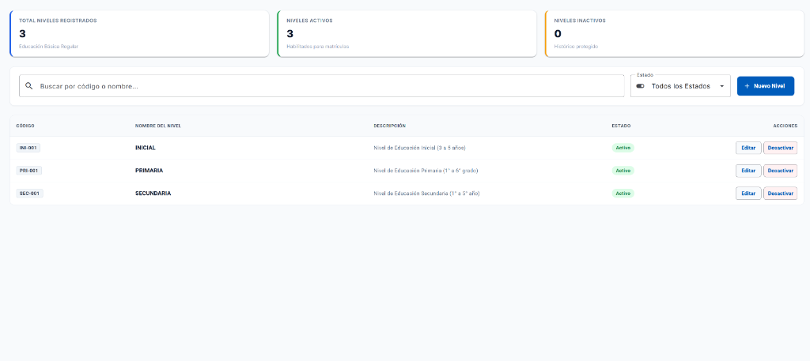
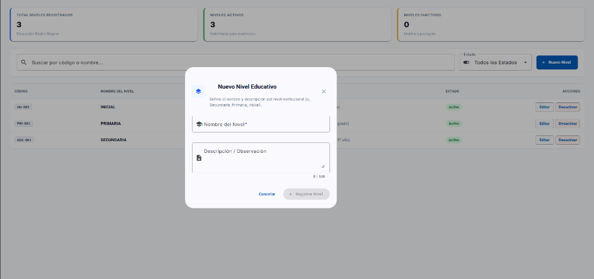
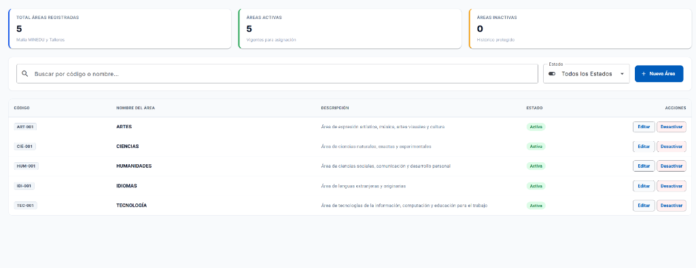
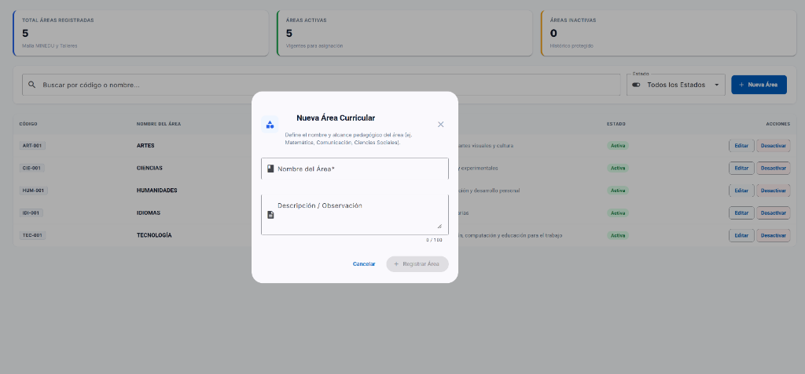

# 🎓 Guía del Estudiante • Sesión 04.1
## Mantenimiento de Tablas Maestras Escolares: Niveles Educativos (`levels`) y Áreas Curriculares (`areas`) en un Feature Modular (`maintenance`) con Lazy Loading, Patrón Container-Presenter, Switch Optimista con Rollback y Modales Reactivos (`eduportal-web`)

> **Curso:** Desarrollo Web Frontend Profesional con Angular 22  
> **Proyecto Transversal:** EduPortal — Sistema de Gestión Escolar SaaS  
> **Duración Oficial:** 3 Horas (180 Minutos)  
> **Rama Oficial de Trabajo:** `04.1-maintenance`  
> **Frontend:** `eduportal-web` (`http://localhost:4200/niveles` y `http://localhost:4200/areas`) • Angular 22 (Standalone & OnPush, Signals & Computeds Derivados, Angular Material, SCSS BEM)  
> **Backend de Soporte:** `eduportal-api-mongodb` (`http://localhost:3000`) • Base de Datos MongoDB: `eduportalangular`  
> **Docente Titular:** Félix Junior Chacaliaza Gutiérrez • Intevex Academy

---

## 🎯 Objetivos y Competencias de la Sesión

1. **Construir un Feature Modular Independiente (`maintenance`):** Crear un módulo aislado para catálogos y tablas maestras escolares, con enrutamiento secundario lazy (`MAINTENANCE_ROUTES`) vinculado en `app.routes.ts`.
2. **Aplicar el Patrón Container-Presenter:** Desacoplar la lógica de estado (Signals y llamadas a servicios en el Presenter) de la vista (eventos del DOM, directivas Material y apertura de modales en el Componente).
3. **Calcular Indicadores con `computed()`:** Derivar métricas estadísticas en tiempo real (Total Registrados, Activos, Inactivos) y listas filtradas multivariable sin duplicar estado en memoria.
4. **Construir Modales Reactivos Reutilizables:** Diseñar formularios modales con `MatDialog` y `ReactiveFormsModule` capaces de operar en modo creación y edición con validaciones estrictas.
5. **Implementar Actualizaciones Optimistas con Rollback:** Brindar una experiencia inmediata al usuario al cambiar el estado de un registro mediante `mat-slide-toggle`, revirtiendo el valor automáticamente si la red falla.
6. **Diseñar con SCSS BEM y Tablas de Layout Fijo:** Aplicar la metodología BEM y `table-layout: fixed` para evitar saltos de interfaz visuales durante la interacción.

---

## 🖼️ Referencia Visual y Arquitectura del Producto

Para guiar el desarrollo de la interfaz gráfica del módulo, a continuación se presentan las 4 pantallas oficiales que construiremos paso a paso:

### 1. Pantalla Principal de Niveles Educativos (`/niveles`)
Incluye las 3 tarjetas de indicadores KPI (total, activos, inactivos), el buscador predictivo y la tabla interactiva de alta densidad con acciones de edición y cambio de estado:



---

### 2. Diálogo Modal de Nuevo Nivel Educativo
Formulario reactivo modal con `MatDialog` para el registro y edición de niveles con validaciones de formulario:



---

### 3. Pantalla Principal de Áreas Curriculares (`/areas`)
Catálogo de áreas pedagógicas del colegio con buscador por código o nombre, filtro de estado y tabla estandarizada:



---

### 4. Diálogo Modal de Nueva Área Curricular
Ventana modal reactiva para registrar o actualizar áreas curriculares:



---

### 5. Arquitectura de Módulos y Enrutamiento (`app.routes.ts`)

El módulo de mantenimiento se integra en `eduportal-web` a través de una arquitectura limpia y desacoplada:

```
src/app/
├── app.routes.ts  ───► Enrutador raíz (Carga MainLayout)
│                        ├── /dashboard           (Dashboard)
│                        ├── /alumnos             (Padrón de Alumnos)
│                        ├── [Lazy] ACADEMIC_ROUTES    (/asignaturas, /grados-asignaturas, /grados-secciones)
│                        └── [Lazy] MAINTENANCE_ROUTES (/niveles, /areas)
│
└── features/
    └── maintenance/
        ├── maintenance.routes.ts  (MAINTENANCE_ROUTES)
        ├── index.ts               (Barrel export)
        ├── levels/                (Niveles Educativos CRUD)
        │   ├── levels.component.{ts,html,scss}
        │   ├── levels.presenter.ts
        │   └── dialogs/level-save-dialog/
        └── areas/                 (Áreas Curriculares CRUD)
            ├── areas.component.{ts,html,scss}
            ├── areas.presenter.ts
            └── dialogs/area-save-dialog/
```

---

## 🗄️ PARTE 1: Base de Datos `eduportalangular` — Colecciones de Mantenimiento

En la base de datos MongoDB `eduportalangular`, utilizaremos dos colecciones fundamentales:

### 1.1 Colección `levels` (Niveles Educativos)
Almacena los niveles educativos institucionales (Primaria, Secundaria, Inicial):

```json
{
  "_id": "67104b2a1a2b3c4d5e6f7a81",
  "code": "SEC",
  "name": "Secundaria",
  "description": "Nivel de Educación Secundaria de Menores (1° a 5° grado)",
  "enabled": true
}
```

### 1.2 Colección `areas` (Áreas Curriculares)
Almacena las áreas normadas por el MINEDU que agrupan a las asignaturas escolares:

```json
{
  "_id": "67104b2a1a2b3c4d5e6f7b92",
  "code": "MAT",
  "name": "Matemática",
  "description": "Área de Razonamiento Matemático, Álgebra, Geometría y Aritmética",
  "enabled": true
}
```

---

## 🌐 PARTE 2: Endpoints REST del Backend

El backend escolar en `http://localhost:3000` nos ofrece los siguientes endpoints:

| Método | Endpoint | Acción |
| :---: | :--- | :--- |
| `GET` | `/api/levels` | Obtener listado de niveles |
| `GET` | `/api/levels/:id` | Obtener nivel por ID |
| `POST` | `/api/levels` | Crear nuevo nivel |
| `PUT` | `/api/levels/:id` | Modificar datos o cambiar estado (`enabled`) de un nivel |
| `GET` | `/api/areas` | Obtener listado de áreas curriculares |
| `POST` | `/api/areas` | Crear nueva área curricular |
| `PUT` | `/api/areas/:id` | Modificar datos o cambiar estado (`enabled`) de un área |

---

## 📝 PARTE 3: Creación de Interfaces y Contratos en `core/api`

Creamos los contratos TypeScript tipados e inmutables en la carpeta `src/app/core/api/models/interfaces/`.

### 3.1 Interfaz `Level` (`level.interface.ts`)

```typescript
// src/app/core/api/models/interfaces/level.interface.ts
export interface Level {
  readonly id: string;
  readonly code: string;
  readonly name: string;
  readonly description?: string;
  readonly enabled: boolean;
}
```

### 3.2 Interfaz `Area` (`area.interface.ts`)

```typescript
// src/app/core/api/models/interfaces/area.interface.ts
export interface Area {
  readonly id: string;
  readonly code: string;
  readonly name: string;
  readonly description: string;
  readonly enabled: boolean;
}
```

---

## 🚀 PARTE 4: Servicios HTTP con `firstValueFrom` en `core/api`

Implementamos los servicios HTTP que encapsulan las llamadas a la API usando `HttpClient` y promesas con `firstValueFrom`.

### 4.1 `LevelService` (`src/app/core/api/services/level.service.ts`)

```typescript
// src/app/core/api/services/level.service.ts
import { HttpClient } from '@angular/common/http';
import { Injectable, inject } from '@angular/core';
import { firstValueFrom } from 'rxjs';
import { API_ENDPOINTS } from '../endpoints';
import { ApiResponse } from '../models/interfaces/api-response.interface';
import { Level } from '../models/interfaces/level.interface';

@Injectable({
  providedIn: 'root',
})
export class LevelService {
  private readonly http = inject(HttpClient);
  private readonly endpoint = API_ENDPOINTS.levels;

  public async getLevels(): Promise<Level[]> {
    const res = await firstValueFrom(
      this.http.get<ApiResponse<Level[]>>(this.endpoint)
    );
    return res.data;
  }

  public async getLevelById(id: string): Promise<Level> {
    const res = await firstValueFrom(
      this.http.get<ApiResponse<Level>>(`${this.endpoint}/${id}`)
    );
    return res.data;
  }

  public async createLevel(payload: Partial<Level>): Promise<Level> {
    const res = await firstValueFrom(
      this.http.post<ApiResponse<Level>>(this.endpoint, payload)
    );
    return res.data;
  }

  public async updateLevel(id: string, payload: Partial<Level>): Promise<Level> {
    const res = await firstValueFrom(
      this.http.put<ApiResponse<Level>>(`${this.endpoint}/${id}`, payload)
    );
    return res.data;
  }
}
```

### 4.2 `AreaService` (`src/app/core/api/services/area.service.ts`)

```typescript
// src/app/core/api/services/area.service.ts
import { HttpClient } from '@angular/common/http';
import { Injectable, inject } from '@angular/core';
import { firstValueFrom } from 'rxjs';
import { API_ENDPOINTS } from '../endpoints';
import { ApiResponse } from '../models/interfaces/api-response.interface';
import { Area } from '../models/interfaces/area.interface';

@Injectable({
  providedIn: 'root',
})
export class AreaService {
  private readonly http = inject(HttpClient);
  private readonly endpoint = API_ENDPOINTS.areas;

  public async getAreas(): Promise<Area[]> {
    const res = await firstValueFrom(
      this.http.get<ApiResponse<Area[]>>(this.endpoint)
    );
    return res.data;
  }

  public async createArea(payload: Partial<Area>): Promise<Area> {
    const res = await firstValueFrom(
      this.http.post<ApiResponse<Area>>(this.endpoint, payload)
    );
    return res.data;
  }

  public async updateArea(id: string, payload: Partial<Area>): Promise<Area> {
    const res = await firstValueFrom(
      this.http.put<ApiResponse<Area>>(`${this.endpoint}/${id}`, payload)
    );
    return res.data;
  }
}
```

### 4.3 Exportar en `src/app/core/api/index.ts`

Asegúrate de exportar los nuevos modelos y servicios en el index de la capa `core/api`:

```typescript
export * from './models/interfaces/level.interface';
export * from './models/interfaces/area.interface';
export * from './services/level.service';
export * from './services/area.service';
```

---

## 🧠 PARTE 5: Arquitectura Modular y Enrutamiento Independiente

Configuramos el nuevo módulo `maintenance` para que se cargue mediante Lazy Loading.

### 5.1 Enrutador de Mantenimiento (`src/app/features/maintenance/maintenance.routes.ts`)

```typescript
import { Routes } from '@angular/router';

export const MAINTENANCE_ROUTES: Routes = [
  {
    path: 'niveles',
    loadComponent: () =>
      import('./levels/levels.component').then(m => m.LevelsComponent),
  },
  {
    path: 'areas',
    loadComponent: () =>
      import('./areas/areas.component').then(m => m.AreasComponent),
  },
];
```

### 5.2 Integración en Rutas Principales (`src/app/app.routes.ts`)

Cargamos `MAINTENANCE_ROUTES` idénticamente a `ACADEMIC_ROUTES` con `loadChildren`:

```typescript
// src/app/app.routes.ts
export const routes: Routes = [
  {
    path: '',
    loadComponent: () =>
      import('./core/layouts/main-layout/main-layout.component').then(m => m.MainLayoutComponent),
    children: [
      {
        path: '',
        redirectTo: 'dashboard',
        pathMatch: 'full'
      },
      {
        path: 'dashboard',
        loadComponent: () =>
          import('./features/dashboard/pages/dashboard-page/dashboard-page.component').then(
            m => m.DashboardPageComponent
          )
      },
      {
        path: 'alumnos',
        loadComponent: () =>
          import('./features/students/pages/students-page/students-page.component').then(
            m => m.StudentsPageComponent
          )
      },
      {
        path: '',
        loadChildren: () =>
          import('./features/academic').then(m => m.ACADEMIC_ROUTES)
      },
      {
        path: '',
        loadChildren: () =>
          import('./features/maintenance').then(m => m.MAINTENANCE_ROUTES)
      },
    ]
  }
];
```

### 5.3 Enlaces en el Menú Lateral (`src/app/shared/layout/sidebar/sidebar.component.ts`)

Agregamos el grupo colapsable de navegación:

```typescript
{
  label: 'Mantenimiento',
  icon: 'tune',
  children: [
    { path: '/niveles', label: 'Niveles Educativos', icon: 'layers' },
    { path: '/areas', label: 'Áreas Curriculares', icon: 'category' },
  ]
}
```

---

## ⚡ PARTE 6: Módulo Niveles Educativos (`levels`)

### 6.1 Presentador Headless (`levels.presenter.ts`)
Encapsula el estado, las derivaciones con `computed()` y la actualización optimista:

```typescript
// src/app/features/maintenance/levels/levels.presenter.ts
import { Injectable, computed, inject, signal } from '@angular/core';
import { Level, LevelService } from '../../../core/api';

export interface LevelFilterState {
  readonly search: string;
  readonly status: 'ALL' | 'ACTIVE' | 'INACTIVE';
}

@Injectable()
export class LevelsPresenter {
  private readonly levelService = inject(LevelService);

  private readonly _levels = signal<readonly Level[]>([]);
  private readonly _filterState = signal<LevelFilterState>({ search: '', status: 'ALL' });
  private readonly _loading = signal<boolean>(false);
  private readonly _errorMessage = signal<string | null>(null);

  public readonly levels = this._levels.asReadonly();
  public readonly filterState = this._filterState.asReadonly();
  public readonly loading = this._loading.asReadonly();
  public readonly errorMessage = this._errorMessage.asReadonly();

  public readonly filteredLevels = computed(() => {
    const list = this._levels();
    const { search, status } = this._filterState();
    const query = search.trim().toLowerCase();

    return list.filter(item => {
      const matchSearch =
        !query ||
        item.name.toLowerCase().includes(query) ||
        item.code.toLowerCase().includes(query) ||
        (item.description && item.description.toLowerCase().includes(query));

      const matchStatus =
        status === 'ALL' ||
        (status === 'ACTIVE' && item.enabled) ||
        (status === 'INACTIVE' && !item.enabled);

      return matchSearch && matchStatus;
    });
  });

  public readonly totalLevels = computed(() => this._levels().length);
  public readonly activeLevels = computed(() => this._levels().filter(l => l.enabled).length);
  public readonly inactiveLevels = computed(() => this._levels().filter(l => !l.enabled).length);

  public async loadLevels(): Promise<void> {
    this._loading.set(true);
    this._errorMessage.set(null);
    try {
      const data = await this.levelService.getLevels();
      this._levels.set(data);
    } catch (err: unknown) {
      this._errorMessage.set('Error al cargar la lista de niveles educativos.');
    } finally {
      this._loading.set(false);
    }
  }

  public setSearch(search: string): void {
    this._filterState.update(prev => ({ ...prev, search }));
  }

  public setStatus(status: 'ALL' | 'ACTIVE' | 'INACTIVE'): void {
    this._filterState.update(prev => ({ ...prev, status }));
  }

  public async toggleLevelStatus(level: Level): Promise<void> {
    const originalState = level.enabled;
    const targetState = !originalState;

    // 1. Cambio visual optimista en UI (0ms de retraso):
    this._levels.update(prev =>
      prev.map(l => (l.id === level.id ? { ...l, enabled: targetState } : l))
    );

    try {
      await this.levelService.updateLevel(level.id, { enabled: targetState });
    } catch (err) {
      // 2. Rollback automático ante error en la red:
      this._levels.update(prev =>
        prev.map(l => (l.id === level.id ? { ...l, enabled: originalState } : l))
      );
      this._errorMessage.set('No se pudo actualizar el estado del nivel. Cambio revertido.');
    }
  }
}
```

### 6.2 Componente Contenedor (`levels.component.ts`)

```typescript
// src/app/features/maintenance/levels/levels.component.ts
import { ChangeDetectionStrategy, Component, OnInit, inject } from '@angular/core';
import { CommonModule } from '@angular/common';
import { MatDialog, MatDialogModule } from '@angular/material/dialog';
import { MatTableModule } from '@angular/material/table';
import { MatIconModule } from '@angular/material/icon';
import { MatButtonModule } from '@angular/material/button';
import { MatSlideToggleModule } from '@angular/material/slide-toggle';
import { MatFormFieldModule } from '@angular/material/form-field';
import { MatInputModule } from '@angular/material/input';
import { MatSelectModule } from '@angular/material/select';
import { MatProgressSpinnerModule } from '@angular/material/progress-spinner';

import { InfoCardComponent } from '../../../shared/components/info-card/info-card.component';
import { Level } from '../../../core/api';
import { LevelsPresenter } from './levels.presenter';
import { LevelSaveDialogComponent } from './dialogs/level-save-dialog/level-save-dialog.component';

@Component({
  selector: 'app-levels',
  standalone: true,
  imports: [
    CommonModule,
    MatDialogModule,
    MatTableModule,
    MatIconModule,
    MatButtonModule,
    MatSlideToggleModule,
    MatFormFieldModule,
    MatInputModule,
    MatSelectModule,
    MatProgressSpinnerModule,
    InfoCardComponent,
  ],
  providers: [LevelsPresenter],
  templateUrl: './levels.component.html',
  styleUrl: './levels.component.scss',
  changeDetection: ChangeDetectionStrategy.OnPush,
})
export class LevelsComponent implements OnInit {
  public readonly presenter = inject(LevelsPresenter);
  private readonly dialog = inject(MatDialog);

  public readonly displayedColumns: string[] = ['code', 'name', 'description', 'status', 'actions'];

  public ngOnInit(): void {
    this.presenter.loadLevels();
  }

  public openCreateDialog(): void {
    const ref = this.dialog.open(LevelSaveDialogComponent, {
      width: '520px',
      disableClose: true,
      data: { level: null },
    });
    ref.afterClosed().subscribe((saved: boolean) => {
      if (saved) this.presenter.loadLevels();
    });
  }

  public openEditDialog(level: Level): void {
    const ref = this.dialog.open(LevelSaveDialogComponent, {
      width: '520px',
      disableClose: true,
      data: { level },
    });
    ref.afterClosed().subscribe((saved: boolean) => {
      if (saved) this.presenter.loadLevels();
    });
  }
}
```

---

## 🎨 PARTE 7: Diálogo Modal de Niveles (`level-save-dialog`)

Creamos el diálogo interactivo para crear y editar registros de niveles educativos.

```typescript
// src/app/features/maintenance/levels/dialogs/level-save-dialog/level-save-dialog.component.ts
import { ChangeDetectionStrategy, Component, OnInit, inject, signal } from '@angular/core';
import { CommonModule } from '@angular/common';
import { FormBuilder, FormGroup, ReactiveFormsModule, Validators } from '@angular/forms';
import { MAT_DIALOG_DATA, MatDialogModule, MatDialogRef } from '@angular/material/dialog';
import { MatFormFieldModule } from '@angular/material/form-field';
import { MatInputModule } from '@angular/material/input';
import { MatButtonModule } from '@angular/material/button';
import { MatIconModule } from '@angular/material/icon';
import { MatSlideToggleModule } from '@angular/material/slide-toggle';
import { MatProgressSpinnerModule } from '@angular/material/progress-spinner';
import { Level, LevelService } from '../../../../../core/api';

export interface LevelSaveDialogData {
  readonly level: Level | null;
}

@Component({
  selector: 'app-level-save-dialog',
  standalone: true,
  imports: [
    CommonModule,
    ReactiveFormsModule,
    MatDialogModule,
    MatFormFieldModule,
    MatInputModule,
    MatButtonModule,
    MatIconModule,
    MatSlideToggleModule,
    MatProgressSpinnerModule,
  ],
  templateUrl: './level-save-dialog.component.html',
  styleUrl: './level-save-dialog.component.scss',
  changeDetection: ChangeDetectionStrategy.OnPush,
})
export class LevelSaveDialogComponent implements OnInit {
  private readonly fb = inject(FormBuilder);
  private readonly dialogRef = inject(MatDialogRef<LevelSaveDialogComponent>);
  public readonly data = inject<LevelSaveDialogData>(MAT_DIALOG_DATA);
  private readonly levelService = inject(LevelService);

  public readonly isSubmitting = signal<boolean>(false);
  public readonly errorMessage = signal<string | null>(null);

  public form!: FormGroup;

  public get isEditMode(): boolean {
    return !!this.data.level;
  }

  public ngOnInit(): void {
    const level = this.data.level;
    this.form = this.fb.group({
      code: [{ value: level?.code ?? '', disabled: this.isEditMode }, [Validators.required, Validators.minLength(2)]],
      name: [level?.name ?? '', [Validators.required, Validators.minLength(3)]],
      description: [level?.description ?? ''],
      enabled: [level?.enabled ?? true],
    });
  }

  public async onSubmit(): Promise<void> {
    if (this.form.invalid || this.isSubmitting()) return;
    this.isSubmitting.set(true);
    this.errorMessage.set(null);

    const values = this.form.getRawValue();
    try {
      if (this.isEditMode && this.data.level) {
        await this.levelService.updateLevel(this.data.level.id, values);
      } else {
        await this.levelService.createLevel(values);
      }
      this.dialogRef.close(true);
    } catch (err: unknown) {
      this.errorMessage.set('Ocurrió un error al guardar el nivel educativo.');
    } finally {
      this.isSubmitting.set(false);
    }
  }

  public onCancel(): void {
    this.dialogRef.close(false);
  }
}
```

---

## ⚙️ PARTE 8: Módulo Áreas Curriculares (`areas`)

Seguimos la misma arquitectura limpia para el catálogo de **Áreas Curriculares**.

### 8.1 Presentador Headless (`areas.presenter.ts`)

```typescript
// src/app/features/maintenance/areas/areas.presenter.ts
import { Injectable, computed, inject, signal } from '@angular/core';
import { Area, AreaService } from '../../../core/api';

export interface AreaFilterState {
  readonly search: string;
  readonly status: 'ALL' | 'ACTIVE' | 'INACTIVE';
}

@Injectable()
export class AreasPresenter {
  private readonly areaService = inject(AreaService);

  private readonly _areas = signal<readonly Area[]>([]);
  private readonly _filterState = signal<AreaFilterState>({ search: '', status: 'ALL' });
  private readonly _loading = signal<boolean>(false);
  private readonly _errorMessage = signal<string | null>(null);

  public readonly areas = this._areas.asReadonly();
  public readonly filterState = this._filterState.asReadonly();
  public readonly loading = this._loading.asReadonly();
  public readonly errorMessage = this._errorMessage.asReadonly();

  public readonly filteredAreas = computed(() => {
    const list = this._areas();
    const { search, status } = this._filterState();
    const query = search.trim().toLowerCase();

    return list.filter(item => {
      const matchSearch =
        !query ||
        item.name.toLowerCase().includes(query) ||
        item.code.toLowerCase().includes(query) ||
        (item.description && item.description.toLowerCase().includes(query));

      const matchStatus =
        status === 'ALL' ||
        (status === 'ACTIVE' && item.enabled) ||
        (status === 'INACTIVE' && !item.enabled);

      return matchSearch && matchStatus;
    });
  });

  public readonly totalAreas = computed(() => this._areas().length);
  public readonly activeAreas = computed(() => this._areas().filter(a => a.enabled).length);
  public readonly inactiveAreas = computed(() => this._areas().filter(a => !a.enabled).length);

  public async loadAreas(): Promise<void> {
    this._loading.set(true);
    this._errorMessage.set(null);
    try {
      const data = await this.areaService.getAreas();
      this._areas.set(data);
    } catch (err: unknown) {
      this._errorMessage.set('Error al cargar la lista de áreas curriculares.');
    } finally {
      this._loading.set(false);
    }
  }

  public setSearch(search: string): void {
    this._filterState.update(prev => ({ ...prev, search }));
  }

  public setStatus(status: 'ALL' | 'ACTIVE' | 'INACTIVE'): void {
    this._filterState.update(prev => ({ ...prev, status }));
  }

  public async toggleAreaStatus(area: Area): Promise<void> {
    const originalState = area.enabled;
    const targetState = !originalState;

    this._areas.update(prev =>
      prev.map(a => (a.id === area.id ? { ...a, enabled: targetState } : a))
    );

    try {
      await this.areaService.updateArea(area.id, { enabled: targetState });
    } catch (err) {
      this._areas.update(prev =>
        prev.map(a => (a.id === area.id ? { ...a, enabled: originalState } : a))
      );
      this._errorMessage.set('No se pudo actualizar el estado del área. Cambio revertido.');
    }
  }
}
```

---

## 🛡️ PARTE 9: Switch Optimista con Rollback y Resiliencia de UI

El patrón **Optimistic UI con Rollback** resuelve uno de los problemas más comunes en desarrollo web:

1. **Sin Optimismo (Pessimistic UI):** El usuario pulsa el switch ➔ la interfaz se congela ➔ pasan 400ms ➔ la red responde ➔ el switch cambia de lado.
2. **Con Optimismo y Rollback (Nivel Senior):** El usuario pulsa el switch ➔ la Signal se actualiza en 0 ms y la UI cambia instantáneamente ➔ se emite la petición en segundo plano ➔ si la petición falla por error de red o de servidor, la Signal revierte el cambio a su valor inicial y se muestra un banner de error.

---

## 🏁 PARTE 10: Verificación Final en el Navegador

### 10.1 Comprobación en Vivo
1. Inicia tu servidor local:
   ```bash
   npm start
   ```
2. Navega a `http://localhost:4200/niveles`:
   - Verifica que las 3 tarjetas de KPI calculen correctamente el total, activos e inactivos.
   - Realiza una búsqueda predictiva por texto.
   - Haz clic en **"Nuevo Nivel"** y registra un nivel nuevo.
   - Haz clic en el icono de edición y modifica su nombre.
   - Activa y desactiva el switch de estado.
3. Navega a `http://localhost:4200/areas` y realiza las mismas validaciones.

### 10.2 Compilación Final
Ejecuta la compilación de producción para validar que no existan errores de tipos:

```bash
npm run build
```

---
**¡Felicitaciones! Has completado el módulo de Mantenimiento con las mejores prácticas profesionales de Angular 22.**
