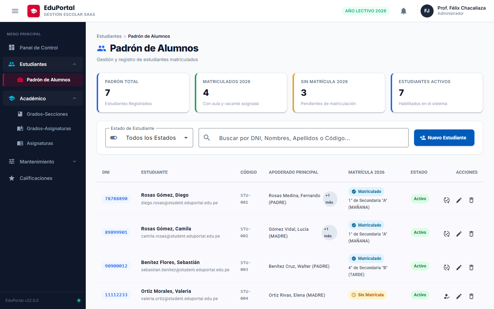
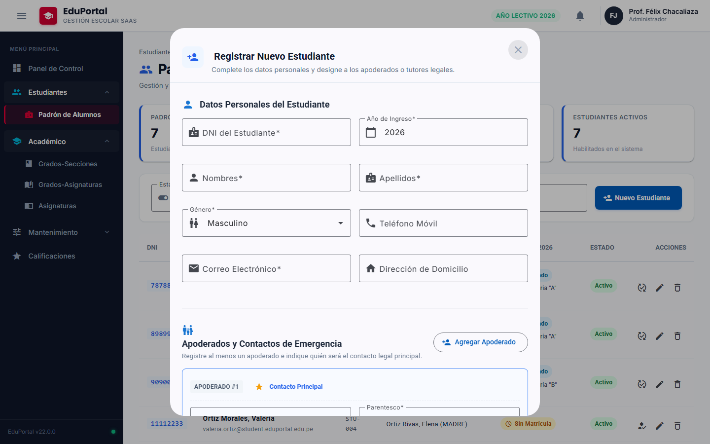
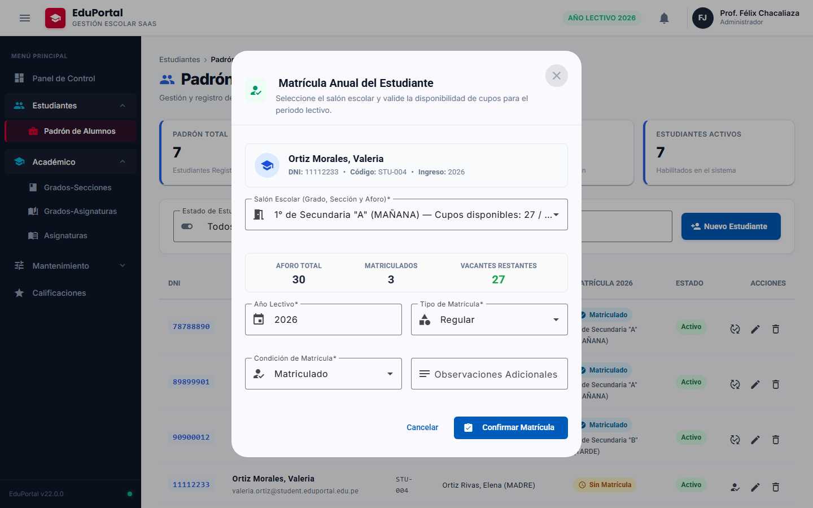
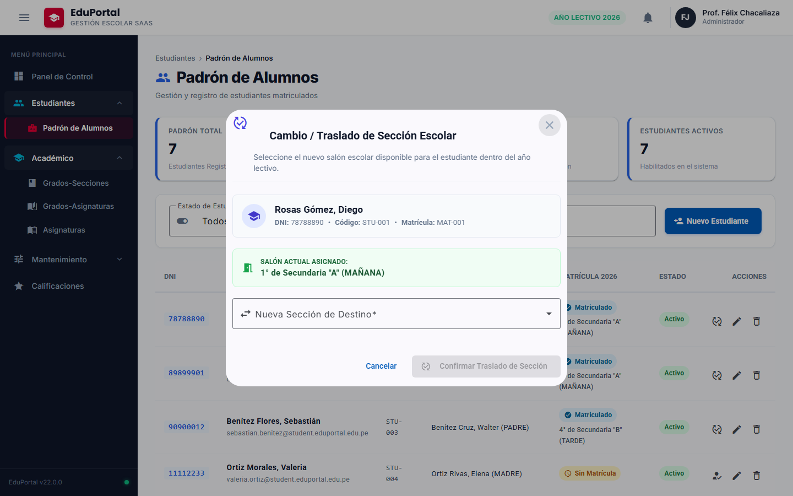
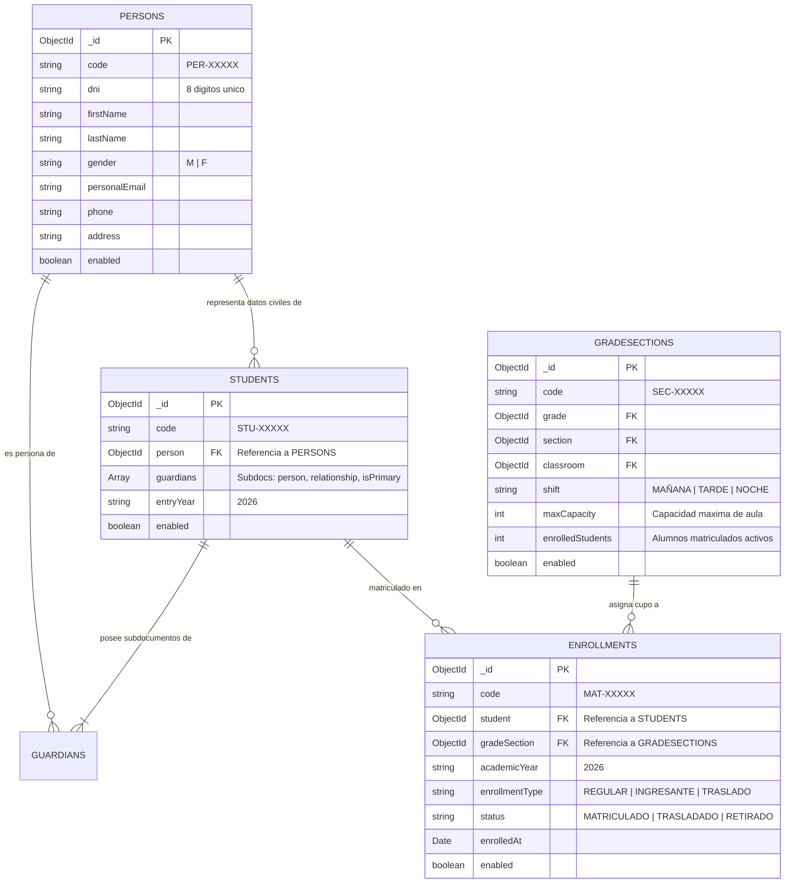

# 🎓 Guía del Estudiante • Sesión 05.0.0
## Padrón Oficial de Estudiantes, Matrícula Anual y Traslado de Sección: Patrón Form Triad (`FormModel` + `FormHtml` + `FormPresenter` + `FormComponent`), Validación Asíncrona de DNI, `FormArray` de Apoderados, Paginador Reactivo y Pruebas Reales E2E (`eduportal-web`)

> **Curso:** Desarrollo Web Frontend Profesional con Angular 22  
> **Proyecto:** EduPortal — Sistema de Gestión Escolar SaaS  
> **Módulo:** `features/students/student-management`  
> **Duración:** 3 Horas (180 Minutos)  
> **Tag Oficial:** `sesion-05.0.0`  
> **Requisitos Previos:** Node.js 20+, Angular 22 CLI, Git, Backend `eduportal-api-starter` en ejecución en `http://localhost:3000`.

---

## ⚡ Sincronización y Punto de Partida con Git

Antes de iniciar el trabajo práctico de hoy, identifica tu situación actual para ejecutar los comandos adecuados en tu terminal:

```bash
# 0. PASO PREVIO OBLIGATORIO: Descargar todos los tags oficiales más recientes desde GitHub
git fetch origin --tags
```

---

### 🟢 Situación 1: No completaste la sesión anterior o tu código tiene errores (Rescate Rápido)
> 💡 **Recomendado si te atrasaste o tienes fallos difíciles de solucionar:**  
> Este comando descarta cambios pendientes no guardados y crea una rama limpia para la sesión de hoy partiendo con el 100% de la funcionalidad oficial de la sesión anterior entregada por el docente.

```bash
# Crear tu rama de trabajo directamente sobre el TAG oficial de la sesión anterior:
git checkout -f tags/sesion-04.2.0 -b feature/sesion-05.0.0

# Instalar dependencias por si hubo nuevos paquetes agregados:
npm install
```

---

### 🟡 Situación 2: Completaste la sesión anterior "a tu modo" (en tu propia rama)
Si desarrollaste la sesión anterior con tu propio código y deseas continuar, elige una de estas dos alternativas:

#### 🔹 Alternativa 2.A: Continuar trabajando sobre tu código personal
> Usa esta opción si tu código funciona correctamente y quieres construir la nueva sesión sobre tu propia implementación previa.

```bash
# 1. Asegúrate de guardar y confirmar tus cambios en tu rama actual:
git add .
git commit -m "feat: culminacion de la sesion anterior con logica propia"

# 2. Crear la nueva rama para la sesión de hoy partiendo de tu código personal:
git checkout -b feature/sesion-05.0.0
```

#### 🔹 Alternativa 2.B: Respaldar tu código pero continuar con la solución oficial del docente
> Usa esta opción si deseas conservar tu código para revisión futura, pero prefieres trabajar hoy sobre la base oficial estándar para evitar discrepancias.

```bash
# 1. Crear una rama de respaldo personal para NO perder tu avance:
git checkout -b mi-respaldo-sesion-anterior

# 2. Crear la rama de hoy partiendo 100% limpio del TAG oficial del docente:
git checkout tags/sesion-04.2.0 -b feature/sesion-05.0.0
```

---

### 🔵 Situación 3: Tu rama de trabajo está en la sesión anterior y deseas jalar el nuevo tag oficial
*(Ejemplo común en clase: Tu rama está alineada al tag/commit anterior como `sesion-04.2.0` y deseas actualizarla para recibir los cambios oficiales sin tener que crear una rama desde cero).*

Tienes dos métodos según prefieras:

#### 🔹 Opción 3.1: Nivelación limpia total (Sobrescribir tu rama con el Tag Oficial — Recomendada)
> ⚠️ Esta opción sobrescribe el contenido de tu rama para que coincida exactamente con el código del docente. Es la vía más segura para evitar conflictos de merge.

```bash
# 1. Asegurarte de estar ubicado en tu rama de trabajo:
git checkout feature/sesion-05.0.0

# 2. Sobrescribir y nivelar tu rama con el tag oficial anterior de forma exacta:
git reset --hard tags/sesion-04.2.0

# 3. (Solo si ya habías hecho push previo a GitHub) Forzar la sincronización en remoto:
git push origin feature/sesion-05.0.0 --force
```

#### 🔹 Opción 3.2: Fusión conservando tus commits personales (`git merge`)
> 📌 Esta opción combina los commits del tag oficial dentro de tu rama conservando tu historial. Si modificaste los mismos archivos que el docente, deberás resolver los conflictos manualmente.

```bash
# 1. Ubicarte en tu rama de trabajo:
git checkout feature/sesion-05.0.0

# 2. Fusionar el tag oficial en tu rama:
git merge tags/sesion-04.2.0 -m "merge: sincronizar con tag oficial sesion-04.2.0"

# 3. Si Git detecta conflictos, resuélvelos en tu editor (VS Code), guarda y confirma:
# git add .
# git commit -m "fix: resolucion de conflictos con tag oficial"
```

---

### 🟣 Situación 4: Inspección rápida del código final terminado de esta sesión
> 📌 Si solo deseas ver, ejecutar o consultar la solución completa y probada de la sesión de hoy (modo solo lectura o referencia):

```bash
git checkout tags/sesion-05.0.0
```
---

## ⚡ Nivelación Rápida con Git Tags (`sesion-05.0.0`)

> 💡 **Botón de Copiado Rápido (1 Solo Clic):**  
> Todos los bloques de comandos y código fuente de esta guía están formateados en bloques de código delimitados con la ruta exacta en la primera línea. En tu visor de Markdown (VS Code, GitHub, Cursor o navegador), **pasa el cursor sobre la esquina superior derecha del bloque y haz clic en el icono "Copiar" / "Copy code"** para copiar todo el bloque al portapapeles sin tener que arrastrar o seleccionar texto manualmente.

#### Opción A: Nivelación Instantánea en 1 Sola Línea (Clic en "Copiar" y pegar en terminal):
```bash
git fetch origin --tags && git reset --hard sesion-05.0.0
```

#### Opción B: Paso a paso tradicional en tu rama:
```bash
# 1. Asegúrate de estar en tu propia rama de alumno (reemplaza 'tu-rama' por tu nombre):
git checkout tu-rama

# 2. Descarga todas las etiquetas (tags) oficiales subidas por el docente:
git fetch origin --tags

# 3. Nivela tu rama exactamente al punto de inicio/cierre de esta sesión (0 conflictos):
git reset --hard sesion-05.0.0

# 4. Sincroniza tu rama en GitHub de forma limpia:
git push origin tu-rama --force
```

---

## 🎯 ¿Qué Aprenderás Hoy?

En esta sesión construirás paso a paso el módulo misional del **Padrón Oficial de Estudiantes, Matrícula Anual y Traslado de Sección**:
1. Desacoplar formularios mediante la arquitectura en 4 capas: `FormModel` (definición), `FormHtml` (textos y restricciones), `FormPresenter` (lógica de estado y validación) y `FormComponent` (plantilla).
2. Respetar la regla de oro: **1 Clase por Archivo `.ts`**.
3. Implementar un validador asíncrono para verificar DNI duplicados y autocompletar personas registradas.
4. Gestionar apoderados dinámicos mediante `FormArray<FormGroup>` garantizando al menos un contacto principal y bloqueando que el alumno sea su propio apoderado (**RN-ACT-02**).
5. Controlar el aforo en matrículas anuales (**RN-MAT-01 / RN-MAT-02**), alternando entre **"Matricular"** y **"Cambiar Sección"** según el estado del estudiante en 2026.
6. Localizar el paginador de Angular Material al español con `StudentPaginatorIntl`.
7. Ejecutar pruebas automatizadas en navegadores reales con **Playwright**.

---

## 🖼️ Referencia Visual del Módulo

A continuación se presentan las 4 pantallas oficiales del módulo que implementaremos:

### 1. Padrón Oficial de Estudiantes (`/alumnos`)
Vista con tarjetas KPI, buscador en tiempo real, tabla paginada en español, estado de matrícula y alternancia de acciones:



---

### 2. Diálogo Modal de Registro de Nuevo Alumno
Formulario modal con validación de DNI en tiempo real y colección dinámica de apoderados:



---

### 3. Diálogo Modal de Matrícula Anual
Selector de aula con cálculo de vacantes disponibles y advertencia de aforo agotado:



---

### 4. Diálogo Modal de Traslado de Sección
Transferencia atómica de sección para alumnos ya matriculados en 2026:



---

## 🏛️ PARTE 1: Modelo de Datos MongoDB y Endpoints REST del Backend (00:00 - 00:20)

### 1.1 Diagrama Entidad-Relación (ERD) en MongoDB (`eduportalangular`)



### 1.2 Endpoints REST del Backend (`http://localhost:3000`)

- `GET /api/students?academicYear=2026`: Lista padrón de estudiantes poblado con persona, apoderados y matrícula activa del 2026.
- `POST /api/students`: Registra un nuevo estudiante validando que el DNI no exista.
- `PUT /api/students/:id`: Actualiza datos personales y apoderados.
- `DELETE /api/students/:id`: Baja lógica del estudiante.
- `GET /api/persons/check-dni/:dni`: Valida la existencia previa en el padrón civil.
- `POST /api/enrollments`: Registra matrícula anual autogenerando código `MAT-XXX` y validando aforo.
- `PATCH /api/enrollments/:id/section`: Traslado atómico de sección: descuenta cupo en aula origen y reserva en destino.
- `GET /api/grade-sections?academicYear=2026`: Salones aperturados con cálculo de vacantes en tiempo real.

---

## 🛠️ PARTE 2: Comandos Rápidos de Angular CLI y Archivos Transversales (00:20 - 00:35)

### 2.1 Comandos Rápidos para Generar la Estructura (Copiar en un solo clic)

#### Opción 1: Comando en 1 Sola Línea (Clic en "Copiar" arriba a la derecha y pegar en terminal):
```bash
ng g c features/students/student-management --skip-tests && ng g c features/students/student-management/components/student-list --skip-tests && ng g c features/students/student-management/dialogs/student-save-dialog --skip-tests && ng g c features/students/student-management/dialogs/student-save-dialog/form --skip-tests && ng g c features/students/student-management/dialogs/enrollment-save-dialog --skip-tests && ng g c features/students/student-management/dialogs/enrollment-save-dialog/form --skip-tests && ng g c features/students/student-management/dialogs/section-change-dialog --skip-tests && ng g c features/students/student-management/dialogs/section-change-dialog/form --skip-tests
```

#### Opción 2: Bloque de comandos multilínea:
```bash
# 1. Contenedor Smart principal
ng g c features/students/student-management --skip-tests

# 2. Componente de tabla Dumb
ng g c features/students/student-management/components/student-list --skip-tests

# 3. Diálogo de Estudiante y su formulario desacoplado
ng g c features/students/student-management/dialogs/student-save-dialog --skip-tests
ng g c features/students/student-management/dialogs/student-save-dialog/form --skip-tests

# 4. Diálogo de Matrícula Anual y su formulario desacoplado
ng g c features/students/student-management/dialogs/enrollment-save-dialog --skip-tests
ng g c features/students/student-management/dialogs/enrollment-save-dialog/form --skip-tests

# 5. Diálogo de Traslado de Sección y su formulario desacoplado
ng g c features/students/student-management/dialogs/section-change-dialog --skip-tests
ng g c features/students/student-management/dialogs/section-change-dialog/form --skip-tests
```

### 2.2 Actualización de Archivos Transversales

#### 2.2.1 `src/app/core/api/endpoints.ts`
```typescript
// src/app/core/api/endpoints.ts
import { environment } from '../../../environments/environment';

export const API_ENDPOINTS = {
  areas: `${environment.apiUrl}/areas`,
  subjects: `${environment.apiUrl}/subjects`,
  levels: `${environment.apiUrl}/levels`,
  grades: `${environment.apiUrl}/grades`,
  sections: `${environment.apiUrl}/sections`,
  classrooms: `${environment.apiUrl}/classrooms`,
  rules: `${environment.apiUrl}/rules`,
  academicYears: `${environment.apiUrl}/academic-years`,
  gradeSections: `${environment.apiUrl}/grade-sections`,
  gradeSubjects: `${environment.apiUrl}/grade-subjects`,
  students: `${environment.apiUrl}/students`,
  persons: `${environment.apiUrl}/persons`,
  enrollments: `${environment.apiUrl}/enrollments`,
} as const;
```

#### 2.2.2 `src/app/shared/layout/sidebar/sidebar.component.ts`
```typescript
// src/app/shared/layout/sidebar/sidebar.component.ts
import { Component, input, signal } from '@angular/core';
import { RouterLink, RouterLinkActive } from '@angular/router';
import { MatIconModule } from '@angular/material/icon';

export interface NavigationSubItem {
  readonly path: string;
  readonly label: string;
  readonly icon?: string;
  readonly badge?: string;
}

export interface NavigationItem {
  readonly label: string;
  readonly icon: string;
  readonly path?: string;
  readonly badge?: string;
  readonly children?: readonly NavigationSubItem[];
}

@Component({
  selector: 'app-sidebar',
  standalone: true,
  imports: [RouterLink, RouterLinkActive, MatIconModule],
  templateUrl: './sidebar.component.html',
  styleUrl: './sidebar.component.scss'
})
export class SidebarComponent {
  public readonly isCollapsed = input<boolean>(false);
  public readonly openGroups = signal<Set<string>>(new Set(['Académico', 'Estudiantes']));

  public toggleGroup(label: string): void {
    const current = new Set(this.openGroups());
    if (current.has(label)) {
      current.delete(label);
    } else {
      current.add(label);
    }
    this.openGroups.set(current);
  }

  public isGroupOpen(label: string): boolean {
    return this.openGroups().has(label);
  }

  public readonly navItems: readonly NavigationItem[] = [
    { path: '/dashboard', label: 'Panel de Control', icon: 'dashboard' },
    {
      label: 'Estudiantes',
      icon: 'people',
      children: [
        { path: '/alumnos', label: 'Padrón de Alumnos', icon: 'badge' },
      ]
    },
    {
      label: 'Académico',
      icon: 'school',
      children: [
        { path: '/grados-secciones', label: 'Grados-Secciones', icon: 'class' },
        { path: '/grados-asignaturas', label: 'Grados-Asignaturas', icon: 'auto_stories' },
        { path: '/asignaturas', label: 'Asignaturas', icon: 'menu_book' },
      ]
    },
    {
      label: 'Mantenimiento',
      icon: 'tune',
      children: [
        { path: '/niveles', label: 'Niveles Educativos', icon: 'layers' },
        { path: '/areas', label: 'Áreas Curriculares', icon: 'category' },
      ]
    },
    { path: '/notas', label: 'Calificaciones', icon: 'grade' }
  ];
}
```

#### 2.2.3 `src/app/app.routes.ts`
```typescript
// src/app/app.routes.ts
import { Routes } from '@angular/router';

export const routes: Routes = [
  {
    path: '',
    loadComponent: () =>
      import('./core/layouts/main-layout/main-layout.component').then(m => m.MainLayoutComponent),
    children: [
      {
        path: '',
        redirectTo: 'dashboard',
        pathMatch: 'full'
      },
      {
        path: 'dashboard',
        loadComponent: () =>
          import('./features/dashboard/pages/dashboard-page/dashboard-page.component').then(
            m => m.DashboardPageComponent
          )
      },
      {
        path: '',
        loadChildren: () =>
          import('./features/students').then(m => m.STUDENTS_ROUTES)
      },
      {
        path: '',
        loadChildren: () =>
          import('./features/academic').then(m => m.ACADEMIC_ROUTES)
      },
      {
        path: '',
        loadChildren: () =>
          import('./features/maintenance').then(m => m.MAINTENANCE_ROUTES)
      },
    ]
  }
];
```

---

## 📐 PARTE 3: Contratos e Interfaces TypeScript (00:35 - 00:50)

Crea cada interfaz en `src/app/features/students/student-management/models/`:

### 3.1 `person.interface.ts`
```typescript
// src/app/features/students/student-management/models/person.interface.ts

export type GenderType = 'M' | 'F';

export interface IPerson {
  id: string;
  code: string;
  dni: string;
  firstName: string;
  lastName: string;
  gender: GenderType;
  personalEmail: string;
  phone?: string;
  address?: string;
  enabled: boolean;
  createdAt?: string;
  updatedAt?: string;
}

export interface ICheckDniResponse {
  exists: boolean;
  isStudent: boolean;
  person?: IPerson;
}
```

### 3.2 `guardian.interface.ts`
```typescript
// src/app/features/students/student-management/models/guardian.interface.ts
import { IPerson } from './person.interface';

export type GuardianRelationshipType = 'PADRE' | 'MADRE' | 'TUTOR' | 'APODERADO';

export interface IGuardianSubdoc {
  person: IPerson;
  relationship: GuardianRelationshipType;
  isPrimary: boolean;
}

export interface IGuardianFormItemDto {
  dni: string;
  firstName: string;
  lastName: string;
  relationship: GuardianRelationshipType;
  isPrimary: boolean;
  phone?: string;
  email?: string;
}
```

### 3.3 `enrollment.interface.ts`
```typescript
// src/app/features/students/student-management/models/enrollment.interface.ts
import { IStudent } from './student.interface';
import { IGradeSectionSummary } from './grade-section-summary.interface';

export type EnrollmentStatusType = 'MATRICULADO' | 'TRASLADADO' | 'RETIRADO';
export type EnrollmentType = 'REGULAR' | 'INGRESANTE' | 'TRASLADO';

export interface IEnrollment {
  id: string;
  code: string;
  student: string | IStudent;
  gradeSection: string | IGradeSectionSummary;
  academicYear: string;
  enrollmentType?: EnrollmentType;
  status: EnrollmentStatusType;
  enrolledAt?: string;
  observation?: string;
  enabled: boolean;
}

export interface IEnrollStudentRequestDto {
  student: string;
  gradeSection: string;
  academicYear: string;
  enrollmentType?: EnrollmentType;
  status?: EnrollmentStatusType;
  observation?: string;
}
```

### 3.4 `grade-section-summary.interface.ts`
```typescript
// src/app/features/students/student-management/models/grade-section-summary.interface.ts

export interface IGradeSectionSummary {
  id: string;
  code: string;
  academicYear: string;
  grade: {
    id: string;
    name: number;
    description: string;
  };
  section: {
    id: string;
    name: string;
  };
  classroom: {
    id: string;
    name: string;
    capacity: number;
  };
  shift: 'MAÑANA' | 'TARDE' | 'NOCHE';
  maxCapacity: number;
  enrolledStudents: number;
  availableVacancies?: number;
}
```

### 3.5 `student.interface.ts`
```typescript
// src/app/features/students/student-management/models/student.interface.ts
import { IPerson } from './person.interface';
import { IGuardianSubdoc, IGuardianFormItemDto } from './guardian.interface';
import { IEnrollment } from './enrollment.interface';

export interface IStudent {
  id: string;
  code: string;
  person: IPerson;
  guardians: IGuardianSubdoc[];
  entryYear: string;
  enabled: boolean;
  currentEnrollment?: IEnrollment | null;
}

export interface ICreateStudentRequestDto {
  dni: string;
  firstName: string;
  lastName: string;
  gender: 'M' | 'F';
  personalEmail: string;
  phone?: string;
  address?: string;
  entryYear: string;
  guardians: IGuardianFormItemDto[];
}

export interface IUpdateStudentRequestDto {
  firstName?: string;
  lastName?: string;
  personalEmail?: string;
  phone?: string;
  address?: string;
  guardians?: IGuardianFormItemDto[];
  enabled?: boolean;
}
```

### 3.6 `models/index.ts`
```typescript
// src/app/features/students/student-management/models/index.ts
export * from './person.interface';
export * from './guardian.interface';
export * from './student.interface';
export * from './enrollment.interface';
export * from './grade-section-summary.interface';
```

---

## 🌐 PARTE 4: Servicios HTTP con `firstValueFrom` (01:00 - 01:20)

### 4.1 `PersonService`
```typescript
// src/app/features/students/student-management/services/person.service.ts
import { Injectable, inject } from '@angular/core';
import { HttpClient } from '@angular/common/http';
import { firstValueFrom } from 'rxjs';
import { API_ENDPOINTS } from '../../../../core/api/endpoints';
import { ApiResponse } from '../../../../core/api/models/interfaces/api-response.interface';
import { IPerson, ICheckDniResponse } from '../models';

@Injectable({
  providedIn: 'root'
})
export class PersonService {
  private readonly http = inject(HttpClient);
  private readonly endpoint = API_ENDPOINTS.persons;

  public async checkDni(dni: string): Promise<ICheckDniResponse> {
    try {
      const response = await firstValueFrom(
        this.http.get<ApiResponse<ICheckDniResponse>>(`${this.endpoint}/check-dni/${dni.trim()}`)
      );
      return response.data;
    } catch {
      return { exists: false, isStudent: false };
    }
  }

  public async getPersonByDni(dni: string): Promise<IPerson | null> {
    try {
      const response = await firstValueFrom(
        this.http.get<ApiResponse<IPerson[]>>(`${this.endpoint}?dni=${dni.trim()}`)
      );
      const list = response.data || [];
      return list.find((p: IPerson) => p.dni === dni.trim()) || null;
    } catch {
      return null;
    }
  }
}
```

### 4.2 `EnrollmentService`
```typescript
// src/app/features/students/student-management/services/enrollment.service.ts
import { Injectable, inject } from '@angular/core';
import { HttpClient, HttpParams } from '@angular/common/http';
import { firstValueFrom } from 'rxjs';
import { API_ENDPOINTS } from '../../../../core/api/endpoints';
import { ApiResponse } from '../../../../core/api/models/interfaces/api-response.interface';
import { IEnrollment, IEnrollStudentRequestDto, IGradeSectionSummary } from '../models';

@Injectable({
  providedIn: 'root'
})
export class EnrollmentService {
  private readonly http = inject(HttpClient);
  private readonly endpoint = API_ENDPOINTS.enrollments;
  private readonly gradeSectionsEndpoint = API_ENDPOINTS.gradeSections;

  public async getEnrollments(academicYear = '2026'): Promise<IEnrollment[]> {
    const params = new HttpParams().set('academicYear', academicYear);
    const response = await firstValueFrom(
      this.http.get<ApiResponse<IEnrollment[]>>(this.endpoint, { params })
    );
    return response.data || [];
  }

  public async enrollStudent(payload: IEnrollStudentRequestDto): Promise<IEnrollment> {
    const response = await firstValueFrom(
      this.http.post<ApiResponse<IEnrollment>>(this.endpoint, payload)
    );
    return response.data;
  }

  public async changeSection(enrollmentId: string, gradeSectionId: string): Promise<IEnrollment> {
    const response = await firstValueFrom(
      this.http.patch<ApiResponse<IEnrollment>>(`${this.endpoint}/${enrollmentId}/section`, {
        gradeSection: gradeSectionId
      })
    );
    return response.data;
  }

  public async getActiveGradeSections(academicYear = '2026'): Promise<IGradeSectionSummary[]> {
    const params = new HttpParams().set('academicYear', academicYear);
    const response = await firstValueFrom(
      this.http.get<ApiResponse<IGradeSectionSummary[]>>(this.gradeSectionsEndpoint, { params })
    );
    const rawList = response.data || [];

    return rawList.map((item: IGradeSectionSummary) => ({
      ...item,
      availableVacancies: Math.max(0, (item.maxCapacity || 0) - (item.enrolledStudents || 0))
    }));
  }
}
```

### 4.3 `StudentService`
```typescript
// src/app/features/students/student-management/services/student.service.ts
import { Injectable, inject } from '@angular/core';
import { HttpClient, HttpParams } from '@angular/common/http';
import { firstValueFrom } from 'rxjs';
import { API_ENDPOINTS } from '../../../../core/api/endpoints';
import { ApiResponse } from '../../../../core/api/models/interfaces/api-response.interface';
import { IStudent, ICreateStudentRequestDto, IUpdateStudentRequestDto } from '../models';

@Injectable({
  providedIn: 'root'
})
export class StudentService {
  private readonly http = inject(HttpClient);
  private readonly endpoint = API_ENDPOINTS.students;

  public async getStudents(status?: 'ACTIVE' | 'INACTIVE', academicYear = '2026'): Promise<IStudent[]> {
    let params = new HttpParams();
    if (status) params = params.set('status', status);
    if (academicYear) params = params.set('academicYear', academicYear);

    const response = await firstValueFrom(
      this.http.get<ApiResponse<IStudent[]>>(this.endpoint, { params })
    );
    return response.data || [];
  }

  public async getStudentById(id: string): Promise<IStudent> {
    const response = await firstValueFrom(
      this.http.get<ApiResponse<IStudent>>(`${this.endpoint}/${id}`)
    );
    return response.data;
  }

  public async createStudent(payload: ICreateStudentRequestDto): Promise<IStudent> {
    const response = await firstValueFrom(
      this.http.post<ApiResponse<IStudent>>(this.endpoint, payload)
    );
    return response.data;
  }

  public async updateStudent(id: string, payload: IUpdateStudentRequestDto): Promise<IStudent> {
    const response = await firstValueFrom(
      this.http.put<ApiResponse<IStudent>>(`${this.endpoint}/${id}`, payload)
    );
    return response.data;
  }

  public async deleteStudent(id: string): Promise<void> {
    await firstValueFrom(this.http.delete(`${this.endpoint}/${id}`));
  }
}
```

---

## ⚡ PARTE 5: Validador Asíncrono de DNI con Debounce (01:20 - 01:35)

```typescript
// src/app/features/students/student-management/validators/dni-async.validator.ts
import { AbstractControl, AsyncValidatorFn, ValidationErrors } from '@angular/forms';
import { Observable, of, timer } from 'rxjs';
import { map, switchMap, catchError } from 'rxjs/operators';
import { PersonService } from '../services/person.service';

export function dniAsyncValidator(personService: PersonService, currentStudentDni?: string): AsyncValidatorFn {
  return (control: AbstractControl): Observable<ValidationErrors | null> => {
    const dni = control.value ? String(control.value).trim() : '';

    if (!dni || dni.length !== 8 || !/^\d{8}$/.test(dni)) {
      return of(null);
    }

    if (currentStudentDni && dni === currentStudentDni.trim()) {
      return of(null);
    }

    return timer(300).pipe(
      switchMap(() => personService.checkDni(dni)),
      map(res => {
        if (res.isStudent) {
          return { studentAlreadyExists: true };
        }
        return null;
      }),
      catchError(() => of(null))
    );
  };
}
```

---

## 📝 PARTE 6: Form Triad #1: Diálogo de Registro de Alumno (`StudentSaveDialog`) (01:35 - 02:00)

### 6.1 `StudentSaveDialogFormModel`
```typescript
// src/app/features/students/student-management/dialogs/student-save-dialog/form/models/student-save-dialog-form.model.ts
import { Validators } from '@angular/forms';
import { FormModel } from '../../../../../../../shared/class/form-model';

export class StudentSaveDialogFormModel extends FormModel {
  dni = ['', [Validators.required, Validators.pattern(/^\d{8}$/)]];
  firstName = ['', [Validators.required, Validators.minLength(2), Validators.maxLength(80)]];
  lastName = ['', [Validators.required, Validators.minLength(2), Validators.maxLength(80)]];
  gender = ['M', [Validators.required]];
  personalEmail = ['', [Validators.required, Validators.email]];
  phone = ['', [Validators.pattern(/^\d{9}$/)]];
  address = [''];
  entryYear = ['2026', [Validators.required, Validators.pattern(/^\d{4}$/)]];
}
```

### 6.2 `GuardianFormModel`
```typescript
// src/app/features/students/student-management/dialogs/student-save-dialog/form/models/guardian-form.model.ts
import { Validators } from '@angular/forms';
import { FormModel } from '../../../../../../../shared/class/form-model';

export class GuardianFormModel extends FormModel {
  dni = ['', [Validators.required, Validators.pattern(/^\d{8}$/)]];
  firstName = ['', [Validators.required, Validators.minLength(2), Validators.maxLength(80)]];
  lastName = ['', [Validators.required, Validators.minLength(2), Validators.maxLength(80)]];
  relationship = ['PADRE', [Validators.required]];
  isPrimary = [false];
  phone = ['', [Validators.pattern(/^\d{9}$/)]];
  email = ['', [Validators.email]];
}
```

### 6.3 `StudentSaveDialogFormPresenter`
```typescript
// src/app/features/students/student-management/dialogs/student-save-dialog/form/student-save-dialog-form.presenter.ts
import { Injectable, inject, DestroyRef, signal } from '@angular/core';
import { FormBuilder, FormGroup, FormArray, Validators } from '@angular/forms';
import { takeUntilDestroyed } from '@angular/core/rxjs-interop';
import { debounceTime, distinctUntilChanged, filter } from 'rxjs/operators';
import { PersonService } from '../../../services/person.service';
import { StudentSaveDialogFormModel } from './models/student-save-dialog-form.model';
import { GuardianFormModel } from './models/guardian-form.model';
import { STUDENT_SAVE_DIALOG_FORM_MODEL_CONSTANT } from './models/student-save-dialog-form.model.constant';
import { GUARDIAN_FORM_MODEL_CONSTANT } from './models/guardian-form.model.constant';
import { dniAsyncValidator } from '../../../validators/dni-async.validator';
import { IStudent, ICreateStudentRequestDto, IGuardianFormItemDto } from '../../../models';

@Injectable()
export class StudentSaveDialogFormPresenter {
  private readonly fb = inject(FormBuilder);
  private readonly personService = inject(PersonService);
  private readonly destroyRef = inject(DestroyRef);

  public readonly formModel = new StudentSaveDialogFormModel();
  public readonly guardianModel = new GuardianFormModel();
  public readonly studentConstant = STUDENT_SAVE_DIALOG_FORM_MODEL_CONSTANT;
  public readonly guardianConstant = GUARDIAN_FORM_MODEL_CONSTANT;

  public readonly form: FormGroup;
  public readonly guardiansArray: FormArray<FormGroup>;

  public readonly isSearchingCivilPerson = signal<boolean>(false);
  public readonly isStudentExists = signal<boolean>(false);

  constructor() {
    this.guardiansArray = this.fb.array<FormGroup>([]);

    this.form = this.fb.group({
      dni: this.formModel.dni,
      firstName: this.formModel.firstName,
      lastName: this.formModel.lastName,
      gender: this.formModel.gender,
      personalEmail: this.formModel.personalEmail,
      phone: this.formModel.phone,
      address: this.formModel.address,
      entryYear: this.formModel.entryYear,
      guardians: this.guardiansArray
    });

    this.setupDniAutoLookup();
  }

  public initialize(student?: IStudent): void {
    if (student) {
      this.form.patchValue({
        dni: student.person?.dni || '',
        firstName: student.person?.firstName || '',
        lastName: student.person?.lastName || '',
        gender: student.person?.gender || 'M',
        personalEmail: student.person?.personalEmail || '',
        phone: student.person?.phone || '',
        address: student.person?.address || '',
        entryYear: student.entryYear || '2026'
      });

      this.form.get('dni')?.setAsyncValidators(
        dniAsyncValidator(this.personService, student.person?.dni)
      );

      this.guardiansArray.clear();
      if (Array.isArray(student.guardians) && student.guardians.length > 0) {
        student.guardians.forEach(g => {
          this.addGuardian({
            dni: g.person?.dni || '',
            firstName: g.person?.firstName || '',
            lastName: g.person?.lastName || '',
            relationship: g.relationship || 'PADRE',
            isPrimary: g.isPrimary || false,
            phone: g.person?.phone || '',
            email: g.person?.personalEmail || ''
          });
        });
      } else {
        this.addGuardian({ isPrimary: true });
      }
    } else {
      this.form.get('dni')?.setAsyncValidators(dniAsyncValidator(this.personService));
      this.guardiansArray.clear();
      this.addGuardian({ isPrimary: true });
    }
  }

  public addGuardian(initialData?: Partial<IGuardianFormItemDto>): void {
    const guardianGroup = this.fb.group({
      dni: [initialData?.dni || '', [Validators.required, Validators.pattern(/^\d{8}$/)]],
      firstName: [initialData?.firstName || '', [Validators.required, Validators.minLength(2)]],
      lastName: [initialData?.lastName || '', [Validators.required, Validators.minLength(2)]],
      relationship: [initialData?.relationship || 'PADRE', [Validators.required]],
      isPrimary: [initialData?.isPrimary || false],
      phone: [initialData?.phone || '', [Validators.pattern(/^\d{9}$/)]],
      email: [initialData?.email || '', [Validators.email]]
    });

    guardianGroup.get('dni')?.valueChanges.pipe(
      debounceTime(350),
      distinctUntilChanged(),
      filter(dni => typeof dni === 'string' && dni.trim().length === 8 && /^\d{8}$/.test(dni)),
      takeUntilDestroyed(this.destroyRef)
    ).subscribe(async (dni) => {
      const person = await this.personService.getPersonByDni(String(dni));
      if (person) {
        guardianGroup.patchValue({
          firstName: person.firstName,
          lastName: person.lastName,
          phone: person.phone || '',
          email: person.personalEmail || ''
        });
      }
    });

    this.guardiansArray.push(guardianGroup);
  }

  public removeGuardian(index: number): void {
    if (this.guardiansArray.length > 1) {
      const wasPrimary = this.guardiansArray.at(index).get('isPrimary')?.value;
      this.guardiansArray.removeAt(index);
      if (wasPrimary && this.guardiansArray.length > 0) {
        this.setPrimaryGuardian(0);
      }
    }
  }

  public setPrimaryGuardian(selectedIndex: number): void {
    this.guardiansArray.controls.forEach((group, idx) => {
      group.get('isPrimary')?.setValue(idx === selectedIndex);
    });
  }

  public getErrorMessage(controlName: string): string {
    return this.formModel.getErrorMessage(controlName, this.form).error;
  }

  public getGuardianErrorMessage(index: number, controlName: string): string {
    const group = this.guardiansArray.at(index);
    if (!group) return '';
    return this.guardianModel.getErrorMessage(controlName, group).error;
  }

  public isValid(): boolean {
    if (this.form.invalid) {
      this.form.markAllAsTouched();
      return false;
    }

    const hasPrimary = this.guardiansArray.controls.some(g => g.get('isPrimary')?.value === true);
    if (!hasPrimary && this.guardiansArray.length > 0) {
      this.setPrimaryGuardian(0);
    }

    const studentDni = this.form.get('dni')?.value?.trim();
    const isSelfGuardian = this.guardiansArray.controls.some(g => g.get('dni')?.value?.trim() === studentDni);
    if (isSelfGuardian) {
      return false;
    }

    return true;
  }

  public getPayload(): ICreateStudentRequestDto {
    const raw = this.form.value;
    const rawGuardians: IGuardianFormItemDto[] = this.guardiansArray.value;

    return {
      dni: String(raw.dni).trim(),
      firstName: String(raw.firstName).trim(),
      lastName: String(raw.lastName).trim(),
      gender: raw.gender,
      personalEmail: String(raw.personalEmail).trim(),
      phone: raw.phone ? String(raw.phone).trim() : undefined,
      address: raw.address ? String(raw.address).trim() : undefined,
      entryYear: String(raw.entryYear || '2026').trim(),
      guardians: rawGuardians.map(g => ({
        dni: String(g.dni).trim(),
        firstName: String(g.firstName).trim(),
        lastName: String(g.lastName).trim(),
        relationship: g.relationship,
        isPrimary: Boolean(g.isPrimary),
        phone: g.phone ? String(g.phone).trim() : undefined,
        email: g.email ? String(g.email).trim() : undefined
      }))
    };
  }

  private setupDniAutoLookup(): void {
    this.form.get('dni')?.valueChanges.pipe(
      debounceTime(350),
      distinctUntilChanged(),
      filter(dni => typeof dni === 'string' && dni.trim().length === 8 && /^\d{8}$/.test(dni)),
      takeUntilDestroyed(this.destroyRef)
    ).subscribe(async (dni) => {
      this.isSearchingCivilPerson.set(true);
      try {
        const check = await this.personService.checkDni(String(dni));
        if (check.exists && check.person) {
          this.form.patchValue({
            firstName: check.person.firstName,
            lastName: check.person.lastName,
            gender: check.person.gender || 'M',
            personalEmail: check.person.personalEmail,
            phone: check.person.phone || '',
            address: check.person.address || ''
          });
        }
      } finally {
        this.isSearchingCivilPerson.set(false);
      }
    });
  }
}
```

---

## 🏛️ PARTE 7: Form Triad #2: Diálogo de Matrícula Anual (`EnrollmentSaveDialog`) (02:00 - 02:20)

### 7.1 `EnrollmentSaveDialogFormModel`
```typescript
// src/app/features/students/student-management/dialogs/enrollment-save-dialog/form/models/enrollment-save-dialog-form.model.ts
import { Validators } from '@angular/forms';
import { FormModel } from '../../../../../../../shared/class/form-model';

export class EnrollmentSaveDialogFormModel extends FormModel {
  gradeSection = ['', [Validators.required]];
  academicYear = ['2026', [Validators.required, Validators.pattern(/^\d{4}$/)]];
  status = ['MATRICULADO', [Validators.required]];
  enrollmentType = ['REGULAR', [Validators.required]];
  observation = [''];
}
```

### 7.2 `EnrollmentSaveDialogFormPresenter`
```typescript
// src/app/features/students/student-management/dialogs/enrollment-save-dialog/form/enrollment-save-dialog-form.presenter.ts
import { Injectable, inject, signal, computed } from '@angular/core';
import { FormBuilder, FormGroup } from '@angular/forms';
import { EnrollmentSaveDialogFormModel } from './models/enrollment-save-dialog-form.model';
import { ENROLLMENT_SAVE_DIALOG_FORM_MODEL_CONSTANT } from './models/enrollment-save-dialog-form.model.constant';
import { IEnrollStudentRequestDto, IGradeSectionSummary } from '../../../models';

@Injectable()
export class EnrollmentSaveDialogFormPresenter {
  private readonly fb = inject(FormBuilder);

  public readonly formModel = new EnrollmentSaveDialogFormModel();
  public readonly enrollmentConstant = ENROLLMENT_SAVE_DIALOG_FORM_MODEL_CONSTANT;

  public readonly form: FormGroup;
  public readonly availableSections = signal<IGradeSectionSummary[]>([]);
  public readonly selectedSectionId = signal<string>('');

  public readonly selectedSection = computed(() => {
    const id = this.selectedSectionId();
    if (!id) return null;
    return this.availableSections().find(s => s.id === id) || null;
  });

  public readonly hasVacancies = computed(() => {
    const section = this.selectedSection();
    if (!section) return true;
    return (section.availableVacancies ?? 0) > 0;
  });

  constructor() {
    this.form = this.fb.group({
      gradeSection: this.formModel.gradeSection,
      academicYear: this.formModel.academicYear,
      enrollmentType: this.formModel.enrollmentType,
      status: this.formModel.status,
      observation: this.formModel.observation
    });

    this.form.get('gradeSection')?.valueChanges.subscribe(val => {
      this.selectedSectionId.set(val || '');
    });
  }

  public initialize(sections: IGradeSectionSummary[]): void {
    this.availableSections.set(sections);
    if (sections.length > 0) {
      const firstWithVacancy = sections.find(s => (s.availableVacancies ?? 0) > 0);
      if (firstWithVacancy) {
        const id = firstWithVacancy.id;
        this.form.patchValue({ gradeSection: id });
        this.selectedSectionId.set(id);
      }
    }
  }

  public getErrorMessage(controlName: string): string {
    return this.formModel.getErrorMessage(controlName, this.form).error;
  }

  public isValid(): boolean {
    if (this.form.invalid) {
      this.form.markAllAsTouched();
      return false;
    }
    return this.hasVacancies();
  }

  public getPayload(studentId: string): IEnrollStudentRequestDto {
    const raw = this.form.value;
    return {
      student: studentId,
      gradeSection: String(raw.gradeSection).trim(),
      academicYear: String(raw.academicYear).trim(),
      enrollmentType: raw.enrollmentType || 'REGULAR',
      status: raw.status || 'MATRICULADO',
      observation: raw.observation ? String(raw.observation).trim() : undefined
    };
  }
}
```

---

## 🔄 PARTE 8: Form Triad #3: Diálogo de Traslado de Sección (`SectionChangeDialog`) (02:20 - 02:35)

### 8.1 `SectionChangeDialogFormModel`
```typescript
// src/app/features/students/student-management/dialogs/section-change-dialog/form/models/section-change-dialog-form.model.ts
import { Validators } from '@angular/forms';
import { FormModel } from '../../../../../../../shared/class/form-model';

export class SectionChangeDialogFormModel extends FormModel {
  gradeSection = ['', [Validators.required]];
}
```

### 8.2 `SectionChangeDialogFormPresenter`
```typescript
// src/app/features/students/student-management/dialogs/section-change-dialog/form/section-change-dialog-form.presenter.ts
import { Injectable, inject, signal, computed } from '@angular/core';
import { FormBuilder, FormGroup } from '@angular/forms';
import { SectionChangeDialogFormModel } from './models/section-change-dialog-form.model';
import { SECTION_CHANGE_DIALOG_FORM_MODEL_CONSTANT } from './models/section-change-dialog-form.model.constant';
import { IGradeSectionSummary } from '../../../models';

@Injectable()
export class SectionChangeDialogFormPresenter {
  private readonly fb = inject(FormBuilder);

  public readonly formModel = new SectionChangeDialogFormModel();
  public readonly constant = SECTION_CHANGE_DIALOG_FORM_MODEL_CONSTANT;

  public readonly form: FormGroup;
  public readonly availableSections = signal<IGradeSectionSummary[]>([]);
  public readonly selectedSectionId = signal<string>('');
  public readonly currentSectionId = signal<string>('');

  public readonly selectedSection = computed(() => {
    const id = this.selectedSectionId();
    if (!id) return null;
    return this.availableSections().find(s => s.id === id) || null;
  });

  public readonly hasVacancies = computed(() => {
    const section = this.selectedSection();
    if (!section) return false;
    return (section.availableVacancies ?? 0) > 0;
  });

  public readonly isSameSection = computed(() => {
    const selected = this.selectedSectionId();
    const current = this.currentSectionId();
    return !!selected && !!current && selected === current;
  });

  constructor() {
    this.form = this.fb.group({
      gradeSection: this.formModel.gradeSection
    });

    this.form.get('gradeSection')?.valueChanges.subscribe(val => {
      this.selectedSectionId.set(val || '');
    });
  }

  public initialize(sections: IGradeSectionSummary[], currentGradeSectionId: string): void {
    this.availableSections.set(sections);
    this.currentSectionId.set(currentGradeSectionId);
  }

  public isValid(): boolean {
    if (this.form.invalid) {
      this.form.markAllAsTouched();
      return false;
    }
    if (this.isSameSection()) {
      return false;
    }
    return this.hasVacancies();
  }

  public getErrorMessage(controlName: string): string {
    return this.formModel.getErrorMessage(controlName, this.form).error;
  }

  public getSelectedSectionId(): string {
    return String(this.form.value.gradeSection).trim();
  }
}
```

---

## 📊 PARTE 9: Tabla Dumb, Paginación Localizada y Smart Container (02:35 - 02:50)

### 9.1 `StudentPaginatorIntl`
```typescript
// src/app/features/students/student-management/components/student-list/student-paginator-intl.ts
import { Injectable } from '@angular/core';
import { MatPaginatorIntl } from '@angular/material/paginator';

@Injectable()
export class StudentPaginatorIntl extends MatPaginatorIntl {
  public override itemsPerPageLabel = 'Estudiantes por página:';
  public override nextPageLabel = 'Página siguiente';
  public override previousPageLabel = 'Página anterior';
  public override firstPageLabel = 'Primera página';
  public override lastPageLabel = 'Última página';

  public override getRangeLabel = (page: number, pageSize: number, length: number): string => {
    if (length === 0 || pageSize === 0) {
      return `0 de ${length}`;
    }
    const startIndex = page * pageSize;
    const endIndex = startIndex < length ? Math.min(startIndex + pageSize, length) : startIndex + pageSize;
    return `${startIndex + 1} – ${endIndex} de ${length}`;
  };
}
```

### 9.2 `StudentListComponent`
```typescript
// src/app/features/students/student-management/components/student-list/student-list.component.ts
import { ChangeDetectionStrategy, Component, computed, effect, input, output, signal } from '@angular/core';
import { CommonModule } from '@angular/common';
import { MatTableModule } from '@angular/material/table';
import { MatButtonModule } from '@angular/material/button';
import { MatIconModule } from '@angular/material/icon';
import { MatChipsModule } from '@angular/material/chips';
import { MatTooltipModule } from '@angular/material/tooltip';
import { MatProgressBarModule } from '@angular/material/progress-bar';
import { MatPaginatorIntl, MatPaginatorModule, PageEvent } from '@angular/material/paginator';
import { IStudent, IGuardianSubdoc, IEnrollment } from '../../models';
import { StudentPaginatorIntl } from './student-paginator-intl';

@Component({
  selector: 'app-student-list',
  standalone: true,
  imports: [
    CommonModule,
    MatTableModule,
    MatButtonModule,
    MatIconModule,
    MatChipsModule,
    MatTooltipModule,
    MatProgressBarModule,
    MatPaginatorModule,
  ],
  providers: [
    { provide: MatPaginatorIntl, useClass: StudentPaginatorIntl },
  ],
  templateUrl: './student-list.component.html',
  styleUrl: './student-list.component.scss',
  changeDetection: ChangeDetectionStrategy.OnPush,
})
export class StudentListComponent {
  public readonly students = input.required<readonly IStudent[]>();
  public readonly isLoading = input<boolean>(false);

  public readonly edit = output<IStudent>();
  public readonly enroll = output<IStudent>();
  public readonly changeSection = output<IStudent>();
  public readonly delete = output<IStudent>();

  public readonly pageSize = signal<number>(5);
  public readonly pageIndex = signal<number>(0);

  public readonly pagedStudents = computed<readonly IStudent[]>(() => {
    const list = this.students();
    const start = this.pageIndex() * this.pageSize();
    return list.slice(start, start + this.pageSize());
  });

  public readonly displayedColumns: readonly string[] = [
    'dni',
    'fullName',
    'code',
    'guardians',
    'enrollment',
    'status',
    'actions',
  ];

  constructor() {
    effect(() => {
      const total = this.students().length;
      const maxIndex = Math.max(0, Math.ceil(total / this.pageSize()) - 1);
      if (this.pageIndex() > maxIndex) {
        this.pageIndex.set(0);
      }
    });
  }

  public onPageChange(event: PageEvent): void {
    this.pageIndex.set(event.pageIndex);
    this.pageSize.set(event.pageSize);
  }

  public getPrimaryGuardian(guardians?: IGuardianSubdoc[]): string {
    if (!guardians || guardians.length === 0) return 'Sin apoderado';
    const primary = guardians.find(g => g.isPrimary);
    const target = primary || guardians[0];
    const name = target.person ? `${target.person.lastName}, ${target.person.firstName}` : 'Apoderado';
    return `${name} (${target.relationship})`;
  }

  public isEnrolled(student: IStudent): boolean {
    return !!student.currentEnrollment && student.currentEnrollment.status === 'MATRICULADO';
  }

  public getEnrollmentSummary(enrollment?: IEnrollment | null): string {
    if (!enrollment) return 'Sin Matrícula';
    const gs = enrollment.gradeSection as any;
    if (typeof gs === 'object' && gs !== null) {
      const gradeDesc = gs.grade?.description || gs.grade?.name || 'Grado';
      const secName = gs.section?.name || '';
      const shift = gs.shift ? ` (${gs.shift})` : '';
      return `${gradeDesc} "${secName}"${shift}`;
    }
    return enrollment.code || 'Matriculado';
  }
}
```

### 9.3 `StudentManagementPresenter`
```typescript
// src/app/features/students/student-management/student-management.presenter.ts
import { Injectable, computed, inject, signal } from '@angular/core';
import { MatDialog } from '@angular/material/dialog';
import { MatSnackBar } from '@angular/material/snack-bar';
import { InfoCardData } from '../../../shared/components/info-card/info-card.component';
import { StudentService } from './services/student.service';
import { IStudent } from './models';
import { StudentSaveDialogComponent } from './dialogs/student-save-dialog/student-save-dialog.component';
import { StudentSaveDialogData } from './dialogs/student-save-dialog/form/models/student-save-dialog-form.interface';
import { EnrollmentSaveDialogComponent } from './dialogs/enrollment-save-dialog/enrollment-save-dialog.component';
import { EnrollmentSaveDialogData } from './dialogs/enrollment-save-dialog/form/models/enrollment-save-dialog-form.interface';
import { SectionChangeDialogComponent } from './dialogs/section-change-dialog/section-change-dialog.component';
import { SectionChangeDialogData } from './dialogs/section-change-dialog/form/models/section-change-dialog-form.interface';

@Injectable()
export class StudentManagementPresenter {
  private readonly studentService = inject(StudentService);
  private readonly dialog = inject(MatDialog);
  private readonly snackBar = inject(MatSnackBar);

  public readonly students = signal<readonly IStudent[]>([]);
  public readonly searchTerm = signal<string>('');
  public readonly statusFilter = signal<'ALL' | 'ACTIVE' | 'INACTIVE'>('ALL');
  public readonly isLoading = signal<boolean>(false);
  public readonly error = signal<string | null>(null);

  public readonly filteredStudents = computed<readonly IStudent[]>(() => {
    const list = this.students();
    const query = this.searchTerm().trim().toLowerCase();
    const status = this.statusFilter();

    return list.filter(item => {
      const matchStatus =
        status === 'ALL' ||
        (status === 'ACTIVE' && item.enabled) ||
        (status === 'INACTIVE' && !item.enabled);

      if (!matchStatus) return false;
      if (!query) return true;

      const dni = item.person?.dni?.toLowerCase() || '';
      const firstName = item.person?.firstName?.toLowerCase() || '';
      const lastName = item.person?.lastName?.toLowerCase() || '';
      const fullName = `${lastName} ${firstName}`.trim();
      const code = item.code?.toLowerCase() || '';

      return (
        dni.includes(query) ||
        firstName.includes(query) ||
        lastName.includes(query) ||
        fullName.includes(query) ||
        code.includes(query)
      );
    });
  });

  public readonly totalCount = computed(() => this.students().length);
  public readonly activeCount = computed(() => this.students().filter(s => s.enabled).length);
  public readonly enrolledCount = computed(() => this.students().filter(s => s.currentEnrollment?.status === 'MATRICULADO').length);
  public readonly pendingEnrollmentCount = computed(() => this.students().filter(s => !s.currentEnrollment).length);

  public readonly cards = computed<readonly InfoCardData[]>(() => [
    { label: 'Padrón Total', value: this.totalCount(), subtitle: 'Estudiantes Registrados', color: 'blue' },
    { label: 'Matriculados 2026', value: this.enrolledCount(), subtitle: 'Con aula y vacante asignada', color: 'green' },
    { label: 'Sin Matrícula 2026', value: this.pendingEnrollmentCount(), subtitle: 'Pendientes de matriculación', color: 'amber' },
    { label: 'Estudiantes Activos', value: this.activeCount(), subtitle: 'Habilitados en el sistema', color: 'blue' }
  ]);

  public async loadStudents(): Promise<void> {
    this.isLoading.set(true);
    this.error.set(null);
    try {
      const data = await this.studentService.getStudents(undefined, '2026');
      this.students.set(data);
    } catch (err: any) {
      console.error('Error al cargar alumnos:', err);
      const msg = err?.error?.message || err?.message || 'Error al obtener la lista de estudiantes';
      this.error.set(msg);
      this.snackBar.open(msg, 'Cerrar', { duration: 4000 });
    } finally {
      this.isLoading.set(false);
    }
  }

  public setSearchTerm(term: string): void {
    this.searchTerm.set(term);
  }

  public setStatusFilter(status: 'ALL' | 'ACTIVE' | 'INACTIVE'): void {
    this.statusFilter.set(status);
  }

  public openCreateDialog(): void {
    const dialogRef = this.dialog.open(StudentSaveDialogComponent, {
      width: '750px',
      maxWidth: '95vw',
      disableClose: true,
      data: { mode: 'create' } as StudentSaveDialogData
    });

    dialogRef.afterClosed().subscribe(res => {
      if (res) {
        this.snackBar.open('¡Estudiante registrado exitosamente!', 'OK', { duration: 3500 });
        this.loadStudents();
      }
    });
  }

  public openEditDialog(student: IStudent): void {
    const dialogRef = this.dialog.open(StudentSaveDialogComponent, {
      width: '750px',
      maxWidth: '95vw',
      disableClose: true,
      data: { mode: 'edit', student } as StudentSaveDialogData
    });

    dialogRef.afterClosed().subscribe(res => {
      if (res) {
        this.snackBar.open('¡Estudiante actualizado exitosamente!', 'OK', { duration: 3500 });
        this.loadStudents();
      }
    });
  }

  public openEnrollDialog(student: IStudent): void {
    const dialogRef = this.dialog.open(EnrollmentSaveDialogComponent, {
      width: '620px',
      maxWidth: '95vw',
      disableClose: true,
      data: { student } as EnrollmentSaveDialogData
    });

    dialogRef.afterClosed().subscribe(enrolled => {
      if (enrolled) {
        this.snackBar.open('¡Matrícula anual registrada con éxito!', 'OK', { duration: 3500 });
        this.loadStudents();
      }
    });
  }

  public openSectionChangeDialog(student: IStudent): void {
    const dialogRef = this.dialog.open(SectionChangeDialogComponent, {
      width: '620px',
      maxWidth: '95vw',
      disableClose: true,
      data: { student } as SectionChangeDialogData
    });

    dialogRef.afterClosed().subscribe(changed => {
      if (changed) {
        this.snackBar.open('¡Traslado de sección registrado con éxito!', 'OK', { duration: 3500 });
        this.loadStudents();
      }
    });
  }

  public async deleteStudent(student: IStudent): Promise<void> {
    const confirmed = window.confirm(
      `¿Está seguro de eliminar al estudiante "${student.person?.lastName}, ${student.person?.firstName}" (DNI: ${student.person?.dni})?`
    );
    if (!confirmed) return;

    this.isLoading.set(true);
    try {
      await this.studentService.deleteStudent(student.id);
      this.snackBar.open('Estudiante eliminado del padrón.', 'OK', { duration: 3000 });
      await this.loadStudents();
    } catch (err: any) {
      console.error('Error al eliminar estudiante:', err);
      const msg = err?.error?.message || err?.message || 'Error al eliminar estudiante';
      this.snackBar.open(msg, 'Cerrar', { duration: 4000 });
    } finally {
      this.isLoading.set(false);
    }
  }
}
```

---


### 9.4 Componente Contenedor Principal (`StudentManagementComponent`)

#### 9.4.1 `src/app/features/students/student-management/student-management.component.ts`
```typescript
// src/app/features/students/student-management/student-management.component.ts
import { ChangeDetectionStrategy, Component, OnInit, inject } from '@angular/core';
import { CommonModule } from '@angular/common';
import { MatProgressSpinnerModule } from '@angular/material/progress-spinner';
import { MatFormFieldModule } from '@angular/material/form-field';
import { MatInputModule } from '@angular/material/input';
import { MatSelectModule } from '@angular/material/select';
import { MatButtonModule } from '@angular/material/button';
import { MatIconModule } from '@angular/material/icon';
import { MatTooltipModule } from '@angular/material/tooltip';
import { InfoCardComponent } from '../../../shared/components/info-card/info-card.component';
import { StudentListComponent } from './components/student-list/student-list.component';
import { StudentManagementPresenter } from './student-management.presenter';

@Component({
  selector: 'app-student-management',
  standalone: true,
  imports: [
    CommonModule,
    MatProgressSpinnerModule,
    MatFormFieldModule,
    MatInputModule,
    MatSelectModule,
    MatButtonModule,
    MatIconModule,
    MatTooltipModule,
    InfoCardComponent,
    StudentListComponent,
  ],
  providers: [StudentManagementPresenter],
  templateUrl: './student-management.component.html',
  styleUrl: './student-management.component.scss',
  changeDetection: ChangeDetectionStrategy.OnPush,
})
export class StudentManagementComponent implements OnInit {
  public readonly presenter = inject(StudentManagementPresenter);

  public ngOnInit(): void {
    this.presenter.loadStudents();
  }
}
```

#### 9.4.2 `src/app/features/students/student-management/student-management.component.html`
```html
<!-- src/app/features/students/student-management/student-management.component.html -->
<div class="students">
  <!-- 1. Tarjetas de Métricas Estadísticas del Padrón -->
  <div class="students-cards">
    @for (card of presenter.cards(); track card.label) {
      <app-info-card [data]="card" />
    }
  </div>

  <!-- 2. Barra Unificada de Filtros, Búsqueda y Botón de Registro -->
  <div class="students-filters">
    <div class="students-filters__controls">
      <!-- Filtro por Estado -->
      <mat-form-field appearance="outline" class="students-filters__field">
        <mat-label>Estado de Estudiante</mat-label>
        <mat-icon matPrefix>toggle_on</mat-icon>
        <mat-select [value]="presenter.statusFilter()" (valueChange)="presenter.setStatusFilter($event)">
          <mat-option value="ALL">Todos los Estados</mat-option>
          <mat-option value="ACTIVE">Solo Activos</mat-option>
          <mat-option value="INACTIVE">Solo Inactivos</mat-option>
        </mat-select>
      </mat-form-field>

      <!-- Buscador predictivo por DNI, Nombres o Código -->
      <mat-form-field appearance="outline" class="students-filters__field students-filters__field--search">
        <mat-label>Buscar por DNI, Nombres, Apellidos o Código...</mat-label>
        <mat-icon matPrefix>search</mat-icon>
        <input
          #searchInput
          matInput
          type="text"
          placeholder="Ej. 74859612, Quispe, STU-2026..."
          [value]="presenter.searchTerm()"
          (input)="presenter.setSearchTerm(searchInput.value)"
        />
        @if (presenter.searchTerm()) {
          <button
            mat-icon-button
            matSuffix
            type="button"
            (click)="presenter.setSearchTerm(''); searchInput.value = ''"
            matTooltip="Limpiar filtro"
          >
            <mat-icon>clear</mat-icon>
          </button>
        }
      </mat-form-field>
    </div>

    <!-- Botón de Acción Principal -->
    <div class="students-filters__action">
      <button
        mat-flat-button
        color="primary"
        class="students-filters__create-btn"
        (click)="presenter.openCreateDialog()"
      >
        <mat-icon>person_add</mat-icon>
        Nuevo Estudiante
      </button>
    </div>
  </div>

  <!-- 3. Spinner de Carga o Tabla Principal -->
  @if (presenter.isLoading()) {
    <div class="students__loading">
      <mat-spinner diameter="44" />
      <p>Cargando padrón oficial de estudiantes...</p>
    </div>
  } @else {
    <app-student-list
      [students]="presenter.filteredStudents()"
      [isLoading]="presenter.isLoading()"
      (edit)="presenter.openEditDialog($event)"
      (enroll)="presenter.openEnrollDialog($event)"
      (changeSection)="presenter.openSectionChangeDialog($event)"
      (delete)="presenter.deleteStudent($event)"
    />
  }
</div>
```

#### 9.4.3 `src/app/features/students/student-management/student-management.component.scss`
```scss
// src/app/features/students/student-management/student-management.component.scss
.students {
  display: flex;
  flex-direction: column;

  &__loading {
    display: flex;
    flex-direction: column;
    align-items: center;
    justify-content: center;
    padding: 3rem 1.5rem;
    gap: 1rem;
    background: #ffffff;
    border-radius: 12px;
    border: 1px solid #e2e8f0;

    p {
      margin: 0;
      color: #64748b;
      font-size: 0.875rem;
      font-weight: 500;
    }
  }
}

.students-cards {
  display: grid;
  grid-template-columns: repeat(auto-fit, minmax(200px, 1fr));
  gap: 1rem;
  margin-bottom: 1.5rem;
}

.students-filters {
  display: flex;
  flex-wrap: wrap;
  align-items: center;
  justify-content: space-between;
  gap: 1rem;
  background-color: #ffffff;
  padding: 1.25rem 1.5rem;
  border-radius: 12px;
  border: 1px solid #e2e8f0;
  margin-bottom: 1.5rem;
  box-shadow: 0 1px 3px rgba(0, 0, 0, 0.05);

  &__controls {
    display: flex;
    flex-wrap: wrap;
    align-items: center;
    gap: 1rem;
    flex: 1;
  }

  &__field {
    min-width: 200px;
    margin-bottom: -1.25em;

    &--search {
      flex: 1;
      min-width: 280px;
    }

    mat-icon {
      color: #64748b;
      margin-right: 0.5rem;
    }
  }

  &__action {
    display: flex;
    align-items: center;
  }

  &__create-btn {
    height: 48px;
    padding: 0 1.5rem;
    font-weight: 600;
    font-size: 0.875rem;
    border-radius: 8px;
    box-shadow: 0 2px 4px rgba(37, 99, 235, 0.2);

    mat-icon {
      margin-right: 0.35rem;
    }
  }
}
```

#### 9.4.4 `src/app/features/students/students.routes.ts` y `index.ts`
```typescript
// src/app/features/students/students.routes.ts
import { Routes } from '@angular/router';

export const STUDENTS_ROUTES: Routes = [
  {
    path: '',
    loadComponent: () =>
      import('./student-management/student-management.component').then(
        (m) => m.StudentManagementComponent
      ),
  },
];
```

```typescript
// src/app/features/students/index.ts
export * from './students.routes';
export * from './student-management/student-management.component';
export * from './student-management/student-management.presenter';
```

---

## 🧪 PARTE 10: Pruebas Unitarias TDD y Playwright E2E en Navegador Real (02:50 - 03:00)

#### Opción 1: Suite Completa en 1 Sola Línea (Clic en "Copiar" arriba a la derecha y ejecutar):
```bash
npm test && npm run test:e2e && npm run build
```

#### Opción 2: Verificación secuencial comentada:
```bash
# 1. Pruebas Unitarias de Reglas de Negocio y Presenters
npm test

# 2. Pruebas Reales de Navegador con Playwright
npm run test:e2e

# 3. Compilación de Producción Angular 22 Zoneless
npm run build
```

### Resultados Esperados de la Suite:
- `npm test`: 24 pruebas pasadas en 8 suites (141ms).
- `npm run test:e2e`: 4 flujos de usuario reales aprobados en Chromium (6.4s - 9.0s).
- `npm run build`: 0 errores de TypeScript, bundle generado en ~3.3 segundos.

¡Felicitaciones! Has completado el módulo de **Padrón Oficial de Estudiantes y Matrícula Anual** en Angular 22.
