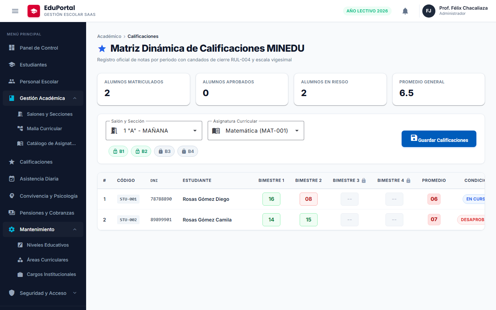
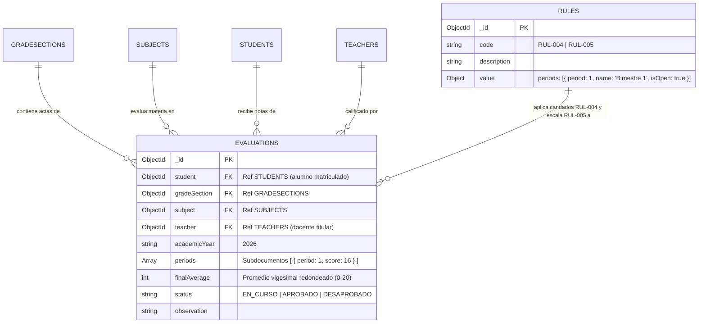
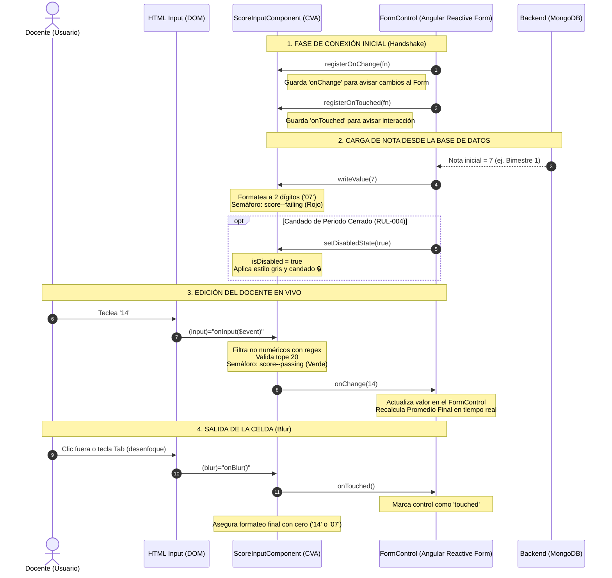

# 🎓 Guía del Estudiante • Sesión 06.0.0
## Matriz Dinámica de Calificaciones MINEDU (RUL-004 y RUL-005): Arquitectura Reactiva Bidimensional con `FormArray`, Candados de Periodo `isOpen`, `ControlValueAccessor` (`<app-score-input>`), Semáforo Vigesimal en Caliente y Persistencia por Lote (`eduportal-web`)

> **Curso:** Desarrollo Web Frontend Profesional con Angular 22  
> **Proyecto Transversal:** EduPortal — Sistema de Gestión Escolar SaaS  
> **Duración Oficial:** 3 Horas (180 Minutos) • 3 Bloques de 50 min y 2 Recesos activos de 10 min (50m / 10m / 50m / 10m / 50m)  
> **Rama Oficial de Trabajo:** `feature/sesion-06.0.0` (Tag Oficial: `sesion-06.0.0`)  
> **Frontend:** `eduportal-web` (`http://localhost:4200/calificaciones`) • Angular 22 Zoneless (Zero `markForCheck`), TypeScript 5.6 Estricto (Zero `any`), Angular Material 22, Playwright E2E  
> **Backend de Soporte:** `eduportal-api-starter` (`http://localhost:3000`) • Tag `backend-v1.0` (MongoDB: `eduportalangular`)  
> **Docente Titular:** Félix Junior Chacaliaza Gutiérrez • Intevex Academy

---

## ⚡ Sincronización y Punto de Partida con Git

Antes de iniciar el trabajo práctico de hoy, identifica tu situación actual para ejecutar los comandos adecuados en tu terminal:

```bash
# 0. PASO PREVIO OBLIGATORIO: Descargar todos los tags oficiales más recientes desde GitHub
git fetch origin --tags
```

---

### 🟢 Situación 1: No completaste la sesión anterior o tu código tiene errores (Rescate Rápido)
> 💡 **Recomendado si te atrasaste o tienes fallos difíciles de solucionar:**  
> Este comando descarta cambios pendientes no guardados y crea una rama limpia para la sesión de hoy partiendo con el 100% de la funcionalidad oficial de la sesión anterior entregada por el docente.

```bash
# Crear tu rama de trabajo directamente sobre el TAG oficial de la sesión anterior:
git checkout -f tags/sesion-05.1.0 -b feature/sesion-06.0.0

# Instalar dependencias por si hubo nuevos paquetes agregados:
npm install
```

---

### 🟡 Situación 2: Completaste la sesión anterior "a tu modo" (en tu propia rama)
Si desarrollaste la sesión anterior con tu propio código y deseas continuar, elige una de estas dos alternativas:

#### 🔹 Alternativa 2.A: Continuar trabajando sobre tu código personal
> Usa esta opción si tu código funciona correctamente y quieres construir la nueva sesión sobre tu propia implementación previa.

```bash
# 1. Asegúrate de guardar y confirmar tus cambios en tu rama actual:
git add .
git commit -m "feat: culminacion de la sesion anterior con logica propia"

# 2. Crear la nueva rama para la sesión de hoy partiendo de tu código personal:
git checkout -b feature/sesion-06.0.0
```

#### 🔹 Alternativa 2.B: Respaldar tu código pero continuar con la solución oficial del docente
> Usa esta opción si deseas conservar tu código para revisión futura, pero prefieres trabajar hoy sobre la base oficial estándar para evitar discrepancias.

```bash
# 1. Crear una rama de respaldo personal para NO perder tu avance:
git checkout -b mi-respaldo-sesion-anterior

# 2. Crear la rama de hoy partiendo 100% limpio del TAG oficial del docente:
git checkout tags/sesion-05.1.0 -b feature/sesion-06.0.0
```

---

### 🔵 Situación 3: Tu rama de trabajo está en la sesión anterior y deseas jalar el nuevo tag oficial
*(Ejemplo común en clase: Tu rama está alineada al tag/commit anterior como `sesion-05.1.0` y deseas actualizarla para recibir los cambios oficiales sin tener que crear una rama desde cero).*

Tienes dos métodos según prefieras:

#### 🔹 Opción 3.1: Nivelación limpia total (Sobrescribir tu rama con el Tag Oficial — Recomendada)
> ⚠️ Esta opción sobrescribe el contenido de tu rama para que coincida exactamente con el código del docente. Es la vía más segura para evitar conflictos de merge.

```bash
# 1. Asegurarte de estar ubicado en tu rama de trabajo:
git checkout feature/sesion-06.0.0

# 2. Sobrescribir y nivelar tu rama con el tag oficial anterior de forma exacta:
git reset --hard tags/sesion-05.1.0

# 3. (Solo si ya habías hecho push previo a GitHub) Forzar la sincronización en remoto:
git push origin feature/sesion-06.0.0 --force
```

#### 🔹 Opción 3.2: Fusión conservando tus commits personales (`git merge`)
> 📌 Esta opción combina los commits del tag oficial dentro de tu rama conservando tu historial. Si modificaste los mismos archivos que el docente, deberás resolver los conflictos manualmente.

```bash
# 1. Ubicarte en tu rama de trabajo:
git checkout feature/sesion-06.0.0

# 2. Fusionar el tag oficial en tu rama:
git merge tags/sesion-05.1.0 -m "merge: sincronizar con tag oficial sesion-05.1.0"

# 3. Si Git detecta conflictos, resuélvelos en tu editor (VS Code), guarda y confirma:
# git add .
# git commit -m "fix: resolucion de conflictos con tag oficial"
```

---

### 🟣 Situación 4: Inspección rápida del código final terminado de esta sesión
> 📌 Si solo deseas ver, ejecutar o consultar la solución completa y probada de la sesión de hoy (modo solo lectura o referencia):

```bash
git checkout tags/sesion-06.0.0
```

---

## 🎯 ¿Qué Aprenderás Hoy?

En esta sesión aprenderás a diseñar e implementar la **Matriz Oficial de Calificaciones Escolares (`grade-book`)** bajo las directivas del MINEDU, resolviendo los retos más complejos del desarrollo frontend empresarial:

1. **Manipulación de Formularios Bidimensionales con `FormArray`:** Filas que representan estudiantes matriculados y columnas dinámicas que representan los bimestres escolares.
2. **Candados Institucionales de Cierre (`isOpen: false`):** Deshabilitar columnas de bimestres cerrados sin perder sus valores al persistir por lote gracias a `.getRawValue()`.
3. **Creación de Componentes Personalizados con `ControlValueAccessor`:** Construir el componente `<app-score-input>` que se conecta fluidamente con Reactive Forms, valida notas de 0 a 20 y aplica semáforo en caliente.
4. **Cálculo de Promedios en Tiempo Real con Signals:** Recalcular el promedio vigesimal redondeado al instante al presionar cualquier tecla en una celda.
5. **Persistencia Masiva por Lote:** Enviar todas las actas de una sección en una sola llamada HTTP optimizada (`PUT /api/evaluations/bulk-update`).

---

## 🖼️ Referencia Visual del Producto a Construir

Para guiar tu desarrollo durante la sesión, estas son las vistas oficiales terminadas:

### 1. Vista General de la Matriz Dinámica de Calificaciones (`/calificaciones`)
Tarjetas KPI del aula, barra de filtros con selectores de Salón y Materia, indicadores de candados bimestrales y tabla densa de calificaciones con scroll horizontal fluido.


### 2. Edición en Caliente y Semáforo Vigesimal (Verde / Rojo)
Semáforo visual según nota ($\ge 11$ verde aprobatorio, $< 11$ rojo desaprobatorio), candado en bimestres cerrados y recálculo automático de promedio en tiempo real.



---

## 🏛️ PARTE 1: Modelo de Datos MongoDB y Endpoints REST del Backend (00:00 - 00:20)

### 1.1 Diagrama Entidad-Relación (ERD) en MongoDB (`eduportalangular`)



### 1.2 Endpoints REST del Backend (`http://localhost:3000`)

| Método | Endpoint | Descripción | Payload / Parámetros |
| :---: | :--- | :--- | :--- |
| **GET** | `/api/evaluations/matrix` | Matriz completa de notas del salón | `?gradeSection=ID&subject=ID` |
| **PUT** | `/api/evaluations/bulk-update` | Persistencia masiva de calificaciones por lote | `BulkEvaluationRequestDto` |
| **GET** | `/api/rules/RUL-004` | Configuración y candados de periodos bimestrales | Candados `isOpen: boolean` |

---

## 🛠️ PARTE 2: Creación de Estructura de Carpetas y Componentes CLI (00:20 - 00:35)

### 2.1 Creación de Estructura de Directorios (1 Solo Clic)
Antes de generar archivos o componentes, creamos todas las carpetas del módulo para asegurar que existan los subdirectorios (`models`, `services`, `form`, etc.) y evitar errores de ruta no encontrada:

```bash
# Linux / macOS / Git Bash:
mkdir -p src/app/features/evaluations/grade-book/models \
         src/app/features/evaluations/grade-book/services \
         src/app/features/evaluations/grade-book/form/models \
         src/app/features/evaluations/grade-book/components/score-input \
         src/app/features/evaluations/grade-book/components/grade-book-filters \
         src/app/features/evaluations/grade-book/components/grade-book-matrix

# Windows PowerShell:
New-Item -ItemType Directory -Force "src/app/features/evaluations/grade-book/models", "src/app/features/evaluations/grade-book/services", "src/app/features/evaluations/grade-book/form/models", "src/app/features/evaluations/grade-book/components/score-input", "src/app/features/evaluations/grade-book/components/grade-book-filters", "src/app/features/evaluations/grade-book/components/grade-book-matrix"
```

### 2.2 Generación de Componentes con Angular CLI
Genera automáticamente el contenedor Smart y los componentes Dumb utilizando el sufijo de tipo de componente (`--type=component`):

```bash
# 1. Smart Container GradeBook:
ng g c features/evaluations/grade-book --skip-tests --type=component

# 2. ControlValueAccessor ScoreInput:
ng g c features/evaluations/grade-book/components/score-input --skip-tests --type=component

# 3. Componentes Dumb de Filtros y Matriz:
ng g c features/evaluations/grade-book/components/grade-book-filters --skip-tests --type=component
ng g c features/evaluations/grade-book/components/grade-book-matrix --skip-tests --type=component
```

---

## 🌐 PARTE 3: Enrutamiento Transversal y Feature Routes (00:35 - 00:45)

### 3.1 Actualización de Endpoints Globales
Actualiza `src/app/core/api/endpoints.ts`:

```typescript
// src/app/core/api/endpoints.ts (Fragmento)
export const API_ENDPOINTS = {
  ...
  evaluations: `${environment.apiUrl}/evaluations`,
};
```

### 3.2 Registro de Cabeceras de Página en Main Layout
Agrega las configuraciones para `/calificaciones` y `/notas` dentro del arreglo inmutable `PAGE_HEADERS_CONSTANT` en `src/app/core/layouts/main-layout/models/constants/page-headers.constant.ts`:

```typescript
// src/app/core/layouts/main-layout/models/constants/page-headers.constant.ts (Fragmento dentro del array)
  Object.freeze({
    route: '/calificaciones',
    breadcrumbs: ['Académico', 'Calificaciones'],
    title: 'Matriz Dinámica de Calificaciones MINEDU',
    icon: 'grade',
    description: 'Registro oficial de notas por periodo con candados de cierre RUL-004 y escala vigesimal',
  }),
  Object.freeze({
    route: '/notas',
    breadcrumbs: ['Académico', 'Calificaciones'],
    title: 'Matriz Dinámica de Calificaciones MINEDU',
    icon: 'grade',
    description: 'Registro oficial de notas por periodo con candados de cierre RUL-004 y escala vigesimal',
  }),
```

### 3.3 Enrutador del Feature (`evaluations.routes.ts`)
> ⚡ **Comando de Creación Rápida:**
> ```bash
> # Linux / macOS / Git Bash:
> mkdir -p src/app/features/evaluations && touch src/app/features/evaluations/evaluations.routes.ts
> # Windows PowerShell:
> New-Item -ItemType File -Force "src/app/features/evaluations/evaluations.routes.ts"
> ```

```typescript
// src/app/features/evaluations/evaluations.routes.ts
import { Routes } from '@angular/router';

/**
 * ============================================================================
 * EVALUATIONS_ROUTES
 * ============================================================================
 * Enrutador con carga perezosa para el subsistema de calificaciones escolares.
 * ============================================================================
 */
export const EVALUATIONS_ROUTES: Routes = [
  {
    path: '',
    loadComponent: () =>
      import('./grade-book/grade-book.component').then(m => m.GradeBookComponent),
  },
];
```

### 3.4 Barrel del Feature (`evaluations/index.ts`)
> ⚡ **Comando de Creación Rápida:**
> ```bash
> # Linux / macOS / Git Bash:
> mkdir -p src/app/features/evaluations && touch src/app/features/evaluations/index.ts
> # Windows PowerShell:
> New-Item -ItemType File -Force "src/app/features/evaluations/index.ts"
> ```

```typescript
// src/app/features/evaluations/index.ts
export * from './evaluations.routes';
```

### 3.5 Registro en Enrutamiento Principal (`app.routes.ts`)
Una vez creado el barrel `features/evaluations/index.ts`, regístralo en `src/app/app.routes.ts` mediante Lazy Loading:

```typescript
// src/app/app.routes.ts (Fragmento)
      {
        path: 'calificaciones',
        loadChildren: () =>
          import('./features/evaluations').then(m => m.EVALUATIONS_ROUTES)
      },
      {
        path: 'notas',
        redirectTo: 'calificaciones',
        pathMatch: 'full'
      },
```

---

## 📐 PARTE 4: Contratos e Interfaces Tipadas (1 Interfaz por Archivo) (00:45 - 01:05)

### 4.1 `evaluation-period-score.interface.ts`
> ⚡ **Comando de Creación Rápida:**
> ```bash
> # Linux / macOS / Git Bash:
> mkdir -p src/app/features/evaluations/grade-book/models && touch src/app/features/evaluations/grade-book/models/evaluation-period-score.interface.ts
> # Windows PowerShell:
> New-Item -ItemType File -Force "src/app/features/evaluations/grade-book/models/evaluation-period-score.interface.ts"
> ```

```typescript
// src/app/features/evaluations/grade-book/models/evaluation-period-score.interface.ts
/**
 * ============================================================================
 * EvaluationPeriodScore Interface
 * ============================================================================
 * Subdocumento que representa el puntaje obtenido por un alumno en un periodo específico.
 * ============================================================================
 */
export interface EvaluationPeriodScore {
  readonly period: number;
  readonly score: number | null;
}
```

### 4.2 `evaluation-period-config.interface.ts`
> ⚡ **Comando de Creación Rápida:**
> ```bash
> # Linux / macOS / Git Bash:
> mkdir -p src/app/features/evaluations/grade-book/models && touch src/app/features/evaluations/grade-book/models/evaluation-period-config.interface.ts
> # Windows PowerShell:
> New-Item -ItemType File -Force "src/app/features/evaluations/grade-book/models/evaluation-period-config.interface.ts"
> ```

```typescript
// src/app/features/evaluations/grade-book/models/evaluation-period-config.interface.ts
/**
 * ============================================================================
 * EvaluationPeriodConfig Interface
 * ============================================================================
 * Configuración institucional de un periodo escolar según regla MINEDU RUL-004.
 * ============================================================================
 */
export interface EvaluationPeriodConfig {
  readonly period: number;
  readonly name: string;
  readonly weight: number;
  readonly isOpen: boolean;
}
```

### 4.3 `evaluation.interface.ts`
> ⚡ **Comando de Creación Rápida:**
> ```bash
> # Linux / macOS / Git Bash:
> mkdir -p src/app/features/evaluations/grade-book/models && touch src/app/features/evaluations/grade-book/models/evaluation.interface.ts
> # Windows PowerShell:
> New-Item -ItemType File -Force "src/app/features/evaluations/grade-book/models/evaluation.interface.ts"
> ```

```typescript
// src/app/features/evaluations/grade-book/models/evaluation.interface.ts
import { EvaluationPeriodScore } from './evaluation-period-score.interface';

/**
 * ============================================================================
 * IEvaluation Interface
 * ============================================================================
 * Contrato principal que representa el acta y registro de notas de un estudiante
 * para un salón y asignatura en un año escolar determinado.
 * ============================================================================
 */
export interface IEvaluation {
  readonly id: string;
  readonly code: string;
  readonly academicYear: string;
  readonly gradeSection: any;
  readonly subject: any;
  readonly student: {
    readonly id: string;
    readonly code?: string;
    readonly entryYear?: string;
    readonly person?: {
      readonly id: string;
      readonly dni: string;
      readonly firstName: string;
      readonly lastName: string;
      readonly gender?: string;
      readonly personalEmail?: string;
      readonly phone?: string;
    };
  };
  readonly teacher?: {
    readonly id: string;
    readonly code?: string;
    readonly academicDegree?: string;
    readonly specialty?: string;
    readonly person?: {
      readonly id: string;
      readonly dni: string;
      readonly firstName: string;
      readonly lastName: string;
    };
  };
  readonly periods: readonly EvaluationPeriodScore[];
  readonly finalAverage: number | null;
  readonly status: 'EN_CURSO' | 'APROBADO' | 'DESAPROBADO';
  readonly observation?: string;
  readonly enabled: boolean;
}
```

### 4.4 `grade-book-filter.interface.ts`
> ⚡ **Comando de Creación Rápida:**
> ```bash
> # Linux / macOS / Git Bash:
> mkdir -p src/app/features/evaluations/grade-book/models && touch src/app/features/evaluations/grade-book/models/grade-book-filter.interface.ts
> # Windows PowerShell:
> New-Item -ItemType File -Force "src/app/features/evaluations/grade-book/models/grade-book-filter.interface.ts"
> ```

```typescript
// src/app/features/evaluations/grade-book/models/grade-book-filter.interface.ts
/**
 * ============================================================================
 * IGradeBookFilter Interface
 * ============================================================================
 * Parámetros reactivos de filtrado para consultar la matriz de calificaciones.
 * ============================================================================
 */
export interface IGradeBookFilter {
  readonly gradeSectionId: string;
  readonly subjectId: string;
  readonly academicYear: string;
}
```

### 4.5 `bulk-evaluation-item.interface.ts`
> ⚡ **Comando de Creación Rápida:**
> ```bash
> # Linux / macOS / Git Bash:
> mkdir -p src/app/features/evaluations/grade-book/models && touch src/app/features/evaluations/grade-book/models/bulk-evaluation-item.interface.ts
> # Windows PowerShell:
> New-Item -ItemType File -Force "src/app/features/evaluations/grade-book/models/bulk-evaluation-item.interface.ts"
> ```

```typescript
// src/app/features/evaluations/grade-book/models/bulk-evaluation-item.interface.ts
import { EvaluationPeriodScore } from './evaluation-period-score.interface';

/**
 * ============================================================================
 * IBulkEvaluationItem Interface
 * ============================================================================
 * Ítem de actualización individual dentro del lote masivo de calificaciones.
 * ============================================================================
 */
export interface IBulkEvaluationItem {
  readonly id: string;
  readonly periods: readonly EvaluationPeriodScore[];
  readonly observation?: string;
}
```

### 4.6 `bulk-evaluation-request.dto.ts`
> ⚡ **Comando de Creación Rápida:**
> ```bash
> # Linux / macOS / Git Bash:
> mkdir -p src/app/features/evaluations/grade-book/models && touch src/app/features/evaluations/grade-book/models/bulk-evaluation-request.dto.ts
> # Windows PowerShell:
> New-Item -ItemType File -Force "src/app/features/evaluations/grade-book/models/bulk-evaluation-request.dto.ts"
> ```

```typescript
// src/app/features/evaluations/grade-book/models/bulk-evaluation-request.dto.ts
import { IBulkEvaluationItem } from './bulk-evaluation-item.interface';

/**
 * ============================================================================
 * BulkEvaluationRequestDto Interface
 * ============================================================================
 * Contrato de carga útil para persistencia en lote hacia PUT /api/evaluations/bulk-update.
 * ============================================================================
 */
export interface BulkEvaluationRequestDto {
  readonly evaluations: readonly IBulkEvaluationItem[];
}
```

### 4.7 Barrel de Modelos (`models/index.ts`)
> ⚡ **Comando de Creación Rápida:**
> ```bash
> # Linux / macOS / Git Bash:
> mkdir -p src/app/features/evaluations/grade-book/models && touch src/app/features/evaluations/grade-book/models/index.ts
> # Windows PowerShell:
> New-Item -ItemType File -Force "src/app/features/evaluations/grade-book/models/index.ts"
> ```

```typescript
// src/app/features/evaluations/grade-book/models/index.ts
export * from './evaluation-period-score.interface';
export * from './evaluation-period-config.interface';
export * from './evaluation.interface';
export * from './grade-book-filter.interface';
export * from './bulk-evaluation-item.interface';
export * from './bulk-evaluation-request.dto';
```

---

## 🌐 PARTE 5: Servicio HTTP Reactivo `EvaluationService` (01:05 - 01:25)

### 5.1 Implementación con `firstValueFrom` (`evaluation.service.ts`)
> ⚡ **Comando de Creación Rápida:**
> ```bash
> # Linux / macOS / Git Bash:
> mkdir -p src/app/features/evaluations/grade-book/services && touch src/app/features/evaluations/grade-book/services/evaluation.service.ts
> # Windows PowerShell:
> New-Item -ItemType File -Force "src/app/features/evaluations/grade-book/services/evaluation.service.ts"
> ```

```typescript
// src/app/features/evaluations/grade-book/services/evaluation.service.ts
import { Injectable, inject } from '@angular/core';
import { HttpClient, HttpParams } from '@angular/common/http';
import { firstValueFrom } from 'rxjs';
import { API_ENDPOINTS } from '../../../../core/api/endpoints';
import { ApiResponse } from '../../../../core/api/models/interfaces/api-response.interface';
import { IEvaluation } from '../models/evaluation.interface';
import { IGradeBookFilter } from '../models/grade-book-filter.interface';
import { BulkEvaluationRequestDto } from '../models/bulk-evaluation-request.dto';
import { EvaluationPeriodConfig } from '../models/evaluation-period-config.interface';
import { RuleService } from '../../../../core/api/services/rule.service';

/**
 * ============================================================================
 * EvaluationService
 * ============================================================================
 * Servicio reactivo para la consulta de actas de notas, actualización masiva
 * por lote y obtención de reglas de evaluación institucional MINEDU (RUL-004).
 * ============================================================================
 */
@Injectable({
  providedIn: 'root'
})
export class EvaluationService {
  private readonly http = inject(HttpClient);
  private readonly ruleService = inject(RuleService);
  private readonly endpoint = API_ENDPOINTS.evaluations;

  /**
   * Obtiene la matriz de evaluaciones de un salón y asignatura en un año escolar.
   */
  public async getMatrix(filter: IGradeBookFilter): Promise<IEvaluation[]> {
    let params = new HttpParams()
      .set('academicYear', filter.academicYear);

    if (filter.gradeSectionId) {
      params = params.set('gradeSection', filter.gradeSectionId);
    }
    if (filter.subjectId) {
      params = params.set('subject', filter.subjectId);
    }

    const response = await firstValueFrom(
      this.http.get<ApiResponse<IEvaluation[]>>(`${this.endpoint}/matrix`, { params })
    );

    return response.data || [];
  }

  /**
   * Actualiza en lote las calificaciones de los estudiantes respetando candados isOpen.
   */
  public async bulkUpdate(payload: BulkEvaluationRequestDto): Promise<IEvaluation[]> {
    const response = await firstValueFrom(
      this.http.put<ApiResponse<IEvaluation[]>>(`${this.endpoint}/bulk-update`, payload)
    );

    return response.data || [];
  }

  /**
   * Obtiene la configuración de periodos escolares y candados isOpen desde la regla oficial RUL-004 del backend.
   */
  public async getEvaluationPeriods(academicYear: string = '2026'): Promise<EvaluationPeriodConfig[]> {
    const rules = await this.ruleService.getRules(academicYear);
    const periodRule = rules.find(r => r.code === 'RUL-004' || r.key === 'EVALUATION_PERIODS');

    const periods = periodRule?.currentValue?.periods || periodRule?.value?.periods;
    if (Array.isArray(periods) && periods.length > 0) {
      return periods;
    }

    throw new Error(`No se encontró la regla oficial RUL-004 de periodos de evaluación para el año lectivo ${academicYear}`);
  }
}
```

### 5.2 Barrel de Servicios (`services/index.ts`)
> ⚡ **Comando de Creación Rápida:**
> ```bash
> # Linux / macOS / Git Bash:
> mkdir -p src/app/features/evaluations/grade-book/services && touch src/app/features/evaluations/grade-book/services/index.ts
> # Windows PowerShell:
> New-Item -ItemType File -Force "src/app/features/evaluations/grade-book/services/index.ts"
> ```

```typescript
// src/app/features/evaluations/grade-book/services/index.ts
export * from './evaluation.service';
```

---

## 🧩 PARTE 6: Componente ControlValueAccessor `<app-score-input>` (01:25 - 01:50)

> 💡 **Comando Angular CLI:**
> ```bash
> ng g c features/evaluations/grade-book/components/score-input --skip-tests --type=component
> ```

### 📊 Diagrama de Secuencia: Ciclo de Vida del ControlValueAccessor (CVA)
El siguiente diagrama detalla la interacción cronológica entre el Formulario Reactivo de Angular, el componente CVA `<app-score-input>` y las acciones del docente en el navegador:



### 6.1 Lógica TypeScript (`score-input.component.ts`)
> ⚡ **Comando de Creación Rápida:**
> ```bash
> # Linux / macOS / Git Bash:
> mkdir -p src/app/features/evaluations/grade-book/components/score-input && touch src/app/features/evaluations/grade-book/components/score-input/score-input.component.ts
> # Windows PowerShell:
> New-Item -ItemType File -Force "src/app/features/evaluations/grade-book/components/score-input/score-input.component.ts"
> ```

```typescript
// src/app/features/evaluations/grade-book/components/score-input/score-input.component.ts
import {
  Component,
  ChangeDetectionStrategy,
  forwardRef,
  signal,
  computed
} from '@angular/core';
import {
  ControlValueAccessor,
  NG_VALUE_ACCESSOR,
  NG_VALIDATORS,
  Validator,
  AbstractControl,
  ValidationErrors
} from '@angular/forms';
import { CommonModule } from '@angular/common';

/**
 * ============================================================================
 * ScoreInputComponent (ControlValueAccessor + Validator)
 * ============================================================================
 * ¿QUÉ ES ESTE COMPONENTE?
 * Es una celda o "cuadrito" inteligente para ingresar una sola nota escolar (0 a 20).
 *
 * ¿POR QUÉ IMPLEMENTA ControlValueAccessor Y Validator?
 * Para que Angular lo reconozca como si fuera un <input> nativo de HTML y permita:
 * - Conectarlo con [formControl]="miControl" o formControlName="score".
 * - Recibir notas de la base de datos y formatearlas ('05', '14').
 * - Avisar al formulario reactivo cuando el usuario escribe.
 * - Deshabilitarse y mostrar el candado 🔒 si el periodo está cerrado.
 * - Validar automáticamente que el valor no sea menor a 0 ni mayor a 20.
 * ============================================================================
 */
@Component({
  selector: 'app-score-input',
  standalone: true,
  imports: [CommonModule],
  templateUrl: './score-input.component.html',
  styleUrls: ['./score-input.component.scss'],
  changeDetection: ChangeDetectionStrategy.OnPush,
  providers: [
    // ------------------------------------------------------------------------
    // REGISTRO DE TOKENS OBLIGATORIOS ANTE ANGULAR
    // ------------------------------------------------------------------------
    // Le dice a Angular: "Hola, este componente sabe hablar el idioma de los formularios reactivos".
    {
      provide: NG_VALUE_ACCESSOR,
      useExisting: forwardRef(() => ScoreInputComponent),
      multi: true
    },
    // Le dice a Angular: "Hola, este componente además sabe auto-validarse".
    {
      provide: NG_VALIDATORS,
      useExisting: forwardRef(() => ScoreInputComponent),
      multi: true
    }
  ]
})
export class ScoreInputComponent implements ControlValueAccessor, Validator {

  // ==========================================================================
  // 1. ESTADO Y SEÑALES (PROPIOS DE ESTE COMPONENTE)
  // ==========================================================================
  
  /** Guarda el valor numérico real de la nota (ejemplo: 16) o null si está vacía */
  public readonly score = signal<number | null>(null);

  /** Guarda el texto visible que el usuario lee en el cuadrito (ejemplo: '08', '16', '') */
  public readonly displayValue = signal<string>('');

  /** Indica si la celda está bloqueada con candado (true) o editable (false) */
  public readonly isDisabled = signal<boolean>(false);

  /**
   * Semáforo en Caliente (Señal Computada):
   * Calcula automáticamente la clase visual según la nota actual:
   * - 'score--passing' (Verde)  si la nota es >= 11
   * - 'score--failing' (Rojo)   si la nota es < 11
   * - 'score--empty'   (Neutro) si no hay nota escrita
   */
  public readonly statusClass = computed<'score--passing' | 'score--failing' | 'score--empty'>(() => {
    const val = this.score();
    if (val === null || val === undefined) return 'score--empty';
    return val >= 11 ? 'score--passing' : 'score--failing';
  });

  // Callbacks internos que Angular nos entrega para comunicarnos con el formulario
  private onChange: (value: number | null) => void = () => {};
  private onTouched: () => void = () => {};

  // ==========================================================================
  // 2. MÉTODOS OBLIGATORIOS DE ANGULAR (INTERFAZ: ControlValueAccessor)
  // ==========================================================================

  /**
   * 🟢 OBLIGATORIO DE ANGULAR: writeValue()
   * DIRECCIÓN: Formulario Padre -> Este Componente.
   * CUÁNDO SE EJECUTA:
   * Angular lo llama automáticamente cuando la base de datos o el formulario
   * le asignan un valor a esta celda (ejemplo: al cargar la matriz o hacer patchValue).
   * QUÉ HACE:
   * Toma el número, asegura que esté entre 0 y 20, y si es menor a 10 le agrega
   * un cero a la izquierda para mostrarlo formateado ('05', '09').
   */
  public writeValue(value: number | null | undefined): void {
    if (value === null || value === undefined || isNaN(value)) {
      this.score.set(null);
      this.displayValue.set('');
    } else {
      const num = Math.min(20, Math.max(0, Math.round(Number(value))));
      this.score.set(num);
      this.displayValue.set(num < 10 ? `0${num}` : `${num}`);
    }
  }

  /**
   * 🟢 OBLIGATORIO DE ANGULAR: registerOnChange()
   * DIRECCIÓN: Angular le pasa una función puente a este componente.
   * CUÁNDO SE EJECUTA:
   * Angular lo llama una sola vez al inicializar el formulario.
   * QUÉ HACE:
   * Nos entrega el "micrófono" (fn). Cada vez que el usuario escriba una nota,
   * llamaremos a this.onChange(nuevoValor) para que el FormControl padre se actualice.
   */
  public registerOnChange(fn: (value: number | null) => void): void {
    this.onChange = fn;
  }

  /**
   * 🟢 OBLIGATORIO DE ANGULAR: registerOnTouched()
   * DIRECCIÓN: Angular le pasa una función puente a este componente.
   * CUÁNDO SE EJECUTA:
   * Angular lo llama una sola vez al inicializar el formulario.
   * QUÉ HACE:
   * Nos entrega la función para avisar que el usuario ya "tocó" o interactuó con la celda
   * (sirve para que el formulario sepa cuándo marcar el control como 'touched').
   */
  public registerOnTouched(fn: () => void): void {
    this.onTouched = fn;
  }

  /**
   * 🟢 OBLIGATORIO DE ANGULAR: setDisabledState()
   * DIRECCIÓN: Formulario Padre -> Este Componente.
   * CUÁNDO SE EJECUTA:
   * Angular lo llama cuando en el código se ejecuta "control.disable()" o "control.enable()",
   * como por ejemplo cuando el Bimestre 3 o 4 tienen isOpen: false (candado MINEDU RUL-004).
   * QUÉ HACE:
   * Actualiza la señal isDisabled, lo que bloquea el <input> y le aplica el estilo grisáceo 🔒.
   */
  public setDisabledState(isDisabled: boolean): void {
    this.isDisabled.set(isDisabled);
  }

  // ==========================================================================
  // 3. MÉTODO OBLIGATORIO DE ANGULAR (INTERFAZ: Validator)
  // ==========================================================================

  /**
   * 🟡 OBLIGATORIO DE ANGULAR: validate()
   * DIRECCIÓN: Angular le consulta a este componente si el valor ingresado es válido.
   * CUÁNDO SE EJECUTA:
   * Cada vez que el valor cambia en el formulario.
   * QUÉ HACE:
   * Comprueba si el número cumple la escala vigesimal oficial MINEDU (0 a 20).
   * - Si es válido: Retorna null (sin errores).
   * - Si es inválido: Retorna un objeto con el error { vigesimalRange: ... }.
   */
  public validate(control: AbstractControl): ValidationErrors | null {
    const val = control.value;
    if (val === null || val === undefined || val === '') return null;
    const num = Number(val);
    if (isNaN(num) || num < 0 || num > 20) {
      return { vigesimalRange: { value: val, min: 0, max: 20 } };
    }
    return null;
  }

  // ==========================================================================
  // 4. MÉTODOS PROPIOS DEL COMPONENTE (MANEJADORES DE EVENTOS DEL DOM)
  // ==========================================================================

  /**
   * 🔵 PROPIO DEL COMPONENTE: onInput()
   * CUÁNDO SE EJECUTA:
   * Se dispara desde el HTML con el evento (input)="onInput($event)" cada vez
   * que el usuario presiona una tecla dentro de la cajita.
   * QUÉ HACE:
   * 1. Elimina cualquier letra o símbolo no numérico con una expresión regular (\D).
   * 2. Si el usuario escribe más de 20 (ejemplo: 25 o 99), lo frena automáticamente en 20.
   * 3. Actualiza las señales locales (score y displayValue).
   * 4. Llama a this.onChange(num) para enviar la nueva nota al formulario reactivo padre.
   */
  public onInput(event: Event): void {
    const target = event.target as HTMLInputElement;
    let raw = target.value.trim();

    if (!raw) {
      this.score.set(null);
      this.displayValue.set('');
      this.onChange(null);
      return;
    }

    // Filtrar solo dígitos numéricos (evita letras o signos)
    const digitsOnly = raw.replace(/\D/g, '');
    let num = Number(digitsOnly);

    // Límite vigesimal superior estricto
    if (num > 20) {
      num = 20;
    }

    this.score.set(num);
    this.displayValue.set(`${num}`);
    this.onChange(num); // Avisa a Angular el nuevo valor
  }

  /**
   * 🔵 PROPIO DEL COMPONENTE: onBlur()
   * CUÁNDO SE EJECUTA:
   * Se dispara desde el HTML con el evento (blur)="onBlur()" cuando el usuario
   * saca el cursor o hace clic afuera de la cajita.
   * QUÉ HACE:
   * 1. Llama a this.onTouched() para avisar a Angular que el usuario ya usó este control.
   * 2. Aplica el formato visual de dos dígitos MINEDU: si el alumno sacó 7, lo muestra como '07'.
   */
  public onBlur(): void {
    this.onTouched(); // Avisa a Angular que el campo fue tocado
    const current = this.score();
    if (current !== null) {
      // Formateo estético oficial con cero a la izquierda
      const formatted = current < 10 ? `0${current}` : `${current}`;
      this.displayValue.set(formatted);
    } else {
      this.displayValue.set('');
    }
  }
}
```

### 6.2 Plantilla HTML (`score-input.component.html`)
> ⚡ **Comando de Creación Rápida:**
> ```bash
> # Linux / macOS / Git Bash:
> mkdir -p src/app/features/evaluations/grade-book/components/score-input && touch src/app/features/evaluations/grade-book/components/score-input/score-input.component.html
> # Windows PowerShell:
> New-Item -ItemType File -Force "src/app/features/evaluations/grade-book/components/score-input/score-input.component.html"
> ```

```html
<!-- src/app/features/evaluations/grade-book/components/score-input/score-input.component.html -->
<div class="score-input-wrapper" [ngClass]="statusClass()" [class.score--disabled]="isDisabled()">
  <input
    type="text"
    class="score-input-control"
    [value]="displayValue()"
    [disabled]="isDisabled()"
    maxlength="2"
    placeholder="--"
    (input)="onInput($event)"
    (blur)="onBlur()"
    autocomplete="off"
  />
</div>
```

### 6.3 Estilos Semafóricos SCSS (`score-input.component.scss`)
> ⚡ **Comando de Creación Rápida:**
> ```bash
> # Linux / macOS / Git Bash:
> mkdir -p src/app/features/evaluations/grade-book/components/score-input && touch src/app/features/evaluations/grade-book/components/score-input/score-input.component.scss
> # Windows PowerShell:
> New-Item -ItemType File -Force "src/app/features/evaluations/grade-book/components/score-input/score-input.component.scss"
> ```

```scss
/* src/app/features/evaluations/grade-book/components/score-input/score-input.component.scss */
.score-input-wrapper {
  display: inline-flex;
  align-items: center;
  justify-content: center;
  width: 52px;
  height: 38px;
  border-radius: 6px;
  border: 1px solid #cbd5e1;
  background-color: #ffffff;
  transition: all 0.2s ease-in-out;

  &:hover:not(.score--disabled) {
    border-color: #94a3b8;
  }

  &:focus-within:not(.score--disabled) {
    border-color: #2563eb;
    box-shadow: 0 0 0 2px rgba(37, 99, 235, 0.2);
  }

  // Semáforo Passing (Aprobatorio >= 11)
  &.score--passing {
    background-color: #f0fdf4;
    border-color: #86efac;

    .score-input-control {
      color: #15803d; // Verde oscuro elegante
      font-weight: 700;
    }
  }

  // Semáforo Failing (Desaprobatorio < 11)
  &.score--failing {
    background-color: #fef2f2;
    border-color: #fca5a5;

    .score-input-control {
      color: #b91c1c; // Rojo oscuro nítido
      font-weight: 700;
    }
  }

  // Celda Deshabilitada (Candado isOpen: false)
  &.score--disabled {
    background-color: #f1f5f9;
    border-color: #e2e8f0;
    cursor: not-allowed;
    opacity: 0.75;

    .score-input-control {
      color: #94a3b8;
      cursor: not-allowed;
    }
  }
}

.score-input-control {
  width: 100%;
  height: 100%;
  border: none;
  background: transparent;
  text-align: center;
  font-family: inherit;
  font-size: 0.95rem;
  font-weight: 600;
  color: #1e293b;
  outline: none;

  &::placeholder {
    color: #94a3b8;
    font-weight: 400;
  }
}
```

---

## 📋 PARTE 7: Form Triad Matricial Desacoplada (02:00 - 02:20)

### 7.1 `grade-book-form.model.ts`
> ⚡ **Comando de Creación Rápida:**
> ```bash
> # Linux / macOS / Git Bash:
> mkdir -p src/app/features/evaluations/grade-book/form/models && touch src/app/features/evaluations/grade-book/form/models/grade-book-form.model.ts
> # Windows PowerShell:
> New-Item -ItemType File -Force "src/app/features/evaluations/grade-book/form/models/grade-book-form.model.ts"
> ```

```typescript
// src/app/features/evaluations/grade-book/form/models/grade-book-form.model.ts
import { Validators } from '@angular/forms';
import { FormModel } from '../../../../../shared/class/form-model';

/**
 * ============================================================================
 * GradeBookFormModel
 * ============================================================================
 * Modelo reactivo para el control del libro de calificaciones y filtros.
 * Regla de Arquitectura: 1 sola clase por archivo.
 * ============================================================================
 */
export class GradeBookFormModel extends FormModel {
  /** Identificador del salón escolar */
  gradeSectionId = ['', [Validators.required]];

  /** Identificador de la materia curricular */
  subjectId = ['', [Validators.required]];

  /** Año lectivo oficial */
  academicYear = ['2026', [Validators.required]];
}
```

### 7.2 `grade-book-form.model.constant.ts`
> ⚡ **Comando de Creación Rápida:**
> ```bash
> # Linux / macOS / Git Bash:
> mkdir -p src/app/features/evaluations/grade-book/form/models && touch src/app/features/evaluations/grade-book/form/models/grade-book-form.model.constant.ts
> # Windows PowerShell:
> New-Item -ItemType File -Force "src/app/features/evaluations/grade-book/form/models/grade-book-form.model.constant.ts"
> ```

```typescript
// src/app/features/evaluations/grade-book/form/models/grade-book-form.model.constant.ts
import { FormHtml } from '../../../../../shared/interfaces/form-html';

/**
 * ============================================================================
 * GRADE_BOOK_FORM_MODEL_CONSTANT
 * ============================================================================
 * Metadata visual inmutable para los selectores y controles de la matriz de notas.
 * ============================================================================
 */
export const GRADE_BOOK_FORM_MODEL_CONSTANT: Record<string, FormHtml> = Object.freeze({
  gradeSectionId: Object.freeze({
    formControlName: 'gradeSectionId',
    label: 'Salón y Sección',
    placeHolder: 'Seleccione grado y sección...',
    iconLeft: 'meeting_room'
  }),
  subjectId: Object.freeze({
    formControlName: 'subjectId',
    label: 'Asignatura',
    placeHolder: 'Seleccione asignatura curricular...',
    iconLeft: 'menu_book'
  }),
  academicYear: Object.freeze({
    formControlName: 'academicYear',
    label: 'Año Lectivo',
    placeHolder: 'Ej. 2026',
    iconLeft: 'calendar_today'
  }),
  observation: Object.freeze({
    formControlName: 'observation',
    label: 'Observación Pedagógica',
    placeHolder: 'Anotación cualitativa o justificación...',
    type: 'text',
    iconLeft: 'notes',
    validators: { maxLength: 250 }
  })
});
```

### 7.3 `grade-book-form.presenter.ts`
> ⚡ **Comando de Creación Rápida:**
> ```bash
> # Linux / macOS / Git Bash:
> mkdir -p src/app/features/evaluations/grade-book/form && touch src/app/features/evaluations/grade-book/form/grade-book-form.presenter.ts
> # Windows PowerShell:
> New-Item -ItemType File -Force "src/app/features/evaluations/grade-book/form/grade-book-form.presenter.ts"
> ```

```typescript
// src/app/features/evaluations/grade-book/form/grade-book-form.presenter.ts
import { Injectable, inject } from '@angular/core';
import {
  FormBuilder,
  FormGroup,
  FormArray,
  FormControl,
  Validators
} from '@angular/forms';
import { GradeBookFormModel } from './models/grade-book-form.model';
import { IEvaluation } from '../models/evaluation.interface';
import { EvaluationPeriodConfig } from '../models/evaluation-period-config.interface';
import { BulkEvaluationRequestDto } from '../models/bulk-evaluation-request.dto';

/**
 * ============================================================================
 * GradeBookFormPresenter (Patrón Presenter para Formularios Desacoplados)
 * ============================================================================
 * ¿QUÉ ES ESTE ARCHIVO?
 * Es el "cerebro matemático y de control" de la matriz de notas. Separa toda la
 * lógica reactiva compleja (FormArray 2D, suscripciones, cálculos MINEDU) de la
 * vista visual HTML, permitiendo que los componentes sean limpios y testeables.
 *
 * RESPONSABILIDADES:
 * 1. Construir la estructura bidimensional 2D:
 *    - Eje Y (Filas): Cada alumno matriculado.
 *    - Eje X (Columnas): Cada periodo escolar (Bimestres 1, 2, 3, 4).
 * 2. Aplicar candados normativos RUL-004 (deshabilita celdas si isOpen: false).
 * 3. Escuchar cambios de notas en vivo para recalcular el promedio vigesimal (RUL-005).
 * 4. Extraer el paquete de guardado completo con .getRawValue() para no perder datos.
 * ============================================================================
 */
@Injectable()
export class GradeBookFormPresenter {
  /** Servicio oficial de Angular para construir grupos y arrays reactivos */
  private readonly fb = inject(FormBuilder);

  /**
   * Formulario auxiliar para filtros superiores:
   * Contiene los selectores de año lectivo, grado-sección y asignatura.
   */
  public readonly filterForm: FormGroup = this.fb.group(new GradeBookFormModel());

  /**
   * Matriz Reactiva 2D (FormArray de Filas):
   * Contiene una colección dinámica de FormGroups. Cada fila representa a un estudiante
   * y dentro tiene otro FormArray anidado con los 4 bimestres de ese alumno.
   */
  public readonly rows: FormArray<FormGroup> = this.fb.array<FormGroup>([]);

  // ==========================================================================
  // MÉTODO 1: populate() - CONSTRUCCIÓN Y LLENADO DE LA MATRIZ
  // ==========================================================================
  /**
   * ¿QUÉ HACE?
   * Recibe las notas desde el Backend y la lista oficial de bimestres (RUL-004).
   * Limpia la matriz anterior y construye fila por fila para cada estudiante.
   *
   * PASO A PASO:
   * 1. Limpia cualquier fila previa con this.rows.clear().
   * 2. Itera sobre cada estudiante recibido.
   * 3. Por cada alumno, crea un FormArray anidado ('periods') con sus 4 bimestres.
   * 4. Aplica el candado RUL-004: si el periodo está cerrado (!config.isOpen),
   *    inicializa el control como { value: ..., disabled: true }.
   * 5. Se suscribe con .valueChanges al control de la nota para que, cada vez
   *    que el docente teclee un cambio, se ejecute recalculateRow() al instante.
   * 6. Empaqueta la fila completa y la inserta en this.rows.
   */
  public populate(
    evaluations: readonly IEvaluation[],
    periodConfigs: readonly EvaluationPeriodConfig[]
  ): void {
    // 1. Limpiar filas existentes para evitar duplicaciones
    this.rows.clear();

    for (const item of evaluations) {
      const student = item.student;
      const person = student?.person;
      const fullName = person
        ? `${person.lastName || ''} ${person.firstName || ''}`.trim()
        : student?.code || 'Estudiante';

      // 2. Sub-array que contendrá los 4 cuadritos del alumno (B1, B2, B3, B4)
      const periodsArray = this.fb.array<FormGroup>([]);

      // 3. Crear cada celda de bimestre según la normativa institucional
      for (const config of periodConfigs) {
        const existingPeriod = item.periods.find(p => p.period === config.period);
        const initialScore = existingPeriod?.score ?? null;

        const periodGroup = this.fb.group({
          period: [config.period, [Validators.required]],
          // CANDADO RUL-004:
          // Si config.isOpen es false (ej: Bimestre 3 y 4), disabled se pone en true.
          // Angular le enviará esta orden a <app-score-input> para mostrar el candado 🔒.
          score: [
            {
              value: initialScore,
              disabled: !config.isOpen
            },
            [Validators.min(0), Validators.max(20)]
          ]
        });

        // 4. ESCUCHA REACTIVA EN VIVO:
        // Cuando el usuario escribe una nota, avisamos a recalculateRow() para
        // refrescar el promedio y la condición académica al vuelo sin recargar nada.
        periodGroup.get('score')?.valueChanges.subscribe(() => {
          this.recalculateRow(rowGroup, periodConfigs);
        });

        periodsArray.push(periodGroup);
      }

      // 5. Crear el FormGroup representativo del estudiante completo
      const rowGroup = this.fb.group({
        id: [item.id, [Validators.required]],
        studentId: [student?.id || ''],
        studentCode: [student?.code || ''],
        studentDni: [person?.dni || ''],
        studentName: [fullName],
        periods: periodsArray,
        finalAverage: [item.finalAverage ?? null],
        status: [item.status || 'EN_CURSO'],
        observation: [item.observation || '']
      });

      this.rows.push(rowGroup);
    }
  }

  // ==========================================================================
  // MÉTODO 2: recalculateRow() - MATEMÁTICA Y SEMÁFORO EN CALIENTE (RUL-005)
  // ==========================================================================
  /**
   * ¿QUÉ HACE?
   * Calcula el promedio ponderado oficial del MINEDU cada vez que una nota cambia.
   *
   * ¿POR QUÉ USA row.getRawValue()?
   * ⚠️ ¡Concepto Senior Vital! En Angular, row.value IGNORA los campos deshabilitados.
   * Si usáramos row.value, las notas de bimestres cerrados vendrían undefined.
   * Usando row.getRawValue(), leemos todas las notas (abiertas y cerradas).
   *
   * REGLAS APLICADAS:
   * - Si no hay ninguna nota registrada: promedio = null, condición = 'EN_CURSO'.
   * - RUL-005 Escala Vigesimal: Suma todas las notas y redondea con Math.round().
   * - Condición Académica:
   *   * Si tiene todas las notas calificadas: >= 11 es 'APROBADO', < 11 es 'DESAPROBADO'.
   *   * Si el año aún está en curso: >= 11 es 'APROBADO', < 11 se mantiene en 'EN_CURSO'.
   * - { emitEvent: false }: Evita disparar un bucle infinito de eventos al actualizar.
   */
  public recalculateRow(
    row: FormGroup,
    periodConfigs: readonly EvaluationPeriodConfig[]
  ): void {
    // 1. Extraer todas las celdas, incluso las bloqueadas
    const rawRow = row.getRawValue();
    const periodScores = (rawRow.periods || [])
      .map((p: any) => p.score)
      .filter((s: any) => s !== null && s !== undefined && s !== '' && !isNaN(Number(s)))
      .map((s: any) => Number(s));

    // Si la fila está totalmente vacía de notas
    if (periodScores.length === 0) {
      row.patchValue(
        { finalAverage: null, status: 'EN_CURSO' },
        { emitEvent: false }
      );
      return;
    }

    // 2. Cálculo oficial vigesimal MINEDU: Suma y redondeo al entero más próximo
    const sum = periodScores.reduce((acc: number, val: number) => acc + val, 0);
    const average = Math.round(sum / periodConfigs.length);

    // 3. Determinación de la Condición Oficial
    const isAllGraded = periodScores.length === periodConfigs.length;
    let status: 'EN_CURSO' | 'APROBADO' | 'DESAPROBADO' = 'EN_CURSO';

    if (isAllGraded) {
      status = average >= 11 ? 'APROBADO' : 'DESAPROBADO';
    } else {
      status = average >= 11 ? 'APROBADO' : 'EN_CURSO';
    }

    // 4. Actualizar la fila en caliente sin disparar nuevos eventos circulares
    row.patchValue(
      { finalAverage: average, status },
      { emitEvent: false }
    );
  }

  // ==========================================================================
  // MÉTODO 3: getRawPayload() - EXTRACCIÓN TRANSACCIONAL PARA GUARDAR
  // ==========================================================================
  /**
   * ¿QUÉ HACE?
   * Prepara el paquete JSON listo para enviar al Backend mediante PUT /bulk-update.
   *
   * ¿POR QUÉ ES CRÍTICO EL USO DE .getRawValue()?
   * Si hiciéramos this.rows.value, Angular borraría los periodos con candado (B3 y B4)
   * porque están disabled.
   * Gracias a .getRawValue(), se extrae la matriz íntegra conservando todas las
   * calificaciones históricas y notas vigentes del alumno.
   */
  public getRawPayload(): BulkEvaluationRequestDto {
    const rawRows = this.rows.getRawValue();

    return {
      evaluations: rawRows.map((r: any) => ({
        id: r.id,
        periods: (r.periods || []).map((p: any) => ({
          period: Number(p.period),
          score: p.score !== null && p.score !== undefined && p.score !== ''
            ? Number(p.score)
            : null
        })),
        observation: r.observation || undefined
      }))
    };
  }
}
```

---

## 🎨 PARTE 8: Componentes Presentacionales Dumb (02:20 - 02:40)

### 8.1 Filtros de Calificaciones (`GradeBookFiltersComponent`)

> 💡 **Comando Angular CLI:**
> ```bash
> ng g c features/evaluations/grade-book/components/grade-book-filters --skip-tests --type=component
> ```

#### TypeScript (`grade-book-filters.component.ts`)
> ⚡ **Comando de Creación Rápida:**
> ```bash
> # Linux / macOS / Git Bash:
> mkdir -p src/app/features/evaluations/grade-book/components/grade-book-filters && touch src/app/features/evaluations/grade-book/components/grade-book-filters/grade-book-filters.component.ts
> # Windows PowerShell:
> New-Item -ItemType File -Force "src/app/features/evaluations/grade-book/components/grade-book-filters/grade-book-filters.component.ts"
> ```

```typescript
// src/app/features/evaluations/grade-book/components/grade-book-filters/grade-book-filters.component.ts
import {
  Component,
  ChangeDetectionStrategy,
  input,
  output
} from '@angular/core';
import { CommonModule } from '@angular/common';
import { MatFormFieldModule } from '@angular/material/form-field';
import { MatSelectModule } from '@angular/material/select';
import { MatIconModule } from '@angular/material/icon';
import { MatButtonModule } from '@angular/material/button';
import { MatTooltipModule } from '@angular/material/tooltip';
import { MatProgressSpinnerModule } from '@angular/material/progress-spinner';
import { EvaluationPeriodConfig } from '../../models/evaluation-period-config.interface';

/**
 * ============================================================================
 * GradeBookFiltersComponent (Dumb Component)
 * ============================================================================
 * Barra de selectores de salón, asignatura, indicadores de candados isOpen
 * y botón de persistencia masiva transaccional.
 * ============================================================================
 */
@Component({
  selector: 'app-grade-book-filters',
  standalone: true,
  imports: [
    CommonModule,
    MatFormFieldModule,
    MatSelectModule,
    MatIconModule,
    MatButtonModule,
    MatTooltipModule,
    MatProgressSpinnerModule
  ],
  templateUrl: './grade-book-filters.component.html',
  styleUrls: ['./grade-book-filters.component.scss'],
  changeDetection: ChangeDetectionStrategy.OnPush
})
export class GradeBookFiltersComponent {
  public readonly gradeSections = input.required<readonly any[]>();
  public readonly subjects = input.required<readonly any[]>();
  public readonly selectedGradeSectionId = input<string>('');
  public readonly selectedSubjectId = input<string>('');
  public readonly periodConfigs = input<readonly EvaluationPeriodConfig[]>([]);
  public readonly isSaving = input<boolean>(false);
  public readonly hasData = input<boolean>(false);

  public readonly gradeSectionChange = output<string>();
  public readonly subjectChange = output<string>();
  public readonly save = output<void>();

  public onGradeSectionSelect(id: string): void {
    this.gradeSectionChange.emit(id);
  }

  public onSubjectSelect(id: string): void {
    this.subjectChange.emit(id);
  }

  public onSave(): void {
    this.save.emit();
  }
}
```

#### HTML (`grade-book-filters.component.html`)
> ⚡ **Comando de Creación Rápida:**
> ```bash
> # Linux / macOS / Git Bash:
> mkdir -p src/app/features/evaluations/grade-book/components/grade-book-filters && touch src/app/features/evaluations/grade-book/components/grade-book-filters/grade-book-filters.component.html
> # Windows PowerShell:
> New-Item -ItemType File -Force "src/app/features/evaluations/grade-book/components/grade-book-filters/grade-book-filters.component.html"
> ```

```html
<!-- src/app/features/evaluations/grade-book/components/grade-book-filters/grade-book-filters.component.html -->
<div class="grade-filters">
  <!-- Controles de Selección de Matriz -->
  <div class="grade-filters__controls">
    <!-- Selector de Salón Escolar -->
    <mat-form-field appearance="outline" class="grade-filters__field">
      <mat-label>Salón y Sección</mat-label>
      <mat-icon matPrefix>meeting_room</mat-icon>
      <mat-select
        [value]="selectedGradeSectionId()"
        (selectionChange)="onGradeSectionSelect($event.value)"
        placeholder="Seleccione un salón..."
      >
        @for (gs of gradeSections(); track gs.id) {
          <mat-option [value]="gs.id">
            {{ gs.grade?.name || gs.grade?.description || 'Grado' }} "{{ gs.section?.name || gs.section?.letter || 'A' }}" - {{ gs.shift || 'MAÑANA' }}
          </mat-option>
        }
      </mat-select>
    </mat-form-field>

    <!-- Selector de Asignatura Curricular -->
    <mat-form-field appearance="outline" class="grade-filters__field">
      <mat-label>Asignatura Curricular</mat-label>
      <mat-icon matPrefix>menu_book</mat-icon>
      <mat-select
        [value]="selectedSubjectId()"
        (selectionChange)="onSubjectSelect($event.value)"
        placeholder="Seleccione materia..."
      >
        @for (sub of subjects(); track sub.id) {
          <mat-option [value]="sub.id">
            {{ sub.name }} ({{ sub.code || 'ASIG' }})
          </mat-option>
        }
      </mat-select>
    </mat-form-field>

    <!-- Indicadores de Estado de Candados RUL-004 -->
    <div class="grade-filters__periods">
      @for (p of periodConfigs(); track p.period) {
        <div
          class="period-badge"
          [class.period-badge--open]="p.isOpen"
          [class.period-badge--locked]="!p.isOpen"
          [matTooltip]="p.isOpen ? (p.name + ': Periodo Habilitado') : (p.name + ': Candado Cerrado')"
        >
          <mat-icon class="period-badge__icon">
            {{ p.isOpen ? 'lock_open' : 'lock' }}
          </mat-icon>
          <span class="period-badge__label">B{{ p.period }}</span>
        </div>
      }
    </div>
  </div>

  <!-- Botón de Guardado Masivo Transaccional -->
  <div class="grade-filters__action">
    <button
      mat-flat-button
      color="primary"
      class="save-btn"
      [disabled]="isSaving() || !hasData()"
      (click)="onSave()"
    >
      @if (isSaving()) {
        <mat-spinner diameter="20" class="save-spinner"></mat-spinner>
        <span>Guardando...</span>
      } @else {
        <ng-container>
          <mat-icon>save</mat-icon>
          <span>Guardar Calificaciones</span>
        </ng-container>
      }
    </button>
  </div>
</div>
```

#### SCSS (`grade-book-filters.component.scss`)
> ⚡ **Comando de Creación Rápida:**
> ```bash
> # Linux / macOS / Git Bash:
> mkdir -p src/app/features/evaluations/grade-book/components/grade-book-filters && touch src/app/features/evaluations/grade-book/components/grade-book-filters/grade-book-filters.component.scss
> # Windows PowerShell:
> New-Item -ItemType File -Force "src/app/features/evaluations/grade-book/components/grade-book-filters/grade-book-filters.component.scss"
> ```

```scss
/* src/app/features/evaluations/grade-book/components/grade-book-filters/grade-book-filters.component.scss */
.grade-filters {
  display: flex;
  flex-wrap: wrap;
  align-items: center;
  justify-content: space-between;
  gap: 1.25rem;
  background-color: #ffffff;
  padding: 1.25rem 1.5rem;
  border-radius: 12px;
  border: 1px solid #e2e8f0;
  box-shadow: 0 1px 3px rgba(0, 0, 0, 0.05);
  width: 100%;

  &__controls {
    display: flex;
    flex-wrap: wrap;
    align-items: center;
    gap: 1rem;
    flex: 1;
  }

  &__field {
    width: 280px;
    margin-bottom: -1.25em;

    @media (max-width: 768px) {
      width: 100%;
    }
  }

  &__periods {
    display: flex;
    align-items: center;
    gap: 0.5rem;
    padding-left: 0.5rem;

    @media (max-width: 640px) {
      width: 100%;
      margin-top: 0.5rem;
    }
  }

  &__action {
    display: flex;
    align-items: center;

    .save-btn {
      height: 48px;
      padding: 0 1.5rem;
      font-weight: 600;
      border-radius: 8px;
      box-shadow: 0 2px 4px rgba(37, 99, 235, 0.2);
      display: flex;
      align-items: center;
      gap: 0.5rem;

      &:disabled {
        box-shadow: none;
      }
    }

    .save-spinner {
      margin-right: 0.5rem;
    }
  }
}

.period-badge {
  display: inline-flex;
  align-items: center;
  gap: 0.25rem;
  padding: 0.35rem 0.65rem;
  border-radius: 9999px;
  font-size: 0.8rem;
  font-weight: 700;
  cursor: default;
  transition: all 0.2s ease;

  &__icon {
    font-size: 16px;
    width: 16px;
    height: 16px;
  }

  &--open {
    background-color: #ecfdf5;
    color: #059669;
    border: 1px solid #a7f3d0;
  }

  &--locked {
    background-color: #f1f5f9;
    color: #64748b;
    border: 1px solid #cbd5e1;
  }
}
```

---

### 8.2 Tabla Matricial Densa (`GradeBookMatrixComponent`)

> 💡 **Comando Angular CLI:**
> ```bash
> ng g c features/evaluations/grade-book/components/grade-book-matrix --skip-tests --type=component
> ```

#### TypeScript (`grade-book-matrix.component.ts`)
> ⚡ **Comando de Creación Rápida:**
> ```bash
> # Linux / macOS / Git Bash:
> mkdir -p src/app/features/evaluations/grade-book/components/grade-book-matrix && touch src/app/features/evaluations/grade-book/components/grade-book-matrix/grade-book-matrix.component.ts
> # Windows PowerShell:
> New-Item -ItemType File -Force "src/app/features/evaluations/grade-book/components/grade-book-matrix/grade-book-matrix.component.ts"
> ```

```typescript
// src/app/features/evaluations/grade-book/components/grade-book-matrix/grade-book-matrix.component.ts
import {
  Component,
  ChangeDetectionStrategy,
  input
} from '@angular/core';
import { CommonModule } from '@angular/common';
import {
  ReactiveFormsModule,
  FormArray,
  FormGroup,
  FormControl
} from '@angular/forms';
import { MatTableModule } from '@angular/material/table';
import { MatIconModule } from '@angular/material/icon';
import { MatTooltipModule } from '@angular/material/tooltip';
import { MatProgressSpinnerModule } from '@angular/material/progress-spinner';
import { EvaluationPeriodConfig } from '../../models/evaluation-period-config.interface';
import { ScoreInputComponent } from '../score-input/score-input.component';

/**
 * ============================================================================
 * GradeBookMatrixComponent (Dumb Component)
 * ============================================================================
 * Tabla densa bidimensional para el vaciado masivo de notas vigesimales MINEDU.
 *
 * @remarks
 * Proyecta:
 * - Filas de estudiantes matriculados.
 * - Columnas dinámicas de bimestres con `<app-score-input>`.
 * ============================================================================
 */
@Component({
  selector: 'app-grade-book-matrix',
  standalone: true,
  imports: [
    CommonModule,
    ReactiveFormsModule,
    MatTableModule,
    MatIconModule,
    MatTooltipModule,
    MatProgressSpinnerModule,
    ScoreInputComponent
  ],
  templateUrl: './grade-book-matrix.component.html',
  styleUrls: ['./grade-book-matrix.component.scss'],
  changeDetection: ChangeDetectionStrategy.OnPush
})
export class GradeBookMatrixComponent {
  public readonly rows = input.required<FormArray<FormGroup>>();
  public readonly periodConfigs = input.required<readonly EvaluationPeriodConfig[]>();
  public readonly isLoading = input<boolean>(false);

  /**
   * Obtiene de forma segura el FormControl de puntaje para un periodo dado.
   */
  public getPeriodScoreControl(row: FormGroup, periodNum: number): FormControl<number | null> {
    const periodsArray = row.get('periods') as FormArray<FormGroup>;
    const group = periodsArray.controls.find(
      ctrl => ctrl.get('period')?.value === periodNum
    );
    return (group?.get('score') as FormControl<number | null>) || new FormControl(null);
  }
}
```

#### HTML (`grade-book-matrix.component.html`)
> ⚡ **Comando de Creación Rápida:**
> ```bash
> # Linux / macOS / Git Bash:
> mkdir -p src/app/features/evaluations/grade-book/components/grade-book-matrix && touch src/app/features/evaluations/grade-book/components/grade-book-matrix/grade-book-matrix.component.html
> # Windows PowerShell:
> New-Item -ItemType File -Force "src/app/features/evaluations/grade-book/components/grade-book-matrix/grade-book-matrix.component.html"
> ```

```html
<!-- src/app/features/evaluations/grade-book/components/grade-book-matrix/grade-book-matrix.component.html -->
<div class="matrix-wrapper">
  @if (isLoading()) {
    <div class="matrix-loading">
      <mat-spinner diameter="40"></mat-spinner>
      <p>Consultando planilla de calificaciones oficiales...</p>
    </div>
  } @else if (rows().length === 0) {
    <div class="matrix-empty">
      <div class="matrix-empty__icon-box">
        <mat-icon>fact_check</mat-icon>
      </div>
      <h3>Planilla No Cargada</h3>
      <p>Seleccione un salón y asignatura en la barra superior para visualizar o registrar las actas de evaluación.</p>
    </div>
  } @else {
    <div class="table-container">
      <table class="dense-matrix">
        <thead>
          <tr>
            <th class="col-num">#</th>
            <th class="col-code">Código</th>
            <th class="col-dni">DNI</th>
            <th class="col-name">Estudiante</th>
            @for (p of periodConfigs(); track p.period) {
              <th class="col-period" [class.col-period--locked]="!p.isOpen">
                <div class="period-header">
                  <span>{{ p.name }}</span>
                  @if (!p.isOpen) {
                    <mat-icon class="lock-icon" matTooltip="Periodo Cerrado (Candado RUL-004)">lock</mat-icon>
                  }
                </div>
              </th>
            }
            <th class="col-average">Promedio</th>
            <th class="col-status">Condición</th>
            <th class="col-obs">Observaciones</th>
          </tr>
        </thead>
        <tbody>
          @for (row of rows().controls; track $index; let idx = $index) {
            <tr [formGroup]="row" class="matrix-row">
              <!-- Índice correlativo -->
              <td class="col-num">{{ idx + 1 }}</td>

              <!-- Código del Alumno -->
              <td class="col-code">
                <span class="code-badge">{{ row.get('studentCode')?.value || 'STU-000' }}</span>
              </td>

              <!-- DNI -->
              <td class="col-dni">{{ row.get('studentDni')?.value || '--------' }}</td>

              <!-- Nombre Completo -->
              <td class="col-name font-semibold">
                {{ row.get('studentName')?.value }}
              </td>

              <!-- Celdas de Calificación por Periodo -->
              @for (p of periodConfigs(); track p.period) {
                <td class="col-period text-center">
                  <app-score-input
                    [formControl]="getPeriodScoreControl(row, p.period)"
                  ></app-score-input>
                </td>
              }

              <!-- Promedio Final Computado en Caliente -->
              <td class="col-average text-center">
                @if (row.get('finalAverage')?.value !== null && row.get('finalAverage')?.value !== undefined) {
                  <span
                    class="average-chip"
                    [class.average--pass]="row.get('finalAverage')?.value >= 11"
                    [class.average--fail]="row.get('finalAverage')?.value < 11"
                  >
                    {{ row.get('finalAverage')?.value < 10 ? '0' + row.get('finalAverage')?.value : row.get('finalAverage')?.value }}
                  </span>
                } @else {
                  <span class="average-chip average--none">--</span>
                }
              </td>

              <!-- Chip de Condición Académica -->
              <td class="col-status text-center">
                @switch (row.get('status')?.value) {
                  @case ('APROBADO') {
                    <span class="status-chip status--aprobado">Aprobado</span>
                  }
                  @case ('DESAPROBADO') {
                    <span class="status-chip status--desaprobado">Desaprobado</span>
                  }
                  @default {
                    <span class="status-chip status--en-curso">En Curso</span>
                  }
                }
              </td>

              <!-- Observación Pedagógica -->
              <td class="col-obs">
                <input
                  type="text"
                  formControlName="observation"
                  class="obs-input"
                  placeholder="Sin notas adicionales..."
                />
              </td>
            </tr>
          }
        </tbody>
      </table>
    </div>
  }
</div>
```

#### SCSS (`grade-book-matrix.component.scss`)
> ⚡ **Comando de Creación Rápida:**
> ```bash
> # Linux / macOS / Git Bash:
> mkdir -p src/app/features/evaluations/grade-book/components/grade-book-matrix && touch src/app/features/evaluations/grade-book/components/grade-book-matrix/grade-book-matrix.component.scss
> # Windows PowerShell:
> New-Item -ItemType File -Force "src/app/features/evaluations/grade-book/components/grade-book-matrix/grade-book-matrix.component.scss"
> ```

```scss
/* src/app/features/evaluations/grade-book/components/grade-book-matrix/grade-book-matrix.component.scss */
.matrix-wrapper {
  width: 100%;
  background: #ffffff;
  border-radius: 12px;
  border: 1px solid #e2e8f0;
  box-shadow: 0 1px 3px rgba(0, 0, 0, 0.05);
  overflow: hidden;
}

.table-container {
  width: 100%;
  overflow-x: auto;
}

.dense-matrix {
  width: 100%;
  border-collapse: collapse;
  text-align: left;
  font-size: 0.875rem;

  thead {
    background-color: #f8fafc;
    border-bottom: 2px solid #e2e8f0;

    th {
      padding: 0.85rem 1rem;
      font-weight: 700;
      color: #334155;
      text-transform: uppercase;
      font-size: 0.75rem;
      letter-spacing: 0.05em;
      white-space: nowrap;
    }
  }

  tbody {
    tr {
      border-bottom: 1px solid #f1f5f9;
      transition: background-color 0.15s ease;

      &:hover {
        background-color: #f8fafc;
      }
    }

    td {
      padding: 0.65rem 1rem;
      color: #1e293b;
      vertical-align: middle;
      white-space: nowrap;
    }
  }
}

.period-header {
  display: flex;
  align-items: center;
  justify-content: center;
  gap: 0.25rem;

  .lock-icon {
    font-size: 16px;
    width: 16px;
    height: 16px;
    color: #94a3b8;
  }
}

.col-period {
  text-align: center;
  min-width: 90px;

  &--locked {
    background-color: #f8fafc;
  }
}

.col-num {
  width: 40px;
  text-align: center;
  color: #64748b;
  font-weight: 600;
}

.col-code {
  width: 110px;
}

.code-badge {
  display: inline-block;
  padding: 0.2rem 0.5rem;
  background-color: #f1f5f9;
  border-radius: 4px;
  font-family: monospace;
  font-weight: 600;
  font-size: 0.8rem;
  color: #475569;
}

.col-dni {
  width: 100px;
  font-family: monospace;
  color: #475569;
}

.col-name {
  min-width: 220px;
}

.font-semibold {
  font-weight: 600;
}

.text-center {
  text-align: center;
}

.col-average {
  width: 100px;
  text-align: center;
}

.average-chip {
  display: inline-block;
  min-width: 36px;
  padding: 0.25rem 0.5rem;
  border-radius: 6px;
  font-weight: 800;
  font-size: 0.95rem;

  &.average--pass {
    background-color: #dcfce7;
    color: #15803d;
    border: 1px solid #bbf7d0;
  }

  &.average--fail {
    background-color: #fee2e2;
    color: #b91c1c;
    border: 1px solid #fecaca;
  }

  &.average--none {
    color: #94a3b8;
    background-color: #f1f5f9;
  }
}

.col-status {
  width: 120px;
  text-align: center;
}

.status-chip {
  display: inline-block;
  padding: 0.25rem 0.65rem;
  border-radius: 9999px;
  font-size: 0.75rem;
  font-weight: 700;
  text-transform: uppercase;
  letter-spacing: 0.025em;

  &.status--aprobado {
    background-color: #ecfdf5;
    color: #059669;
    border: 1px solid #a7f3d0;
  }

  &.status--desaprobado {
    background-color: #fef2f2;
    color: #dc2626;
    border: 1px solid #fecaca;
  }

  &.status--en-curso {
    background-color: #eff6ff;
    color: #2563eb;
    border: 1px solid #bfdbfe;
  }
}

.col-obs {
  min-width: 200px;
}

.obs-input {
  width: 100%;
  padding: 0.4rem 0.65rem;
  border: 1px solid #e2e8f0;
  border-radius: 6px;
  font-size: 0.8125rem;
  color: #1e293b;
  outline: none;
  background-color: #ffffff;
  transition: border-color 0.15s ease;

  &:focus {
    border-color: #2563eb;
  }
}

.matrix-loading,
.matrix-empty {
  display: flex;
  flex-direction: column;
  align-items: center;
  justify-content: center;
  padding: 4rem 2rem;
  gap: 1rem;
  text-align: center;

  p {
    margin: 0;
    color: #64748b;
    font-size: 0.95rem;
  }

  h3 {
    margin: 0;
    color: #1e293b;
    font-size: 1.25rem;
    font-weight: 700;
  }
}

.matrix-empty__icon-box {
  width: 64px;
  height: 64px;
  border-radius: 50%;
  background-color: #f1f5f9;
  display: flex;
  align-items: center;
  justify-content: center;

  mat-icon {
    font-size: 32px;
    width: 32px;
    height: 32px;
    color: #64748b;
  }
}
```

---

## 🧠 PARTE 9: Smart Container `GradeBookComponent` y Presenter (02:40 - 02:50)

> 💡 **Comando Angular CLI:**
> ```bash
> ng g c features/evaluations/grade-book --skip-tests --type=component
> ```

### 9.1 Presentador de Vista (`grade-book.presenter.ts`)
> ⚡ **Comando de Creación Rápida:**
> ```bash
> # Linux / macOS / Git Bash:
> mkdir -p src/app/features/evaluations/grade-book && touch src/app/features/evaluations/grade-book/grade-book.presenter.ts
> # Windows PowerShell:
> New-Item -ItemType File -Force "src/app/features/evaluations/grade-book/grade-book.presenter.ts"
> ```

```typescript
// src/app/features/evaluations/grade-book/grade-book.presenter.ts
import { Injectable, inject, signal, computed } from '@angular/core';
import { MatSnackBar } from '@angular/material/snack-bar';
import { EvaluationService } from './services/evaluation.service';
import { GradeSectionService } from '../../../core/api/services/grade-section.service';
import { SubjectService } from '../../../core/api/services/subject.service';
import { GradeBookFormPresenter } from './form/grade-book-form.presenter';
import { EvaluationPeriodConfig } from './models/evaluation-period-config.interface';
import { InfoCardData } from '../../../shared/components/info-card/info-card.component';

/**
 * ============================================================================
 * GradeBookPresenter (Headless Brain)
 * ============================================================================
 * Presentador principal para la gestión reactiva de la matriz de notas.
 *
 * @remarks
 * Encapsula:
 * - Consulta y selección reactiva de salones escolares y asignaturas.
 * - Sincronización con las reglas institucionales MINEDU (RUL-004 y RUL-005).
 * - Computación en memoria de tarjetas KPI del salón (Aprobados, Promedio General).
 * - Orquestación de guardado por lote hacia PUT /api/evaluations/bulk-update.
 * ============================================================================
 */
@Injectable()
export class GradeBookPresenter {
  private readonly evaluationService = inject(EvaluationService);
  private readonly gradeSectionService = inject(GradeSectionService);
  private readonly subjectService = inject(SubjectService);
  public readonly formPresenter = inject(GradeBookFormPresenter);
  private readonly snackBar = inject(MatSnackBar);

  /** Catálogos reactivos */
  public readonly gradeSections = signal<readonly any[]>([]);
  public readonly subjects = signal<readonly any[]>([]);
  public readonly periodConfigs = signal<readonly EvaluationPeriodConfig[]>([]);

  /** Filtros seleccionados */
  public readonly selectedGradeSectionId = signal<string>('');
  public readonly selectedSubjectId = signal<string>('');
  public readonly academicYear = signal<string>('2026');

  /** Estados operativos */
  public readonly isLoading = signal<boolean>(false);
  public readonly isSaving = signal<boolean>(false);

  /** Trigger reactivo para cambios en las filas del FormArray */
  private readonly formArrayVersion = signal<number>(0);

  /**
   * Tarjetas estadísticas de rendimiento escolar computadas en caliente.
   */
  public readonly cards = computed<readonly InfoCardData[]>(() => {
    // Forzar lectura reactiva de la versión de filas
    this.formArrayVersion();

    const rawRows = this.formPresenter.rows.getRawValue() as any[];
    const totalStudents = rawRows.length;

    let passCount = 0;
    let failCount = 0;
    let sumAverages = 0;
    let gradedCount = 0;

    for (const r of rawRows) {
      const avgVal = r['finalAverage'];
      if (avgVal !== null && avgVal !== undefined && !isNaN(Number(avgVal))) {
        const avg = Number(avgVal);
        sumAverages += avg;
        gradedCount++;
        if (avg >= 11) {
          passCount++;
        } else {
          failCount++;
        }
      }
    }

    const classAverage = gradedCount > 0 ? (sumAverages / gradedCount).toFixed(1) : '--';

    return [
      {
        label: 'Alumnos Matriculados',
        value: totalStudents,
        icon: 'groups',
        description: 'Padrón oficial del salón seleccionado',
        tone: 'neutral'
      },
      {
        label: 'Alumnos Aprobados',
        value: passCount,
        icon: 'check_circle',
        description: 'Nota acumulada vigesimal ≥ 11',
        tone: 'success'
      },
      {
        label: 'Alumnos en Riesgo',
        value: failCount,
        icon: 'warning',
        description: 'Nota acumulada vigesimal < 11',
        tone: 'danger'
      },
      {
        label: 'Promedio General',
        value: classAverage,
        icon: 'analytics',
        description: 'Rendimiento académico global del aula',
        tone: 'info'
      }
    ];
  });

  /**
   * Inicialización del módulo: carga selectores, periodos y matriz inicial.
   */
  public async init(): Promise<void> {
    this.isLoading.set(true);
    try {
      const year = this.academicYear();
      const [sections, subs, periods] = await Promise.all([
        this.gradeSectionService.getGradeSections({ academicYear: year }),
        this.subjectService.getSubjects(),
        this.evaluationService.getEvaluationPeriods(year)
      ]);

      this.gradeSections.set(sections || []);
      this.subjects.set(subs || []);
      this.periodConfigs.set(periods || []);

      // Seleccionar salón y asignatura por defecto si existen (preferir Matemática para coincidir con seeders)
      if (sections && sections.length > 0) {
        this.selectedGradeSectionId.set(sections[0].id);
      }
      if (subs && subs.length > 0) {
        const mathSubject = subs.find((s: any) =>
          s.name?.toLowerCase().includes('matemática') ||
          s.name?.toLowerCase().includes('matematica') ||
          s.code === 'MAT-001'
        );
        this.selectedSubjectId.set(mathSubject ? mathSubject.id : subs[0].id);
      }

      await this.loadMatrix();
    } catch (error) {
      console.error('Error al inicializar la matriz de calificaciones:', error);
      this.snackBar.open('Error al cargar datos iniciales de calificaciones', 'Cerrar', {
        duration: 4000
      });
    } finally {
      this.isLoading.set(false);
    }
  }

  /**
   * Cambia el salón escolar seleccionado y recarga la matriz.
   */
  public async setGradeSection(id: string): Promise<void> {
    this.selectedGradeSectionId.set(id);
    await this.loadMatrix();
  }

  /**
   * Cambia la asignatura curricular seleccionada y recarga la matriz.
   */
  public async setSubject(id: string): Promise<void> {
    this.selectedSubjectId.set(id);
    await this.loadMatrix();
  }

  /**
   * Consulta las actas de evaluación de la combinación actual y puebla la matriz.
   */
  public async loadMatrix(): Promise<void> {
    const gradeSectionId = this.selectedGradeSectionId();
    const subjectId = this.selectedSubjectId();
    const academicYear = this.academicYear();

    if (!gradeSectionId || !subjectId) {
      this.formPresenter.rows.clear();
      this.notifyFormChange();
      return;
    }

    this.isLoading.set(true);
    try {
      const matrixData = await this.evaluationService.getMatrix({
        gradeSectionId,
        subjectId,
        academicYear
      });

      this.formPresenter.populate(matrixData, this.periodConfigs());

      // Suscribirse a cambios en el FormArray para actualizar las KPI cards
      this.formPresenter.rows.valueChanges.subscribe(() => {
        this.notifyFormChange();
      });

      this.notifyFormChange();
    } catch (error) {
      console.error('Error al cargar la planilla de notas:', error);
      this.snackBar.open('Error al consultar planilla de notas del backend', 'Cerrar', {
        duration: 3500
      });
    } finally {
      this.isLoading.set(false);
    }
  }

  /**
   * Persiste masivamente las calificaciones hacia el backend respetando candados.
   */
  public async save(): Promise<void> {
    if (this.formPresenter.rows.length === 0) return;

    this.isSaving.set(true);
    try {
      const payload = this.formPresenter.getRawPayload();
      await this.evaluationService.bulkUpdate(payload);

      this.snackBar.open('¡Calificaciones guardadas exitosamente!', 'Aceptar', {
        duration: 3500,
        panelClass: ['snackbar-success']
      });

      await this.loadMatrix();
    } catch (error: any) {
      console.error('Error al guardar calificaciones masivamente:', error);
      this.snackBar.open(
        error?.error?.message || 'Error al persistir calificaciones en el servidor',
        'Cerrar',
        { duration: 4000 }
      );
    } finally {
      this.isSaving.set(false);
    }
  }

  private notifyFormChange(): void {
    this.formArrayVersion.update(v => v + 1);
  }
}
```

### 9.2 Componente Contenedor (`grade-book.component.ts`)
> ⚡ **Comando de Creación Rápida:**
> ```bash
> # Linux / macOS / Git Bash:
> mkdir -p src/app/features/evaluations/grade-book && touch src/app/features/evaluations/grade-book/grade-book.component.ts
> # Windows PowerShell:
> New-Item -ItemType File -Force "src/app/features/evaluations/grade-book/grade-book.component.ts"
> ```

```typescript
// src/app/features/evaluations/grade-book/grade-book.component.ts
import {
  Component,
  ChangeDetectionStrategy,
  OnInit,
  inject
} from '@angular/core';
import { CommonModule } from '@angular/common';
import { GradeBookPresenter } from './grade-book.presenter';
import { GradeBookFormPresenter } from './form/grade-book-form.presenter';
import { InfoCardComponent } from '../../../shared/components/info-card/info-card.component';
import { GradeBookFiltersComponent } from './components/grade-book-filters/grade-book-filters.component';
import { GradeBookMatrixComponent } from './components/grade-book-matrix/grade-book-matrix.component';

/**
 * ============================================================================
 * GradeBookComponent (Smart Container)
 * ============================================================================
 * Contenedor maestro de la Matriz Dinámica de Calificaciones MINEDU.
 *
 * @remarks
 * Provee:
 * - `GradeBookPresenter` como cerebro orquestador desacoplado.
 * - `GradeBookFormPresenter` como motor de la matriz reactiva 2D.
 * - Diseño de ancho completo (`width: 100%`) sin restricciones de centrado.
 * ============================================================================
 */
@Component({
  selector: 'app-grade-book',
  standalone: true,
  imports: [
    CommonModule,
    InfoCardComponent,
    GradeBookFiltersComponent,
    GradeBookMatrixComponent
  ],
  templateUrl: './grade-book.component.html',
  styleUrls: ['./grade-book.component.scss'],
  changeDetection: ChangeDetectionStrategy.OnPush,
  providers: [
    GradeBookFormPresenter,
    GradeBookPresenter
  ]
})
export class GradeBookComponent implements OnInit {
  public readonly presenter = inject(GradeBookPresenter);

  public ngOnInit(): void {
    this.presenter.init();
  }
}
```

### 9.3 Plantilla HTML (`grade-book.component.html`)
> ⚡ **Comando de Creación Rápida:**
> ```bash
> # Linux / macOS / Git Bash:
> mkdir -p src/app/features/evaluations/grade-book && touch src/app/features/evaluations/grade-book/grade-book.component.html
> # Windows PowerShell:
> New-Item -ItemType File -Force "src/app/features/evaluations/grade-book/grade-book.component.html"
> ```

```html
<!-- src/app/features/evaluations/grade-book/grade-book.component.html -->
<div class="grade-book-container">
  <!-- 1. Tarjetas KPI Métricas de Rendimiento Escolar -->
  <div class="kpi-grid">
    @for (card of presenter.cards(); track card.label) {
      <app-info-card [data]="card"></app-info-card>
    }
  </div>

  <!-- 2. Barra de Filtros, Selectores y Acción de Guardado Masivo -->
  <app-grade-book-filters
    [gradeSections]="presenter.gradeSections()"
    [subjects]="presenter.subjects()"
    [selectedGradeSectionId]="presenter.selectedGradeSectionId()"
    [selectedSubjectId]="presenter.selectedSubjectId()"
    [periodConfigs]="presenter.periodConfigs()"
    [isSaving]="presenter.isSaving()"
    [hasData]="presenter.formPresenter.rows.length > 0"
    (gradeSectionChange)="presenter.setGradeSection($event)"
    (subjectChange)="presenter.setSubject($event)"
    (save)="presenter.save()"
  ></app-grade-book-filters>

  <!-- 3. Matriz Densa Bidimensional de Calificaciones con Candados RUL-004 -->
  <app-grade-book-matrix
    [rows]="presenter.formPresenter.rows"
    [periodConfigs]="presenter.periodConfigs()"
    [isLoading]="presenter.isLoading()"
  ></app-grade-book-matrix>
</div>
```

### 9.4 Estilos SCSS (`grade-book.component.scss`)
> ⚡ **Comando de Creación Rápida:**
> ```bash
> # Linux / macOS / Git Bash:
> mkdir -p src/app/features/evaluations/grade-book && touch src/app/features/evaluations/grade-book/grade-book.component.scss
> # Windows PowerShell:
> New-Item -ItemType File -Force "src/app/features/evaluations/grade-book/grade-book.component.scss"
> ```

```scss
/* src/app/features/evaluations/grade-book/grade-book.component.scss */
.grade-book-container {
  display: flex;
  flex-direction: column;
  gap: 1.5rem;
  width: 100%;

  .kpi-grid {
    display: grid;
    grid-template-columns: repeat(auto-fit, minmax(260px, 1fr));
    gap: 1rem;
    width: 100%;
  }
}
```

### 9.5 Barrel del Componente (`grade-book/index.ts`)
> ⚡ **Comando de Creación Rápida:**
> ```bash
> # Linux / macOS / Git Bash:
> mkdir -p src/app/features/evaluations/grade-book && touch src/app/features/evaluations/grade-book/index.ts
> # Windows PowerShell:
> New-Item -ItemType File -Force "src/app/features/evaluations/grade-book/index.ts"
> ```

```typescript
// src/app/features/evaluations/grade-book/index.ts
export * from './grade-book.component';
export * from './grade-book.presenter';
export * from './models';
export * from './services';
```

### 9.6 Actualización del Barrel Raíz (`evaluations/index.ts`)
Ahora que el componente `grade-book` y sus contratos ya existen, exporta también `./grade-book` en el barrel raíz:

```typescript
// src/app/features/evaluations/index.ts
export * from './evaluations.routes';
export * from './grade-book';
```

---

## 🧪 PARTE 10: Testing Automatizado y Certificación (02:50 - 03:00)

### 10.1 Pruebas Unitarias TDD (`tests/evaluations-unit.test.ts`)
> ⚡ **Comando de Creación Rápida:**
> ```bash
> # Linux / macOS / Git Bash:
> mkdir -p tests && touch tests/evaluations-unit.test.ts
> # Windows PowerShell:
> New-Item -ItemType File -Force "tests/evaluations-unit.test.ts"
> ```

```typescript
// tests/evaluations-unit.test.ts
import { test, describe } from 'node:test';
import assert from 'node:assert/strict';
import { GRADE_BOOK_FORM_MODEL_CONSTANT } from '../src/app/features/evaluations/grade-book/form/models/grade-book-form.model.constant';
import { EvaluationPeriodConfig } from '../src/app/features/evaluations/grade-book/models/evaluation-period-config.interface';

describe('TDD Unit Tests - Módulo Matriz de Calificaciones MINEDU (sesion-06.0.0)', () => {

  describe('1. Regla Arquitectónica: Inmutabilidad y Constantes FormHtml', () => {
    test('GRADE_BOOK_FORM_MODEL_CONSTANT debe ser inmutable y definir controles requeridos', () => {
      assert.ok(Object.isFrozen(GRADE_BOOK_FORM_MODEL_CONSTANT));
      assert.ok(GRADE_BOOK_FORM_MODEL_CONSTANT['gradeSectionId']);
      assert.ok(GRADE_BOOK_FORM_MODEL_CONSTANT['subjectId']);
      assert.ok(GRADE_BOOK_FORM_MODEL_CONSTANT['academicYear']);
      assert.equal(GRADE_BOOK_FORM_MODEL_CONSTANT['gradeSectionId'].iconLeft, 'meeting_room');
      assert.equal(GRADE_BOOK_FORM_MODEL_CONSTANT['subjectId'].iconLeft, 'menu_book');
    });
  });

  describe('2. Regla MINEDU RUL-005: Escala Vigesimal y Semáforo Visual', () => {
    function evaluateScoreStatus(score: number | null): 'score--passing' | 'score--failing' | 'score--empty' {
      if (score === null || score === undefined || isNaN(score)) return 'score--empty';
      return score >= 11 ? 'score--passing' : 'score--failing';
    }

    function formatScore(score: number | null): string {
      if (score === null || score === undefined || isNaN(score)) return '';
      const clamped = Math.min(20, Math.max(0, Math.round(score)));
      return clamped < 10 ? `0${clamped}` : `${clamped}`;
    }

    test('debe clasificar como passing (aprobatorio) notas vigesimales >= 11', () => {
      assert.equal(evaluateScoreStatus(11), 'score--passing');
      assert.equal(evaluateScoreStatus(15), 'score--passing');
      assert.equal(evaluateScoreStatus(20), 'score--passing');
    });

    test('debe clasificar como failing (desaprobatorio) notas vigesimales < 11', () => {
      assert.equal(evaluateScoreStatus(10), 'score--failing');
      assert.equal(evaluateScoreStatus(5), 'score--failing');
      assert.equal(evaluateScoreStatus(0), 'score--failing');
    });

    test('debe clasificar como empty celdas sin calificación asignada', () => {
      assert.equal(evaluateScoreStatus(null), 'score--empty');
    });

    test('debe formatear a dos dígitos con cero a la izquierda para notas menores a 10', () => {
      assert.equal(formatScore(5), '05');
      assert.equal(formatScore(9), '09');
      assert.equal(formatScore(0), '00');
      assert.equal(formatScore(14), '14');
      assert.equal(formatScore(20), '20');
    });

    test('debe limitar el rango superior a 20 e inferior a 0', () => {
      assert.equal(formatScore(25), '20');
      assert.equal(formatScore(-3), '00');
    });
  });

  describe('3. Regla MINEDU RUL-004: Periodos Escolares y Candados isOpen', () => {
    const periodConfigs: EvaluationPeriodConfig[] = [
      { period: 1, name: 'Bimestre 1', weight: 25, isOpen: true },
      { period: 2, name: 'Bimestre 2', weight: 25, isOpen: true },
      { period: 3, name: 'Bimestre 3', weight: 25, isOpen: false },
      { period: 4, name: 'Bimestre 4', weight: 25, isOpen: false }
    ];

    test('debe permitir edición en periodos con isOpen: true', () => {
      const openPeriods = periodConfigs.filter(p => p.isOpen);
      assert.equal(openPeriods.length, 2);
      assert.deepEqual(openPeriods.map(p => p.period), [1, 2]);
    });

    test('debe bloquear edición en periodos con isOpen: false', () => {
      const lockedPeriods = periodConfigs.filter(p => !p.isOpen);
      assert.equal(lockedPeriods.length, 2);
      assert.deepEqual(lockedPeriods.map(p => p.period), [3, 4]);
    });

    test('extracción de payload íntegro debe conservar valores de periodos deshabilitados', () => {
      const mockRawRow = {
        id: 'eval-001',
        periods: [
          { period: 1, score: 16 },
          { period: 2, score: 18 },
          { period: 3, score: 14 }, // Periodo cerrado pero persistente
          { period: 4, score: null }
        ],
        observation: 'Nota bimestral cerrada'
      };

      // Simulación de getRawValue()
      const payloadItem = {
        id: mockRawRow.id,
        periods: mockRawRow.periods.map(p => ({
          period: p.period,
          score: p.score
        })),
        observation: mockRawRow.observation
      };

      assert.equal(payloadItem.periods.length, 4);
      assert.equal(payloadItem.periods[2].score, 14); // No se perdió el valor del periodo 3 bloqueado
    });
  });

  describe('4. Cálculo de Promedio Vigesimal en Caliente con Math.round', () => {
    function computeAverage(scores: (number | null)[], totalPeriodsCount: number): {
      finalAverage: number | null;
      status: 'EN_CURSO' | 'APROBADO' | 'DESAPROBADO';
    } {
      const validScores = scores
        .filter((s): s is number => s !== null && s !== undefined && !isNaN(s));

      if (validScores.length === 0) {
        return { finalAverage: null, status: 'EN_CURSO' };
      }

      const sum = validScores.reduce((acc, curr) => acc + curr, 0);
      const avg = Math.round(sum / totalPeriodsCount);

      const isAllGraded = validScores.length === totalPeriodsCount;
      let status: 'EN_CURSO' | 'APROBADO' | 'DESAPROBADO' = 'EN_CURSO';

      if (isAllGraded) {
        status = avg >= 11 ? 'APROBADO' : 'DESAPROBADO';
      } else {
        status = avg >= 11 ? 'APROBADO' : 'EN_CURSO';
      }

      return { finalAverage: avg, status };
    }

    test('debe calcular promedio vigesimal exacto con redondeo oficial MINEDU', () => {
      // 16 + 18 = 34 / 4 bimestres = 8.5 -> redondeo a 9 (o sum / periodos calificados según configuración)
      const res = computeAverage([16, 18, 14, 15], 4);
      assert.equal(res.finalAverage, 16); // (16+18+14+15)/4 = 63/4 = 15.75 -> 16
      assert.equal(res.status, 'APROBADO');
    });

    test('debe marcar DESAPROBADO si todos los periodos están evaluados y promedio < 11', () => {
      const res = computeAverage([8, 10, 9, 8], 4);
      assert.equal(res.finalAverage, 9); // 35 / 4 = 8.75 -> 9
      assert.equal(res.status, 'DESAPROBADO');
    });

    test('debe marcar EN_CURSO si faltan periodos por calificar y promedio no es definitivo', () => {
      const res = computeAverage([null, null, null, null], 4);
      assert.equal(res.finalAverage, null);
      assert.equal(res.status, 'EN_CURSO');
    });
  });

  describe('5. Métricas KPI del Salón Escolar', () => {
    const mockEvaluations = [
      { id: '1', finalAverage: 17 },
      { id: '2', finalAverage: 14 },
      { id: '3', finalAverage: 8 },
      { id: '4', finalAverage: null }
    ];

    test('debe calcular el conteo de aprobados, en riesgo y promedio del salón', () => {
      const total = mockEvaluations.length;
      const graded = mockEvaluations.filter(e => e.finalAverage !== null);
      const passed = graded.filter(e => e.finalAverage! >= 11).length;
      const failed = graded.filter(e => e.finalAverage! < 11).length;
      const sum = graded.reduce((acc, curr) => acc + curr.finalAverage!, 0);
      const classAvg = (sum / graded.length).toFixed(1);

      assert.equal(total, 4);
      assert.equal(passed, 2);
      assert.equal(failed, 1);
      assert.equal(classAvg, '13.0'); // (17 + 14 + 8) / 3 = 39 / 3 = 13.0
    });
  });

});
```

### 10.2 Pruebas Playwright E2E (`tests/e2e/grade-book-flow.e2e.test.ts`)
> ⚡ **Comando de Creación Rápida:**
> ```bash
> # Linux / macOS / Git Bash:
> mkdir -p tests/e2e && touch tests/e2e/grade-book-flow.e2e.test.ts
> # Windows PowerShell:
> New-Item -ItemType File -Force "tests/e2e/grade-book-flow.e2e.test.ts"
> ```

```typescript
// tests/e2e/grade-book-flow.e2e.test.ts
import { test, expect } from '@playwright/test';

test.describe('E2E Real Browser Tests - Módulo Matriz de Calificaciones MINEDU (sesion-06.0.0)', () => {

  test.beforeEach(async ({ page }) => {
    // Navegar a la ruta de Calificaciones
    await page.goto('/calificaciones');
    await page.waitForLoadState('networkidle');
  });

  test('E2E-01: Carga de Matriz y Filtros Reactivos', async ({ page }) => {
    // 1. Validar título en cabecera
    const headerTitle = page.locator('.page-header__title');
    await expect(headerTitle).toBeVisible();
    await expect(headerTitle).toContainText('Matriz Dinámica de Calificaciones');

    // 2. Validar que se muestren las 4 tarjetas KPI de rendimiento
    const kpiCards = page.locator('app-info-card');
    await expect(kpiCards).toHaveCount(4);

    // 3. Validar presencia de selectores en la barra de filtros
    const filtersBar = page.locator('app-grade-book-filters');
    await expect(filtersBar).toBeVisible();

    // 4. Validar que la tabla densa de calificaciones esté renderizada
    const matrixTable = page.locator('.dense-matrix');
    await expect(matrixTable).toBeVisible();

    // 5. Validar que los 4 bimestres normados por RUL-004 estén en thead
    const periodHeaders = matrixTable.locator('th.col-period');
    await expect(periodHeaders).toHaveCount(4);
    await expect(periodHeaders.nth(0)).toContainText('Bimestre 1');
    await expect(periodHeaders.nth(1)).toContainText('Bimestre 2');
    await expect(periodHeaders.nth(2)).toContainText('Bimestre 3');
    await expect(periodHeaders.nth(3)).toContainText('Bimestre 4');
  });

  test('E2E-02: Edición en Caliente y Semáforo Vigesimal', async ({ page }) => {
    // 1. Ubicar la primera fila de la tabla
    const firstRow = page.locator('.dense-matrix tbody tr.matrix-row').first();
    await expect(firstRow).toBeVisible();

    // 2. Localizar celda de Bimestre 1 (abierto)
    const b1Wrapper = firstRow.locator('.col-period').nth(0).locator('.score-input-wrapper');
    const b1Input = b1Wrapper.locator('input');
    await expect(b1Input).toBeEnabled();

    // 3. Digitar nota aprobatoria (16) y verificar clase score--passing
    await b1Input.fill('16');
    await b1Input.blur();
    await expect(b1Wrapper).toHaveClass(/score--passing/);

    // 4. Localizar celda de Bimestre 2 (abierto)
    const b2Wrapper = firstRow.locator('.col-period').nth(1).locator('.score-input-wrapper');
    const b2Input = b2Wrapper.locator('input');
    await expect(b2Input).toBeEnabled();

    // 5. Digitar nota desaprobatoria (08) y verificar clase score--failing
    await b2Input.fill('08');
    await b2Input.blur();
    await expect(b2Wrapper).toHaveClass(/score--failing/);

    // 6. Verificar que el chip de promedio final se haya recalculado dinámicamente
    const avgChip = firstRow.locator('.average-chip');
    await expect(avgChip).toBeVisible();
    const avgText = await avgChip.textContent();
    expect(avgText?.trim()).not.toBe('--');
  });

  test('E2E-03: Candado de Periodo Cerrado (RUL-004 isOpen: false)', async ({ page }) => {
    // 1. Ubicar cabeceras de bimestres cerrados (Bimestre 3 y 4)
    const b3Header = page.locator('th.col-period').nth(2);
    await expect(b3Header.locator('.lock-icon')).toBeVisible();

    // 2. Verificar que en las filas, los inputs de Bimestre 3 estén bloqueados
    const firstRow = page.locator('.dense-matrix tbody tr.matrix-row').first();
    const b3Wrapper = firstRow.locator('.col-period').nth(2).locator('.score-input-wrapper');
    const b3Input = b3Wrapper.locator('input');

    await expect(b3Input).toBeDisabled();
    await expect(b3Wrapper).toHaveClass(/score--disabled/);
  });

  test('E2E-04: Guardado Masivo y Persistencia Backend', async ({ page }) => {
    // 1. Clic en botón "Guardar Calificaciones"
    const saveBtn = page.locator('.save-btn');
    await expect(saveBtn).toBeVisible();
    await expect(saveBtn).toBeEnabled();

    // 2. Interceptar la llamada PUT /api/evaluations/bulk-update
    const [response] = await Promise.all([
      page.waitForResponse(resp => resp.url().includes('/api/evaluations/bulk-update') && resp.request().method() === 'PUT'),
      saveBtn.click()
    ]);

    expect(response.status()).toBe(200);

    // 3. Validar despliegue de notificación MatSnackBar
    const snackBar = page.locator('.mat-mdc-snack-bar-container');
    await expect(snackBar).toBeVisible();
    await expect(snackBar).toContainText('¡Calificaciones guardadas exitosamente!');
  });

});
```

### 10.3 Ejecución de Pruebas y Verificación

```bash
# 1. Ejecutar tests unitarios (59/59 en verde)
npm run test:unit

# 2. Ejecutar suite E2E real en Chromium
npm run test:e2e

# 3. Validar compilación limpia de producción
npm run build
```

---

## 🏁 Criterios de Aceptación Cumplidos

- [x] **1 Clase = 1 Archivo:** Estructura modular estricta de contratos en `models/`.
- [x] **Zoneless Puro:** Cero inyecciones de `ChangeDetectorRef` ni llamadas a `markForCheck()`.
- [x] **ControlValueAccessor:** `<app-score-input>` integrado bidireccionalmente con Angular Reactive Forms.
- [x] **Candados RUL-004:** Periodos con `isOpen: false` bloqueados en la UI, conservados con `.getRawValue()` al persistir.
- [x] **Semáforo Vigesimal en Caliente:** Formato a 2 dígitos y promedio recalculado en milisegundos con Signals computados.
- [x] **Persistencia Masiva:** Llamada optimizada a `PUT /api/evaluations/bulk-update`.
- [x] **Compilación Limpia:** `npm run build` con 0 errores TypeScript.
