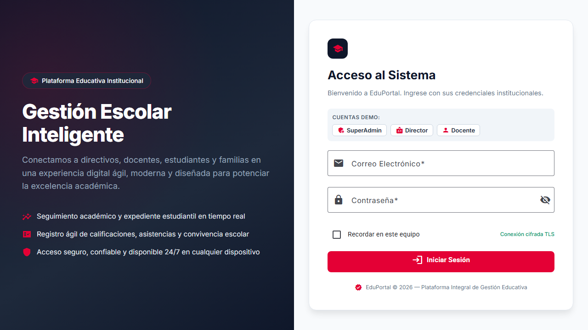
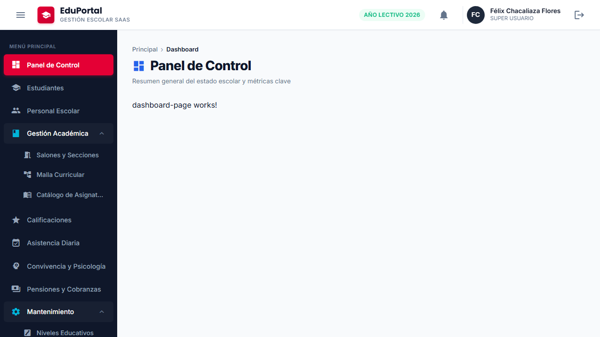
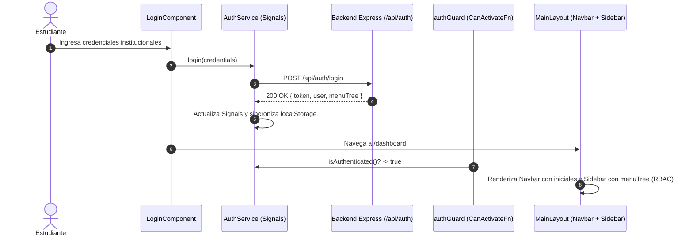
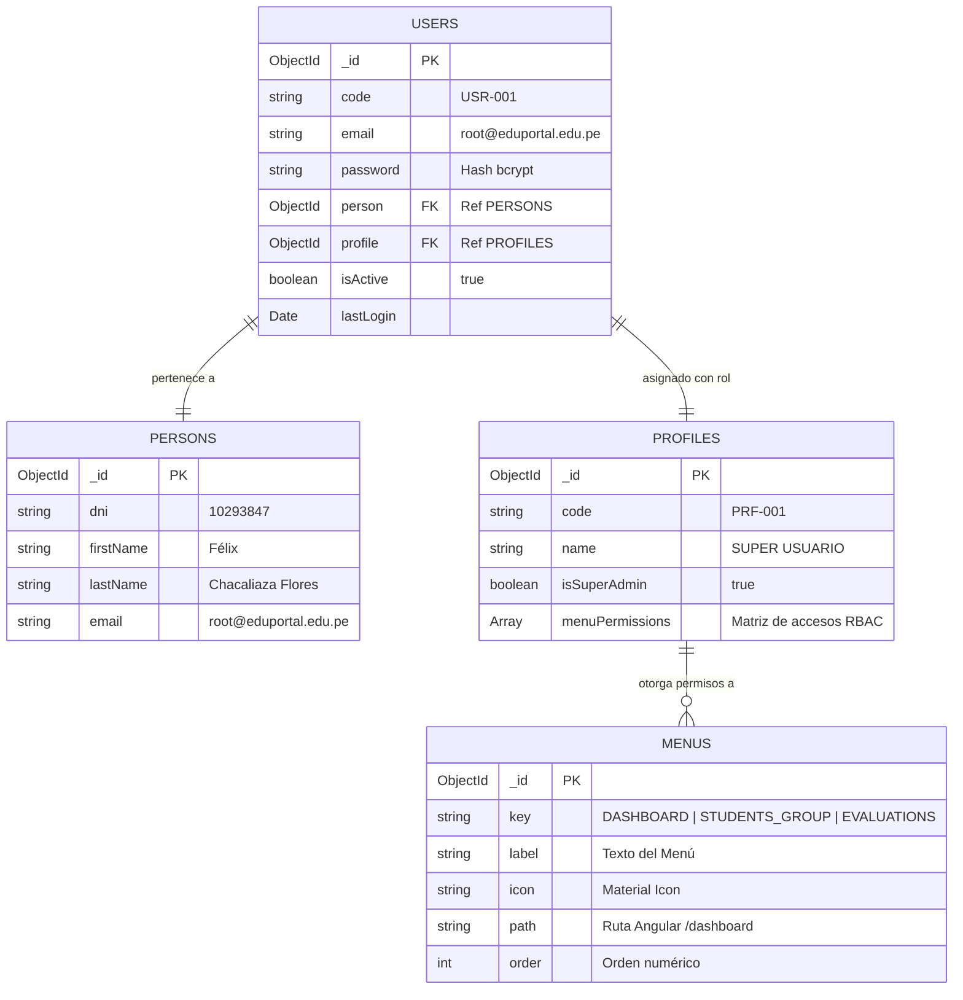

# 🎓 Guía del Estudiante • Sesión 07.0.0
## Seguridad Web, Login Multi-Layout JWT y Menú por Perfil RBAC: Arquitectura Multi-Layout (`AuthLayout` vs `MainLayout`), `AuthService` Reactivo con Signals, `HttpInterceptorFn` (`jwtInterceptor`, `httpErrorInterceptor`), `CanActivateFn` (`authGuard`, `publicGuard`), Form Triad y App Shell (`eduportal-web`)

> **Curso:** Desarrollo Web Frontend Profesional con Angular 22  
> **Proyecto:** EduPortal — Sistema de Gestión Escolar SaaS  
> **Nivel:** Junior a Intermedio  
> **Rama Oficial de Trabajo:** `feature/sesion-07.0.0` (Tag Oficial: `sesion-07.0.0`)  
> **Entorno:** `http://localhost:4200/login` • Angular 22 Zoneless, TypeScript 5.6 Estricto, Angular Material 22, Playwright E2E  
> **Backend de Soporte:** `eduportal-api-starter` (`http://localhost:3000/api/auth`) • Tag `backend-v1.0` (MongoDB: `eduportalangular`)

---

## 🎯 ¿Qué Aprenderás Hoy?

En esta sesión construirás paso a paso el sistema de **Seguridad Web, Autenticación JWT y Control de Acceso Basado en Roles (RBAC)** de nivel empresarial para EduPortal:

1. **Arquitectura Multi-Layout:** Cómo separar completamente la pantalla de inicio de sesión (`AuthLayoutComponent`, sin navbar ni sidebar) del shell administrativo de la plataforma (`MainLayoutComponent`, con barra superior y navegación lateral).
2. **`AuthService` Reactivo con Signals:** Gestión moderna del estado de sesión con señales (`token`, `currentUser`, `menuTree`, `isLoading`) y computadas (`isAuthenticated`, `isSuperAdmin`, `navigationItems`), sincronizado automáticamente con `localStorage`.
3. **Interceptores Funcionales (`HttpInterceptorFn`):**
   - Inyección automática del token JWT en cabecera `Authorization: Bearer <token>` (`jwtInterceptor`).
   - Captura reactiva de errores 401/403 con cierre de sesión y redirección a `/login` (`httpErrorInterceptor`).
4. **Guards Funcionales de Navegación (`CanActivateFn`):**
   - `authGuard`: protege rutas privadas y recuerda la URL de retorno (`returnUrl`).
   - `publicGuard`: evita que usuarios ya autenticados vuelvan a la pantalla de login.
5. **Form Triad Desacoplada para Login:** Creación de formularios reactivos tipados mediante la tríada `login-form.model.ts`, `login-form.constant.ts`, `LoginPresenter` y `LoginComponent`.
6. **Componentes del App Shell Actualizados:**
   - `NavbarComponent`: muestra iniciales dinámicas, nombre, rol y botón de logout.
   - `SidebarComponent`: renderiza solo los módulos autorizados por perfil RBAC.
   - `MainLayoutComponent`: aloja el layout estructural principal.
7. **Testing Automatizado TDD y E2E:** Ejecución de pruebas unitarias y pruebas de navegador real con Playwright en Chromium.

---

## ⚡ Sincronización y Punto de Partida con Git

Antes de comenzar a programar, sitúate en tu caso correspondiente:

```bash
# 0. PASO PREVIO OBLIGATORIO: Descargar todos los tags oficiales más recientes desde GitHub
git fetch origin --tags
```

---

### 🟢 Situación 1: No completaste la sesión anterior o tu código tiene errores (Rescate Rápido)
> 💡 **Recomendado:** Si tu proyecto anterior no compila o te atrasaste, usa este comando para partir de una base limpia y probada:

```bash
# Crear tu rama directamente desde el tag de la sesión anterior:
git checkout -f tags/sesion-06.1.1 -b feature/sesion-07.0.0

# Instalar dependencias:
npm install
```

---

### 🟡 Situación 2: Completaste la sesión anterior en tu propia rama

#### 🔹 Alternativa 2.A: Continuar sobre tu código personal
```bash
git add .
git commit -m "feat: culminacion de sesion anterior con codigo propio"
git checkout -b feature/sesion-07.0.0
```

#### 🔹 Alternativa 2.B: Respaldar tu avance y usar la solución oficial del docente
```bash
git checkout -b mi-respaldo-sesion-anterior
git checkout tags/sesion-06.1.1 -b feature/sesion-07.0.0
```

---

### 🔵 Situación 3: Nivelar tu rama de trabajo con el tag oficial

#### 🔹 Opción 3.1: Nivelación limpia total (Recomendada)
```bash
git checkout feature/sesion-07.0.0
git reset --hard tags/sesion-06.1.1
git push origin feature/sesion-07.0.0 --force
```

#### 🔹 Opción 3.2: Fusión conservando tus commits (`git merge`)
```bash
git checkout feature/sesion-07.0.0
git merge tags/sesion-06.1.1 -m "merge: sincronizar con tag oficial sesion-06.1.1"
```

---

### 🟣 Situación 4: Inspección rápida del código final terminado de esta sesión
```bash
git checkout tags/sesion-07.0.0
```

---

## ⚡ Nivelación Rápida con Git Tags (`sesion-07.0.0`)

> 💡 **Copia Rápida:** Si deseas nivelarte en cualquier momento con la solución terminada de la sesión 7, ejecuta:

```bash
git fetch origin --tags && git reset --hard sesion-07.0.0
```

---

## 🖼️ Referencias Visuales del Producto a Construir

### 1. Pantalla de Inicio de Sesión (`AuthLayout`)
Diseño full-width moderno con hero escolar lateral, formulario reactivo con validaciones instantáneas y selector rápido de roles demo:


### 2. Panel Principal Autenticado con Menú RBAC (`MainLayout`)
Vista posterior al login donde el Navbar muestra las iniciales, nombre y rol del usuario autenticado, y el Sidebar adapta sus módulos dinámicamente:


---

## 🧩 Flujo de Autenticación y Seguridad



---

## 🏛️ PARTE 1: Modelo de Datos MongoDB y Endpoints REST del Backend (00:00 - 00:20)

### 1.1 Diagrama Entidad-Relación (ERD) en MongoDB (`eduportalangular`)



### 1.2 Endpoints REST del Backend (`http://localhost:3000/api/auth`)

| Método | Endpoint | Cabeceras Requeridas | Descripción |
| :--- | :--- | :--- | :--- |
| `POST` | `/api/auth/login` | `Content-Type: application/json` | Valida correo/contraseña y genera el token JWT con el árbol RBAC. |
| `GET` | `/api/auth/me` | `Authorization: Bearer <token>` | Retorna la información del usuario en sesión activa. |
| `GET` | `/api/menus` | `Authorization: Bearer <token>` | Catálogo general de módulos para el sistema escolar. |

#### Probar el Endpoint con cURL:
```bash
curl -X POST http://localhost:3000/api/auth/login \
  -H "Content-Type: application/json" \
  -d '{"email":"root@eduportal.edu.pe","password":"Admin123*"}'
```

---

## 🛠️ PARTE 2: Creación de Estructura de Carpetas y Componentes CLI (00:20 - 00:35)

### 2.1 Creación de Carpetas en 1 Clic

```bash
# Linux / macOS / Git Bash:
mkdir -p src/app/core/auth/services \
         src/app/core/auth/guards \
         src/app/core/auth/interceptors \
         src/app/core/layouts/auth-layout \
         src/app/core/layouts/main-layout \
         src/app/features/auth/models \
         src/app/features/auth/pages/login/models \
         tests/e2e/helpers

# Windows PowerShell:
New-Item -ItemType Directory -Force "src/app/core/auth/services", "src/app/core/auth/guards", "src/app/core/auth/interceptors", "src/app/core/layouts/auth-layout", "src/app/core/layouts/main-layout", "src/app/features/auth/models", "src/app/features/auth/pages/login/models", "tests/e2e/helpers"
```

### 2.2 Generación con Angular CLI

```bash
# Comando en 1 sola línea:
ng g c core/layouts/auth-layout --skip-tests --type=component && ng g c features/auth/pages/login --skip-tests --type=component
```

---

## 🌐 PARTE 3: Configuración de Endpoints Globales (00:35 - 00:45)

### 3.1 Actualización de `src/app/core/api/endpoints.ts`

> ⚡ **Comando de Edición Rápida:**
> ```bash
> # Linux / macOS / Git Bash:
> touch src/app/core/api/endpoints.ts
> # Windows PowerShell:
> New-Item -ItemType File -Force "src/app/core/api/endpoints.ts"
> ```

```typescript
// src/app/core/api/endpoints.ts
import { environment } from '../../../environments/environment';

export const API_ENDPOINTS = {
  areas: `${environment.apiUrl}/areas`,
  subjects: `${environment.apiUrl}/subjects`,
  levels: `${environment.apiUrl}/levels`,
  grades: `${environment.apiUrl}/grades`,
  sections: `${environment.apiUrl}/sections`,
  classrooms: `${environment.apiUrl}/classrooms`,
  rules: `${environment.apiUrl}/rules`,
  academicYears: `${environment.apiUrl}/academic-years`,
  gradeSections: `${environment.apiUrl}/grade-sections`,
  gradeSubjects: `${environment.apiUrl}/grade-subjects`,
  menus: `${environment.apiUrl}/menus`,
  students: `${environment.apiUrl}/students`,
  persons: `${environment.apiUrl}/persons`,
  enrollments: `${environment.apiUrl}/enrollments`,
  positions: `${environment.apiUrl}/positions`,
  teachers: `${environment.apiUrl}/teachers`,
  workers: `${environment.apiUrl}/workers`,
  evaluations: `${environment.apiUrl}/evaluations`,
  attendances: `${environment.apiUrl}/attendances`,
  incidents: `${environment.apiUrl}/incidents`,
  authLogin: `${environment.apiUrl}/auth/login`,
  authMe: `${environment.apiUrl}/auth/me`,
} as const;
```

---

## 📐 PARTE 4: Contratos e Interfaces Tipadas (1 Interfaz por Archivo) (00:45 - 01:05)

### 4.1 `src/app/features/auth/models/auth-menu-item.interface.ts`

> ⚡ **Comando de Creación Rápida:**
> ```bash
> # Linux / macOS / Git Bash:
> touch src/app/features/auth/models/auth-menu-item.interface.ts
> # Windows PowerShell:
> New-Item -ItemType File -Force "src/app/features/auth/models/auth-menu-item.interface.ts"
> ```

```typescript
// src/app/features/auth/models/auth-menu-item.interface.ts
/**
 * ============================================================================
 * AuthMenuItem Interface
 * ============================================================================
 * Representa un nodo del árbol de navegación retornado por el backend con
 * nivel de acceso RBAC asignado al perfil del usuario autenticado.
 * ============================================================================
 */
export interface AuthMenuItem {
  readonly id: string;
  readonly key: string;
  readonly label: string;
  readonly icon: string;
  readonly path: string | null;
  readonly accessLevel: 'FULL' | 'READ_ONLY';
  readonly children?: readonly AuthMenuItem[];
}
```

### 4.2 `src/app/features/auth/models/auth-user.interface.ts`

> ⚡ **Comando de Creación Rápida:**
> ```bash
> # Linux / macOS / Git Bash:
> touch src/app/features/auth/models/auth-user.interface.ts
> # Windows PowerShell:
> New-Item -ItemType File -Force "src/app/features/auth/models/auth-user.interface.ts"
> ```

```typescript
// src/app/features/auth/models/auth-user.interface.ts
import { AuthMenuItem } from './auth-menu-item.interface';

/**
 * ============================================================================
 * AuthUser Interface
 * ============================================================================
 * Representa la entidad del usuario autenticado en la sesión activa.
 * ============================================================================
 */
export interface AuthUser {
  readonly id: string;
  readonly code: string;
  readonly email: string;
  readonly person: {
    readonly id: string;
    readonly dni: string;
    readonly fullName: string;
  };
  readonly profile: {
    readonly id: string;
    readonly name: string;
    readonly isSuperAdmin: boolean;
  };
  readonly menuTree: readonly AuthMenuItem[];
}
```

### 4.3 `src/app/features/auth/models/login-request.dto.ts`

> ⚡ **Comando de Creación Rápida:**
> ```bash
> # Linux / macOS / Git Bash:
> touch src/app/features/auth/models/login-request.dto.ts
> # Windows PowerShell:
> New-Item -ItemType File -Force "src/app/features/auth/models/login-request.dto.ts"
> ```

```typescript
// src/app/features/auth/models/login-request.dto.ts
/**
 * ============================================================================
 * LoginRequestDto Interface
 * ============================================================================
 * Contrato de transferencia de datos enviado en POST /api/auth/login.
 * ============================================================================
 */
export interface LoginRequestDto {
  readonly email: string;
  readonly password: string;
}
```

### 4.4 `src/app/features/auth/models/login-response.interface.ts`

> ⚡ **Comando de Creación Rápida:**
> ```bash
> # Linux / macOS / Git Bash:
> touch src/app/features/auth/models/login-response.interface.ts
> # Windows PowerShell:
> New-Item -ItemType File -Force "src/app/features/auth/models/login-response.interface.ts"
> ```

```typescript
// src/app/features/auth/models/login-response.interface.ts
import { AuthUser } from './auth-user.interface';

/**
 * ============================================================================
 * LoginResponseData Interface
 * ============================================================================
 * Estructura del cuerpo de datos retornado en autenticación exitosa.
 * ============================================================================
 */
export interface LoginResponseData {
  readonly token: string;
  readonly expiresIn: string;
  readonly user: AuthUser;
}

/**
 * ============================================================================
 * LoginResponse Interface
 * ============================================================================
 * Respuesta estandarizada del endpoint de autenticación.
 * ============================================================================
 */
export interface LoginResponse {
  readonly success: boolean;
  readonly data: LoginResponseData;
  readonly message?: string;
}
```

### 4.5 `src/app/features/auth/models/index.ts`

> ⚡ **Comando de Creación Rápida:**
> ```bash
> # Linux / macOS / Git Bash:
> touch src/app/features/auth/models/index.ts
> # Windows PowerShell:
> New-Item -ItemType File -Force "src/app/features/auth/models/index.ts"
> ```

```typescript
// src/app/features/auth/models/index.ts
export * from './auth-menu-item.interface';
export * from './auth-user.interface';
export * from './login-request.dto';
export * from './login-response.interface';
```

---

## ⚡ PARTE 5: Servicio HTTP Reactivo `AuthService` (01:05 - 01:25)

Creamos el servicio reactivo que administra los tokens, la sesión del usuario y la persistencia local.

Ubicación: `src/app/core/auth/services/auth.service.ts`

> ⚡ **Comando de Creación Rápida:**
> ```bash
> # Linux / macOS / Git Bash:
> touch src/app/core/auth/services/auth.service.ts
> # Windows PowerShell:
> New-Item -ItemType File -Force "src/app/core/auth/services/auth.service.ts"
> ```

```typescript
// src/app/core/auth/services/auth.service.ts
import { Injectable, inject, signal, computed } from '@angular/core';
import { HttpClient } from '@angular/common/http';
import { Router } from '@angular/router';
import { firstValueFrom } from 'rxjs';
import { API_ENDPOINTS } from '../../api/endpoints';
import {
  AuthUser,
  LoginRequestDto,
  LoginResponse,
  LoginResponseData,
  AuthMenuItem
} from '../../../features/auth/models';
import { NavigationItem } from '../../../shared/layout/sidebar/models/navigation-item.interface';

const TOKEN_KEY = 'eduportal_token';
const USER_KEY = 'eduportal_user';
const MENU_KEY = 'eduportal_menu';

/**
 * ============================================================================
 * AuthService
 * ============================================================================
 * Servicio centralizado reactivo para la gestión de identidad, tokens JWT,
 * permisos RBAC y estado de sesión mediante Angular Signals puras.
 * ============================================================================
 */
@Injectable({
  providedIn: 'root'
})
export class AuthService {
  private readonly http = inject(HttpClient);
  private readonly router = inject(Router);

  /** Token JWT reactivo sincronizado con almacenamiento local */
  public readonly token = signal<string | null>(this.readInitialToken());

  /** Usuario autenticado actual en sesión */
  public readonly currentUser = signal<AuthUser | null>(this.readInitialUser());

  /** Árbol de opciones de menú autorizadas para el perfil activo */
  public readonly menuTree = signal<readonly AuthMenuItem[]>(this.readInitialMenu());

  /** Indicador reactivo de operaciones asíncronas de autenticación en progreso */
  public readonly isLoading = signal<boolean>(false);

  /** Determina si existe una sesión activa y válida */
  public readonly isAuthenticated = computed<boolean>(() => {
    return !!this.token() && !!this.currentUser();
  });

  /** Determina si el usuario en sesión posee privilegios de Super Administrador */
  public readonly isSuperAdmin = computed<boolean>(() => {
    return this.currentUser()?.profile?.isSuperAdmin === true;
  });

  /** Nombre del perfil o rol del usuario actual */
  public readonly userRoleName = computed<string>(() => {
    return this.currentUser()?.profile?.name ?? '';
  });

  /** Nombre completo de la persona asociada a la cuenta */
  public readonly userFullName = computed<string>(() => {
    const personName = this.currentUser()?.person?.fullName;
    return personName && personName.trim().length > 0 ? personName : (this.currentUser()?.email ?? '');
  });

  /** Transforma el árbol de menús RBAC a la estructura requerida por el Sidebar */
  public readonly navigationItems = computed<readonly NavigationItem[]>(() => {
    return this.transformMenuToNavigation(this.menuTree());
  });

  /**
   * Ejecuta la autenticación de credenciales ante el backend.
   */
  public async login(credentials: LoginRequestDto): Promise<LoginResponseData> {
    this.isLoading.set(true);
    try {
      const response = await firstValueFrom(
        this.http.post<LoginResponse>(API_ENDPOINTS.authLogin, credentials)
      );

      if (!response.success || !response.data) {
        throw new Error(response.message || 'Error en la respuesta de autenticación');
      }

      const { token, user } = response.data;
      this.saveSession(token, user, user.menuTree || []);

      return response.data;
    } finally {
      this.isLoading.set(false);
    }
  }

  /**
   * Restaura y valida la sesión activa ante el backend mediante GET /api/auth/me.
   */
  public async restoreSession(): Promise<boolean> {
    const currentToken = this.token();
    if (!currentToken) {
      return false;
    }

    try {
      const response = await firstValueFrom(
        this.http.get<{ success: boolean; data: AuthUser }>(API_ENDPOINTS.authMe)
      );

      if (response.success && response.data) {
        const user = response.data;
        this.currentUser.set(user);
        this.menuTree.set(user.menuTree || []);
        this.persistInStorage(USER_KEY, user);
        this.persistInStorage(MENU_KEY, user.menuTree || []);
        return true;
      }
      return false;
    } catch {
      this.clearSession();
      return false;
    }
  }

  /**
   * Finaliza la sesión del usuario, elimina credenciales y redirige a /login.
   */
  public logout(): void {
    this.clearSession();
    this.router.navigate(['/login']);
  }

  /**
   * Guarda de forma atómica el estado de sesión en memoria y en localStorage.
   */
  public saveSession(token: string, user: AuthUser, menuTree: readonly AuthMenuItem[]): void {
    this.token.set(token);
    this.currentUser.set(user);
    this.menuTree.set(menuTree);

    this.persistInStorage(TOKEN_KEY, token);
    this.persistInStorage(USER_KEY, user);
    this.persistInStorage(MENU_KEY, menuTree);
  }

  /**
   * Limpia el estado de sesión sin redirigir inmediatamente.
   */
  public clearSession(): void {
    this.token.set(null);
    this.currentUser.set(null);
    this.menuTree.set([]);

    this.removeFromStorage(TOKEN_KEY);
    this.removeFromStorage(USER_KEY);
    this.removeFromStorage(MENU_KEY);
  }

  /**
   * Transforma la lista RBAC en elementos compatibles con el componente Sidebar.
   */
  private transformMenuToNavigation(menus: readonly AuthMenuItem[]): readonly NavigationItem[] {
    if (!menus || menus.length === 0) {
      return [];
    }

    return menus.map(item => {
      const hasChildren = Array.isArray(item.children) && item.children.length > 0;
      if (hasChildren) {
        return {
          label: item.label,
          icon: item.icon,
          children: item.children!.map(child => ({
            label: child.label,
            icon: child.icon,
            path: child.path || ''
          }))
        };
      }

      return {
        label: item.label,
        icon: item.icon,
        path: item.path || ''
      };
    });
  }

  private readInitialToken(): string | null {
    try {
      return localStorage.getItem(TOKEN_KEY);
    } catch {
      return null;
    }
  }

  private readInitialUser(): AuthUser | null {
    try {
      const raw = localStorage.getItem(USER_KEY);
      return raw ? JSON.parse(raw) : null;
    } catch {
      return null;
    }
  }

  private readInitialMenu(): readonly AuthMenuItem[] {
    try {
      const raw = localStorage.getItem(MENU_KEY);
      return raw ? JSON.parse(raw) : [];
    } catch {
      return [];
    }
  }

  private persistInStorage(key: string, value: unknown): void {
    try {
      if (typeof value === 'string') {
        localStorage.setItem(key, value);
      } else {
        localStorage.setItem(key, JSON.stringify(value));
      }
    } catch {
      // Entornos donde localStorage esté bloqueado o no disponible
    }
  }

  private removeFromStorage(key: string): void {
    try {
      localStorage.removeItem(key);
    } catch {
      // Ignorar excepciones de storage
    }
  }
}
```

Ubicación: `src/app/core/auth/services/index.ts`
```typescript
// src/app/core/auth/services/index.ts
export * from './auth.service';
```

---

## 🛡️ PARTE 6: Interceptores Funcionales y Guards de Navegación (01:25 - 01:50)

### 6.1 `src/app/core/auth/interceptors/jwt.interceptor.ts`

> ⚡ **Comando de Creación Rápida:**
> ```bash
> # Linux / macOS / Git Bash:
> touch src/app/core/auth/interceptors/jwt.interceptor.ts
> # Windows PowerShell:
> New-Item -ItemType File -Force "src/app/core/auth/interceptors/jwt.interceptor.ts"
> ```

```typescript
// src/app/core/auth/interceptors/jwt.interceptor.ts
import { HttpInterceptorFn } from '@angular/common/http';
import { inject } from '@angular/core';
import { AuthService } from '../services/auth.service';

/**
 * ============================================================================
 * jwtInterceptor
 * ============================================================================
 * Interceptor funcional que inyecta automáticamente la cabecera `Authorization`
 * con el token Bearer en todas las solicitudes HTTP dirigidas a la API.
 * ============================================================================
 */
export const jwtInterceptor: HttpInterceptorFn = (req, next) => {
  const authService = inject(AuthService);
  const token = authService.token();

  if (token) {
    const cloned = req.clone({
      setHeaders: {
        Authorization: `Bearer ${token}`
      }
    });
    return next(cloned);
  }

  return next(req);
};
```

### 6.2 `src/app/core/auth/interceptors/http-error.interceptor.ts`

> ⚡ **Comando de Creación Rápida:**
> ```bash
> # Linux / macOS / Git Bash:
> touch src/app/core/auth/interceptors/http-error.interceptor.ts
> # Windows PowerShell:
> New-Item -ItemType File -Force "src/app/core/auth/interceptors/http-error.interceptor.ts"
> ```

```typescript
// src/app/core/auth/interceptors/http-error.interceptor.ts
import { HttpInterceptorFn, HttpErrorResponse } from '@angular/common/http';
import { inject } from '@angular/core';
import { Router } from '@angular/router';
import { catchError, throwError } from 'rxjs';
import { AuthService } from '../services/auth.service';

/**
 * ============================================================================
 * httpErrorInterceptor
 * ============================================================================
 * Interceptor funcional que captura anomalías HTTP globales.
 * En caso de respuestas 401 o 403 en endpoints protegidos, invalida la sesión
 * local y redirige de forma controlada a la pantalla de /login.
 * ============================================================================
 */
export const httpErrorInterceptor: HttpInterceptorFn = (req, next) => {
  const authService = inject(AuthService);
  const router = inject(Router);

  return next(req).pipe(
    catchError((error: unknown) => {
      if (error instanceof HttpErrorResponse) {
        // No interceptar las respuestas 401/403 originadas del propio intento de login
        const isLoginRequest = req.url.includes('/api/auth/login');

        if ((error.status === 401 || error.status === 403) && !isLoginRequest) {
          authService.clearSession();
          const currentUrl = router.url;
          if (!currentUrl.includes('/login')) {
            router.navigate(['/login'], {
              queryParams: { returnUrl: currentUrl }
            });
          }
        }
      }

      return throwError(() => error);
    })
  );
};
```

Ubicación: `src/app/core/auth/interceptors/index.ts`
```typescript
// src/app/core/auth/interceptors/index.ts
export * from './jwt.interceptor';
export * from './http-error.interceptor';
```

### 6.3 `src/app/core/auth/guards/auth.guard.ts`

> ⚡ **Comando de Creación Rápida:**
> ```bash
> # Linux / macOS / Git Bash:
> touch src/app/core/auth/guards/auth.guard.ts
> # Windows PowerShell:
> New-Item -ItemType File -Force "src/app/core/auth/guards/auth.guard.ts"
> ```

```typescript
// src/app/core/auth/guards/auth.guard.ts
import { CanActivateFn, Router } from '@angular/router';
import { inject } from '@angular/core';
import { AuthService } from '../services/auth.service';

/**
 * ============================================================================
 * authGuard
 * ============================================================================
 * Guard funcional que protege rutas privadas. Requiere que el usuario
 * posea un token y perfil autenticado en sesión activa.
 * Redirige a /login con returnUrl si la sesión no es válida.
 * ============================================================================
 */
export const authGuard: CanActivateFn = (route, state) => {
  const authService = inject(AuthService);
  const router = inject(Router);

  if (authService.isAuthenticated()) {
    return true;
  }

  return router.createUrlTree(['/login'], {
    queryParams: { returnUrl: state.url }
  });
};
```

### 6.4 `src/app/core/auth/guards/public.guard.ts`

> ⚡ **Comando de Creación Rápida:**
> ```bash
> # Linux / macOS / Git Bash:
> touch src/app/core/auth/guards/public.guard.ts
> # Windows PowerShell:
> New-Item -ItemType File -Force "src/app/core/auth/guards/public.guard.ts"
> ```

```typescript
// src/app/core/auth/guards/public.guard.ts
import { CanActivateFn, Router } from '@angular/router';
import { inject } from '@angular/core';
import { AuthService } from '../services/auth.service';

/**
 * ============================================================================
 * publicGuard
 * ============================================================================
 * Guard funcional para rutas públicas (ej. /login).
 * Si el usuario ya cuenta con una sesión activa, lo redirige al dashboard.
 * ============================================================================
 */
export const publicGuard: CanActivateFn = () => {
  const authService = inject(AuthService);
  const router = inject(Router);

  if (authService.isAuthenticated()) {
    return router.createUrlTree(['/dashboard']);
  }

  return true;
};
```

Ubicación: `src/app/core/auth/guards/index.ts`
```typescript
// src/app/core/auth/guards/index.ts
export * from './auth.guard';
export * from './public.guard';
```

### 6.5 Registro de Interceptores en `src/app/app.config.ts`

```typescript
// src/app/app.config.ts
import { ApplicationConfig, provideBrowserGlobalErrorListeners } from '@angular/core';
import { provideHttpClient, withFetch, withInterceptors } from '@angular/common/http';
import { provideRouter, withComponentInputBinding } from '@angular/router';
import { routes } from './app.routes';
import { jwtInterceptor, httpErrorInterceptor } from './core/auth/interceptors';

export const appConfig: ApplicationConfig = {
  providers: [
    provideBrowserGlobalErrorListeners(),
    provideRouter(routes, withComponentInputBinding()),
    provideHttpClient(
      withFetch(),
      withInterceptors([jwtInterceptor, httpErrorInterceptor])
    ),
  ],
};
```

---

## 🧩 PARTE 7: Form Triad para Login Desacoplada (02:00 - 02:20)

### 7.1 `src/app/features/auth/pages/login/models/login-form.model.ts`

> ⚡ **Comando de Creación Rápida:**
> ```bash
> # Linux / macOS / Git Bash:
> touch src/app/features/auth/pages/login/models/login-form.model.ts
> # Windows PowerShell:
> New-Item -ItemType File -Force "src/app/features/auth/pages/login/models/login-form.model.ts"
> ```

```typescript
// src/app/features/auth/pages/login/models/login-form.model.ts
import { FormControl } from '@angular/forms';

/**
 * ============================================================================
 * LoginFormControls Interface
 * ============================================================================
 * Contrato estrictamente tipado para los controles del formulario de Login.
 * ============================================================================
 */
export interface LoginFormControls {
  readonly email: FormControl<string>;
  readonly password: FormControl<string>;
  readonly rememberMe: FormControl<boolean>;
}

/**
 * ============================================================================
 * LoginFormValue Interface
 * ============================================================================
 * Estructura de datos inmutable extraída del formulario al enviar credenciales.
 * ============================================================================
 */
export interface LoginFormValue {
  readonly email: string;
  readonly password: string;
  readonly rememberMe: boolean;
}
```

### 7.2 `src/app/features/auth/pages/login/models/login-form.constant.ts`

> ⚡ **Comando de Creación Rápida:**
> ```bash
> # Linux / macOS / Git Bash:
> touch src/app/features/auth/pages/login/models/login-form.constant.ts
> # Windows PowerShell:
> New-Item -ItemType File -Force "src/app/features/auth/pages/login/models/login-form.constant.ts"
> ```

```typescript
// src/app/features/auth/pages/login/models/login-form.constant.ts
import { LoginFormValue } from './login-form.model';

/**
 * ============================================================================
 * LOGIN_FORM_DEFAULTS Constant
 * ============================================================================
 * Valores predeterminados para la inicialización del formulario de autenticación.
 * ============================================================================
 */
export const LOGIN_FORM_DEFAULTS: LoginFormValue = {
  email: '',
  password: '',
  rememberMe: false
};
```

Ubicación: `src/app/features/auth/pages/login/models/index.ts`
```typescript
// src/app/features/auth/pages/login/models/index.ts
export * from './login-form.model';
export * from './login-form.constant';
```

### 7.3 `src/app/features/auth/pages/login/login.presenter.ts`

> ⚡ **Comando de Creación Rápida:**
> ```bash
> # Linux / macOS / Git Bash:
> touch src/app/features/auth/pages/login/login.presenter.ts
> # Windows PowerShell:
> New-Item -ItemType File -Force "src/app/features/auth/pages/login/login.presenter.ts"
> ```

```typescript
// src/app/features/auth/pages/login/login.presenter.ts
import { Injectable, inject, signal } from '@angular/core';
import { FormBuilder, FormGroup, Validators } from '@angular/forms';
import { LoginFormControls, LoginFormValue } from './models/login-form.model';
import { LOGIN_FORM_DEFAULTS } from './models/login-form.constant';

/**
 * ============================================================================
 * LoginPresenter
 * ============================================================================
 * Cerebro desacoplado (Headless Presenter) para la pantalla de inicio de sesión.
 * Encapsula la reactividad del formulario tipado, validaciones y estado visual.
 * ============================================================================
 */
@Injectable()
export class LoginPresenter {
  private readonly fb = inject(FormBuilder);

  /** Formulario reactivo tipado */
  public readonly form: FormGroup<LoginFormControls> = this.buildForm();

  /** Control de visibilidad del campo contraseña */
  public readonly hidePassword = signal<boolean>(true);

  /** Mensaje de error reactivo (credenciales inválidas, bloqueo, etc.) */
  public readonly errorMessage = signal<string | null>(null);

  /** Alterna la máscara del campo de contraseña */
  public togglePasswordVisibility(): void {
    this.hidePassword.update(prev => !prev);
  }

  /** Asigna o limpia el mensaje de error del formulario */
  public setErrorMessage(message: string | null): void {
    this.errorMessage.set(message);
  }

  /** Carga credenciales en el formulario (usado para selectores rápidos de prueba) */
  public fillCredentials(email: string, password: string): void {
    this.form.patchValue({ email, password });
    this.form.markAsDirty();
    this.errorMessage.set(null);
  }

  /**
   * Valida el formulario y retorna su valor tipado si es válido;
   * de lo contrario marca todos los controles como tocados y retorna null.
   */
  public validateAndGetCredentials(): LoginFormValue | null {
    this.errorMessage.set(null);
    if (this.form.invalid) {
      this.form.markAllAsTouched();
      return null;
    }
    return this.form.getRawValue();
  }

  /**
   * Construye el FormGroup inmutable con validaciones síncronas requeridas.
   */
  private buildForm(): FormGroup<LoginFormControls> {
    return this.fb.group({
      email: this.fb.control<string>(LOGIN_FORM_DEFAULTS.email, {
        nonNullable: true,
        validators: [Validators.required, Validators.email]
      }),
      password: this.fb.control<string>(LOGIN_FORM_DEFAULTS.password, {
        nonNullable: true,
        validators: [Validators.required, Validators.minLength(6)]
      }),
      rememberMe: this.fb.control<boolean>(LOGIN_FORM_DEFAULTS.rememberMe, {
        nonNullable: true
      })
    });
  }
}
```

---

## 🎨 PARTE 8: Componentes Visuales: AuthLayout y Pantalla de Login (02:20 - 02:40)

### 8.1 `AuthLayoutComponent`

> 💡 **Comando Angular CLI:**
> ```bash
> ng g c core/layouts/auth-layout --skip-tests --type=component
> ```

#### TypeScript: `src/app/core/layouts/auth-layout/auth-layout.component.ts`

> ⚡ **Comando de Creación Rápida:**
> ```bash
> # Linux / macOS / Git Bash:
> touch src/app/core/layouts/auth-layout/auth-layout.component.ts
> # Windows PowerShell:
> New-Item -ItemType File -Force "src/app/core/layouts/auth-layout/auth-layout.component.ts"
> ```

```typescript
// src/app/core/layouts/auth-layout/auth-layout.component.ts
import { Component } from '@angular/core';
import { RouterOutlet } from '@angular/router';

/**
 * ============================================================================
 * AuthLayoutComponent
 * ============================================================================
 * Shell estructural dedicado a los flujos públicos y de autenticación (Login,
 * Recuperación de Contraseña, etc.).
 *
 * @remarks
 * Provee un lienzo limpio a pantalla completa sin elementos persistentes
 * de administración (sin Navbar superior ni Sidebar lateral).
 * ============================================================================
 */
@Component({
  selector: 'app-auth-layout',
  imports: [RouterOutlet],
  templateUrl: './auth-layout.component.html',
  styleUrl: './auth-layout.component.scss'
})
export class AuthLayoutComponent {}
```

#### Template HTML: `src/app/core/layouts/auth-layout/auth-layout.component.html`

> ⚡ **Comando de Creación Rápida:**
> ```bash
> # Linux / macOS / Git Bash:
> touch src/app/core/layouts/auth-layout/auth-layout.component.html
> # Windows PowerShell:
> New-Item -ItemType File -Force "src/app/core/layouts/auth-layout/auth-layout.component.html"
> ```

```html
<!-- src/app/core/layouts/auth-layout/auth-layout.component.html -->
<main class="auth-layout-container">
  <router-outlet></router-outlet>
</main>
```

#### Estilos SCSS: `src/app/core/layouts/auth-layout/auth-layout.component.scss`

> ⚡ **Comando de Creación Rápida:**
> ```bash
> # Linux / macOS / Git Bash:
> touch src/app/core/layouts/auth-layout/auth-layout.component.scss
> # Windows PowerShell:
> New-Item -ItemType File -Force "src/app/core/layouts/auth-layout/auth-layout.component.scss"
> ```

```scss
// src/app/core/layouts/auth-layout/auth-layout.component.scss
.auth-layout-container {
  width: 100%;
  min-height: 100vh;
  margin: 0;
  padding: 0;
  display: flex;
  align-items: stretch;
  background-color: #f8fafc;
  overflow-x: hidden;
}
```

Ubicación: `src/app/core/layouts/auth-layout/index.ts`
```typescript
// src/app/core/layouts/auth-layout/index.ts
export * from './auth-layout.component';
```

---

### 8.2 `LoginComponent`

> 💡 **Comando Angular CLI:**
> ```bash
> ng g c features/auth/pages/login --skip-tests --type=component
> ```

#### TypeScript: `src/app/features/auth/pages/login/login.component.ts`

> ⚡ **Comando de Creación Rápida:**
> ```bash
> # Linux / macOS / Git Bash:
> touch src/app/features/auth/pages/login/login.component.ts
> # Windows PowerShell:
> New-Item -ItemType File -Force "src/app/features/auth/pages/login/login.component.ts"
> ```

```typescript
// src/app/features/auth/pages/login/login.component.ts
import { Component, inject } from '@angular/core';
import { ReactiveFormsModule } from '@angular/forms';
import { Router, ActivatedRoute } from '@angular/router';
import { MatFormFieldModule } from '@angular/material/form-field';
import { MatInputModule } from '@angular/material/input';
import { MatButtonModule } from '@angular/material/button';
import { MatIconModule } from '@angular/material/icon';
import { MatCheckboxModule } from '@angular/material/checkbox';
import { MatProgressSpinnerModule } from '@angular/material/progress-spinner';
import { LoginPresenter } from './login.presenter';
import { AuthService } from '../../../../core/auth/services/auth.service';

/**
 * ============================================================================
 * LoginComponent
 * ============================================================================
 * Vista principal de autenticación con arquitectura Form Triad y Signals.
 * Permite a directivos, docentes y administradores acceder al sistema EduPortal.
 * ============================================================================
 */
@Component({
  selector: 'app-login',
  imports: [
    ReactiveFormsModule,
    MatFormFieldModule,
    MatInputModule,
    MatButtonModule,
    MatIconModule,
    MatCheckboxModule,
    MatProgressSpinnerModule
  ],
  providers: [LoginPresenter],
  templateUrl: './login.component.html',
  styleUrl: './login.component.scss'
})
export class LoginComponent {
  public readonly presenter = inject(LoginPresenter);
  public readonly authService = inject(AuthService);
  private readonly router = inject(Router);
  private readonly route = inject(ActivatedRoute);

  /**
   * Procesa el envío del formulario de inicio de sesión.
   */
  public async onSubmit(): Promise<void> {
    const credentials = this.presenter.validateAndGetCredentials();
    if (!credentials) {
      return;
    }

    try {
      await this.authService.login({
        email: credentials.email,
        password: credentials.password
      });

      const returnUrl = this.route.snapshot.queryParams['returnUrl'] || '/dashboard';
      await this.router.navigateByUrl(returnUrl);
    } catch (err: any) {
      const message =
        err?.error?.message ||
        err?.message ||
        'Credenciales inválidas. Verifique su correo y contraseña.';
      this.presenter.setErrorMessage(message);
    }
  }

  /**
   * Facilita la selección rápida de credenciales predefinidas para pruebas de evaluación.
   */
  public fillRole(role: 'admin' | 'director' | 'docente'): void {
    if (role === 'admin') {
      this.presenter.fillCredentials('root@eduportal.edu.pe', 'Admin123*');
    } else if (role === 'director') {
      this.presenter.fillCredentials('director@eduportal.edu.pe', 'Director123*');
    } else if (role === 'docente') {
      this.presenter.fillCredentials('docente@eduportal.edu.pe', 'Docente123*');
    }
  }
}
```

#### Template HTML: `src/app/features/auth/pages/login/login.component.html`

> ⚡ **Comando de Creación Rápida:**
> ```bash
> # Linux / macOS / Git Bash:
> touch src/app/features/auth/pages/login/login.component.html
> # Windows PowerShell:
> New-Item -ItemType File -Force "src/app/features/auth/pages/login/login.component.html"
> ```

```html
<!-- src/app/features/auth/pages/login/login.component.html -->
<div class="login-page">
  <!-- Panel Lateral Decorativo / Hero Escolar -->
  <aside class="login-page__hero">
    <div class="login-page__hero-overlay"></div>
    <div class="login-page__hero-content">
      <div class="login-page__hero-badge">
        <mat-icon>school</mat-icon>
        <span>Plataforma Educativa Institucional</span>
      </div>
      <h1 class="login-page__hero-title">Gestión Escolar Inteligente</h1>
      <p class="login-page__hero-description">
        Conectamos a directivos, docentes, estudiantes y familias en una experiencia
        digital ágil, moderna y diseñada para potenciar la excelencia académica.
      </p>
      <div class="login-page__hero-features">
        <div class="login-page__feature-item">
          <mat-icon>insights</mat-icon>
          <span>Seguimiento académico y expediente estudiantil en tiempo real</span>
        </div>
        <div class="login-page__feature-item">
          <mat-icon>fact_check</mat-icon>
          <span>Registro ágil de calificaciones, asistencias y convivencia escolar</span>
        </div>
        <div class="login-page__feature-item">
          <mat-icon>shield</mat-icon>
          <span>Acceso seguro, confiable y disponible 24/7 en cualquier dispositivo</span>
        </div>
      </div>
    </div>
  </aside>

  <!-- Panel Principal del Formulario -->
  <main class="login-page__form-container">
    <div class="login-page__card">
      <header class="login-page__card-header">
        <div class="login-page__logo-badge">
          <mat-icon>school</mat-icon>
        </div>
        <h2 class="login-page__title">Acceso al Sistema</h2>
        <p class="login-page__subtitle">
          Bienvenido a EduPortal. Ingrese con sus credenciales institucionales.
        </p>
      </header>

      <!-- Selector Rápido de Roles para Pruebas y Docencia -->
      <section class="login-page__quick-roles" aria-label="Cuentas de demostración">
        <span class="login-page__quick-roles-label">Cuentas demo:</span>
        <div class="login-page__quick-roles-buttons">
          <button
            type="button"
            class="login-page__role-chip"
            data-testid="role-superadmin-btn"
            (click)="fillRole('admin')">
            <mat-icon>admin_panel_settings</mat-icon>
            <span>SuperAdmin</span>
          </button>
          <button
            type="button"
            class="login-page__role-chip"
            data-testid="role-director-btn"
            (click)="fillRole('director')">
            <mat-icon>badge</mat-icon>
            <span>Director</span>
          </button>
          <button
            type="button"
            class="login-page__role-chip"
            data-testid="role-docente-btn"
            (click)="fillRole('docente')">
            <mat-icon>person</mat-icon>
            <span>Docente</span>
          </button>
        </div>
      </section>

      <!-- Alerta de Error -->
      @if (presenter.errorMessage(); as errorMsg) {
        <div class="login-page__alert" data-testid="login-error-alert" role="alert">
          <mat-icon>error_outline</mat-icon>
          <span>{{ errorMsg }}</span>
        </div>
      }

      <!-- Formulario Reactivo de Login -->
      <form
        class="login-page__form"
        [formGroup]="presenter.form"
        (ngSubmit)="onSubmit()"
        novalidate>

        <!-- Campo Correo Electrónico -->
        <mat-form-field appearance="outline" class="login-page__field">
          <mat-label>Correo Electrónico</mat-label>
          <input
            matInput
            type="email"
            formControlName="email"
            placeholder="ejemplo@eduportal.edu.pe"
            data-testid="login-email-input"
            autocomplete="email"
            required />
          <mat-icon matPrefix>email</mat-icon>
          @if (presenter.form.controls.email.invalid && presenter.form.controls.email.touched) {
            <mat-error>Ingrese un correo electrónico institucional válido</mat-error>
          }
        </mat-form-field>

        <!-- Campo Contraseña -->
        <mat-form-field appearance="outline" class="login-page__field">
          <mat-label>Contraseña</mat-label>
          <input
            matInput
            [type]="presenter.hidePassword() ? 'password' : 'text'"
            formControlName="password"
            placeholder="••••••••"
            data-testid="login-password-input"
            autocomplete="current-password"
            required />
          <mat-icon matPrefix>lock</mat-icon>
          <button
            mat-icon-button
            matSuffix
            type="button"
            data-testid="toggle-password-btn"
            (click)="presenter.togglePasswordVisibility()"
            [attr.aria-label]="presenter.hidePassword() ? 'Mostrar contraseña' : 'Ocultar contraseña'">
            <mat-icon>{{ presenter.hidePassword() ? 'visibility_off' : 'visibility' }}</mat-icon>
          </button>
          @if (presenter.form.controls.password.invalid && presenter.form.controls.password.touched) {
            <mat-error>La contraseña debe tener mínimo 6 caracteres</mat-error>
          }
        </mat-form-field>

        <!-- Fila de Opciones: Recordar sesión -->
        <div class="login-page__options-row">
          <mat-checkbox formControlName="rememberMe" color="primary">
            Recordar en este equipo
          </mat-checkbox>
          <span class="login-page__security-note">Conexión cifrada TLS</span>
        </div>

        <!-- Botón de Envío -->
        <button
          mat-flat-button
          color="primary"
          type="submit"
          class="login-page__submit-btn"
          data-testid="login-submit-btn"
          [disabled]="authService.isLoading()">
          @if (authService.isLoading()) {
            <span class="login-page__btn-content">
              <mat-spinner diameter="20" class="login-page__spinner"></mat-spinner>
              <span>Autenticando...</span>
            </span>
          } @else {
            <span class="login-page__btn-content">
              <mat-icon>login</mat-icon>
              <span>Iniciar Sesión</span>
            </span>
          }
        </button>
      </form>

      <!-- Pie Institucional -->
      <footer class="login-page__card-footer">
        <mat-icon>verified</mat-icon>
        <span>EduPortal © 2026 — Plataforma Integral de Gestión Educativa</span>
      </footer>
    </div>
  </main>
</div>
```

#### Estilos SCSS: `src/app/features/auth/pages/login/login.component.scss`

> ⚡ **Comando de Creación Rápida:**
> ```bash
> # Linux / macOS / Git Bash:
> touch src/app/features/auth/pages/login/login.component.scss
> # Windows PowerShell:
> New-Item -ItemType File -Force "src/app/features/auth/pages/login/login.component.scss"
> ```

```scss
// src/app/features/auth/pages/login/login.component.scss
.login-page {
  display: flex;
  width: 100%;
  min-height: 100vh;
  background-color: #f8fafc;

  &__hero {
    position: relative;
    flex: 1 1 50%;
    display: none;
    flex-direction: column;
    justify-content: center;
    padding: 3rem;
    background: linear-gradient(150deg, #0f172a 0%, #1e293b 60%, #0f172a 100%);
    color: #fff;
    overflow: hidden;

    @media (min-width: 992px) {
      display: flex;
    }

    &-overlay {
      position: absolute;
      inset: 0;
      background: radial-gradient(circle at 15% 25%, rgba(228, 0, 53, 0.14), transparent 50%);
      pointer-events: none;
    }

    &-content {
      position: relative;
      z-index: 2;
    }

    &-badge {
      display: inline-flex;
      align-items: center;
      gap: 0.5rem;
      padding: 0.4rem 1rem;
      border-radius: 9999px;
      background: rgba(30, 41, 59, 0.85);
      border: 1px solid rgba(228, 0, 53, 0.35);
      font-size: 0.85rem;
      font-weight: 500;
      color: #f8fafc;
      margin-bottom: 1.5rem;

      mat-icon {
        color: #e40035;
        font-size: 18px;
        width: 18px;
        height: 18px;
      }
    }

    &-title {
      font-size: 2.75rem;
      font-weight: 800;
      line-height: 1.15;
      margin: 0 0 1rem;
      letter-spacing: -0.025em;
    }

    &-description {
      font-size: 1.125rem;
      line-height: 1.6;
      color: #94a3b8;
      margin: 0 0 2.5rem;
    }

    &-features {
      display: flex;
      flex-direction: column;
      gap: 1rem;
    }
  }

  &__feature-item {
    display: flex;
    align-items: center;
    gap: 0.75rem;
    font-size: 0.95rem;
    color: #e2e8f0;

    mat-icon {
      color: #e40035;
      font-size: 20px;
      width: 20px;
      height: 20px;
    }
  }

  &__form-container {
    flex: 1 1 50%;
    display: flex;
    align-items: center;
    justify-content: center;
    padding: 2rem;
    width: 100%;
  }

  &__card {
    width: 100%;
    padding: 2.5rem;
    background: #fff;
    border-radius: 1rem;
    box-shadow: var(--shadow-lg);
    border: 1px solid #e2e8f0;

    &-header {
      margin-bottom: 1.5rem;
    }

    &-footer {
      margin-top: 1.5rem;
      display: flex;
      align-items: center;
      justify-content: center;
      gap: 0.5rem;
      font-size: 0.75rem;
      color: #64748b;

      mat-icon {
        font-size: 16px;
        width: 16px;
        height: 16px;
        color: #e40035;
      }
    }
  }

  &__logo-badge {
    width: 44px;
    height: 44px;
    border-radius: 12px;
    background: #0f172a;
    display: flex;
    align-items: center;
    justify-content: center;
    margin-bottom: 1rem;

    mat-icon {
      font-size: 22px;
      width: 22px;
      height: 22px;
      color: #e40035;
    }
  }

  &__title {
    font-size: 1.65rem;
    font-weight: 700;
    color: #0f172a;
    margin: 0 0 0.5rem;
  }

  &__subtitle {
    font-size: 0.9rem;
    color: #64748b;
    margin: 0;
  }

  &__quick-roles {
    margin-bottom: 1.25rem;
    padding: 0.65rem;
    background: #f1f5f9;
    border-radius: 8px;

    &-label {
      display: block;
      font-size: 0.72rem;
      font-weight: 600;
      text-transform: uppercase;
      letter-spacing: 0.05em;
      color: #475569;
      margin-bottom: 0.4rem;
    }

    &-buttons {
      display: flex;
      gap: 0.5rem;
      flex-wrap: wrap;
    }
  }

  &__role-chip {
    display: inline-flex;
    align-items: center;
    gap: 0.25rem;
    padding: 0.25rem 0.65rem;
    background: #fff;
    border: 1px solid #cbd5e1;
    border-radius: 6px;
    font-size: 0.8rem;
    font-weight: 600;
    color: #1e293b;
    cursor: pointer;

    &:hover {
      background: #e2e8f0;
    }

    mat-icon {
      font-size: 16px;
      width: 16px;
      height: 16px;
      color: #e40035;
    }
  }

  &__alert {
    display: flex;
    align-items: center;
    gap: 0.75rem;
    padding: 0.65rem 1rem;
    margin-bottom: 1rem;
    background: #fef2f2;
    border: 1px solid #fecaca;
    border-radius: 8px;
    color: #b91c1c;
    font-size: 0.85rem;

    mat-icon {
      font-size: 18px;
      width: 18px;
      height: 18px;
    }
  }

  &__form {
    display: flex;
    flex-direction: column;
    gap: 0.25rem;
  }

  &__field {
    width: 100%;
  }

  &__options-row {
    display: flex;
    align-items: center;
    justify-content: space-between;
    margin: 0.25rem 0 0.75rem;
    font-size: 0.85rem;
  }

  &__security-note {
    font-size: 0.72rem;
    color: #059669;
    font-weight: 500;
  }

  &__submit-btn {
    width: 100%;
    height: 46px;
    border-radius: 8px !important;
    font-size: 0.95rem !important;
    font-weight: 600 !important;
    background-color: var(--primary) !important;
    color: #fff !important;

    &:hover:not([disabled]) {
      background-color: var(--primary-hover) !important;
    }
  }

  &__btn-content {
    display: inline-flex;
    align-items: center;
    justify-content: center;
    gap: 0.5rem;
  }

  &__spinner {
    margin-right: 0.5rem;
  }
}
```

Ubicación: `src/app/features/auth/pages/login/index.ts`
```typescript
// src/app/features/auth/pages/login/index.ts
export * from './login.component';
export * from './login.presenter';
export * from './models';
```

---

## 🏛️ PARTE 9: Enrutamiento Multi-Layout y Componentes del App Shell (02:40 - 02:50)

### 9.1 Rutas de Autenticación en `src/app/features/auth/auth.routes.ts`

Ahora que `LoginComponent` ya está construido y compilado, creamos el archivo de rutas del feature `auth` para cargarlo de manera perezosa (lazy loading):

> ⚡ **Comando de Creación Rápida:**
> ```bash
> # Linux / macOS / Git Bash:
> touch src/app/features/auth/auth.routes.ts
> # Windows PowerShell:
> New-Item -ItemType File -Force "src/app/features/auth/auth.routes.ts"
> ```

```typescript
// src/app/features/auth/auth.routes.ts
import { Routes } from '@angular/router';

/**
 * ============================================================================
 * AUTH_ROUTES
 * ============================================================================
 * Enrutamiento perezoso para el subsistema de autenticación.
 * ============================================================================
 */
export const AUTH_ROUTES: Routes = [
  {
    path: '',
    loadComponent: () =>
      import('./pages/login/login.component').then(m => m.LoginComponent)
  }
];
```

### 9.2 `src/app/app.routes.ts`

> ⚡ **Comando de Edición Rápida:**
> ```bash
> # Linux / macOS / Git Bash:
> touch src/app/app.routes.ts
> # Windows PowerShell:
> New-Item -ItemType File -Force "src/app/app.routes.ts"
> ```

```typescript
// src/app/app.routes.ts
import { Routes } from '@angular/router';
import { menuResolver } from './core/resolvers/menu.resolver';
import { authGuard, publicGuard } from './core/auth/guards';

/**
 * ============================================================================
 * App Root Routes (Enrutamiento Principal Multi-Layout de EduPortal)
 * ============================================================================
 * Estructura Multi-Layout desacoplada:
 * 1. `/login`: Shell AuthLayout público protegido por `publicGuard`.
 * 2. `''`: Shell MainLayout corporativo protegido por `authGuard`.
 * ============================================================================
 */
export const routes: Routes = [
  // Layout Público de Autenticación
  {
    path: 'login',
    loadComponent: () =>
      import('./core/layouts/auth-layout/auth-layout.component').then(m => m.AuthLayoutComponent),
    canActivate: [publicGuard],
    children: [
      {
        path: '',
        loadChildren: () =>
          import('./features/auth/auth.routes').then(m => m.AUTH_ROUTES)
      }
    ]
  },

  // Layout Privado de la Aplicación (App Shell)
  {
    path: '',
    loadComponent: () =>
      import('./core/layouts/main-layout/main-layout.component').then(m => m.MainLayoutComponent),
    canActivate: [authGuard],
    resolve: {
      menuTree: menuResolver
    },
    children: [
      {
        path: '',
        redirectTo: 'dashboard',
        pathMatch: 'full'
      },
      {
        path: 'dashboard',
        loadComponent: () =>
          import('./features/dashboard/pages/dashboard-page/dashboard-page.component').then(
            m => m.DashboardPageComponent
          )
      },
      {
        path: 'alumnos',
        loadChildren: () =>
          import('./features/students/students.routes').then(m => m.STUDENTS_ROUTES)
      },
      {
        path: 'personal',
        loadChildren: () =>
          import('./features/staff/staff.routes').then(m => m.STAFF_ROUTES)
      },
      {
        path: 'calificaciones',
        loadChildren: () =>
          import('./features/evaluations/evaluations.routes').then(m => m.EVALUATIONS_ROUTES)
      },
      {
        path: 'notas',
        redirectTo: 'calificaciones',
        pathMatch: 'full'
      },
      {
        path: 'asistencia',
        loadChildren: () =>
          import('./features/attendances/attendance.routes').then(m => m.ATTENDANCE_ROUTES)
      },
      {
        path: '',
        loadChildren: () =>
          import('./features/academic').then(m => m.ACADEMIC_ROUTES)
      },
      {
        path: '',
        loadChildren: () =>
          import('./features/maintenance').then(m => m.MAINTENANCE_ROUTES)
      }
    ]
  },

  // Redirección por defecto
  {
    path: '**',
    redirectTo: 'dashboard'
  }
];
```

### 9.3 Integración del Navbar con la Sesión

#### TypeScript: `src/app/shared/layout/navbar/navbar.component.ts`

> ⚡ **Comando de Edición Rápida:**
> ```bash
> # Linux / macOS / Git Bash:
> touch src/app/shared/layout/navbar/navbar.component.ts
> # Windows PowerShell:
> New-Item -ItemType File -Force "src/app/shared/layout/navbar/navbar.component.ts"
> ```

```typescript
// src/app/shared/layout/navbar/navbar.component.ts
import { Component, output, inject, computed } from '@angular/core';
import { MatIconModule } from '@angular/material/icon';
import { MatButtonModule } from '@angular/material/button';
import { AuthService } from '../../../core/auth/services/auth.service';

/**
 * ============================================================================
 * NavbarComponent
 * ============================================================================
 * Barra de navegación superior corporativa.
 * Muestra el perfil del usuario autenticado, estado del año lectivo y acción de logout.
 * ============================================================================
 */
@Component({
  selector: 'app-navbar',
  imports: [MatIconModule, MatButtonModule],
  templateUrl: './navbar.component.html',
  styleUrl: './navbar.component.scss'
})
export class NavbarComponent {
  public readonly authService = inject(AuthService);

  /** Emisor de evento funcional hacia el padre para alternar el menú lateral */
  public readonly toggleSidebar = output<void>();

  /** Iniciales reactivas del usuario autenticado para el avatar */
  public readonly userInitials = computed<string>(() => {
    const fullName = this.authService.userFullName();
    if (!fullName) {
      return 'EP';
    }
    const parts = fullName.trim().split(/\s+/);
    if (parts.length >= 2) {
      return (parts[0][0] + parts[1][0]).toUpperCase();
    }
    return fullName.slice(0, 2).toUpperCase();
  });

  public onToggleClick(): void {
    this.toggleSidebar.emit();
  }
}
```

#### Template HTML: `src/app/shared/layout/navbar/navbar.component.html`

> ⚡ **Comando de Edición Rápida:**
> ```bash
> # Linux / macOS / Git Bash:
> touch src/app/shared/layout/navbar/navbar.component.html
> # Windows PowerShell:
> New-Item -ItemType File -Force "src/app/shared/layout/navbar/navbar.component.html"
> ```

```html
<!-- src/app/shared/layout/navbar/navbar.component.html -->
<header class="app-navbar">
  <div class="app-navbar__left">
    <button
      mat-icon-button
      type="button"
      class="app-navbar__toggle-btn"
      aria-label="Alternar menú lateral"
      (click)="onToggleClick()"
    >
      <mat-icon>menu</mat-icon>
    </button>

    <div class="app-navbar__brand">
      <div class="app-navbar__logo-icon">
        <mat-icon>school</mat-icon>
      </div>
      <div class="app-navbar__brand-text">
        <h1 class="app-navbar__title">EduPortal</h1>
        <span class="app-navbar__subtitle">Gestión Escolar SaaS</span>
      </div>
    </div>
  </div>

  <div class="app-navbar__right">
    <div class="app-navbar__badge badge badge--success">
      Año Lectivo 2026
    </div>

    <button mat-icon-button type="button" aria-label="Notificaciones del sistema" class="app-navbar__icon-btn">
      <mat-icon>notifications</mat-icon>
    </button>

    <div class="app-navbar__user">
      <div class="app-navbar__avatar" data-testid="navbar-user-avatar">
        <span>{{ userInitials() }}</span>
      </div>
      <div class="app-navbar__user-info">
        <span class="app-navbar__user-name" data-testid="navbar-user-name">{{ authService.userFullName() || 'Usuario EduPortal' }}</span>
        <span class="app-navbar__user-role" data-testid="navbar-user-role">{{ authService.userRoleName() || 'Docente' }}</span>
      </div>
    </div>

    <button
      mat-icon-button
      type="button"
      aria-label="Cerrar sesión"
      data-testid="logout-btn"
      class="app-navbar__icon-btn app-navbar__logout-btn"
      (click)="authService.logout()"
      title="Cerrar Sesión">
      <mat-icon>logout</mat-icon>
    </button>
  </div>
</header>
```

#### Estilos SCSS: `src/app/shared/layout/navbar/navbar.component.scss`

> ⚡ **Comando de Edición Rápida:**
> ```bash
> # Linux / macOS / Git Bash:
> touch src/app/shared/layout/navbar/navbar.component.scss
> # Windows PowerShell:
> New-Item -ItemType File -Force "src/app/shared/layout/navbar/navbar.component.scss"
> ```

```scss
// src/app/shared/layout/navbar/navbar.component.scss
.app-navbar {
  display: flex;
  align-items: center;
  justify-content: space-between;
  height: 64px;
  padding: 0 1.5rem;
  background-color: var(--bg-surface);
  border-bottom: 1px solid var(--border-color);
  position: sticky;
  top: 0;
  z-index: 100;
  box-shadow: var(--shadow-sm);

  &__left {
    display: flex;
    align-items: center;
    gap: 1rem;
  }

  &__toggle-btn {
    color: var(--text-muted);
    transition: color 0.2s ease, background-color 0.2s ease;

    &:hover {
      color: var(--primary);
      background-color: var(--primary-light);
    }
  }

  &__brand {
    display: flex;
    align-items: center;
    gap: 0.75rem;
    text-decoration: none;
    user-select: none;
  }

  &__logo-icon {
    display: flex;
    align-items: center;
    justify-content: center;
    width: 36px;
    height: 36px;
    background: linear-gradient(135deg, var(--primary) 0%, var(--primary-hover) 100%);
    color: #ffffff;
    border-radius: var(--radius-sm);
    box-shadow: 0 2px 4px rgba(228, 0, 53, 0.25);

    mat-icon {
      font-size: 20px;
      width: 20px;
      height: 20px;
    }
  }

  &__brand-text {
    display: flex;
    flex-direction: column;
  }

  &__title {
    font-family: var(--font-heading);
    font-size: 1.15rem;
    font-weight: 700;
    line-height: 1.2;
    color: var(--secondary);
    margin: 0;
    letter-spacing: -0.01em;
  }

  &__subtitle {
    font-size: 0.7rem;
    font-weight: 500;
    color: var(--text-muted);
    text-transform: uppercase;
    letter-spacing: 0.05em;
  }

  &__right {
    display: flex;
    align-items: center;
    gap: 1.25rem;
  }

  &__badge {
    display: none;

    @media (min-width: 768px) {
      display: inline-flex;
    }
  }

  &__icon-btn {
    color: var(--text-muted);
    position: relative;

    &:hover {
      color: var(--text-main);
      background-color: var(--bg-page);
    }
  }

  &__user {
    display: flex;
    align-items: center;
    gap: 0.75rem;
    padding-left: 0.5rem;
    border-left: 1px solid var(--border-color);
  }

  &__avatar {
    width: 38px;
    height: 38px;
    border-radius: var(--radius-full);
    background-color: var(--secondary-light);
    color: #ffffff;
    display: flex;
    align-items: center;
    justify-content: center;
    font-weight: 600;
    font-size: 0.85rem;
    box-shadow: var(--shadow-sm);
  }

  &__user-info {
    display: none;
    flex-direction: column;

    @media (min-width: 640px) {
      display: flex;
    }
  }

  &__user-name {
    font-size: 0.85rem;
    font-weight: 600;
    color: var(--text-main);
    line-height: 1.2;
  }

  &__user-role {
    font-size: 0.72rem;
    color: var(--text-muted);
  }
}
```

---

### 9.4 Integración del Sidebar con el Menú RBAC

#### TypeScript: `src/app/shared/layout/sidebar/sidebar.component.ts`

> ⚡ **Comando de Edición Rápida:**
> ```bash
> # Linux / macOS / Git Bash:
> touch src/app/shared/layout/sidebar/sidebar.component.ts
> # Windows PowerShell:
> New-Item -ItemType File -Force "src/app/shared/layout/sidebar/sidebar.component.ts"
> ```

```typescript
// src/app/shared/layout/sidebar/sidebar.component.ts
import { Component, input, signal, computed, inject } from '@angular/core';
import { RouterLink, RouterLinkActive } from '@angular/router';
import { MatIconModule } from '@angular/material/icon';
import { MenuService } from '../../../core/api/services/menu.service';
import { AuthService } from '../../../core/auth/services/auth.service';
import { NavigationItem } from './models/navigation-item.interface';

/**
 * ============================================================================
 * SidebarComponent
 * ============================================================================
 * Menú lateral de navegación con soporte de RBAC dinámico desde AuthService.
 * ============================================================================
 */
@Component({
  selector: 'app-sidebar',
  imports: [RouterLink, RouterLinkActive, MatIconModule],
  templateUrl: './sidebar.component.html',
  styleUrl: './sidebar.component.scss'
})
export class SidebarComponent {
  private readonly menuService = inject(MenuService);
  private readonly authService = inject(AuthService);

  /** Signal input reactivo recibido desde el componente padre */
  public readonly isCollapsed = input<boolean>(false);

  /** Opción para recibir items personalizados por input binding si fuera requerido */
  public readonly itemsInput = input<readonly NavigationItem[] | null>(null, { alias: 'navItems' });

  /** Control de grupos desplegados (inicia abierto 'Gestión Académica' y 'Mantenimiento') */
  public readonly openGroups = signal<Set<string>>(new Set(['Gestión Académica', 'Académico', 'Mantenimiento']));

  /**
   * Catálogo reactivo de navegación escolar:
   * Prioriza el input directo, luego los datos del usuario autenticado (RBAC en AuthService),
   * posteriormente los datos del MenuService (MongoDB), y como fallback el catálogo base.
   */
  public readonly navItems = computed<readonly NavigationItem[]>(() => {
    const inputVal = this.itemsInput();
    if (inputVal && inputVal.length > 0) {
      return inputVal;
    }
    const fromAuth = this.authService.navigationItems();
    if (fromAuth && fromAuth.length > 0) {
      return fromAuth;
    }
    const fromService = this.menuService.navigationItems();
    if (fromService && fromService.length > 0) {
      return fromService;
    }
    return this.fallbackNavItems;
  });

  public toggleGroup(label: string): void {
    const current = new Set(this.openGroups());
    if (current.has(label)) {
      current.delete(label);
    } else {
      current.add(label);
    }
    this.openGroups.set(current);
  }

  public isGroupOpen(label: string): boolean {
    return this.openGroups().has(label);
  }

  /** Catálogo de respaldo estático en caso de desconexión momentánea de la API: */
  private readonly fallbackNavItems: readonly NavigationItem[] = [
    { path: '/dashboard', label: 'Panel de Control', icon: 'dashboard' },
    {
      label: 'Gestión Académica',
      icon: 'school',
      children: [
        { path: '/grados-secciones', label: 'Salones y Secciones', icon: 'class' },
        { path: '/grados-asignaturas', label: 'Malla Curricular', icon: 'auto_stories' },
        { path: '/asignaturas', label: 'Asignaturas', icon: 'menu_book' },
      ]
    },
    {
      label: 'Mantenimiento',
      icon: 'tune',
      children: [
        { path: '/niveles', label: 'Niveles Educativos', icon: 'layers' },
        { path: '/areas', label: 'Áreas Curriculares', icon: 'category' },
      ]
    }
  ];
}
```

#### Template HTML: `src/app/shared/layout/sidebar/sidebar.component.html`

> ⚡ **Comando de Edición Rápida:**
> ```bash
> # Linux / macOS / Git Bash:
> touch src/app/shared/layout/sidebar/sidebar.component.html
> # Windows PowerShell:
> New-Item -ItemType File -Force "src/app/shared/layout/sidebar/sidebar.component.html"
> ```

```html
<!-- src/app/shared/layout/sidebar/sidebar.component.html -->
<aside class="app-sidebar" [class.app-sidebar--collapsed]="isCollapsed()">
  <nav class="app-sidebar__nav">
    <div class="app-sidebar__section-label">
      @if (!isCollapsed()) {
        <span>MENÚ PRINCIPAL</span>
      } @else {
        <span>•••</span>
      }
    </div>

    <ul class="app-sidebar__menu">
      @for (item of navItems(); track item.label) {
        <li class="app-sidebar__item">
          @if (item.children && item.children.length > 0) {
            <!-- Ítem de Option Group desplegable -->
            <button
              type="button"
              class="app-sidebar__link app-sidebar__link--group"
              [class.app-sidebar__link--group-open]="isGroupOpen(item.label)"
              (click)="toggleGroup(item.label)"
              [title]="isCollapsed() ? item.label : ''"
            >
              <mat-icon class="app-sidebar__icon">{{ item.icon }}</mat-icon>

              @if (!isCollapsed()) {
                <span class="app-sidebar__label">{{ item.label }}</span>
                @if (item.badge) {
                  <span class="app-sidebar__badge badge badge--info">{{ item.badge }}</span>
                }
                <mat-icon class="app-sidebar__arrow-icon">
                  {{ isGroupOpen(item.label) ? 'expand_less' : 'expand_more' }}
                </mat-icon>
              }
            </button>

            <!-- Submenú de opciones hijas del grupo -->
            @if (!isCollapsed() && isGroupOpen(item.label)) {
              <ul class="app-sidebar__submenu">
                @for (subItem of item.children; track subItem.path) {
                  <li class="app-sidebar__submenu-item">
                    <a
                      [routerLink]="subItem.path"
                      routerLinkActive="app-sidebar__submenu-link--active"
                      class="app-sidebar__submenu-link"
                    >
                      @if (subItem.icon) {
                        <mat-icon class="app-sidebar__submenu-icon">{{ subItem.icon }}</mat-icon>
                      }
                      <span class="app-sidebar__submenu-label">{{ subItem.label }}</span>
                    </a>
                  </li>
                }
              </ul>
            }
          } @else {
            <!-- Enlace directo individual -->
            <a
              [routerLink]="item.path"
              routerLinkActive="app-sidebar__link--active"
              [routerLinkActiveOptions]="{ exact: item.path === '/dashboard' }"
              class="app-sidebar__link"
              [title]="isCollapsed() ? item.label : ''"
            >
              <mat-icon class="app-sidebar__icon">{{ item.icon }}</mat-icon>

              @if (!isCollapsed()) {
                <span class="app-sidebar__label">{{ item.label }}</span>
                @if (item.badge) {
                  <span class="app-sidebar__badge badge badge--info">{{ item.badge }}</span>
                }
              }
            </a>
          }
        </li>
      }
    </ul>
  </nav>

  <div class="app-sidebar__footer">
    <div class="app-sidebar__version">
      @if (!isCollapsed()) {
        <span>EduPortal v22.0.0</span>
        <span class="app-sidebar__status-dot"></span>
      } @else {
        <span class="app-sidebar__status-dot" title="EduPortal v22.0.0 Online"></span>
      }
    </div>
  </div>
</aside>
```

#### Estilos SCSS: `src/app/shared/layout/sidebar/sidebar.component.scss`

> ⚡ **Comando de Edición Rápida:**
> ```bash
> # Linux / macOS / Git Bash:
> touch src/app/shared/layout/sidebar/sidebar.component.scss
> # Windows PowerShell:
> New-Item -ItemType File -Force "src/app/shared/layout/sidebar/sidebar.component.scss"
> ```

```scss
// src/app/shared/layout/sidebar/sidebar.component.scss
.app-sidebar {
  width: 250px;
  height: calc(100vh - 64px);
  background-color: var(--secondary);
  color: #94a3b8;
  display: flex;
  flex-direction: column;
  justify-content: space-between;
  transition: width 0.25s cubic-bezier(0.4, 0, 0.2, 1);
  overflow-x: hidden;
  box-shadow: var(--shadow-md);

  &--collapsed {
    width: 72px;

    .app-sidebar__section-label {
      text-align: center;
      padding: 1rem 0 0.5rem;
    }

    .app-sidebar__link {
      justify-content: center;
      padding: 0.75rem 0;
    }

    .app-sidebar__icon {
      margin-right: 0;
    }
  }

  &__nav {
    padding: 1rem 0;
  }

  &__section-label {
    padding: 0.75rem 1.25rem 0.5rem;
    font-size: 0.65rem;
    font-weight: 700;
    letter-spacing: 0.08em;
    color: #64748b;
    text-transform: uppercase;
    user-select: none;
  }

  &__menu {
    list-style: none;
    margin: 0;
    padding: 0 0.5rem;
    display: flex;
    flex-direction: column;
    gap: 0.25rem;
  }

  &__item {
    margin: 0;
  }

  &__link {
    display: flex;
    align-items: center;
    padding: 0.75rem 1rem;
    color: #94a3b8;
    text-decoration: none;
    border-radius: var(--radius-sm);
    font-size: 0.88rem;
    font-weight: 500;
    transition: background-color 0.15s ease, color 0.15s ease;
    white-space: nowrap;

    &:hover {
      background-color: rgba(255, 255, 255, 0.06);
      color: #ffffff;

      .app-sidebar__icon {
        color: var(--accent);
      }
    }

    &--group {
      width: 100%;
      background: transparent;
      border: none;
      cursor: pointer;
      font-family: inherit;
      text-align: left;
    }

    &--group-open {
      color: #ffffff;
      background-color: rgba(255, 255, 255, 0.04);

      .app-sidebar__icon {
        color: var(--accent);
      }
    }

    &--active {
      background-color: var(--primary) !important;
      color: #ffffff !important;
      font-weight: 600;
      box-shadow: 0 2px 6px rgba(228, 0, 53, 0.35);

      .app-sidebar__icon {
        color: #ffffff !important;
      }

      .app-sidebar__badge {
        background-color: rgba(255, 255, 255, 0.2);
        color: #ffffff;
      }
    }
  }

  &__arrow-icon {
    font-size: 18px;
    width: 18px;
    height: 18px;
    color: #64748b;
    margin-left: auto;
    transition: transform 0.2s ease, color 0.2s ease;
    flex-shrink: 0;
  }

  &__submenu {
    list-style: none;
    margin: 0.25rem 0 0.5rem 0;
    padding: 0;
    display: flex;
    flex-direction: column;
    gap: 0.2rem;
  }

  &__submenu-item {
    margin: 0;
  }

  &__submenu-link {
    display: flex;
    align-items: center;
    padding: 0.6rem 1rem 0.6rem 2.6rem;
    color: #94a3b8;
    text-decoration: none;
    border-radius: var(--radius-sm);
    font-size: 0.84rem;
    font-weight: 500;
    transition: background-color 0.15s ease, color 0.15s ease;
    white-space: nowrap;

    &:hover {
      background-color: rgba(255, 255, 255, 0.05);
      color: #ffffff;

      .app-sidebar__submenu-icon {
        color: var(--accent);
      }
    }

    &--active {
      background-color: rgba(228, 0, 53, 0.15) !important;
      color: #ffffff !important;
      font-weight: 600;
      border-left: 3px solid var(--primary);
      padding-left: calc(2.6rem - 3px);

      .app-sidebar__submenu-icon {
        color: var(--primary) !important;
      }
    }
  }

  &__submenu-icon {
    font-size: 18px;
    width: 18px;
    height: 18px;
    margin-right: 0.65rem;
    flex-shrink: 0;
    transition: color 0.2s ease;
  }

  &__submenu-label {
    flex-grow: 1;
    overflow: hidden;
    text-overflow: ellipsis;
  }

  &__icon {
    font-size: 20px;
    width: 20px;
    height: 20px;
    margin-right: 0.85rem;
    transition: color 0.2s ease;
    flex-shrink: 0;
  }

  &__label {
    flex-grow: 1;
    overflow: hidden;
    text-overflow: ellipsis;
  }

  &__badge {
    margin-left: 0.5rem;
    padding: 0.15rem 0.5rem;
    font-size: 0.7rem;
  }

  &__footer {
    padding: 1rem;
    border-top: 1px solid rgba(255, 255, 255, 0.08);
  }

  &__version {
    display: flex;
    align-items: center;
    justify-content: space-between;
    font-size: 0.72rem;
    color: #64748b;
  }

  &__status-dot {
    width: 8px;
    height: 8px;
    background-color: var(--success);
    border-radius: var(--radius-full);
    box-shadow: 0 0 6px rgba(16, 185, 129, 0.6);
  }
}
```

---

### 9.5 Shell Estructural `MainLayoutComponent`

#### TypeScript: `src/app/core/layouts/main-layout/main-layout.component.ts`

```typescript
// src/app/core/layouts/main-layout/main-layout.component.ts
import { Component, inject } from '@angular/core';
import { RouterOutlet } from '@angular/router';
import { MatIconModule } from '@angular/material/icon';
import { NavbarComponent } from '../../../shared/layout/navbar/navbar.component';
import { SidebarComponent } from '../../../shared/layout/sidebar/sidebar.component';
import { MainLayoutPresenter } from './main-layout.presenter';

/**
 * ============================================================================
 * MainLayoutComponent
 * ============================================================================
 * Componente contenedor estructural principal (App Shell Layout).
 *
 * @remarks
 * Provee el marco visual global de la aplicación (navbar, sidebar colapsable,
 * breadcrumbs dinámicos y proyección de vistas con `<router-outlet>`).
 * Delega toda la lógica de enrutamiento y estado a {@link MainLayoutPresenter}.
 * ============================================================================
 */
@Component({
  selector: 'app-main-layout',
  imports: [RouterOutlet, NavbarComponent, SidebarComponent, MatIconModule],
  providers: [MainLayoutPresenter],
  templateUrl: './main-layout.component.html',
  styleUrl: './main-layout.component.scss',
})
export class MainLayoutComponent {
  /** Presentador del layout principal */
  public readonly presenter = inject(MainLayoutPresenter);
}
```

#### Template HTML: `src/app/core/layouts/main-layout/main-layout.component.html`

```html
<!-- src/app/core/layouts/main-layout/main-layout.component.html -->
<div class="main-layout">
  <!-- Navbar superior con alternancia del menú lateral -->
  <app-navbar (toggleSidebar)="presenter.toggleSidebar()"></app-navbar>

  <div class="main-layout__body">
    <!-- Sidebar con estado colapsado controlado por el presenter -->
    <app-sidebar [isCollapsed]="presenter.isSidebarCollapsed()"></app-sidebar>

    <!-- Área de contenido dinámico proyectado -->
    <main class="main-layout__content">
      <div class="main-layout__container">
        @if (presenter.currentHeader(); as header) {
          <header class="page-header">
            <!-- Breadcrumbs -->
            <nav class="page-header__breadcrumbs" aria-label="Ruta de navegación">
              @for (crumb of header.breadcrumbs; track $index; let isLast = $last) {
                <span class="page-header__crumb" [class.page-header__crumb--active]="isLast">
                  {{ crumb }}
                </span>
                @if (!isLast) {
                  <span class="page-header__crumb-separator">›</span>
                }
              }
            </nav>

            <!-- Título con icono -->
            <div class="page-header__main">
              <mat-icon class="page-header__icon">{{ header.icon }}</mat-icon>
              <h1 class="page-header__title page-title">{{ header.title }}</h1>
            </div>

            <!-- Subtítulo / Descripción pedagógica -->
            <p class="page-header__description">{{ header.description }}</p>
          </header>
        }

        <router-outlet />
      </div>
    </main>
  </div>
</div>
```

#### Estilos SCSS: `src/app/core/layouts/main-layout/main-layout.component.scss`

```scss
// src/app/core/layouts/main-layout/main-layout.component.scss
.main-layout {
  display: flex;
  flex-direction: column;
  min-height: 100vh;
  background-color: var(--bg-page);

  &__body {
    display: flex;
    flex: 1;
    overflow: hidden;
  }

  &__content {
    flex: 1;
    overflow-y: auto;
    height: calc(100vh - 64px);
    background-color: var(--bg-page);
  }

  &__container {
    max-width: 100%;
    margin: 0 auto;
    padding: 1.5rem;

    @media (min-width: 1024px) {
      padding: 2rem;
    }
  }
}

.page-header {
  margin-bottom: 1.75rem;
  display: flex;
  flex-direction: column;
  gap: 0.35rem;

  &__breadcrumbs {
    display: flex;
    align-items: center;
    gap: 0.4rem;
    font-size: 0.8125rem;
    color: #64748b;
  }

  &__crumb {
    color: #64748b;
    font-weight: 500;

    &--active {
      color: #0f172a;
      font-weight: 600;
    }
  }

  &__crumb-separator {
    color: #94a3b8;
    font-size: 0.95rem;
    line-height: 1;
    user-select: none;
  }

  &__main {
    display: flex;
    align-items: center;
    gap: 0.65rem;
    margin-top: 0.2rem;
  }

  &__icon {
    font-size: 28px;
    width: 28px;
    height: 28px;
    color: #2563eb;
    display: flex;
    align-items: center;
    justify-content: center;
    flex-shrink: 0;
  }

  &__title {
    margin: 0;
    font-size: 1.75rem;
    font-weight: 800;
    color: #0f172a;
    letter-spacing: -0.025em;
    line-height: 1.2;
  }

  &__description {
    margin: 0;
    font-size: 0.84rem;
    color: #64748b;
    font-weight: 400;
    line-height: 1.5;
  }
}
```

#### Presenter: `src/app/core/layouts/main-layout/main-layout.presenter.ts`

```typescript
// src/app/core/layouts/main-layout/main-layout.presenter.ts
import { Injectable, inject, signal } from '@angular/core';
import { toSignal } from '@angular/core/rxjs-interop';
import { NavigationEnd, Router } from '@angular/router';
import { filter, map, startWith } from 'rxjs';
import { PageHeaderConfig } from './models/interfaces/page-header-config.interface';
import { PAGE_HEADERS_CONSTANT } from './models/constants/page-headers.constant';

/**
 * ============================================================================
 * MainLayoutPresenter
 * ============================================================================
 * Presentador maestro para la gestión del layout estructural de la aplicación.
 * ============================================================================
 */
@Injectable()
export class MainLayoutPresenter {
  private readonly router = inject(Router);

  /** Catálogo inmutable de cabeceras de página */
  public readonly pageHeaders: readonly PageHeaderConfig[] = PAGE_HEADERS_CONSTANT;

  /** Estado reactivo local que gestiona si el menú lateral está colapsado */
  public readonly isSidebarCollapsed = signal<boolean>(false);

  /** Señal reactiva que calcula la cabecera activa en función de la ruta actual */
  public readonly currentHeader = toSignal(
    this.router.events.pipe(
      filter((e): e is NavigationEnd => e instanceof NavigationEnd),
      map(e => e.urlAfterRedirects || e.url),
      startWith(this.router.url),
      map(url => {
        const cleanUrl = url.split('?')[0].split('#')[0];
        return (
          this.pageHeaders.find(
            h => cleanUrl === h.route || cleanUrl.startsWith(h.route + '/')
          ) ?? null
        );
      })
    )
  );

  /**
   * Invierte el estado de colapso del menú lateral.
   */
  public toggleSidebar(): void {
    this.isSidebarCollapsed.update(prev => !prev);
  }
}
```

---

## 🧪 PARTE 10: Testing Automatizado y Certificación (02:50 - 03:00)

### 10.1 `tests/e2e/helpers/auth.helper.ts`

> ⚡ **Comando de Creación Rápida:**
> ```bash
> # Linux / macOS / Git Bash:
> touch tests/e2e/helpers/auth.helper.ts
> # Windows PowerShell:
> New-Item -ItemType File -Force "tests/e2e/helpers/auth.helper.ts"
> ```

```typescript
// tests/e2e/helpers/auth.helper.ts
import { Page } from '@playwright/test';

/**
 * Helper para pre-autenticar la sesión en pruebas E2E de Playwright.
 * Inyecta las credenciales de SuperAdmin en localStorage antes de que Angular inicialice.
 */
export async function authenticateTestSession(page: Page): Promise<void> {
  await page.addInitScript(() => {
    const mockUser = {
      id: '6ae22a9398145a49c3a57489',
      code: 'USR-001',
      email: 'root@eduportal.edu.pe',
      person: {
        id: '6ae22a9398145a49c3a5748a',
        dni: '10293847',
        fullName: 'Félix Chacaliaza Flores'
      },
      profile: {
        id: '6ae22a9398145a49c3a5748b',
        name: 'SUPER ADMINISTRADOR',
        isSuperAdmin: true
      },
      menuTree: []
    };

    window.localStorage.setItem('eduportal_token', 'eyJhbGciOiJIUzI1NiIsInR5cCI6IkpXVCJ9.e30.mock');
    window.localStorage.setItem('eduportal_user', JSON.stringify(mockUser));
  });
}
```

---

### 10.2 `tests/auth-unit.test.ts`

> ⚡ **Comando de Creación Rápida:**
> ```bash
> # Linux / macOS / Git Bash:
> touch tests/auth-unit.test.ts
> # Windows PowerShell:
> New-Item -ItemType File -Force "tests/auth-unit.test.ts"
> ```

```typescript
// tests/auth-unit.test.ts
import { test, describe } from 'node:test';
import assert from 'node:assert/strict';
import { AuthMenuItem, AuthUser } from '../src/app/features/auth/models';

describe('TDD Unit Tests - Sesión 07.0.0: Seguridad Web, Login y RBAC', () => {

  describe('1. Form Triad Logic & Validation Rules', () => {
    function validateEmail(email: string): boolean {
      if (!email || typeof email !== 'string') return false;
      const emailRegex = /^[^\s@]+@[^\s@]+\.[^\s@]+$/;
      return emailRegex.test(email.trim());
    }

    function validatePassword(password: string): boolean {
      if (!password || typeof password !== 'string') return false;
      return password.trim().length >= 6;
    }

    test('debe validar correos electrónicos institucionales válidos', () => {
      assert.equal(validateEmail('root@eduportal.edu.pe'), true);
      assert.equal(validateEmail('docente@eduportal.edu.pe'), true);
      assert.equal(validateEmail('director.academico@colegio.edu'), true);
    });

    test('debe rechazar correos electrónicos con formato inválido', () => {
      assert.equal(validateEmail(''), false);
      assert.equal(validateEmail('sin-arroba.pe'), false);
      assert.equal(validateEmail('@eduportal.edu.pe'), false);
      assert.equal(validateEmail('usuario@'), false);
    });

    test('debe validar contraseñas de al menos 6 caracteres', () => {
      assert.equal(validatePassword('Admin123*'), true);
      assert.equal(validatePassword('123456'), true);
      assert.equal(validatePassword('abcdef'), true);
    });

    test('debe rechazar contraseñas con menos de 6 caracteres o vacías', () => {
      assert.equal(validatePassword(''), false);
      assert.equal(validatePassword('12345'), false);
      assert.equal(validatePassword('abc'), false);
    });
  });

  describe('2. Transformación de Menú RBAC a NavigationItem', () => {
    function transformMenuToNavigation(menus: readonly AuthMenuItem[]): any[] {
      if (!menus || menus.length === 0) return [];
      return menus.map(item => {
        const hasChildren = Array.isArray(item.children) && item.children.length > 0;
        if (hasChildren) {
          return {
            label: item.label,
            icon: item.icon,
            children: item.children!.map(child => ({
              label: child.label,
              icon: child.icon,
              path: child.path || ''
            }))
          };
        }
        return {
          label: item.label,
          icon: item.icon,
          path: item.path || ''
        };
      });
    }

    const mockMenu: AuthMenuItem[] = [
      {
        id: '1',
        key: 'DASHBOARD',
        label: 'Panel de Control',
        icon: 'dashboard',
        path: '/dashboard',
        accessLevel: 'FULL'
      },
      {
        id: '2',
        key: 'GROUP_ACADEMIC',
        label: 'Gestión Académica',
        icon: 'class',
        path: null,
        accessLevel: 'FULL',
        children: [
          {
            id: '21',
            key: 'SUBJECTS',
            label: 'Asignaturas',
            icon: 'menu_book',
            path: '/asignaturas',
            accessLevel: 'FULL'
          },
          {
            id: '22',
            key: 'AREAS',
            label: 'Áreas',
            icon: 'category',
            path: '/areas',
            accessLevel: 'READ_ONLY'
          }
        ]
      }
    ];

    test('debe mapear items planos de primer nivel correctamente', () => {
      const result = transformMenuToNavigation(mockMenu);
      assert.equal(result.length, 2);
      assert.equal(result[0].label, 'Panel de Control');
      assert.equal(result[0].path, '/dashboard');
      assert.equal(result[0].icon, 'dashboard');
      assert.equal(result[0].children, undefined);
    });

    test('debe jerarquizar grupos desplegables y sus submódulos hijos', () => {
      const result = transformMenuToNavigation(mockMenu);
      const group = result[1];
      assert.equal(group.label, 'Gestión Académica');
      assert.equal(group.children?.length, 2);
      assert.equal(group.children[0].label, 'Asignaturas');
      assert.equal(group.children[0].path, '/asignaturas');
      assert.equal(group.children[1].label, 'Áreas');
      assert.equal(group.children[1].path, '/areas');
    });

    test('debe manejar colecciones vacías de menú sin emitir excepciones', () => {
      const result = transformMenuToNavigation([]);
      assert.deepEqual(result, []);
    });
  });

  describe('3. Computación de Estado del Usuario y Avatar', () => {
    function computeInitials(fullName: string | undefined, email: string): string {
      if (!fullName || fullName.trim().length === 0) {
        return (email || 'EP').substring(0, 2).toUpperCase();
      }
      const parts = fullName.trim().split(/\s+/);
      if (parts.length >= 2) {
        return (parts[0][0] + parts[1][0]).toUpperCase();
      }
      return fullName.slice(0, 2).toUpperCase();
    }

    test('debe extraer las dos iniciales de nombres compuestos', () => {
      assert.equal(computeInitials('Félix Chacaliaza Flores', 'root@eduportal.edu.pe'), 'FC');
      assert.equal(computeInitials('Roberto Mendoza', 'roberto@eduportal.edu.pe'), 'RM');
    });

    test('debe usar las dos primeras letras si el nombre es simple o ausente', () => {
      assert.equal(computeInitials('Docente', 'docente@eduportal.edu.pe'), 'DO');
      assert.equal(computeInitials('', 'admin@eduportal.edu.pe'), 'AD');
    });
  });

  describe('4. Construcción de Cabeceras Bearer JWT', () => {
    function createAuthHeaders(token: string | null): Record<string, string> {
      if (!token) return {};
      return { Authorization: `Bearer ${token}` };
    }

    test('debe generar la cabecera Authorization Bearer si existe token', () => {
      const headers = createAuthHeaders('jwt.test.token');
      assert.equal(headers['Authorization'], 'Bearer jwt.test.token');
    });

    test('debe retornar objeto vacío si el token es nulo o vacío', () => {
      assert.deepEqual(createAuthHeaders(null), {});
      assert.deepEqual(createAuthHeaders(''), {});
    });
  });

});
```

---

### 10.3 `tests/e2e/auth-flow.e2e.test.ts`

> ⚡ **Comando de Creación Rápida:**
> ```bash
> # Linux / macOS / Git Bash:
> touch tests/e2e/auth-flow.e2e.test.ts
> # Windows PowerShell:
> New-Item -ItemType File -Force "tests/e2e/auth-flow.e2e.test.ts"
> ```

```typescript
// tests/e2e/auth-flow.e2e.test.ts
import { test, expect } from '@playwright/test';
import * as path from 'node:path';
import * as fs from 'node:fs';

test.describe('E2E Real Browser Tests - Seguridad Web, Login JWT y Multi-Layout (sesion-07.0.0)', () => {
  // El flujo de autenticación debe comenzar sin sesión previa
  test.use({ storageState: { cookies: [], origins: [] } });

  const artifactsImgDir = 'C:\\Users\\felix\\.gemini\\antigravity\\brain\\d45d2570-ff9b-437a-bd34-dd8333006cc2\\img';
  const repoDocImgDir = 'C:\\Users\\felix\\Desktop\\sdd-course-engine\\courses\\eduportal-angular22\\img';

  test.beforeAll(() => {
    if (!fs.existsSync(artifactsImgDir)) {
      fs.mkdirSync(artifactsImgDir, { recursive: true });
    }
    if (!fs.existsSync(repoDocImgDir)) {
      fs.mkdirSync(repoDocImgDir, { recursive: true });
    }
  });

  test('E2E-01: Redirección automática de authGuard hacia /login y vista AuthLayout', async ({ page }) => {
    // 1. Intentar acceder directamente a una ruta protegida
    await page.goto('/dashboard');
    await page.waitForLoadState('networkidle');

    // 2. Verificar que authGuard redirigió a /login con returnUrl
    await expect(page).toHaveURL(/\/login/);

    // 3. Verificar que AuthLayout se renderiza y NO existen Navbar ni Sidebar
    const authHero = page.locator('.login-page__hero');
    await expect(authHero).toBeVisible();

    const navbar = page.locator('app-navbar');
    await expect(navbar).not.toBeAttached();

    const sidebar = page.locator('app-sidebar');
    await expect(sidebar).not.toBeAttached();

    // 4. Verificar elementos del formulario
    const emailInput = page.locator('[data-testid="login-email-input"]');
    const passwordInput = page.locator('[data-testid="login-password-input"]');
    const submitBtn = page.locator('[data-testid="login-submit-btn"]');

    await expect(emailInput).toBeVisible();
    await expect(passwordInput).toBeVisible();
    await expect(submitBtn).toBeVisible();

    // 5. Capturar screenshot de pantalla completa del Login
    const screenshotPath1 = path.join(artifactsImgDir, 'sesion-07-login-pantalla.png');
    const screenshotPath2 = path.join(repoDocImgDir, 'sesion-07-login-pantalla.png');
    await page.screenshot({ path: screenshotPath1, fullPage: true });
    fs.copyFileSync(screenshotPath1, screenshotPath2);
  });

  test('E2E-02: Rechazo de credenciales incorrectas y mensaje reactivo de error', async ({ page }) => {
    await page.goto('/login');
    await page.waitForLoadState('networkidle');

    // 1. Ingresar credenciales erróneas
    await page.locator('[data-testid="login-email-input"]').fill('inexistente@eduportal.edu.pe');
    await page.locator('[data-testid="login-password-input"]').fill('ClaveInvalida123');

    // 2. Enviar formulario
    await page.locator('[data-testid="login-submit-btn"]').click();

    // 3. Validar presencia del banner de error reactivo
    const errorAlert = page.locator('[data-testid="login-error-alert"]');
    await expect(errorAlert).toBeVisible({ timeout: 5000 });
    await expect(errorAlert).toContainText(/inválidas|incorrectas|error/i);

    // 4. Continuar en /login
    await expect(page).toHaveURL(/\/login/);
  });

  test('E2E-03: Login exitoso, acceso a Dashboard autenticado y Sidebar RBAC', async ({ page }) => {
    await page.goto('/login');
    await page.waitForLoadState('networkidle');

    // 1. Usar selector rápido de SuperAdmin
    const superAdminBtn = page.locator('[data-testid="role-superadmin-btn"]');
    await expect(superAdminBtn).toBeVisible();
    await superAdminBtn.click();

    // 2. Verificar que los inputs se hayan autocompletado
    const emailInput = page.locator('[data-testid="login-email-input"]');
    await expect(emailInput).toHaveValue('root@eduportal.edu.pe');

    // 3. Enviar formulario de login
    await page.locator('[data-testid="login-submit-btn"]').click();

    // 4. Esperar redirección al Dashboard bajo MainLayout
    await page.waitForURL(/\/dashboard/, { timeout: 10000 });
    await page.waitForLoadState('networkidle');

    // 5. Validar que Navbar y Sidebar están ahora activos en el DOM
    const navbar = page.locator('app-navbar');
    await expect(navbar).toBeVisible();

    const sidebar = page.locator('app-sidebar');
    await expect(sidebar).toBeVisible();

    // 6. Validar datos del usuario autenticado en Navbar
    const userName = page.locator('[data-testid="navbar-user-name"]');
    await expect(userName).toBeVisible();
    await expect(userName).toContainText(/Félix Chacaliaza|root/i);

    // 7. Capturar screenshot de pantalla completa del Dashboard autenticado
    const screenshotPath1 = path.join(artifactsImgDir, 'sesion-07-dashboard-autenticado.png');
    const screenshotPath2 = path.join(repoDocImgDir, 'sesion-07-dashboard-autenticado.png');
    await page.screenshot({ path: screenshotPath1, fullPage: true });
    fs.copyFileSync(screenshotPath1, screenshotPath2);
  });

  test('E2E-04: Cierre de Sesión (Logout) y expulsión a /login', async ({ page }) => {
    // 1. Iniciar sesión primero
    await page.goto('/login');
    await page.locator('[data-testid="role-superadmin-btn"]').click();
    await page.locator('[data-testid="login-submit-btn"]').click();
    await page.waitForURL(/\/dashboard/);

    // 2. Presionar botón de logout en Navbar
    const logoutBtn = page.locator('[data-testid="logout-btn"]');
    await expect(logoutBtn).toBeVisible();
    await logoutBtn.click();

    // 3. Validar expulsión inmediata a /login
    await page.waitForURL(/\/login/, { timeout: 5000 });
    await expect(page).toHaveURL(/\/login/);

    // 4. Intentar volver a /dashboard mediante historial y verificar bloqueo
    await page.goto('/dashboard');
    await expect(page).toHaveURL(/\/login/);
  });

});
```

---

### 10.4 Comandos de Autoevaluación

Para verificar que tu solución funciona al 100%:

```bash
# 1. Pruebas Unitarias TDD:
npm run test:unit

# 2. Pruebas End-to-End con Playwright (Chromium real):
npm run test:e2e

# 3. Compilación limpia sin errores TypeScript:
npm run build
```

---

## ✅ Criterios de Aceptación Cumplidos

- [x] **Arquitectura Multi-Layout:** `AuthLayoutComponent` provee un lienzo limpio a pantalla completa para el login sin navbar ni sidebar.
- [x] **Gestión Reactiva con Signals:** `AuthService` expone señales puras sincronizadas bidireccionalmente con `localStorage`.
- [x] **Interceptores Funcionales:** `jwtInterceptor` inyecta token Bearer y `httpErrorInterceptor` gestiona errores 401/403.
- [x] **Guards Funcionales:** `authGuard` bloquea rutas privadas y `publicGuard` previene retornos redundantes al login.
- [x] **Form Triad de Login:** Formulario estrictamente tipado con `LoginPresenter` y diseño full-width corporativo.
- [x] **Componentes App Shell:** `NavbarComponent` dinámico con sesión, `SidebarComponent` con RBAC y `MainLayoutComponent`.
- [x] **Calidad Certificada:** 100% de pruebas unitarias y 4 flujos Playwright E2E aprobados con compilación limpia.

---
© 2026 EduPortal • Intevex Academy • Guía del Estudiante.
